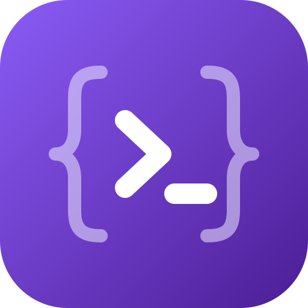

<p align="center"></p>

# kirokit

A `kirokit` Go CLI plus repository layout that lets multiple teams own their own [Kiro CLI v3](https://kiro.dev) config sources as templates. Each team's agents, hooks, prompts, skills, and steering docs are rendered deterministically into Kiro's real config layout, MCP server versions are pinned centrally, secrets are injected via [SOPS](https://github.com/getsops/sops) at MCP-launch time (never baked into any committed or rendered file), and the rendering pipeline is locked down with golden-file tests that run in CI.

## Quickstart

Homebrew installs only the `kirokit` binary. The team configs (`teams/`, `global/`, `env/`) live in this repository, and `kirokit` reads them from the current directory, so clone it and run every command from its root. The example `platform-team` also launches SOPS-secured MCP servers, so install `sops` (`brew install sops`) and have a key that can decrypt its secrets file before starting the agent.

```bash
# install the binary via homebrew
brew install --cask mavogel/tap/kirokit
kirokit version

# get the team configs and work from the repository root
git clone https://github.com/mavogel/kirokit.git && cd kirokit

# let's backup first, if you have used it
export KIRO_HOME_BACKUP=$KIRO_HOME
# create a temporary KIRO_HOME directory
# which kiro respects. No worries it will not
# break your existing setup
export KIRO_HOME=$(mktemp -d)
echo $KIRO_HOME

# install it in $KIRO_HOME
kirokit install platform-team

# now you have the devops agent from the platform-team
kiro-cli chat --agent devops --v3

# cleaup and verify KIRO_HOME is still set to the temporary directory
echo $KIRO_HOME
rm -rf $KIRO_HOME
# reset to the old value
export KIRO_HOME=$KIRO_HOME_BACKUP
echo $KIRO_HOME
```

## Taskfile

A [`Taskfile.yml`](https://taskfile.dev) wraps the common Go commands. Install `task` and `golang` via Homebrew (`brew install go go-task`), then:

```bash
task build   # go build -o kirokit ./cmd/kirokit
task vet     # go vet ./...
task lint    # golangci-lint run
task test    # go test ./... -v (includes every team's golden-file comparisons)
task ci      # build + vet + lint + test, matching .github/workflows/ci.yaml
```

## Directory Layout

```
teams/<team>/manifest.yaml              # team identity + global steering opt-ins + externalSkills
teams/<team>/agents/<agent>/agent.json.tmpl
teams/<team>/agents/<agent>/env/secrets.enc.yaml   # optional, SOPS-encrypted
teams/<team>/hooks/*.json.tmpl          # shared across the team's agents
teams/<team>/prompts/*.md.tmpl
teams/<team>/skills/<skill>/SKILL.md.tmpl
teams/<team>/steerings/*.md.tmpl
teams/<team>/external/skills/<name>/    # vendored external skills (generated, never hand-edit)
teams/<team>/external/skills.lock.yaml  # generated

global/steerings/*.md                   # shared steerings teams opt into
env/mcp-versions.yaml                   # central MCP version pins

testdata/golden/<team>/rendered/...     # committed golden output tree
testdata/golden/<team>/context.json     # committed golden template-context snapshot
```

- Template sources use a double extension `<ext>.tmpl`; the renderer globs `**/*.tmpl` and strips `.tmpl`.
- Agent source `agents/<agent>/agent.json.tmpl` renders to flat `agents/<agent>.json` (Kiro CLI v3 layout).
- Paths `teams/`, `global/steerings/`, `env/mcp-versions.yaml` and `testdata/golden/` resolve against the cwd, or against `KIROKIT_REPO` when that environment variable is set (a relative value is made absolute once at start; empty means unset). With `KIROKIT_REPO=<checkout>` every command (`render`, `test`, `update`, `install`, `sync`, `onboard`, `skills fetch`) runs from any folder. There is no repo-root discovery.
- Example teams: `platform-team` (`devops`, `platformdev`; SOPS MCP servers; opted into `security-baseline`) and `data-team` (`javadev` with SOPS Snowflake MCP, `godev` with plain MCP; no global steerings). Copy one or use `kirokit onboard`; duplication between teams is expected.
- Prompts are slash commands: Kiro v3 lists every file in `$KIRO_HOME/prompts/` (`@name` on other engines) even if no agent uses it as `prompt`; `$ARGUMENTS` / `${1}` are filled from user input. Example: `teams/platform-team/prompts/create-steering.md.tmpl` becomes `/create-steering [focus]`.

## manifest.yaml Reference

```yaml
team: my-team
globalSteerings:
  - security-baseline   # must match global/steerings/<slug>.md; [] opts out (see teams/data-team)
externalSkills:         # optional, see "External Skills"
  - source: https://github.com/anthropics/skills.git   # git URL, no credentials
    ref: <commit-sha>   # tag, branch or commit
    paths:              # skill directories inside the repo; each is named after its last element
      - skills/pdf
      - skills/xlsx
  - source: https://github.com/anthropics/skills.git
    ref: <commit-sha>
    paths:
      - skills/frontend-design
    name: design        # optional; only with a single path
  - source: https://github.com/anthropics/skills.git
    ref: <commit-sha>
    paths:
      - skills          # directory of skills
    all: true           # vendor each subdirectory containing SKILL.md
    exclude:            # optional; skip these skill directories (single path only)
      - docx
```

- Each opted-in global steering renders to `$KIRO_HOME/kirokit-steerings/<team>/<slug>.md` and is appended (created if missing) to the `resources` of every agent of the team as `file://$KIRO_HOME/kirokit-steerings/<team>/<slug>.md`. It is not written to Kiro's auto-loaded `steering/` dir, so only opted-in teams load it. Start the file with steering front matter (e.g. `inclusion: always`).
- `{{ globalSteering "<slug>" }}` inlines a steering, front matter included; prefer the automatic resource.
- Every agent of every team also gets `file://.kiro/steering/**/*.md` and `skill://.kiro/skills/**/SKILL.md` in `resources`, after global steerings. Relative paths load the steering/skills of the workspace Kiro starts in. `skill://` loads metadata at startup, the rest on demand. Existing identical entries are not duplicated.

## External Skills

Vendor skills from other git repos (e.g. [anthropics/skills](https://github.com/anthropics/skills)), pinned by `ref`. An entry vendors the skill directories listed in `paths` from one repo; use `all: true` when each path is a directory of skills.

```bash
kirokit skills fetch <team>      # no team = every team declaring external skills
kirokit update <team>            # refresh goldens, review and commit the diff
```

- `skills fetch` resolves `ref` to a commit with the local `git`, copies the directory byte for byte to `teams/<team>/external/skills/<name>/`, and records source, ref, commit and content hash in `teams/<team>/external/skills.lock.yaml`. Commit both. It is the only networked step; `render`, `test`, `install`, `sync` are offline and need no credentials. If any entry fails, nothing changes.
- Render/install places files at `$KIRO_HOME/skills/<name>/` and adds `skill://$KIRO_HOME/skills/<name>/SKILL.md` to every agent's `resources`. Executable bits are kept. Vendored files bypass the template engine (`*.tmpl` and `{{ }}` arrive intact).
- **`paths`:** required; one entry per repo and `ref` covers every listed path, and each skill is named after its path's last element. Two paths ending in the same name are a duplicate-name error. `name` needs a single path.
- **`all: true`:** each path in `paths` is a directory of skills; each immediate subdirectory with a `SKILL.md` is vendored, others ignored; `exclude` skips directories (single path only); `name` cannot be combined with `all`. Each skill has its own lock entry (`from` names the collection) and `skill://` resource. New upstream skills appear only on re-fetch at a newer `ref`; a longer `exclude` removes skills on re-fetch. An `exclude` naming a nonexistent directory is an error.
- **Update:** change `ref` (or re-run `fetch` to advance a branch ref), run `skills fetch`, review the vendored diff. Dropped files are removed.
- **No tags upstream:** `anthropics/skills` has none; pin a commit SHA or follow a branch. The lock records the exact commit regardless.
- **Drift is an error:** if `manifest.yaml`, the lock and the vendored files disagree (hand edit, changed `ref` without re-fetch, directory with no entry), `render`, `test`, `install`, `sync` fail naming the skill. Never edit `teams/<team>/external/**`.
- **Name collisions:** an external skill named like a team `skills/<name>` or another external skill is an error (also at fetch); set `name` on a single-path entry or `exclude` it from the collection.
- **Private sources:** SSH URL with an agent, or HTTPS with a git credential helper (`gh auth setup-git`). No credentials are stored; a `source` containing credentials is rejected. Allowed `source`: `https`, `http`, `ssh`, `git`, `file` URL, scp-style address, or local path. Rejected: leading `-` (option), `ext::` (transport helper), and a `ref` starting with `-` or containing whitespace. Only the person running `skills fetch` needs access; on auth failure the error names the source and nothing is written.
- **Symlinks** inside a skill are rejected; `SKILL.md` must be at the skill root.
- **Licences:** source licence files (e.g. `LICENSE.txt`) are vendored with the skill. Check redistribution terms, especially with `all: true`; some `anthropics/skills` entries carry restrictive terms, so `exclude` or review them.

## Central env/mcp-versions.yaml

Flat map of MCP server name to pinned version:

```yaml
jira-mcp: "1.4.2"
confluence-mcp: "2.1.0"
```

- Templates read it with `{{ mcpVersion "jira-mcp" }}`. An undefined key fails the render naming the key and file.
- `context.json` snapshots the entire resolved map, so bumping any entry changes every team's golden context; run `kirokit test` to see the affected output.

## Secrets via SOPS

Secrets never appear in plaintext in templates, rendered files or goldens.

1. Each agent needing a secret has `teams/<team>/agents/<agent>/env/secrets.enc.yaml` (flat SOPS-encrypted YAML, safe to commit).
2. `agent.json.tmpl` wraps the MCP server in `sops exec-env` via `sopsCommand` / `sopsArgsJSON`:

   ```
   "command": {{ sopsCommand }},
   "args": {{ sopsArgsJSON (printf "%s/kirokit-secrets/<team>/<agent>/secrets.enc.yaml" .KiroHome) "<real-mcp-command>" "<real-arg>" ... }}
   ```

   The secrets path must be absolute and `.KiroHome`-based, never repo-relative: it resolves under the installed `$KIRO_HOME`.
3. `sops exec-env <file> "<command>"` decrypts and launches the command with the keys as env vars at MCP launch time, not render time, and not via Kiro's `${VAR}` substitution (unreliable).
4. `kirokit install` copies each secrets file to `$KIRO_HOME/kirokit-secrets/<team>/<agent>/secrets.enc.yaml`.

**Remote (HTTP) MCP servers** (e.g. Atlassian `https://mcp.atlassian.com/v2/mcp`) run through the pinned `mcp-remote` proxy under the same wrapper. The secret holds the full header value (`Bearer <key>` for a service-account key, `Basic <base64(email:token)>` for a personal token); the template passes `--header 'Authorization:${ATLASSIAN_AUTH}'`. The single quotes keep the placeholder literal in the rendered file; `mcp-remote` expands it from the env sops sets. See `teams/platform-team/agents/devops/agent.json.tmpl`.

Atlassian prerequisites:
- An org admin must enable **Allow API token authentication** in [Atlassian Administration](https://admin.atlassian.com/) (Rovo → Rovo MCP server → Authentication); otherwise every call fails with "You don't have permission to connect via API token".
- Create the token on the [MCP token page](https://id.atlassian.com/manage-profile/security/api-tokens?autofillToken&expiryDays=max&appId=mcp-v2&selectedScopes=all); it needs the "… via Agent Interface" scopes (e.g. `search:jira:agent-interface`), which the generic token page does not offer. Details: [Configure authentication via API token](https://support.atlassian.com/atlassian-rovo-mcp-server/docs/configuring-authentication-via-api-token/).
- Jira Cloud rejects unbounded JQL; restrict searches (e.g. `project = KEY`).

Keys: decrypting needs a SOPS key (age, PGP, KMS) listed as a recipient in `.sops.yaml`. Each team has its own `creation_rules` entry with its age public key(s); a team key cannot decrypt another team's secrets. Never commit private keys (e.g. keep them in `~/.config/sops/age/<team>.txt`).

```bash
SOPS_AGE_KEY_FILE=~/.config/sops/age/platform-team.txt sops teams/platform-team/agents/devops/env/secrets.enc.yaml   # edit
age-keygen -o ~/.config/sops/age/my-team.txt                                                                         # new team key
```

Add an engineer: append their age public key (comma-separated) to the team's rule, then `sops updatekeys <file>` per secrets file. Committed secret values are placeholders; replace via `sops <file>`.

## Testing and verify by rendering upfront

```bash
kirokit render [team] --out <dir>   # render only, never touches testdata/golden/
kirokit test [team]                 # render + diff against testdata/golden/<team>/ (CI entry point)
kirokit update [team]               # render + overwrite testdata/golden/<team>/
```

No `[team]` = every directory under `teams/`. `test` exits non-zero and lists each mismatched file. `update` regenerates `testdata/golden/<team>/rendered/` and `context.json`; review the diff before committing.

## Onboarding a New Team

```bash
kirokit onboard <team>
```

Scaffolds `teams/<team>/` from an embedded starter: `manifest.yaml` with the team name, one example agent (`agents/example-agent/`), empty `hooks/`, `prompts/`, `skills/`, `steerings/`. Errors if `teams/<team>/` exists. Copying another team's directory works too.

## Install / Uninstall

```bash
kirokit install <team>
kirokit install <team> --kb-agent <agent> --kb-source <folder> --kb-mount <path>
kirokit uninstall <team>
```

- `install` renders with the real `$KIRO_HOME` baked in (`KIRO_HOME` env var, else Kiro's default `~/.kiro`) and copies the rendered tree plus each agent's encrypted secrets file there.
- A Kiro home holds one team. `install <team>` first uninstalls every other installed team and prints `uninstalled <other> from <home>` for each, then `installed <team> into <home>`. Reinstalling the installed team removes nothing. If an uninstall fails, nothing is installed.
- `uninstall` removes exactly what the matching `install` wrote, tracked in `$KIRO_HOME/.kirokit-installed/<team>.json`; other teams' files and Kiro-managed files are untouched.
- `--kb-*` flags (all or none) attach a local `knowledgeBase` resource to one installed agent: `--kb-source` local folder, `--kb-mount` symlink location (never copied), `--kb-agent` agent whose `resources` gets the entry. Entry: name `<agent>-kb`, `indexType: "best"`, `include: ["**/*.md"]`, `autoUpdate: true`. `include` works in `kiro-cli` but is not yet in Kiro's agent-config docs, and Kiro issues report agent-config knowledge bases are not always indexed automatically; check `/knowledge show`. `uninstall` removes the symlink, never the source folder.

### Existing files are backed up

Before `render --out <dir>`, `install` or `sync` changes something on disk, the folder is kept as `YYYYMMDD-HHmmss-<folder>.backup` (local time) beside it:

- **`render --out <dir>`:** an existing `<dir>` whose content would change is renamed to `YYYYMMDD-HHmmss-<dir name>.backup` and a fresh `<dir>` is rendered. A matching or empty `<dir>` is left alone.
- **`install` / `sync`:** each top-level folder in `$KIRO_HOME` holding a file that would change (`agents`, `prompts`, `skills`, `steering`, `hooks`, `kirokit-steerings`, `kirokit-secrets`) is first copied to `$KIRO_HOME/YYYYMMDD-HHmmss-<folder>.backup`. Unchanged folders and Kiro's own data (sessions etc.) are not copied. The backup name differs from the live folder, so Kiro does not load it.
- A no-change re-install or `sync` makes no backup.
- Same-second collisions add a counter: `20261015-101530-2-agents.backup`.
- Backups are not in the install manifest; `uninstall` neither removes nor restores them.
- Deletion is not backed up: `sync` removes files the team stopped shipping and `uninstall` removes everything the install wrote. Only manifest-listed files are ever removed.

## Installing the CLI

```bash
brew install --cask mavogel/tap/kirokit
```

Each release publishes a Homebrew cask to [mavogel/homebrew-tap](https://github.com/mavogel/homebrew-tap) (`brew upgrade --cask kirokit` picks up new versions). The cask covers macOS and Linux (arm64 and amd64). The binaries are not notarized, so on macOS it clears the quarantine attribute after install.

## Sync (automatic updates)

```bash
kirokit sync <team> --repo ~/.kirokit-config
kirokit sync <team> --repo ~/.kirokit-config --latest-tag
kirokit sync --repo ~/.kirokit-config --latest-tag      # no team: update the checkout only
```

- `sync` runs `git fetch --tags`, then a fast-forward `git pull` of the checked-out branch (with `--latest-tag`: checkout of the newest `v*` tag, so only releases reach the machine), then the same install as `kirokit install`.
- Unlike `install`, it removes files the previous install wrote that the new version no longer ships, plus directories left empty.
- Like `install`, `sync <team>` uninstalls every other installed team (one `uninstalled <other> from <home>` line each), but only after the checkout updated and `<team>` rendered; a failed pull or an unknown team leaves the installed team in place.
- Without a team, `sync` only updates the checkout and installs nothing: it prints `updated <before> -> <after>` when HEAD moved, then `checked out <tag or branch> at <commit>`. It needs no Kiro home, and the `--kb-*` flags are an error (`kirokit sync: --kb-agent needs a team`).
- `--repo` defaults to `$KIROKIT_REPO`, else the cwd; an explicit `--repo` wins over `KIROKIT_REPO`. `--kb-*` flags behave as for `install`; without them a previously attached knowledge base is dropped, so pass them on every run.

**Migration:** one machine now holds one team. A second scheduled sync of a different team (a second run of `scripts/kirokit-sync-setup.sh --team <other>`) replaces the first team on every run instead of installing beside it, so keep one scheduled sync per machine.

`scripts/kirokit-sync-setup.sh` clones the config repo, runs a first sync and registers a launchd agent (macOS) or systemd user timer (Linux):

```bash
scripts/kirokit-sync-setup.sh --team platform-team --repo-url git@github.com:org/kiro-config.git --latest-tag
scripts/kirokit-sync-setup.sh --team platform-team --dry-run ...   # print the scheduler definition only
scripts/kirokit-sync-setup.sh --team platform-team --remove        # unregister (checkout and installed config stay)
```

Options: `--dir` (checkout, default `~/.kirokit-config`), `--interval` (hours, default 4). Needs `git` and `kirokit` on `PATH`; logs to `~/.kirokit-sync.log`; each user needs their own SOPS age key. Keep the checkout dedicated: a fast-forward pull fails on local commits and `--latest-tag` leaves a detached HEAD.

## Desktop app

`desktop/` holds a macOS app (Wails) for people who would rather press buttons than type commands. It bundles `kirokit` and runs the same commands, so what it writes is byte for byte what the command line writes. Install it with `brew install --cask mavogel/tap/kirokit-desktop` (each release attaches `kirokit-desktop_<version>_darwin_universal.zip` and publishes the cask; macOS 13 or later, Apple silicon and Intel). The app is not signed or notarized, so the cask clears the quarantine attribute after install; if you unzip the release by hand, run `xattr -dr com.apple.quarantine kirokit.app` once, or macOS reports the app as damaged. Build it yourself with `task desktop:build`, or run it from source with `task desktop:dev` (`task desktop:test` runs its checks).

- **First launch** asks for your team's repository address (https, ssh, `file://`, `git@host:path` or an absolute path; an address starting with `-` is refused), runs `git clone -- <address> <app folder>/repo`, then `kirokit sync --latest-tag`, so the clone sits on the newest `v*` tag. A repository with no `v*` tag is kept and the app says it has no release yet. Saving a different address in Settings clones it the same way (progress in the kirokit tab, catalog refreshed on success) and renames the old clone to `repo.old-<unix time>`; a failed clone puts it back.
- **Teams** has an Install button per team. It first shows the checks it needs (SOPS, the decryption key, Kiro CLI, read from your login shell), then runs `kirokit install <team>`. A Kiro home holds one team, so installing another team asks before it replaces the installed one.
- **Install and sync** has Sync (`kirokit sync <team> --latest-tag`) and Uninstall (`kirokit uninstall <team>`) per installed team; **Settings** has Update (`kirokit sync --latest-tag` for the installed team, or without a team when none is installed).
- Every button command runs in the dock's **kirokit** tab, where a git sign-in prompt can be answered; the **zsh** tab is your own login shell with the bundled `kirokit` first on `PATH`. The app sets `KIROKIT_REPO` to its clone and `KIRO_HOME` to the Kiro home folder saved in Settings.
- `KIROKIT_REPO` also works on the command line: with it set, `kirokit sync --latest-tag` (no team) updates a checkout from any folder.

**Migration:** one machine now holds one team, in the app and on the command line alike. A second scheduled sync from `scripts/kirokit-sync-setup.sh` for another team replaces the first team on every run.

## Git Hooks

[Lefthook](https://lefthook.dev) runs checks on every commit (`brew install lefthook gitleaks commitizen uv`, then once per clone):

```bash
lefthook install
```

- **pre-commit:** `trailing-whitespace`, `end-of-file-fixer`, `check-yaml`, `check-json` (from [pre-commit-hooks](https://github.com/pre-commit/pre-commit-hooks), run via `uvx`) and `gitleaks` on the staged changes. The two fixers re-stage what they change but fail the commit, so run it again. They skip `testdata/golden/**` (byte-compared by `kirokit test`) and `*.enc.yaml` (SOPS MAC).
- **commit-msg:** `cz check` enforces Conventional Commits, which `svu` needs to compute versions. Use `cz commit` for an interactive prompt.

Run everything on demand with `lefthook run pre-commit --all-files`.
