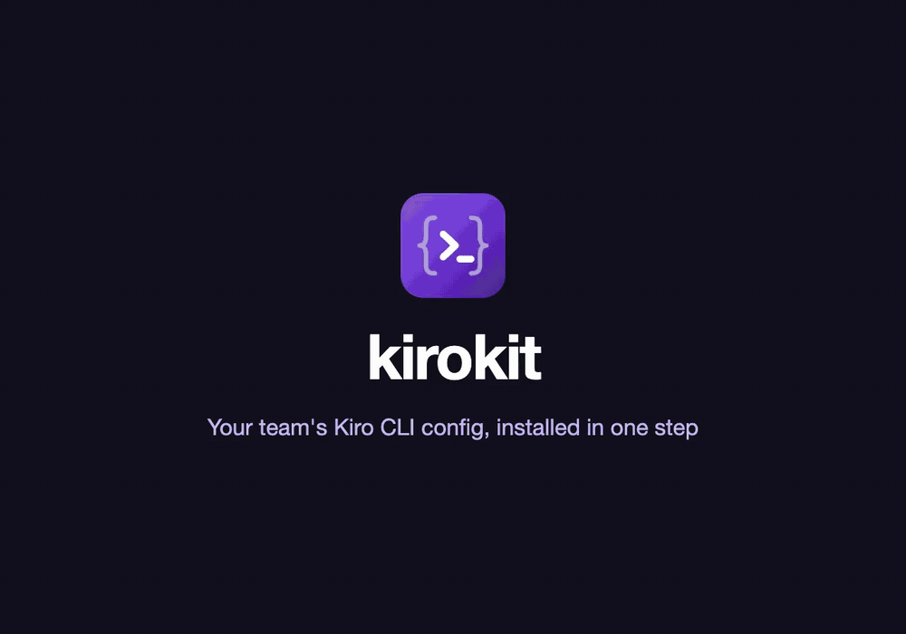
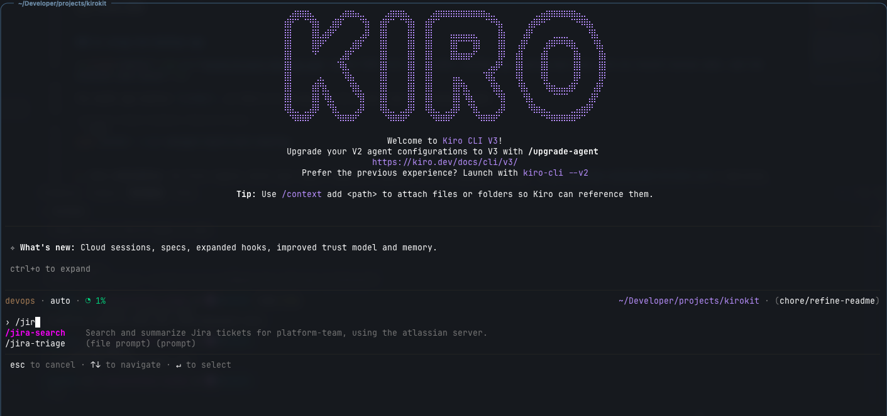

<p align="center"></p>

# kirokit

> [!NOTE]
> This tool is an unofficial helper CLI for managing and sharing kiro{cli|ide|web|crew} configurations such as agents, skills, steerings etc.

The unoffical `kirokit` Go CLI plus repository layout that lets multiple teams own their own [Kiro CLI v3](https://kiro.dev) config sources as templates. Each team's agents, hooks, prompts, skills, and steering docs are rendered deterministically into Kiro's real config layout, MCP server versions are pinned centrally, secrets are injected via [SOPS](https://github.com/getsops/sops) at MCP-launch time (never baked into any committed or rendered file), and the rendering pipeline is locked down with golden-file tests that run in CI.

<p align="center"><a href="assets/kirokit-showcase.mp4"></a></p>
<p align="center"><sub>Sharper version: <a href="assets/kirokit-showcase.mp4">kirokit-showcase.mp4</a></sub></p>

## Quickstart

### using the cli

Install the `kirokit` binary for your system. Every release carries it for macOS, Linux and Windows, on amd64 and arm64:

| System | Install | Or download from the [release](https://github.com/mavogel/kirokit/releases) |
|---|---|---|
| macOS | `brew install --cask mavogel/tap/kirokit` | `kirokit_<version>_darwin_<arch>.tar.gz` |
| Linux | `brew install --cask mavogel/tap/kirokit`, or `sudo apt install ./kirokit_<version>_linux_<arch>.deb`, or `sudo dnf install ./kirokit_<version>_linux_<arch>.rpm` | `kirokit_<version>_linux_<arch>.tar.gz` |
| Windows (PowerShell) | `scoop bucket add mavogel https://github.com/mavogel/scoop-bucket` then `scoop install kirokit` | `kirokit_<version>_windows_<arch>.zip` (put `kirokit.exe` on your `PATH`) |

`kirokit --version` prints the installed version. Kiro CLI itself runs on macOS, Linux (glibc 2.34+ or musl) and Windows 11 ([installation](https://kiro.dev/docs/cli/installation/)).

The package installs only the `kirokit` binary. The team configs (`teams/`, `global/`, `env/`) live in this repository, so `kirokit setup` downloads it first, onto its newest release. `kirokit` reads the configs from the folder `KIROKIT_REPO` names (else the current directory). The example `platform-team` also launches SOPS-secured MCP servers, so install `sops` (`brew install sops` on macOS, your package manager or the [sops releases](https://github.com/getsops/sops/releases) on Linux, `scoop install sops` on Windows) and have a key that can decrypt its secrets file before starting the agent (see [Secrets via SOPS](#secrets-via-sops) for where the key goes on each system).

The commands below are for a macOS or Linux shell; in Windows PowerShell set variables with `$env:KIROKIT_REPO = "$HOME\.kirokit-config"` instead of `export`.

```bash
# install the binary (see the table above for Linux and Windows)
brew install --cask mavogel/tap/kirokit
kirokit --version

# download the team configs (newest v* tag) and point kirokit at them;
# use your team's repository address instead of the example one
kirokit setup --source https://github.com/mavogel/kirokit.git --target ~/.kirokit-config
export KIROKIT_REPO=~/.kirokit-config

# let's backup first, if you have used it
export KIRO_HOME_BACKUP=$KIRO_HOME
# create a temporary KIRO_HOME directory
# which kiro respects. No worries it will not
# break your existing setup
export KIRO_HOME=$(mktemp -d)
echo $KIRO_HOME

# install it in $KIRO_HOME
kirokit install platform-team

# now you have the devops agent from the platform-team
kiro-cli chat --agent devops --v3
```

and type `/jir` to see the example skill `jira-search` and the prompt `jira-triage` in the `devops` agent

<p align="center"></p>


cleanup and verify KIRO_HOME is still set to the temporary directory
```bash
echo $KIRO_HOME
rm -rf $KIRO_HOME
# reset to the old value
export KIRO_HOME=$KIRO_HOME_BACKUP
echo $KIRO_HOME
```

### using the desktop app

For less technial folks, who likes UIs. It does the same job and uses the `cli` under the hood:

<p align="center"></p>

The app bundles its own `kirokit`, so there is nothing else to install and no terminal needed:

| System | Install |
|---|---|
| macOS 13+ | `brew install --cask mavogel/tap/kirokit-desktop`, or open `kirokit-desktop_<version>_darwin_<arch>.dmg` |
| Linux (Ubuntu 22.04+, Debian 12+, Fedora 40+) | `sudo apt install ./kirokit-desktop_<version>_linux_<arch>.deb` or `sudo dnf install ./kirokit-desktop_<version>_linux_<arch>.rpm`; it pulls in GTK 3 and WebKitGTK 4.1 and adds **kirokit** to the app menu (`kirokit-desktop` from a terminal) |
| Windows 10/11 | run `kirokit-desktop_<version>_windows_<arch>-setup.exe`; it adds **kirokit** to the Start menu and the desktop |

The apps are not signed:
- **Windows:** SmartScreen says "Windows protected your PC" when you start the setup program. Choose **More info**, then **Run anyway**.
- **macOS:** the cask clears the quarantine attribute for you; if you open the DMG by hand, run `xattr -dr com.apple.quarantine kirokit.app` once, or macOS reports the app as damaged.

1. Open **kirokit**. On first launch, enter your team's repository address (for the example configs, `https://github.com/mavogel/kirokit.git`) and press **Clone**. You can also choose the folder it is cloned into.
2. On **Teams**, press **Install** on your team. The app first shows what it needs (SOPS, the decryption key, Kiro CLI), then runs `kirokit install <team>`.
3. Start the agent as above: `kiro-cli chat --agent devops --v3`.

**Install and sync** keeps the installed team up to date, and **Settings** holds the Kiro home folder and the repository. Every button command runs in the terminal dock, so you see exactly what `kirokit` does. [Desktop app](#desktop-app) has the details.

## Directory Layout

This repository has the configs, the `cli` and desktop app. It can be used as a baseline for the configuration as follows:

```
teams/<team>/manifest.yaml              # team identity + owners + feedback repository + global steering opt-ins + externalSkills
teams/<team>/agents/<agent>/agent.json.tmpl
teams/<team>/agents/<agent>/env/secrets.enc.yaml   # optional, SOPS-encrypted
teams/<team>/hooks/*.json.tmpl          # shared across the team's agents
teams/<team>/prompts/*.md.tmpl
teams/<team>/skills/<skill>/SKILL.md.tmpl
teams/<team>/steerings/*.md.tmpl
teams/<team>/external/skills/<name>/    # vendored external skills (generated, never hand-edit)
teams/<team>/external/skills.lock.yaml  # generated

global/steerings/*.md                   # shared steerings teams opt into
env/mcp-versions.yaml                   # central MCP version pins

testdata/golden/<team>/rendered/...     # committed golden output tree
testdata/golden/<team>/context.json     # committed golden template-context snapshot
```

- Template sources use a double extension `<ext>.tmpl`; the renderer globs `**/*.tmpl` and strips `.tmpl`.
- Agent source `agents/<agent>/agent.json.tmpl` renders to flat `agents/<agent>.json` (Kiro CLI v3 layout).
- Paths `teams/`, `global/steerings/`, `env/mcp-versions.yaml` and `testdata/golden/` resolve against the cwd, or against `KIROKIT_REPO` when that environment variable is set (a relative value is made absolute once at start; empty means unset). With `KIROKIT_REPO=<checkout>` every command (`render`, `test`, `update`, `install`, `sync`, `onboard`, `skills fetch`) runs from any folder. There is no repo-root discovery.
- Example teams: `platform-team` (`devops`, `platformdev`; SOPS MCP servers; opted into `security-baseline`), `data-team` (`javadev` with SOPS Snowflake MCP, `godev` with plain MCP; no global steerings) and `product-team` (five role agents that consult each other, spec review gates, `/feedback` and `analyze-session`; no MCP servers or secrets; see [Role agents and feedback](#role-agents-and-feedback)). Copy one or use `kirokit onboard`; duplication between teams is expected.
- Prompts are slash commands: Kiro v3 lists every file in `$KIRO_HOME/prompts/` (`@name` on other engines) even if no agent uses it as `prompt`; `$ARGUMENTS` / `${1}` are filled from user input. Example: `teams/platform-team/prompts/create-steering.md.tmpl` becomes `/create-steering [focus]`.

## manifest.yaml Reference

```yaml
team: my-team
owner: "@my-org/my-team"   # optional; GitHub handle (@user or @org/team) owning every agent and skill
owners:                    # optional; per-item owners instead of the team owner
  agents:
    devops: "@jane"
  skills:
    jira-search: "@nick"
feedback:                  # optional; where feedback issues go (owner/repo on GitHub)
  github: my-org/kiro-config
globalSteerings:
  - security-baseline   # must match global/steerings/<slug>.md; [] opts out (see teams/data-team)
externalSkills:         # optional, see "External Skills"
  - source: https://github.com/anthropics/skills.git   # git URL, no credentials
    ref: <commit-sha>   # tag, branch or commit
    paths:              # skill directories inside the repo; each is named after its last element
      - skills/pdf
      - skills/xlsx
  - source: https://github.com/anthropics/skills.git
    ref: <commit-sha>
    paths:
      - skills/frontend-design
    name: design        # optional; only with a single path
  - source: https://github.com/anthropics/skills.git
    ref: <commit-sha>
    paths:
      - skills          # directory of skills
    all: true           # vendor each subdirectory containing SKILL.md
    exclude:            # optional; skip these skill directories (single path only)
      - docx
```

- Each opted-in global steering renders to `$KIRO_HOME/kirokit-steerings/<team>/<slug>.md` and is appended (created if missing) to the `resources` of every agent of the team as `file://$KIRO_HOME/kirokit-steerings/<team>/<slug>.md`. It is not written to Kiro's auto-loaded `steering/` dir, so only opted-in teams load it. Start the file with steering front matter (e.g. `inclusion: always`).
- `{{ globalSteering "<slug>" }}` inlines a steering, front matter included; prefer the automatic resource.
- Every agent of every team also gets `file://.kiro/steering/**/*.md` and `skill://.kiro/skills/**/SKILL.md` in `resources`, after global steerings. Relative paths load the steering/skills of the workspace Kiro starts in. `skill://` loads metadata at startup, the rest on demand. Existing identical entries are not duplicated.
- `owner`, `owners` and `feedback` are optional; a team without them renders as before. Handles must look like `@user` or `@org/team` and `feedback.github` like `owner/repo`, else loading fails naming the field (`owners.agents.qa: "jane" is not a GitHub handle (write @jane)`). An `owners` key naming an agent or skill the team does not have fails render. Vendored skills have the team owner unless `owners.skills` names them. See [Role agents and feedback](#role-agents-and-feedback).

## Role agents and feedback

`product-team` is an example of the whole team working through Kiro, not only engineers: five role agents that ask each other before answering, review gates for Kiro's spec workflow, an owner for every agent and skill, and a way for anyone to send feedback to that owner.

```bash
kirokit install product-team
kiro-cli chat --agent product-owner     # "Ask the customer agent what frustrates them about onboarding."
```

- **Role agents:** `product-owner`, `engineer`, `customer`, `qa` and `ux-designer`. Each has `subagent` in `tools` and may call the other four (`toolsSettings.subagent.availableAgents`). Calling one of the four that cannot write files runs without a prompt; calling the `engineer` (which can write files and run commands) asks first. In Kiro CLI v3 `trustedAgents` alone still prompts, so each agent also carries a permission rule whose `match` names the agents: `{ "capability": "subagent", "match": ["customer", "qa", "ux-designer"], "effect": "allow" }`. Render fails when `availableAgents`, `trustedAgents` or such a rule names something that is neither a glob nor an agent of the same team, since Kiro accepts any name there. The personas are examples to replace; the `customer` one is invented until you fill it from your own interviews.
- **Spec review gates:** the steering `spec-review-gates` (`inclusion: always`, in every role agent's `resources`) tells the agent writing a spec to ask `product-owner` to review `requirements.md` (vision fit, completeness, testable acceptance criteria, priorities) and `engineer` to review `design.md` (deep modules, information hiding, red flags) before the next phase. Try it with `kiro-cli chat --agent engineer --mode spec`. A steering instructs the agent; it cannot force the review.
- **Owners:** `owner`, `owners.agents.<name>` and `owners.skills.<name>` in `manifest.yaml` (see the [reference](#manifestyaml-reference)). Write a GitHub handle, so an issue that @-mentions it notifies them. Templates read the table with `{{ range owners }}{{ .Kind }} {{ .Name }} {{ .Owner }} {{ .FromTeam }}{{ end }}` (`Kind` is `agent` or `skill`, `Owner` is empty when nobody is named, `FromTeam` marks the team owner) and the repository with `{{ feedbackRepo }}`, which fails the render when `feedback.github` is not set.
- **`/feedback` in Kiro:** `teams/product-team/prompts/feedback.md.tmpl` becomes `/feedback [what went wrong]`. The agent picks the agent or skill from the chat (or asks), drafts a title and a body that @-mentions its owner, and prints a link to `https://github.com/<feedback.github>/issues/new?…` with the labels `feedback`, `team:<team>` and `agent:<name>` or `skill:<name>`. Nothing is sent: the person opens the link, edits and submits. GitHub applies the labels only for people who may triage that repository; title and body name the team and item for everyone. To give another team `/feedback`, copy the prompt into its `prompts/` and set `feedback.github` in its manifest.
- **Feedback in the desktop app:** the Agents and Skills pages show each owner (*team owner* under an inherited one, *No owner* when there is none) and a **Feedback** button that opens the same kind of prefilled issue in the browser. A team without `feedback.github` shows its buttons off, with the reason under the table. The app opens nothing but a `https://github.com/<owner>/<repo>/issues/new?…` address.
- **`analyze-session`:** a skill every role agent has. Ask "Analyze my last session" (or give an id from `/session-id`); the agent reads `$KIRO_HOME/sessions/<hash>/sess_<id>/` (`session.json`, `messages.jsonl`) with file reads only, looks for denied or failed tools, repeated permission prompts and lookups, unused skills, corrections and heavy context use, and reports recommendations (a hook, a steering, a permission, a sharper prompt) grouped by owner. It then offers one prefilled issue per owner in the `/feedback` format. Each role agent allows loading this skill without a prompt (`{ "capability": "skill", "match": ["analyze-session"], "effect": "allow" }`).

## External Skills

Vendor skills from other git repos (e.g. [anthropics/skills](https://github.com/anthropics/skills)), pinned by `ref`. An entry vendors the skill directories listed in `paths` from one repo; use `all: true` when each path is a directory of skills.

```bash
kirokit skills fetch <team>      # no team = every team declaring external skills
kirokit update <team>            # refresh goldens, review and commit the diff
```

- `skills fetch` resolves `ref` to a commit with the local `git`, copies the directory byte for byte to `teams/<team>/external/skills/<name>/`, and records source, ref, commit and content hash in `teams/<team>/external/skills.lock.yaml`. Commit both. It is the only networked step; `render`, `test`, `install`, `sync` are offline and need no credentials. If any entry fails, nothing changes.
- Render/install places files at `$KIRO_HOME/skills/<name>/` and adds `skill://$KIRO_HOME/skills/<name>/SKILL.md` to every agent's `resources`. Executable bits are kept. Vendored files bypass the template engine (`*.tmpl` and `{{ }}` arrive intact).
- **Execute bits on Windows:** the lock lists each skill's executable files under `executables` (from git's own file modes), and the content hash covers them. Windows keeps no execute bit, so there `render` and `install` check the hash with that list; a lock written before `executables` existed must be fetched again (`kirokit skills fetch <team>`, on any system) before a skill with scripts verifies on Windows.
- **`paths`:** required; one entry per repo and `ref` covers every listed path, and each skill is named after its path's last element. Two paths ending in the same name are a duplicate-name error. `name` needs a single path.
- **`all: true`:** each path in `paths` is a directory of skills; each immediate subdirectory with a `SKILL.md` is vendored, others ignored; `exclude` skips directories (single path only); `name` cannot be combined with `all`. Each skill has its own lock entry (`from` names the collection) and `skill://` resource. New upstream skills appear only on re-fetch at a newer `ref`; a longer `exclude` removes skills on re-fetch. An `exclude` naming a nonexistent directory is an error.
- **Update:** change `ref` (or re-run `fetch` to advance a branch ref), run `skills fetch`, review the vendored diff. Dropped files are removed.
- **No tags upstream:** `anthropics/skills` has none; pin a commit SHA or follow a branch. The lock records the exact commit regardless.
- **Drift is an error:** if `manifest.yaml`, the lock and the vendored files disagree (hand edit, changed `ref` without re-fetch, directory with no entry), `render`, `test`, `install`, `sync` fail naming the skill. Never edit `teams/<team>/external/**`.
- **Name collisions:** an external skill named like a team `skills/<name>` or another external skill is an error (also at fetch); set `name` on a single-path entry or `exclude` it from the collection.
- **Private sources:** SSH URL with an agent, or HTTPS with a git credential helper (`gh auth setup-git`). No credentials are stored; a `source` containing credentials is rejected. Allowed `source`: `https`, `http`, `ssh`, `git`, `file` URL, scp-style address, or local path. Rejected: leading `-` (option), `ext::` (transport helper), and a `ref` starting with `-` or containing whitespace. Only the person running `skills fetch` needs access; on auth failure the error names the source and nothing is written.
- **Symlinks** inside a skill are rejected; `SKILL.md` must be at the skill root.
- **Licences:** source licence files (e.g. `LICENSE.txt`) are vendored with the skill. Check redistribution terms, especially with `all: true`; some `anthropics/skills` entries carry restrictive terms, so `exclude` or review them.

## Central env/mcp-versions.yaml

Flat map of MCP server name to pinned version:

```yaml
jira-mcp: "1.4.2"
confluence-mcp: "2.1.0"
```

- Templates read it with `{{ mcpVersion "jira-mcp" }}`. An undefined key fails the render naming the key and file.
- `context.json` snapshots the entire resolved map, so bumping any entry changes every team's golden context; run `kirokit test` to see the affected output.

## Secrets via SOPS

Secrets never appear in plaintext in templates, rendered files or goldens.

1. Each agent needing a secret has `teams/<team>/agents/<agent>/env/secrets.enc.yaml` (flat SOPS-encrypted YAML, safe to commit).
2. `agent.json.tmpl` wraps the MCP server in `sops exec-env` via `sopsCommand` / `sopsArgsJSON`:

   ```
   "command": {{ sopsCommand }},
   "args": {{ sopsArgsJSON (printf "%s/kirokit-secrets/<team>/<agent>/secrets.enc.yaml" .KiroHome) "<real-mcp-command>" "<real-arg>" ... }}
   ```

   The secrets path must be absolute and `.KiroHome`-based, never repo-relative: it resolves under the installed `$KIRO_HOME`.
3. `sops exec-env <file> "<command>"` decrypts and launches the command with the keys as env vars at MCP launch time, not render time, and not via Kiro's `${VAR}` substitution (unreliable).
4. `kirokit install` copies each secrets file to `$KIRO_HOME/kirokit-secrets/<team>/<agent>/secrets.enc.yaml`.

**Windows:** sops runs the command with `cmd.exe /C` there instead of `/bin/sh -c`, and `cmd.exe` cannot take quoted arguments. So on Windows `kirokit install` writes the arguments space-separated and unquoted, and refuses any argument with a space, a tab, `"` or one of `& | < > ^ % ! ( )`, naming the team, agent and argument (`render: <team>/<agent>: argument "…" cannot pass through sops exec-env on Windows (cmd.exe): …`). Write such values without spaces, as mcp-remote documents for headers: `Authorization:${VAR}`, with the space inside the secret. Goldens and `render` always use the macOS/Linux form.

**Remote (HTTP) MCP servers** (e.g. Atlassian `https://mcp.atlassian.com/v2/mcp`) run through the pinned `mcp-remote` proxy under the same wrapper. The secret holds the full header value (`Bearer <key>` for a service-account key, `Basic <base64(email:token)>` for a personal token); the template passes `--header Authorization:${ATLASSIAN_AUTH}` (no space, so it also passes `cmd.exe` on Windows). On macOS and Linux the rendered command single-quotes it, which keeps the placeholder literal; `mcp-remote` expands it from the env sops sets. See `teams/platform-team/agents/devops/agent.json.tmpl`.

Atlassian prerequisites:
- An org admin must enable **Allow API token authentication** in [Atlassian Administration](https://admin.atlassian.com/) (Rovo → Rovo MCP server → Authentication); otherwise every call fails with "You don't have permission to connect via API token".
- Create the token on the [MCP token page](https://id.atlassian.com/manage-profile/security/api-tokens?autofillToken&expiryDays=max&appId=mcp-v2&selectedScopes=all); it needs the "… via Agent Interface" scopes (e.g. `search:jira:agent-interface`), which the generic token page does not offer. Details: [Configure authentication via API token](https://support.atlassian.com/atlassian-rovo-mcp-server/docs/configuring-authentication-via-api-token/).
- Jira Cloud rejects unbounded JQL; restrict searches (e.g. `project = KEY`).

Without `SOPS_AGE_KEY_FILE`, sops reads the age key from `keys.txt` in its config folder: `~/Library/Application Support/sops/age/keys.txt` on macOS, `~/.config/sops/age/keys.txt` on Linux (or `$XDG_CONFIG_HOME/sops/age/keys.txt` on either), `%AppData%\sops\age\keys.txt` on Windows. The desktop app's setup check looks in the same place.

Keys: decrypting needs a SOPS key (age, PGP, KMS) listed as a recipient in `.sops.yaml`. Each team has its own `creation_rules` entry with its age public key(s); a team key cannot decrypt another team's secrets. Never commit private keys (e.g. keep them in `~/.config/sops/age/<team>.txt`).

```bash
SOPS_AGE_KEY_FILE=~/.config/sops/age/platform-team.txt sops teams/platform-team/agents/devops/env/secrets.enc.yaml   # edit
age-keygen -o ~/.config/sops/age/my-team.txt                                                                         # new team key
```

Add an engineer: append their age public key (comma-separated) to the team's rule, then `sops updatekeys <file>` per secrets file. Committed secret values are placeholders; replace via `sops <file>`.

## Testing and verify by rendering upfront

```bash
kirokit render [team] --out <dir>   # render only, never touches testdata/golden/
kirokit test [team]                 # render + diff against testdata/golden/<team>/ (CI entry point)
kirokit update [team]               # render + overwrite testdata/golden/<team>/
```

No `[team]` = every directory under `teams/`. `test` exits non-zero and lists each mismatched file. `update` regenerates `testdata/golden/<team>/rendered/` and `context.json`; review the diff before committing.

## Onboarding a New Team

```bash
kirokit onboard <team>
```

Scaffolds `teams/<team>/` from an embedded starter: `manifest.yaml` with the team name, one example agent (`agents/example-agent/`), empty `hooks/`, `prompts/`, `skills/`, `steerings/`. Errors if `teams/<team>/` exists. Copying another team's directory works too.

## Install / Uninstall

```bash
kirokit install <team>
kirokit install <team> --kb-agent <agent> --kb-source <folder> --kb-mount <path>
kirokit uninstall <team>
```

- `install` renders with the real `$KIRO_HOME` baked in (`KIRO_HOME` env var, else Kiro's default `~/.kiro`, which is `%USERPROFILE%\.kiro` on Windows) and copies the rendered tree plus each agent's encrypted secrets file there. Paths in the installed configs use forward slashes on every system (`C:/Users/…/.kiro/…` on Windows).
- A Kiro home holds one team. `install <team>` first uninstalls every other installed team and prints `uninstalled <other> from <home>` for each, then `installed <team> into <home>`. Reinstalling the installed team removes nothing. If an uninstall fails, nothing is installed.
- `uninstall` removes exactly what the matching `install` wrote, tracked in `$KIRO_HOME/.kirokit-installed/<team>.json`; other teams' files and Kiro-managed files are untouched.
- `--kb-*` flags (all or none) attach a local `knowledgeBase` resource to one installed agent: `--kb-source` local folder, `--kb-mount` symlink location (never copied), `--kb-agent` agent whose `resources` gets the entry. Entry: name `<agent>-kb`, `indexType: "best"`, `include: ["**/*.md"]`, `autoUpdate: true`. `include` works in `kiro-cli` but is not yet in Kiro's agent-config docs, and Kiro issues report agent-config knowledge bases are not always indexed automatically; check `/knowledge show`. `uninstall` removes the symlink, never the source folder. On Windows, where a symlink needs Developer Mode or an administrator, the mount is a directory junction instead, which reinstall and uninstall treat the same way.

### Existing files are backed up

Before `render --out <dir>`, `install` or `sync` changes something on disk, the folder is kept as `YYYYMMDD-HHmmss-<folder>.backup` (local time) beside it:

- **`render --out <dir>`:** an existing `<dir>` whose content would change is renamed to `YYYYMMDD-HHmmss-<dir name>.backup` and a fresh `<dir>` is rendered. A matching or empty `<dir>` is left alone.
- **`install` / `sync`:** each top-level folder in `$KIRO_HOME` holding a file that would change (`agents`, `prompts`, `skills`, `steering`, `hooks`, `kirokit-steerings`, `kirokit-secrets`) is first copied to `$KIRO_HOME/YYYYMMDD-HHmmss-<folder>.backup`. Unchanged folders and Kiro's own data (sessions etc.) are not copied. The backup name differs from the live folder, so Kiro does not load it.
- A no-change re-install or `sync` makes no backup.
- Same-second collisions add a counter: `20261015-101530-2-agents.backup`.
- Backups are not in the install manifest; `uninstall` neither removes nor restores them.
- Deletion is not backed up: `sync` removes files the team stopped shipping and `uninstall` removes everything the install wrote. Only manifest-listed files are ever removed.

## Setup (initial download)

```bash
brew install --cask mavogel/tap/kirokit   # or see Quickstart for Linux and Windows
kirokit setup --source https://github.com/mavogel/kirokit.git --target ~/.kirokit-config
export KIROKIT_REPO=~/.kirokit-config
```

- `setup` is the command-line twin of the desktop app's first launch: `git clone -- <source> <target>`, then a checkout of the newest `v*` tag (detached HEAD). `--source` and `--target` are required.
- `--branch <name>` checks out that branch or tag instead (`git clone --branch`), skipping the newest-tag rule: `kirokit setup --source <address> --target <folder> --branch main`. It cannot be empty, start with `-` or contain whitespace, and an unknown name fails the clone. It is the same thing `manifest.yaml` calls `ref` for external skills, minus commit hashes.
- `--source` is an `https`, `ssh` or `file` address, `git@host:path`, or an absolute path (on Windows also a drive path, `C:\…` or `C:/…`); an address starting with `-` is refused. `--target` must not exist or must be an empty folder, so an existing clone is never overwritten (use `sync` to update it).
- Without `--branch`, a repository with no `v*` tag is kept on its default branch and `setup` prints that it has no release yet (exit 0).
- It prints the `KIROKIT_REPO` line to use next; then run `install` or `sync`.

## Sync (automatic updates)

```bash
kirokit sync <team> --repo ~/.kirokit-config
kirokit sync <team> --repo ~/.kirokit-config --latest-tag
kirokit sync <team> --repo ~/.kirokit-config --branch <name>   # switch to a branch or tag, then install
kirokit sync --repo ~/.kirokit-config --latest-tag      # no team: update the checkout only
```

- `sync` runs `git fetch --tags`, then a fast-forward `git pull` of the checked-out branch (with `--latest-tag`: checkout of the newest `v*` tag, so only releases reach the machine), then the same install as `kirokit install`. When the checkout is on a tag (detached HEAD), a plain `sync` stays on it and reinstalls from it.
- `kirokit sync <team> --branch <name>` switches the checkout first: to `origin`'s branch of that name, fast-forwarded (a local branch is created to track it when there is none), or, when `origin` has no such branch, to the tag (detached HEAD). Later plain syncs keep the choice: they bring in new commits of the branch and stay on the tag, until `--latest-tag` goes back to releases. When a branch and a tag share a name, the branch wins. Branch and tag names only, no commit hashes.
- A switch changes nothing when it is refused. Untracked files do not block it. The refusals:
  - `kirokit sync: local changes in <dir>: commit or discard them, then try again` (tracked files are edited)
  - `kirokit sync: --branch <name>: local branch <name> has commits that are not on origin/<name>`
  - `kirokit sync: --branch <name>: no branch or tag of that name on origin`
  - `kirokit sync: --branch and --latest-tag cannot be used together`
  - `kirokit sync: --branch: must be a branch or tag name, not empty, starting with '-' or containing whitespace` (the rule `setup --branch` uses)
- Every sync prints `updated <before> -> <after>` when HEAD moved, then `checked out <branch or tag> at <commit>` (the commit itself as the name on a detached HEAD with no tag), with or without a team.
- Unlike `install`, it removes files the previous install wrote that the new version no longer ships, plus directories left empty.
- Like `install`, `sync <team>` uninstalls every other installed team (one `uninstalled <other> from <home>` line each), but only after the checkout updated and `<team>` rendered; a failed pull, a refused `--branch` or an unknown team leaves the installed team in place.
- Without a team, `sync` only updates the checkout and installs nothing. It needs no Kiro home, and the `--kb-*` flags are an error (`kirokit sync: --kb-agent needs a team`).
- `--repo` defaults to `$KIROKIT_REPO`, else the cwd; an explicit `--repo` wins over `KIROKIT_REPO`. `--kb-*` flags behave as for `install`; without them a previously attached knowledge base is dropped, so pass them on every run.

**Migration:** one machine now holds one team. A second scheduled sync of a different team (a second run of `scripts/kirokit-sync-setup.sh --team <other>`) replaces the first team on every run instead of installing beside it, so keep one scheduled sync per machine.

`scripts/kirokit-sync-setup.sh` clones the config repo, runs a first sync and registers a launchd agent (macOS) or systemd user timer (Linux); it does not support Windows, where you run `kirokit sync` yourself:

```bash
scripts/kirokit-sync-setup.sh --team platform-team --repo-url git@github.com:org/kiro-config.git --latest-tag
scripts/kirokit-sync-setup.sh --team platform-team --dry-run ...   # print the scheduler definition only
scripts/kirokit-sync-setup.sh --team platform-team --remove        # unregister (checkout and installed config stay)
```

Options: `--dir` (checkout, default `~/.kirokit-config`), `--interval` (hours, default 4). Needs `git` and `kirokit` on `PATH`; logs to `~/.kirokit-sync.log`; each user needs their own SOPS age key. Keep the checkout dedicated: a fast-forward pull fails on local commits and `--latest-tag` leaves a detached HEAD.

## Desktop app

`desktop/` holds a desktop app (Wails) for macOS, Linux and Windows, for people who would rather press buttons than type commands. It bundles `kirokit` and runs the same commands, so what it writes is byte for byte what the command line writes. Each release carries:

- **macOS 13 or later** (Apple silicon and Intel): `kirokit-desktop_<version>_darwin_arm64.dmg` and `..._darwin_amd64.dmg`, both holding the same universal app, plus the `kirokit-desktop` cask (`brew install --cask mavogel/tap/kirokit-desktop`). The app is not signed or notarized, so the cask clears the quarantine attribute after install; if you open the DMG by hand, run `xattr -dr com.apple.quarantine kirokit.app` once, or macOS reports the app as damaged.
- **Linux** (amd64 and arm64): `kirokit-desktop_<version>_linux_<arch>.deb` and `.rpm`. They install `/usr/bin/kirokit-desktop`, its own CLI at `/usr/lib/kirokit-desktop/kirokit`, a menu entry and an icon, and depend on GTK 3 and WebKitGTK 4.1 (Ubuntu 22.04+, Debian 12+, Fedora 40+). The package is named `kirokit-desktop`, so it installs beside the `kirokit` CLI package.
- **Windows 10/11** (amd64 and arm64): `kirokit-desktop_<version>_windows_<arch>-setup.exe`, which installs `kirokit-desktop.exe` with `bin\kirokit.exe` beside it, a Start menu and desktop shortcut, and an uninstaller. It is not signed: SmartScreen shows "Windows protected your PC"; choose **More info**, then **Run anyway**. The app uses the WebView2 runtime Windows 11 ships with (the setup installs it if missing).

The release builds each system on its own GitHub runner and publishes them together. Build it yourself with `task desktop:build` (on Linux it needs `libgtk-3-dev` and `libwebkit2gtk-4.1-dev`; on Windows `makensis` from NSIS and Git Bash), or run it from source with `task desktop:dev` (`task desktop:test` runs its checks).

The app keeps its settings and default clone in `kirokit-desktop` in the user's config folder: `~/Library/Application Support/kirokit-desktop` on macOS, `~/.config/kirokit-desktop` on Linux, `%AppData%\kirokit-desktop` on Windows.

- **First launch** asks for your team's repository address (https, ssh, `file://`, `git@host:path` or an absolute path, on Windows also `C:\…`; an address starting with `-` is refused), runs `git clone -- <address> <repository folder>`, then `kirokit sync --latest-tag`, so the clone sits on the newest `v*` tag. A repository with no `v*` tag is kept and the app says it has no release yet. After the clone the same page asks for the **Version** (see below), with Newest release preselected (or the default branch when there is no release yet): Continue keeps it, another entry runs the switch first, and a failed switch shows its reason under the list and leaves the clone on the newest release. Saving a different address in Settings clones it the same way (progress in the kirokit tab, catalog refreshed on success) and renames the old clone to `repo.old-<unix time>`; a failed clone puts it back, keeps the old address stored and shows the failure beside the address field, so Save can retry the same address. The new address is stored only after its clone succeeds. The repository folder defaults to `repo` in the app's folder above (`~/Library/Application Support/kirokit-desktop/repo` on macOS); the first-launch page and Settings both let you choose another absolute folder (new or empty, or an existing git checkout; the home folder itself is refused). Saving a different folder in Settings shows the setup page so you can clone there; the old folder is left as it is.
- **Teams** has an Install button per team. It first shows the checks it needs (SOPS, the decryption key, Kiro CLI, read from your login shell; on Windows from the app's own environment, finding `.exe` and `.cmd` tools and Scoop's shims), then runs `kirokit install <team>`. A Kiro home holds one team, so installing another team asks before it replaces the installed one.
- **Agents** and **Skills** show each agent's and skill's owner and a **Feedback** button that opens a prefilled GitHub issue in the team's `feedback.github` repository (see [Role agents and feedback](#role-agents-and-feedback)).
- **Install and sync** has Sync (`kirokit sync <team>` for the chosen version) and Uninstall (`kirokit uninstall <team>`) per installed team; **Settings** has Update (`kirokit sync` for the chosen version, for the installed team, or without a team when none is installed).
- **Version** (Settings → Templates, and the first-launch page after the clone) lists Newest release, the repository's branches and its tags. Newest release follows each new release (`--latest-tag`); a branch follows its new commits and a tag stays fixed (`--branch <name>`). Picking another entry turns Update into "Switch to <name> and update", which runs `kirokit sync [team] --branch <name>` in the kirokit tab; the choice is saved only when that succeeds, and from then on Update, Sync and the first-launch Continue use the chosen version, never jumping back to the newest release on their own. A refused switch (see [Sync](#sync-automatic-updates)) shows the CLI's message under the list and changes nothing. A tag with the same name as a branch is not listed, since the branch wins. The list is read from the clone without the network, so a branch pushed since the last fetch appears after the next Update. Saving a new repository address goes back to Newest release.
- **Install and sync** and Settings' "In use" line show where the installed templates come from: `Templates from branch main at b81d0a7`, a tag, or the newest release. Anything but Newest release carries a badge: "not a release" for a branch, "pinned · does not follow new releases" for a chosen tag, even when it is today's newest.
- Every button command runs in the dock's **kirokit** tab, where a git sign-in prompt can be answered; the second tab is your own shell, named after it, with the bundled `kirokit` first on `PATH`: your login shell on macOS and Linux (**zsh**, **bash**, …; startup files of shells other than zsh may reorder `PATH`, which Settings notes), and **PowerShell** on Windows (PowerShell 7 when installed, else Windows PowerShell; PowerShell 7 puts its own folder first, and `kirokit` there still runs the bundled one). The app sets `KIROKIT_REPO` to its clone and `KIRO_HOME` to the Kiro home folder saved in Settings.
- `KIROKIT_REPO` also works on the command line: with it set, `kirokit sync --latest-tag` (no team) updates a checkout from any folder.

**Migration:** one machine now holds one team, in the app and on the command line alike. A second scheduled sync from `scripts/kirokit-sync-setup.sh` for another team replaces the first team on every run.
