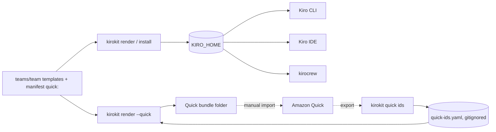

<div align="center">


# kirokit

## One set of team templates for every Kiro tool

**Each team keeps its agents, skills, prompts and steering as reviewed templates.**<br>
kirokit installs them for Kiro CLI, Kiro IDE and kirocrew, and exports them for Amazon Quick.

<p>
  <a href="#install">Install</a> •
  <a href="#first-steps">First steps</a> •
  <a href="#works-with">Works with</a> •
  <a href="#documentation">Docs</a> •
  <a href="https://github.com/mavogel/kirokit/releases">Releases</a>
</p>

<a href="assets/kirokit-showcase.mp4"></a>

<sub>Sharper version: <a href="assets/kirokit-showcase.mp4">kirokit-showcase.mp4</a></sub>

</div>

> [!NOTE]
> kirokit is an unofficial helper for managing and sharing Kiro configurations. It is not made by or affiliated with the Kiro or Amazon Quick teams.

---

## Why kirokit

| You get | How it works |
|---|---|
| **Configs a team owns** | Each team keeps `teams/<team>/` in one git repository: agents, hooks, prompts, skills and steering as templates, with an owner per agent and skill. |
| **The same result on every machine** | Templates render into Kiro's real layout byte for byte; golden files catch every change in CI before it reaches anyone. |
| **One install, three Kiro tools** | `kirokit install <team>` writes into `KIRO_HOME`, which Kiro CLI, Kiro IDE and kirocrew all read. |
| **An Amazon Quick bundle** | `kirokit render --quick <team>` turns the skills and agents the team picks into files Quick imports, from the same templates. |
| **No secrets in files** | MCP servers get their secrets from [SOPS](https://github.com/getsops/sops) when they start, never from a committed or rendered file. |
| **Pinned versions** | MCP server versions and vendored skills from other repositories are pinned centrally and updated on purpose. |
| **Buttons for everyone else** | The desktop app clones, installs, syncs and exports with the same commands, shown in its terminal dock. |

---

<h2 id="install">Install</h2>

**Command line.** Every release carries the `kirokit` binary for macOS, Linux and Windows, on amd64 and arm64:

| System | Install | Or download from the [release](https://github.com/mavogel/kirokit/releases) |
|---|---|---|
| macOS | `brew install --cask mavogel/tap/kirokit` | `kirokit_<version>_darwin_<arch>.tar.gz` |
| Linux | `brew install --cask mavogel/tap/kirokit`, or `sudo apt install ./kirokit_<version>_linux_<arch>.deb`, or `sudo dnf install ./kirokit_<version>_linux_<arch>.rpm` | `kirokit_<version>_linux_<arch>.tar.gz` |
| Windows (PowerShell) | `scoop bucket add mavogel https://github.com/mavogel/scoop-bucket` then `scoop install kirokit` | `kirokit_<version>_windows_<arch>.zip` (put `kirokit.exe` on your `PATH`) |

`kirokit --version` prints the installed version. The package holds only the binary; `kirokit setup` downloads the team configs (see [First steps](#first-steps)).

**Desktop app.** It bundles its own `kirokit`, so nothing else is needed:

| System | Install |
|---|---|
| macOS 13+ | `brew install --cask mavogel/tap/kirokit-desktop`, or open `kirokit-desktop_<version>_darwin_<arch>.dmg` |
| Linux (Ubuntu 22.04+, Debian 12+, Fedora 40+) | `sudo apt install ./kirokit-desktop_<version>_linux_<arch>.deb` or `sudo dnf install ./kirokit-desktop_<version>_linux_<arch>.rpm` |
| Windows 10/11 | run `kirokit-desktop_<version>_windows_<arch>-setup.exe` |

<details>
<summary><b>The apps are not signed</b></summary>

- **Windows:** SmartScreen says "Windows protected your PC" when you start the setup program. Choose **More info**, then **Run anyway**.
- **macOS:** the cask clears the quarantine attribute for you; if you open the DMG by hand, run `xattr -dr com.apple.quarantine kirokit.app` once, or macOS reports the app as damaged.

</details>

You also need [Kiro CLI](https://kiro.dev/docs/cli/installation/) (macOS, Linux with glibc 2.34+ or musl, Windows 11). Teams whose MCP servers use secrets, such as the example `platform-team`, also need `sops` and a key that decrypts their secrets file ([Secrets via SOPS](docs/secrets.md)).

---

## First steps

**On the command line**, download the team configs and install one team into a throwaway Kiro home, so your own setup stays as it is (in PowerShell set `$env:KIROKIT_REPO = "$HOME\.kirokit-config"` instead of `export`):

```bash
# download the configs onto their newest release; use your team's repository address
kirokit setup --source https://github.com/mavogel/kirokit.git --target ~/.kirokit-config
export KIROKIT_REPO=~/.kirokit-config

# install product-team into a temporary Kiro home
export KIRO_HOME=$(mktemp -d)
kirokit install product-team

# start its product owner, then type /user to see the user-story skill
kiro-cli chat --agent product-owner --v3
```

Remove the temporary home with `rm -rf "$KIRO_HOME"` and `unset KIRO_HOME` when you are done.

**In the desktop app**, enter your team's repository address on first launch (for the examples, `https://github.com/mavogel/kirokit.git`) and press **Clone**. On **Teams**, press **Install** on your team: the app shows what it needs first, then runs `kirokit install <team>` in its terminal dock. [Desktop app](docs/desktop-app.md) has every page.

**For Amazon Quick**, render the team's bundle and import its files in Quick:

```bash
kirokit render --quick product-team --out ~/quick/product-team
```

[Amazon Quick](docs/amazon-quick.md) explains the import and how `kirokit quick ids` keeps skill ids across reimports. In the app, **Export for Quick** on the team does the same.

---

<h2 id="works-with">Works with</h2>



| Tool | What it picks up | Notes |
|---|---|---|
| **Kiro CLI v3** | Everything `kirokit install` writes: agents, skills, prompts as slash commands, steering, hooks, and MCP servers started through `sops exec-env`. | The target the templates are written for; `kiro-cli agent validate` checks every golden agent. |
| **Kiro IDE** (1.4.26 checked) | The team's agents, listed under **Global** in the chat's agent selector, plus skills and steering from the same Kiro home. | The IDE honours `KIRO_HOME` only when it is absolute, not a root folder and not your home folder or a parent of it; otherwise it falls back to `~/.kiro`. Start it from a shell that has `KIRO_HOME` set. |
| **kirocrew** (0.10.0 checked) | The team's agents, listed as agents it did not create, with their skills. | On start it writes its own `kirocrew*.json` agents into the same `agents/` folder, so Kiro CLI and IDE list them too; kirokit's backups copy them and `uninstall` leaves them. kirocrew follows `KIRO_HOME` for agents but still reads sessions and some MCP settings from `~/.kiro`. |
| **Amazon Quick** | The skills and agents a team lists under `quick` in `manifest.yaml`, as files you import in Quick. | Quick has no API, so import stays manual; no MCP servers or secrets go into the bundle. |

---

## Documentation

| Page | What it covers |
|---|---|
| [Configuration](docs/configuration.md) | Directory layout, the `manifest.yaml` reference, central MCP versions, onboarding a new team |
| [Agents and skills](docs/agents-and-skills.md) | The example role agents, owners and `/feedback`, vendored external skills |
| [Secrets via SOPS](docs/secrets.md) | Encrypted secrets per agent, keys per team, Windows and remote MCP servers |
| [Install, setup and sync](docs/install-and-sync.md) | `install`, `uninstall`, backups, `setup`, `sync` and scheduled updates |
| [Testing](docs/testing.md) | `render`, `test` and `update` with the golden files |
| [Desktop app](docs/desktop-app.md) | Releases, data folder and every page of the app |
| [Amazon Quick](docs/amazon-quick.md) | The Quick bundle, the ids file and the two-pass import |

Contributions are welcome: [CONTRIBUTING.md](CONTRIBUTING.md) has the development setup and checks.
