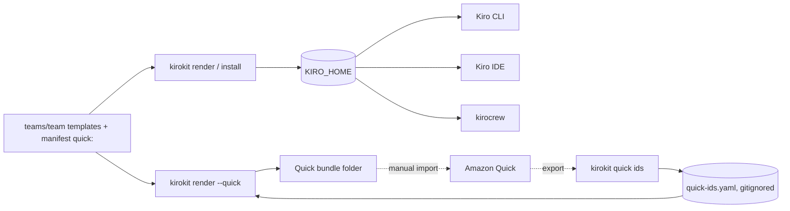

# Amazon Quick

kirokit turns the skills and agents a team chooses into an [Amazon Quick](https://docs.aws.amazon.com/quick/latest/userguide/agents-desktop.html) bundle, from the same templates Kiro gets. Quick has no API, CLI or local folder for agents and skills, so kirokit writes files and you import them through Quick's own screens. Back to the [README](../README.md).



## What goes into the bundle

Only what the team lists under `quick` in its `manifest.yaml`; everything else stays Kiro-only.

```yaml
quick:
  skills: [user-story]            # team or vendored skills
  agents:
    - name: product-owner         # an agent of this team
      welcomeMessage: "What should we build next?"
      starterPrompts: ["Write a user story for exporting a report as CSV"]
      skills: [user-story]        # pinned to the agent in Quick; each must be in quick.skills
```

```text
<out>/
  skills/user-story/SKILL.md      # the Kiro-rendered skill (plus its folder's other files), with id: when known
  agents/product-owner.json       # Quick's agent format
```

- **Skills** are the exact files Kiro gets (a vendored script keeps its execute bit), so they need `name` and `description` frontmatter (Quick needs both; render fails without them). With a known id, `id: <id>` is added as the last frontmatter line, where Quick writes it on export. An `id:` line the template already carries is dropped: ids belong to one Quick account and come only from the ids file.
- **Agents** take `name`, `description` and the prompt (an inline `prompt`, or the rendered file a `file://` prompt points to) from the Kiro agent. `welcome_message`, `starter_prompts` and the pinned `skills` come from the manifest; `capabilities`, `connectors`, `spaces` and `files` stay empty. A prompt over 50,000 characters (Quick's limit) or a `file://` prompt outside the rendered tree fails the render.
- **Prompts are not rewritten for Quick.** A prompt that mentions Kiro-only abilities (subagents, MCP tools, `/feedback`) keeps that text, and steerings stay Kiro-only.
- **No MCP servers and no secrets.** Quick agents attach only shared account connectors, which an admin sets up in Quick; nothing from `mcpServers` or SOPS reaches the bundle.
- **`{{input}}` placeholders.** Quick skills reference inputs as `{{name}}`, which is kirokit's template syntax too. In a team skill write `{{"{{"}}name}}`, or vendor the skill as an [external skill](agents-and-skills.md#external-skills), whose files never pass through the template engine.

## Commands

```bash
kirokit render --quick <team> --out <dir>     # the team's Quick bundle into <dir>
kirokit render --quick --out <dir>            # every team with a quick section, one folder each
kirokit quick ids <export>...                 # record the ids Quick assigned, from exported skills
```

- `render --quick` prints `rendered Quick bundle for <team>: N skills, M agents -> <dir>` and, for each skill without an id yet, `warning: no Quick id for skill <name> yet (first import); run kirokit quick ids after importing` on stderr. Missing ids are normal before the first import and never fail the render.
- A named team without a `quick` section fails with `team <team> lists nothing for Quick`; without a team such teams are skipped with a note. A listed skill or agent the team does not have, a pinned skill missing from `quick.skills`, or two listed skills with the same frontmatter `name` (Quick would merge them into one) fails the render naming it.
- `--out` is replaced the way `render` replaces it: an existing folder whose content would change is kept as a `.backup` beside it.
- `quick ids` takes exported `SKILL.md` files (any `.md` file given directly), `.zip` exports, or folders, which it searches for `SKILL.md` files and `.zip` files. It reads each export's frontmatter `name` and `id`, updates those names in the ids file, keeps the others, and prints `recorded <n> ids in <file>` and `skipped <path>: no id` per export without one. Two different ids for one name, or an id that is not 32 lowercase hex characters, fails and writes nothing. Zips are read in memory (at most 256 entries and 1 MiB per `SKILL.md`).
- The desktop app's **Export for Quick** button runs the same render ([Desktop app](desktop-app.md)).

## The ids file

Quick assigns a skill's id on its first import and ignores an id a file brings for a new skill. An overwrite keeps the id only when the imported file carries it. So kirokit keeps the ids in `quick-ids.yaml`, keyed by the skill's frontmatter `name` (Quick's match key):

```yaml
# Amazon Quick skill ids for one Quick account. Written by `kirokit quick ids`; never commit.
skills:
  user-story: 0123456789abcdef0123456789abcdef
```

- It sits at the config repository root (`KIROKIT_REPO`, else the current directory), or where `KIROKIT_QUICK_IDS` or `--quick-ids <file>` points; the flag wins over the variable. The repository's `.gitignore` lists `/quick-ids.yaml`; ids differ per account, so never commit it. `quick ids` writes it readable only by you.
- The goldens never read it: they use the made-up ids in `testdata/golden/quick-ids.yaml` ([Testing](testing.md)).
- kirokit cannot tell when an id goes stale. If a skill is deleted and recreated in Quick, its id changes: export it again and rerun `kirokit quick ids`.
- A skill's `name` is its identity in Quick. Renaming it creates a new Quick skill and leaves the old one behind.

## Importing, the two-pass flow

1. **Render without ids:** `kirokit render --quick product-team --out ~/quick/product-team`. Each skill gets a warning; that is expected.
2. **Import in Quick:** Customize > Skills > Create > **From folder**, one skill folder at a time (`skills/user-story`). Then Customize > Agents > Create > **From file** with `agents/product-owner.json`. Quick assigns the skill ids.
3. **Record the ids:** export each skill from Quick (owner only) and run `kirokit quick ids <the exported files or their folder>`.
4. **Render again:** the same `render --quick` now writes each skill's `id:` line and lists the ids in the agents' `skills`.
5. **Reimport** the skills and the agent and confirm Quick's overwrite prompt ("already exists and will be overwritten"). A skill reimported with its `id:` line keeps its id; that was seen in Quick. That the agent is overwritten in place and keeps its pinned skill has not been confirmed in Quick yet, so check the agent's skills after the reimport.

To check a skill, export it from Quick and compare it with the rendered file: Quick's export equals the imported file byte for byte, so `diff <export>/SKILL.md <out>/skills/<name>/SKILL.md` prints nothing once the ids are in.

Quick matches skills by `name` on import. If Quick offers no overwrite for the agent and creates a second one, delete the old agent before importing again.

Formats and import rules come from export and import round trips with Quick desktop 1.1.4053. The agent format is not documented by AWS and may change.
