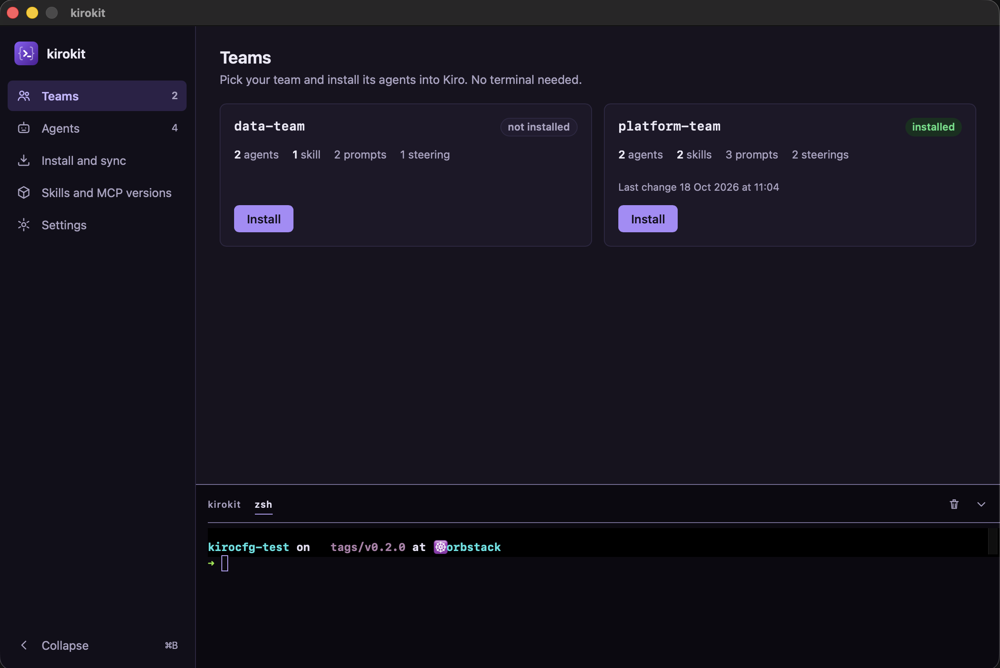

# Desktop app

The kirokit desktop app in detail: what each release carries, where it keeps its data, and what every page does. Installing it is in the [README](../README.md#install).

`desktop/` holds a desktop app ([Wails](https://v3.wails.io) v3) for macOS, Linux and Windows, for people who would rather press buttons than type commands. It bundles `kirokit` and runs the same commands, so what it writes is byte for byte what the command line writes. Each release carries:

- **macOS 13 or later** (Apple silicon and Intel): `kirokit-desktop_<version>_darwin_arm64.dmg` and `..._darwin_amd64.dmg`, both holding the same universal app, plus the `kirokit-desktop` cask (`brew install --cask mavogel/tap/kirokit-desktop`). The app is not signed or notarized, so the cask clears the quarantine attribute after install; if you open the DMG by hand, run `xattr -dr com.apple.quarantine kirokit.app` once, or macOS reports the app as damaged.
- **Linux** (amd64 and arm64): `kirokit-desktop_<version>_linux_<arch>.deb` and `.rpm`. They install `/usr/bin/kirokit-desktop`, its own CLI at `/usr/lib/kirokit-desktop/kirokit`, a menu entry and an icon, and depend on GTK 4 and WebKitGTK 6.0. The app needs GTK 4.14 or later: each release's Linux app starts on Ubuntu 24.04, Ubuntu 26.04 and Debian 13 in CI; Ubuntu 22.04 and Debian 12 ship an older GTK 4 and are not supported (the 0.8 releases, built on GTK 3, still run there). The `.rpm` depends on `gtk4` and `webkitgtk6.0` and is not tested on Fedora. The `.deb` also installs and loads an AppArmor profile, `/etc/apparmor.d/kirokit-desktop`: WebKitGTK 6.0 runs each page in a bubblewrap sandbox, and Ubuntu 23.10 and later allow the user namespaces it needs only to programs whose profile says so. The profile grants that to `/usr/bin/kirokit-desktop` and nothing else. The package is named `kirokit-desktop`, so it installs beside the `kirokit` CLI package.
- **Windows 10/11** (amd64 and arm64): `kirokit-desktop_<version>_windows_<arch>-setup.exe`, which installs `kirokit-desktop.exe` with `bin\kirokit.exe` beside it, a Start menu and desktop shortcut, and an uninstaller. It is not signed: SmartScreen shows "Windows protected your PC"; choose **More info**, then **Run anyway**. The app uses the WebView2 runtime Windows 11 ships with (the setup installs it if missing).

The release builds each system on its own GitHub runner and publishes them together. Build it yourself with `task desktop:build` (on Linux it needs `libgtk-4-dev` and `libwebkitgtk-6.0-dev`; on Windows `makensis` from NSIS and Git Bash), or run it from source with `task desktop:dev` (Wails' `wails3 dev`, at the version `desktop/go.mod` pins; `task desktop:test` runs its checks).

The app has a native menu. On macOS the menu bar shows **kirokit** (About, **Settings…** ⌘,, Services, Hide, Hide Others, Show All, Quit), **Edit** (undo, cut, copy, paste, select all), **Window** and **Help** (**kirokit documentation**, which opens this page, and **Report a problem with kirokit…**, which opens a new issue for kirokit itself on GitHub). On Windows and Linux the same menu sits at the top of the window, with **File** (Settings… Ctrl+,, Quit) in place of the kirokit menu and About under Help. Settings… opens the Settings page as the sidebar does; on the first-launch page it does nothing.

The app keeps its settings, default clone and Quick exports in `kirokit-desktop` in the user's config folder: `~/Library/Application Support/kirokit-desktop` on macOS, `~/.config/kirokit-desktop` on Linux, `%AppData%\kirokit-desktop` on Windows.

- **First launch** asks for your team's repository address (https, ssh, `file://`, `git@host:path` or an absolute path, on Windows also `C:\…`; an address starting with `-` is refused), runs `git clone -- <address> <repository folder>`, then `kirokit sync --latest-tag`, so the clone sits on the newest `v*` tag. A repository with no `v*` tag is kept and the app says it has no release yet. After the clone the same page asks for the **Version** (see below), with Newest release preselected (or the default branch when there is no release yet): Continue keeps it, another entry runs the switch first, and a failed switch shows its reason under the list and leaves the clone on the newest release. Saving a different address in Settings clones it the same way (progress in the kirokit tab, catalog refreshed on success) and renames the old clone to `repo.old-<unix time>`; a failed clone puts it back, keeps the old address stored and shows the failure beside the address field, so Save can retry the same address. The new address is stored only after its clone succeeds. The repository folder defaults to `repo` in the app's folder above (`~/Library/Application Support/kirokit-desktop/repo` on macOS); the first-launch page and Settings both let you choose another absolute folder (new or empty, or an existing git checkout; the home folder itself is refused). Saving a different folder in Settings shows the setup page so you can clone there; the old folder is left as it is.
- **Teams** has an Install button per team. It first shows the checks it needs (SOPS, the decryption key, Kiro CLI, read from your login shell; on Windows from the app's own environment, finding `.exe` and `.cmd` tools and Scoop's shims), then runs `kirokit install <team>`. A Kiro home holds one team, so installing another team asks before it replaces the installed one.
- **Export for Quick** sits beside Install on each team whose `manifest.yaml` lists skills or agents under `quick` (other teams say they have no Quick export). It runs `kirokit render --quick <team> --out <app folder>/quick/<team>` in the kirokit tab, then the card shows "Quick bundle ready: N skills, M agents", the folder and **Show folder**, and the folder opens once in Finder, the file manager or Explorer. A failed render says so beside the button and the kirokit tab holds the reason. Import the folder's files in Amazon Quick as [Amazon Quick](amazon-quick.md) describes; the ids file comes from the clone (`quick-ids.yaml` there, written by `kirokit quick ids` in the shell tab).
- **Agents** and **Skills** show each agent's and skill's owner and a **Feedback** button that opens a prefilled GitHub issue in the team's `feedback.github` repository (see [Role agents and feedback](agents-and-skills.md#role-agents-and-feedback)).
- **Install and sync** has Sync (`kirokit sync <team>` for the chosen version) and Uninstall (`kirokit uninstall <team>`) per installed team; **Settings** has Update (`kirokit sync` for the chosen version, for the installed team, or without a team when none is installed).
- **Version** (Settings → Templates, and the first-launch page after the clone) lists Newest release, the repository's branches and its tags. Newest release follows each new release (`--latest-tag`); a branch follows its new commits and a tag stays fixed (`--branch <name>`). Picking another entry turns Update into "Switch to <name> and update", which runs `kirokit sync [team] --branch <name>` in the kirokit tab; the choice is saved only when that succeeds, and from then on Update, Sync and the first-launch Continue use the chosen version, never jumping back to the newest release on their own. A refused switch (see [Sync](install-and-sync.md#sync-automatic-updates)) shows the CLI's message under the list and changes nothing. A tag with the same name as a branch is not listed, since the branch wins. The list is read from the clone without the network, so a branch pushed since the last fetch appears after the next Update. Saving a new repository address goes back to Newest release.
- **Install and sync** and Settings' "In use" line show where the installed templates come from: `Templates from branch main at b81d0a7`, a tag, or the newest release. Anything but Newest release carries a badge: "not a release" for a branch, "pinned · does not follow new releases" for a chosen tag, even when it is today's newest.
- Every button command runs in the dock's **kirokit** tab, where a git sign-in prompt can be answered; the second tab is your own shell, named after it, with the bundled `kirokit` first on `PATH`: your login shell on macOS and Linux (**zsh**, **bash**, …; startup files of shells other than zsh may reorder `PATH`, which Settings notes), and **PowerShell** on Windows (PowerShell 7 when installed, else Windows PowerShell; PowerShell 7 puts its own folder first, and `kirokit` there still runs the bundled one). The app sets `KIROKIT_REPO` to its clone and `KIRO_HOME` to the Kiro home folder saved in Settings.
- `KIROKIT_REPO` also works on the command line: with it set, `kirokit sync --latest-tag` (no team) updates a checkout from any folder.

**Migration:** one machine now holds one team, in the app and on the command line alike. A second scheduled sync from `scripts/kirokit-sync-setup.sh` for another team replaces the first team on every run.
