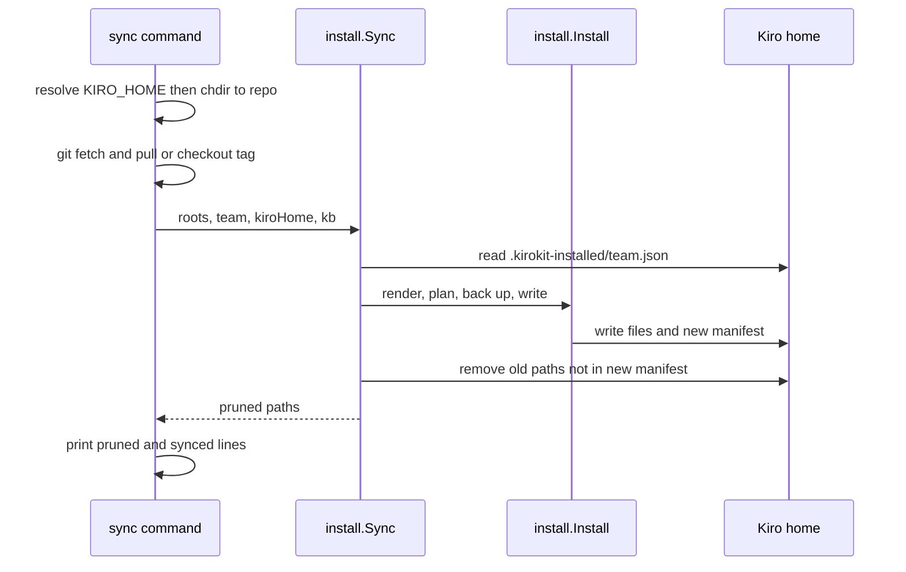
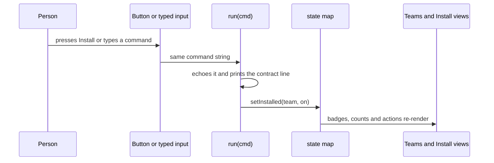
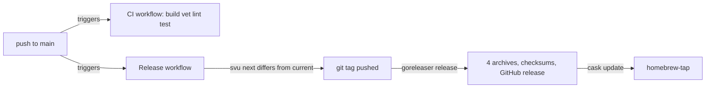

# Research: Desktop app from design

## Summary

**kirokit's install logic is reusable, but its commands assume a terminal in the repository.** Install, uninstall and sync take explicit folders and a Kiro home, so a Go app in the same module can call them. The commands themselves read the folders from the working directory. Sync also changes that directory and runs `git` there.

**There is no data layer for teams and agents.** Team manifests and version pins have loaders. Teams are found by listing folders, and agents exist only as template files. The install record is a private JSON file per team in the Kiro home folder, which lists every written path.

**The design page is one hand-written HTML file with a small token set.** Its colours come from the violet logo, and it uses system fonts and inline icons. It follows the viewer's light or dark choice. Its terminal is a script that fakes kirokit's output lines.

**Wails v2 is the stable choice, and v3 is still a beta.** Wails v2 builds a macOS app bundle, including one universal app for both chip types. A real terminal needs a pseudo-terminal library in Go and xterm.js in the page, wired together by the app.

**A Finder-launched app does not see the terminal's PATH or variables.** On this machine `sops` and `kiro-cli` live in Homebrew's folder, and the age key sits in sops's default place.

**Today's build is pure Go, with CGO off, released from a Linux runner.** CI runs on Linux only, and the release builds CLI archives plus a Homebrew cask that clears the quarantine flag. The 208 tests pass today.

## The questions

1. **How do kirokit's commands find the repository folders and the Kiro home today?** Look at `cmd/kirokit/commands/root.go`, `install.go`, `sync.go`, `uninstall.go` and `internal/install/install.go` (`Roots`, `ResolveKiroHome`). Note every place that depends on the current working directory or an environment variable.
2. **How do the internal packages expose teams, agents, skills and MCP pins as data?** Look at `internal/manifest`, `internal/render`, `internal/mcpversions`, `internal/externalskills`, `teams/*/manifest.yaml` and `teams/*/agents/*/agent.json.tmpl`. Name the exported functions and types a caller in the same module could use.
3. **How does install record what it wrote, and how are install and sync results reported?** Look at `internal/install/install.go` (`manifest`, `installManifestPath`, `Uninstall`), `internal/install/sync.go` and `internal/install/backup.go`. Describe the files under the Kiro home folder and the output each command prints.
4. **How is the sidebar-layout design page built, and what design system does it use?** Read `docs/plans/2026-10-17-desktop-app-sidebar-layout/design/sidebar-layout.html` and that task's `03-plan.md` contracts. Describe its structure, colour tokens, fonts, icons, theme handling, keyboard shortcuts and simulated terminal, plus `assets/logo.svg`.
5. **How do Wails v2 and Wails v3 structure a Go app with a web frontend at their current releases?** Use the official Wails documentation and release notes. Cover project layout, Go-to-frontend bindings, events, window options, the build command, macOS app bundles, and whether it fits a module that already builds a CLI.
6. **How do Go pseudo-terminal libraries and xterm.js connect a real shell inside a webview?** Look at `creack/pty` and `@xterm/xterm` at their current releases, and how an existing Wails or webview app streams a shell. Cover resizing, input, output streaming and shutdown of the child process.
7. **How do a macOS app's PATH and environment differ from a terminal session?** Use Apple and community documentation. Describe what a Finder-launched app inherits, and how apps commonly find tools like `sops`, `kiro-cli` and an age key file.
8. **How do the build, lint, CI and release setup handle binaries today?** Look at `Taskfile.yml`, `.goreleaser.yaml`, `.github/workflows/ci.yaml`, `.github/workflows/release.yaml`, `lefthook.yml` and the golangci-lint configuration. Note CGO settings, target platforms and what `go test ./...` and `go build ./...` cover.

9. **How does the project clone and update git repositories, and what do Go git options offer?** Look at `internal/externalskills/fetch.go`, which fetches external skills, and at the current `go-git` release and the `git` command line. Cover clone, pull, authentication for private repositories, and where macOS apps keep their own data.

**Key context pointers:**

- `docs/plans/2026-10-17-desktop-app-sidebar-layout/design/sidebar-layout.html` — the approved design page
- `docs/plans/2026-10-17-desktop-app-sidebar-layout/01-discuss.md` and `03-plan.md` — the design task's decisions and contracts
- `docs/prd/2026-09-28-kiro-cli-kit-multi-team.md` — the v1 product requirements
- `assets/logo.svg` — the project's visual identity
- `README.md` — the command reference

## Findings

<!-- ql:folded -->
### Every command resolves repository folders from the working directory, with no discovery

**Answers:** 1

The four repository paths are constants, relative to the current working directory (`cmd/kirokit/commands/root.go:11-19`): `teams`, `global/steerings`, `env/mcp-versions.yaml` and `testdata/golden`. The comment says kirokit has no repository-root discovery in v1. `install` copies them into `install.Roots` (`cmd/kirokit/commands/install.go:29-33`); `sync`, `test` and `update` do the same (`sync.go:56-60`, `test.go:26-29`, `update.go:26-29`). `render` passes them straight to `render.RenderTeam` (`render.go:34`).

`sync` is the only command that changes directory. It runs `os.Chdir(repo)` (`cmd/kirokit/commands/sync.go:43`) with `--repo` defaulting to `.` (`sync.go:72`), then runs git and the install from there. `install` and `uninstall` never chdir.

The Kiro home comes from one function. `ResolveKiroHome` returns `$KIRO_HOME` when set and non-empty (`internal/install/install.go:47-48`). Otherwise it returns `$HOME/.kiro` via `os.UserHomeDir` (`install.go:50-54`). It does not make the path absolute. `install`, `sync` and `uninstall` each call it (`install.go:24`, `sync.go:37`, `uninstall.go:18`). `render`, `test` and `update` do not; they render with the fixed sentinel `/kiro-home` (`internal/render/context.go:15`, applied at `context.go:48-50`).

```
cwd + env dependencies (non-test code)
├── root.go:15-18        teams, global/steerings, env/mcp-versions.yaml, testdata/golden  -> cwd
├── root.go:51           teamNames: os.ReadDir("teams")                                   -> cwd
├── sync.go:43           os.Chdir(--repo)                                                 -> moves cwd
├── install.go:47        os.Getenv("KIRO_HOME")
├── install.go:50        os.UserHomeDir()                                                 -> $HOME
└── install.go:135       filepath.Abs(kb.Source)                                          -> cwd at call time
```

An exhaustive search for `Getenv|Getwd|Chdir|Setenv|LookupEnv|UserHomeDir|Executable` over non-test Go files under `cmd/` and `internal/` found only the lines above. No other environment variable is read.

Order matters in `sync`. `ResolveKiroHome` runs at `sync.go:37`, before the chdir at `sync.go:43`, but returns the string unchanged. A relative `$KIRO_HOME`, and relative `--kb-source` or `--kb-mount` values, are therefore used after the chdir (`sync.go:61`) and resolve against `--repo`, not the shell's directory. That follows from the code; no test was run to confirm it.

### Teams, agents and pins are read as files; only manifests and pins have a typed loader

**Answers:** 2

There is no exported "list teams" or "list agents" function. `teamNames` is unexported and lists directories under `teams/` (`cmd/kirokit/commands/root.go:47-62`). Agents are discovered by directory walk: `planSecrets` reads `teams/<team>/agents/*` (`internal/install/install.go:325-353`) and `mapOutputPath` turns `agents/<name>/agent.json.tmpl` into `agents/<name>.json` (`internal/render/render.go:229-230`). Both teams today hold two agents (`teams/platform-team/agents/{devops,platformdev}`, `teams/data-team/agents/{godev,javadev}`).

```
Exported surface a same-module caller can use
manifest      Manifest{Team, GlobalSteerings, ExternalSkills}   manifest.go:16-20
              ExternalSkill{Name, Source, Ref, Paths, All, Exclude, Path}   manifest.go:33-43
              Load(path) (*Manifest, error)                     manifest.go:58
              ExternalSkill.Expand / Validate / EffectiveName / IsCollection
mcpversions   Versions map[string]string; Load(path)            mcpversions.go:13,16
render        Context{Team, Env, Global, KiroHome}              context.go:18-23
              BuildContext(teamsRoot, team, globalRoot, envVersionsPath, kiroHome)   context.go:27
              RenderTeam(teamsRoot, team, globalRoot, envVersionsPath, outDir, kiroHome)   render.go:25
              FuncMap(ctx); DefaultKiroHomeSentinel             funcs.go:13, context.go:15
externalskills  Lock{Skills []LockEntry}; ReadLock, WriteLock, HashDir, SkillsDir, LockPath   lock.go:20-102
              Fetch(teamDir, entries) (Lock, error)             fetch.go:23
              Verify(teamDir, entries) error; Resolve(teamDir, entries) ([]string, error)   verify.go:18,27
```

`manifest.Load` fails when `team` is empty (`manifest.go:68-70`) and expands `paths:` into one entry per path (`manifest.go:81-90`, `94-117`). The two shipped manifests are small: `teams/data-team/manifest.yaml` holds `team` and an empty `globalSteerings`; `teams/platform-team/manifest.yaml` opts into `security-baseline` and has `externalSkills` commented out. `mcpversions.Load` parses a flat string map (`mcpversions.go:16-27`), and `env/mcp-versions.yaml` holds eight entries (for example `pipeline-mcp: "3.0.0"`). Templates read a pin through `mcpVersion`, which errors on an undefined key (`internal/render/funcs.go:23-31`).

An agent template is JSON with Go template actions (`teams/data-team/agents/godev/agent.json.tmpl:1-32`). It uses `.KiroHome` (line 20) and `mcpVersion ... | jsonString` (line 27). The render context carries the whole manifest and the pins, but the agent's own fields (name, tools, MCP servers) exist only as rendered text. The only Go parsing of agent JSON is validation (`internal/render/render.go:196-199`, `kiroconfig.ValidateAgentJSON`) and the resources splice (`render.go:92-97`). Nothing returns an agent as a struct.

### Install writes files, then a per-team JSON manifest that uninstall and sync replay

**Answers:** 3

`Install` renders into a temp directory with the real Kiro home baked in (`internal/install/install.go:63-70`). It plans every file before writing: the rendered tree (`planRenderedTree`, `install.go:289-321`) plus each agent's `env/secrets.enc.yaml` (`planSecrets`, `install.go:325-353`). It backs up changed folders, writes, creates the optional knowledge-base symlink, and finally writes the manifest (`install.go:96-120`).

```
$KIRO_HOME
├── agents/<agent>.json                         rendered, 0600
├── hooks/ prompts/ skills/ steering/...        rendered tree (mapOutputPath)
├── kirokit-secrets/<team>/<agent>/secrets.enc.yaml   0600   install.go:347
├── .kirokit-installed/<team>.json              0600   install.go:260-262, 273
└── YYYYMMDD-HHmmss-<folder>.backup/            not recorded in the manifest
```

The manifest struct is `{files: [...], symlinks: [...]}` (`install.go:39-42`), pretty-printed JSON with absolute paths. Its own path is appended to `files`, so uninstall removes it too (`install.go:114-115`). Files are written 0600, or 0700 when the source had the owner-execute bit (`install.go:310-313`).

`Uninstall` reads the manifest, removes symlinks then files, ignores already-missing paths, and prints nothing itself (`install.go:232-258`). A missing manifest is an error, `no install manifest found for team %q` (`install.go:237`). It does not remove emptied directories.

`Sync` reads the previous manifest (a missing one is zero), runs `Install`, reads the new one, and removes every previous path absent from the new one (`internal/install/sync.go:16-49`). It then removes empty parent directories up to, but excluding, the Kiro home (`sync.go:55-62`).

Backups come from `internal/backup`, not an `install/backup.go` (that file does not exist). `backupChangedFolders` makes a sibling copy of each top-level folder in which an existing file would change (`install.go:379-408`). `backup.Differs` is true only for an existing file with different content, a symlink or a folder (`internal/backup/backup.go:107-117`). Unchanged re-installs therefore create no backups. The name is `<stamp>-<folder>.backup`, or `<stamp>-<n>-<folder>.backup` on a same-second clash (`backup.go:25-34`).

| Command | Printed on stdout | Source |
|---|---|---|
| `install <team>` | `installed <team> into <kiroHome>` | `cmd/kirokit/commands/install.go:37` |
| `uninstall <team>` | `uninstalled <team> from <kiroHome>` | `cmd/kirokit/commands/uninstall.go:26` |
| `sync <team>` | `updated <before> -> <after>` only if HEAD moved; `pruned <path>` per removed path; `synced <team> into <kiroHome> at <after>` | `cmd/kirokit/commands/sync.go:53,66,68` |

Errors are returned wrapped as `kirokit <command>: ...`; the root command silences cobra's own usage and error output (`root.go:30-31`). `install` and `sync` do not print the backup names or the written paths, so the backup folders are visible only on disk. `sync`'s `before` and `after` come from `git rev-parse --short HEAD` with the error ignored (`sync.go:47,51`). `--latest-tag` checks out the newest `v*` tag (`sync.go:88-96`).



### The design page is one self-contained HTML file with a violet-from-the-logo token set

**Answers:** 4

The page is a single file with inline CSS and script (`docs/plans/2026-10-17-desktop-app-sidebar-layout/design/sidebar-layout.html:9-174`, `317-472`). The plan states this as a decision (`docs/plans/2026-10-17-desktop-app-sidebar-layout/03-plan.md:32-34`). It is a fixed 1180x760 "window" that scrolls sideways instead of reflowing (`sidebar-layout.html:64`, `03-plan.md:144`). No Go, Wails or build files change (`03-plan.md:148`).

```
.window (grid: 36px titlebar / 1fr)            sidebar-layout.html:64
├── .titlebar  traffic-light dots + title      :67-71
└── .app (grid: auto sidebar / 1fr)            :72
    ├── aside.sidebar  232px, 60px as .rail    :75, :91
    │   ├── .brand  inline logo + "kirokit"    :182-185
    │   ├── nav ul.nav  5 buttons[data-page]   :186-194
    │   └── button.collapse  kbd "⌘B"           :196
    └── .work (grid: 1fr / auto)               :98
        ├── main  5 <section id="page-*">      :200-276
        ├── button.term-toggle (hidden)        :278
        └── section.terminal 220px (120-480)   :279-291
dialog#replace, dialog#setup (outside .window) :297-315
```

Pages: Teams (cards), Agents, Install and sync, Skills and MCP versions (tables), Settings (two inputs) (`:201-275`). Everything but install state, file counts, times and the two paths is copied from the repo (`03-plan.md:88-90`, `sidebar-layout.html:215`, `240`).

**Colour tokens** are CSS variables on `:root` (`:10-39`). Light: bg `#f4f2fa`, window `#ffffff`, sidebar `#f1eff9`, text `#1d1730`, muted `#574f6e`, accent `#6d28d9`, accent-soft `#ede9fe`, ok `#15803d`, warn `#854d0e`. Terminal tokens (`--term-bg #15111f`, `--term-text`, `--term-prompt`, `--term-ok`, `--term-err`) are defined once and are not overridden in dark, so the terminal looks the same in both themes (`:30-35`, `40-55`). Dark values (accent `#a78bfa`, bg `#0d0b13`) are declared twice: under `prefers-color-scheme: dark` guarded by `:root:not([data-theme="light"])` (`:40-48`) and under `:root[data-theme="dark"]` (`:49-55`). The plan calls the accent "taken from the logo's violet" and no product design system exists (`03-plan.md:17`, `139`).

**Fonts**: no webfont is loaded. `--font` is `ui-sans-serif, system-ui, -apple-system, "Segoe UI", sans-serif`; `--mono` is `ui-monospace, "SF Mono", Menlo, Consolas, monospace` (`:37-38`). Team, agent, skill and server names use mono (`03-plan.md:141`; `.card h3` at `:107`, `.mono` at `:125`).

**Icons**: hand-inlined 24x24 stroke SVGs, `stroke="currentColor"` width 1.8, one per nav item, collapse chevron, clear (trash) and hide (chevron) buttons (`:188-192`, `196`, `282-283`). Icon-only buttons carry `title`/`aria-label`. In rail mode `.label` becomes visually hidden, so the name stays accessible (`:93`).

**Theme handling**: the script reads `data-theme` on `<html>` and listens for the host's `ql:design-mode` event (`:320-322`). Only values `light` or `dark` are applied. There is no in-page toggle and no storage; the viewer's choice comes from the host or `prefers-color-scheme`.

**Keyboard shortcuts** (one document-level handler, `:397-400`): Cmd or Ctrl+B toggles the rail; Ctrl+backtick toggles the terminal. The resize separator is focusable (`tabindex=0`), and ArrowUp/ArrowDown change height by 20px within 120-480 (`:394`, `387`). The dialogs are native `<dialog>` with `showModal()` and focus return (`:431`, `439`, `453-457`). Plan contract: `03-plan.md:81-83`, `209-211`. Note the plan names Control-backtick only, while the code also accepts Ctrl+B.

**Simulated terminal**: input `keydown` Enter calls `run(cmd)` (`:382`). `run` echoes the line, handles `clear`, answers any non-`kirokit` word with `zsh: command not found` and switches on `help|install|uninstall|sync|test|render|version` (`:364-381`). A page-level `state` map holds `{platform-team: false, data-team: true}` (`:351`), and `setInstalled` rewrites both the Teams card and the Install row (`:403-419`). Buttons call the same `run` (`:426-427`, `464-465`). Installing a second team runs `uninstall` of the first (`:361-363`, `464`), matching option A (`03-plan.md:119-120`, `207`). The output region is `aria-live="polite"` (`:285`). The printed lines mirror real sources cited at `03-plan.md:185-192`.

**Logo**: `assets/logo.svg:1-20` is a 512x512 rounded square (`rx=112`) with a linear gradient `#8b5cf6` to `#4c1d95` (`:4-9`), two translucent `#ede9fe` curly braces (`:11-14`) and a white prompt chevron plus cursor bar (`:16-19`). The page inlines it with identical paths at `sidebar-layout.html:183`; the plan says to copy `assets/logo.svg:1-20` (`03-plan.md:219`).



**Change-readiness.** `git log --since=90.days` shows one commit touching `assets` or this plan folder (`440b841`). The plan said the draft page was excluded from git (`03-plan.md:223`), but commit `440b841` began tracking design folders (`.gitignore:9-11`), and `git ls-files` lists `sidebar-layout.html`. Hard to change: all behaviour is one 150-line IIFE with global-ish `let` state and no tests. The only checks named are `qualitylayer design check` / `design shot` and a manual browser run (`03-plan.md:221`).

### Wails v2 is stable and binds a struct; Wails v3 is a beta that registers services

**Answers:** 5

Current releases from the GitHub API on 2026-10-17: v2 latest `v2.14.0`; v3 is `v3.0.0-beta.30`, a prerelease published 2026-10-15 (v3 docs live under `v3alpha.wails.io`).

| | Wails v2 | Wails v3 (beta) |
|---|---|---|
| Layout | `build/`, `frontend/`, `go.mod`, `main.go`, `wails.json` ([firstproject](https://wails.io/docs/gettingstarted/firstproject)) | `build/` with per-OS Taskfiles, `frontend/`, `main.go`, `greetservice.go`, `Taskfile.yml`, `go.mod` ([first app](https://v3alpha.wails.io/getting-started/your-first-app/)) |
| Config | `wails.json` (`frontend:install`, `frontend:build`, `wailsjsdir`, `outputfilename`, hooks) ([project config](https://wails.io/docs/reference/project-config)) | `build/config.yml` plus Taskfiles |
| Bindings | `Bind: []interface{}{app}` in `options.App`; public methods exposed; JS imports `../wailsjs/go/main/App` ([app dev](https://wails.io/docs/guides/application-development)) | `application.NewService(...)` in `Options.Services`; exported methods only, services are singletons shared by all windows; JS imports `./bindings/<module>/<Service>` ([services](https://v3alpha.wails.io/features/bindings/services/)) |
| Events | Go `runtime.EventsEmit(ctx, name, data...)` / `EventsOn(ctx, ...)`; JS `EventsOn/EventsEmit` ([events](https://wails.io/docs/reference/runtime/events)) | `app.Event.Emit/On`; JS `Events.On/Emit` from `@wailsio/runtime`; per-window `window.EmitEvent` ([events](https://v3alpha.wails.io/features/events/system/)) |
| Window options | `options.App`: Title, Width, Height, MinWidth, Frameless, StartHidden, HideWindowOnClose, OnStartup/OnShutdown/OnBeforeClose, `mac.Options` ([options](https://wails.io/docs/reference/options)) | Multiple `WebviewWindow`s via `app.Window.New()`; `SetSize/SetMinSize/Hide/Show/Close` and `WindowClosing` hook ([window API](https://v3alpha.wails.io/reference/window/)) |
| Build | `wails build` (`-clean`, `-platform`, `-nopackage`, `-ldflags`, `-obfuscated`) ([CLI](https://wails.io/docs/reference/cli)) | `wails3 build` (debug); `wails3 package GOOS=darwin` for a `.app` ([macOS](https://v3alpha.wails.io/guides/build/macos/)) |
| macOS bundle | not confirmed from the pages read; the `-clean` flag refers to `build/bin` | `bin/<AppName>.app` with binary in `Contents/MacOS`, icon and `Info.plist`; universal task `wails3 task darwin:package:universal`; `Info.plist` under `build/darwin/` |

**Fit with this module.** The module is `github.com/mavogel/kirokit` on `go 1.27` with the CLI in `cmd/kirokit/` (`go.mod:1-3`, `AGENTS.md` project section). Both toolchains scaffold a root `main.go` and `go.mod` (fact above), and the repo already has a CLI built from `cmd/kirokit`. Whether a Wails app can live in a subfolder (for example `cmd/kirokit-desktop`) inside the same module without a second `go.mod` is not stated on the pages read (inference only). The repo has no Wails, frontend or `package.json` today (`git ls-files` shows none). The existing packages return errors and only `commands` prints (`03-plan.md:19`), so Go code in `internal/` could be called by a bound service; that is an observation about the layout, not a tested path. Tooling: `wails` is not installed on this machine (`which wails` found nothing). v3 changes between betas every few days (beta.25 on 2026-09-22 to beta.30 on 2026-10-15).

### A Go pty plus xterm.js is a two-way byte pipe whose resize and shutdown the app must wire itself

**Answers:** 6

Versions: `creack/pty` latest `v1.1.24` (2024-10-31), `@xterm/xterm` latest `6.0.0` (npm and GitHub, 2025-12-22), beta tag `6.1.0-beta.315`. xterm.js "is not `bash`"; it is connected to a process through a pty library (README, [xterm.js](https://github.com/xtermjs/xterm.js/blob/master/README.md)). Its documented wiring is `pty.onData(d => term.write(d))` and `term.onData(d => pty.write(d))`.

`creack/pty` API ([pkg.go.dev](https://pkg.go.dev/github.com/creack/pty)): `Start(cmd)` attaches the tty to the command's stdin/stdout/stderr, starts it in a new session with a controlling terminal and returns the master `*os.File`; `StartWithSize(cmd, *Winsize)` sets the size before start; `Setsize(f, *Winsize)` resizes; `InheritSize` is meant for `SIGWINCH` in a terminal program. The README shell example defers `ptmx.Close()` and copies with `io.Copy` both ways; its own caveat is that the stdin-to-pty goroutine "will keep reading until the next keystroke" ([README](https://raw.githubusercontent.com/creack/pty/master/README.md)).

```
Input:    xterm onData -> bound Go method / event -> ptmx.Write(bytes)
Output:   goroutine ptmx.Read(buf) -> Events.Emit("term:data", chunk) -> term.write(chunk)
Resize:   FitAddon.fit() (ResizeObserver) -> term.onResize({cols,rows}) -> Go -> pty.Setsize(ptmx,&Winsize{Rows,Cols})
Shutdown: cmd.Process.Signal/Kill, ptmx.Close(), cmd.Wait() to reap -> read loop gets EOF -> emit "term:exit"
```

In the xterm.js repo, `addon-fit` computes cols and rows from the container (recent commits to `addons/addon-fit` dated 2026-03 and 2026-06 touch `fit()` behaviour with ResizeObserver) ([addon-fit](https://github.com/xtermjs/xterm.js/tree/master/addons/addon-fit)). The Go-to-frontend transport choices map to section 5: v2 `EventsEmit` and v3 `Event.Emit` carry JSON data, so raw bytes need encoding (for example string or base64). Whether either transport preserves arbitrary binary unmodified was not tested here.

Gap: I did not find a Wails v3 `examples/terminal` (the path returns 404), and I did not locate a specific open-source Wails app that streams a shell; the wiring above is composed from the library docs, not from such an app. Unix-only: `creack/pty` returns `ErrUnsupported` where a function is unavailable, which matters only for non-macOS/Linux targets.

### A Finder-launched app does not see the terminal PATH, and the tools here live in places outside it

**Answers:** 7

Observed on this machine (a Terminal login shell, not a Finder launch): `launchctl getenv PATH` printed nothing, and `/etc/paths` lists `/usr/local/bin`, `/System/Cryptexes/App/usr/bin`, `/usr/bin`, `/bin`, `/usr/sbin`, `/sbin` (no `/opt/homebrew/bin`). The login shell PATH starts with `~/.pilot/bin`, `~/.bun/bin`, `/usr/local/bin`, set by the user's shell startup files. `sops` is at `/opt/homebrew/bin/sops`; `kiro-cli` is at both `/opt/homebrew/bin` and `~/.local/bin`; an age key exists at `~/Library/Application Support/sops/age/keys.txt` (existence only; contents not read).

Documented behaviour in the repo that depends on it:
- `sopswrap` emits the bare command name `sops` as the executable (`internal/sopswrap/sopswrap.go:14`), so it is found through the PATH of whatever process starts the agent.
- `ResolveKiroHome` uses `$KIRO_HOME` if set, else `~/.kiro` (`internal/install/install.go:44-55`). A Finder-launched app will not see `KIRO_HOME` set in a shell profile.
- README names `SOPS_AGE_KEY_FILE` as the key-file variable (`README.md:168`).
- sops' age key source reads `SOPS_AGE_KEY_FILE`, otherwise `sops/age/keys.txt` under the user config dir, with macOS handling `XDG_CONFIG_HOME` manually (`age/keysource.go:32`, `48-50`, `393` in the sops repo, raw file fetched from `getsops/sops` main).

Not verified in this session: Apple's page on launchd jobs was fetched but is generic (it describes launchd as parent of user agents) and does not state the GUI app default PATH; the `LSEnvironment` page returned an error. The statement that apps launched from Finder or Dock inherit launchd's minimal environment (typically `/usr/bin:/bin:/usr/sbin:/sbin`, not shell profile exports) is community knowledge that I did not check against a primary source here. Commonly used approaches (inference, unverified here): run the user's login shell once (`$SHELL -ilc 'env'`) and read its environment; probe known directories (`/opt/homebrew/bin`, `/usr/local/bin`, `~/.local/bin`); let the user set paths in an in-app setting; use `/usr/libexec/path_helper` output. The design's Settings page currently exposes only the Kiro home and repository paths (`sidebar-layout.html:272-273`).

### One pure-Go binary is built for four targets, only at release time

**Answers:** 8

The only shipped binary is `kirokit`, built from `./cmd/kirokit`. GoReleaser sets `CGO_ENABLED=0` (`.goreleaser.yaml:13-14`) and builds darwin and linux for amd64 and arm64 (`.goreleaser.yaml:15-20`), four targets. Windows is not built. No Go file uses `import "C"`, and the only `//go:embed` is `//go:embed all:starter` in `internal/scaffold/scaffold.go:20`. `go list` reports zero cgo files in all 12 packages. The two dependencies are cobra and yaml.v3 (`go.mod:5-13`). `go.mod:3` says `go 1.27`, and the local toolchain is go1.27.2 darwin/arm64 with `CGO_ENABLED=1` by default.

Ldflags strip symbols (`-s -w`) and inject three variables into `cmd/kirokit/commands` (`.goreleaser.yaml:21-25`). Those variables are `version = "dev"`, `commit` and `date` (`cmd/kirokit/commands/version.go:12-16`). When version stays `dev`, `buildInfo` falls back to `debug.ReadBuildInfo` (`cmd/kirokit/commands/version.go:40-51`). Archives are `tar.gz` named `kirokit_<ver>_<os>_<arch>` plus `checksums.txt` (`.goreleaser.yaml:27-36`).

A Homebrew cask is pushed to `mavogel/homebrew-tap` (`.goreleaser.yaml:56-62`). Its post-install hook strips the macOS quarantine attribute because the binaries are not notarized (`.goreleaser.yaml:64-71`). Nothing signs or notarizes binaries. A local `dist/` holds snapshot archives for all four targets, and `.gitignore:1-2` ignores `/dist/` and `/kirokit`.

```
task build -> go build -o kirokit ./cmd/kirokit      (local, host platform, CGO default)
CI         -> go build ./...                          (ubuntu, no output binary)
release    -> goreleaser release --clean              (CGO=0, 2 OS x 2 arch)
```

### CI builds, vets, lints and tests on one Linux runner

**Answers:** 8

`ci.yaml` runs on pull requests and on pushes to `main` (`.github/workflows/ci.yaml:3-6`). It uses a single `ubuntu-latest` job (`.github/workflows/ci.yaml:12-13`). Go is `stable`, not read from `go.mod` (`.github/workflows/ci.yaml:18-21`). The steps run in this order:

1. `go build ./...`
2. `go vet ./...`
3. golangci-lint v2.14.0 through the action
4. `go test ./... -v`
5. `node scripts/sync-agent-assets.mjs --check`

(`.github/workflows/ci.yaml:23-38`). CI has no OS or architecture matrix and sets no CGO variable, so the Linux runner uses the default `CGO_ENABLED=1`. It never builds the CGO-disabled darwin or arm64 targets that release ships. `KIROKIT_REQUIRE_KIRO_CLI` appears nowhere in `.github` or `Taskfile.yml` (grep). The kiro-cli validation tests therefore skip in CI, through `skipUnlessRequired` in `internal/golden/kirocli_test.go:12-24`.

`task ci` mirrors CI except for the asset-sync check. It runs build, vet, lint, then `go test ./... -v` (`Taskfile.yml:24-30`). Its `build` step writes `./kirokit`, while CI's step builds all packages without output.

### Release runs on every push to main and tags with svu

**Answers:** 8

`release.yaml` fires on pushes to `main` with `contents: write` (`.github/workflows/release.yaml:3-8`). A `release` concurrency group queues releases (`.github/workflows/release.yaml:11-13`). The job checks out full history and installs svu v3.4.1 (`.github/workflows/release.yaml:19-30`). It computes `svu next --v0` and compares it with `svu current` (`.github/workflows/release.yaml:35-47`). If they differ, it pushes the tag (`.github/workflows/release.yaml:49-53`) and runs goreleaser-pro `~> v2` with `release --clean` (`.github/workflows/release.yaml:55-61`). Secrets used are `GITHUB_TOKEN`, `GORELEASER_KEY` and `HOMEBREW_TAP_GITHUB_TOKEN` (`.github/workflows/release.yaml:62-67`).

The release job does not run build, vet, lint or tests. It only runs `go mod tidy` before the build (`.goreleaser.yaml:5-7`). The release runs on a different Go: `stable`, as in CI. `distribution: goreleaser-pro` is used although `.goreleaser.yaml` uses only open-source keys.



The CI and release workflows are independent; neither waits on the other.

### Lint is four linters, hooks cover hygiene and commit messages

**Answers:** 8

`.golangci.yml` is v2 with `default: none` and four linters enabled: govet, staticcheck, errcheck, unused (`.golangci.yml:1-8`). There is no formatter section, no build tags and no path exclusions. Lint runs through `golangci-lint run` locally (`Taskfile.yml:14-17`) and through the pinned action in CI.

lefthook runs on pre-commit: trailing-whitespace, end-of-file-fixer, check-yaml, check-json and gitleaks on staged files (`lefthook.yml:14-47`). On commit-msg it runs `cz check` (`lefthook.yml:49-52`). Golden files, `*.enc.yaml`, PNGs and vendored `teams/*/external/**` are excluded from the fixers (`lefthook.yml:7-12`, `18-22`). Hooks do not run `go build`, `go vet`, lint or tests. Commit messages feed svu, so Conventional Commits drive the release version.

### What the Go commands cover

**Answers:** 8

`go build ./...` and `go test ./...` span 12 packages: `cmd/kirokit`, `cmd/kirokit/commands`, and ten under `internal/` (backup, externalskills, golden, install, kiroconfig, manifest, mcpversions, render, scaffold, sopswrap; from `go list ./...`). `go build ./...` succeeded locally with the exit code unchecked beyond the printed `BUILD_OK`. `go test` was not run. `cmd/kirokit` has no test files. The rest each have 1 to 4. There are no build-tag-gated files (grep for `go:build` found none), so both commands cover all source on any platform. Neither command covers `teams/`, `global/`, `env/` or `scripts/`. Those are covered indirectly: the golden tests render every team and compare to `testdata/golden`, per `AGENTS.md`.

**Change history, last 90 days** (`git log --oneline --since=90.days` across these config files): 12 commits touched them. Recent ones are `440b841`, `8c86d79` (pin dependencies), `bcd9d8c` (module rename) and `8a27d60` (golangci-lint bump).
<!-- /ql:folded -->

### kirokit clones and pulls only through the git command line, with the machine's own credentials

**Answers:** 9

Both networked paths shell out to `git`; the module has no git library (`go.mod:5-13`).

```
kirokit sync <team> --repo <dir>        cmd/kirokit/commands/sync.go:29-70
├── os.Chdir(repo)                      sync.go:43
├── git rev-parse --short HEAD          sync.go:47 (error ignored)
├── updateCheckout                      sync.go:80-98
│   ├── git fetch --tags --prune --quiet
│   └── git pull --ff-only --quiet   or   git checkout <newest v* tag>
└── install.Sync(roots, team, kiroHome) sync.go:61
kirokit skills fetch                    internal/externalskills/fetch.go:23
└── runGit(dir, "fetch", "--depth", "1", ...)   fetch.go:240, 258-269
```

`sync` updates an existing checkout; nothing in kirokit runs `git clone`. `runGit` passes the caller's environment and stdin, so "the machine's own authentication applies" (`internal/externalskills/fetch.go:256-261`). Its error hint names SSH URLs or a git credential helper (`fetch.go:246`). `gitOutput` in `sync` does the same with `CombinedOutput` (`cmd/kirokit/commands/sync.go:100-107`). The repository `github.com/mavogel/kirokit` is public (`gh repo view`, 2026-10-17).

Outside the repository: Go's `os.UserConfigDir` returns `$HOME/Library/Application Support` on macOS ([pkg.go.dev](https://pkg.go.dev/os#UserConfigDir)). Homebrew's installation needs the Xcode Command Line Tools, which include `git` ([Homebrew installation](https://docs.brew.sh/Installation)). Not checked: the current `go-git` release and its authentication options.

**Tested today:** `cmd/kirokit/commands/sync_test.go` exercises `updateCheckout` in a temp repository; `internal/externalskills/fetch_test.go` exercises fetch against local repositories.

## What the goal puts at risk

- **Reuse `install.Install`, `Uninstall` and `Sync` with absolute roots.** They take explicit folders and a Kiro home (`internal/install/install.go:62`, `232`; `internal/install/sync.go:16`), so they need no working directory.
- **The `sync` command changes the process's working directory.** Calling it inside a long-running app would move the app's own directory (`cmd/kirokit/commands/sync.go:43`).
- **An existing test installs two teams side by side.** `TestInstall_GlobalSteeringIsInstalledPerTeamAndReferencedByTheAgent` installs two teams into one Kiro home and asserts both remain (`internal/install/install_test.go:105-144`). A one-team rule placed inside `install.Install` breaks it. **Look here:** risky · the CLI's one-team rule decides which layer owns it, and the README's install section describes side-by-side teams today.
- **`go build ./...` and `go vet ./...` on Linux CI compile every package.** A desktop package that needs a webview through CGO, or embeds a built frontend folder, fails there unless it is kept out (`.github/workflows/ci.yaml:12-13`, `23-38`). **Look here:** risky · a clean checkout on Ubuntu has no frontend build and no macOS webview.
- **The release job runs on Ubuntu with CGO off.** A macOS app bundle needs a macOS runner and CGO, and the cask today ships only the CLI binary (`.github/workflows/release.yaml`, `.goreleaser.yaml:13-20`, `56-71`).
- **The quarantine-clearing cask hook is reusable.** The CLI cask already runs `xattr -dr com.apple.quarantine` after install (`.goreleaser.yaml:64-71`).
- **Every install path depends on tools found through PATH.** `sopswrap` emits a bare `sops` (`internal/sopswrap/sopswrap.go:14`), and a Finder-launched app sees a minimal PATH. **Look here:** unsure · the Finder PATH is community knowledge, not checked against an Apple source here.
- **The touched packages change often.** `cmd/kirokit/commands` had 7 commits and `internal/install` 8 in the last 90 days.
- **No research question covered the README's install text or the Homebrew tap layout.** The README's install section and Homebrew lines describe the CLI only (`README.md:9-13`, `192-221`).

## Open questions

Question 5: Whether a Wails v2 project can live in a subfolder of this module without its own `go.mod`. The docs read do not say, and `wails` is not installed here.
Question 6: Whether Wails v2 events carry raw pseudo-terminal bytes unchanged, or need encoding. No working example was found.
Question 7: What PATH a Finder-launched app gets, from a primary Apple source.
Question 9: The current `go-git` release and how it authenticates to private repositories.

## Decided with you

<!-- ql:decided -->
| # | Question | Your answer |
|---|---|---|
| 5 | Which repository should the app clone by default? | Asked on first launch |
| 6 | Which templates should the app's Update action bring in? | The newest release tag |
| 7 | How should Homebrew offer the desktop app? | A separate kirokit-desktop cask |
<!-- /ql:decided -->

## Code references

- Git use: `cmd/kirokit/commands/sync.go:29-107`, `internal/externalskills/fetch.go:23-100`, `239-269`
- Two-team install test: `internal/install/install_test.go:105-144`
- README install and Homebrew text: `README.md:9-13`, `192-221`
- Exhaustive for git invocations in non-test Go; the folded lists below cover the rest.

<!-- ql:folded references -->
- Folder constants and team listing: `cmd/kirokit/commands/root.go:11-19`, `47-62`
- Kiro home: `internal/install/install.go:44-55`
- Chdir: `cmd/kirokit/commands/sync.go:43`
- Install, manifest, uninstall: `internal/install/install.go:22-121`, `229-277`, `379-408`
- Sync: `internal/install/sync.go:16-78`
- Backup: `internal/backup/backup.go:19-117`
- Data loaders: `internal/manifest/manifest.go:16-117`, `internal/mcpversions/mcpversions.go:13-27`, `internal/render/context.go:18-58`, `internal/render/funcs.go:13-31`, `internal/externalskills/verify.go:18-27`
- Agent template: `teams/data-team/agents/godev/agent.json.tmpl`
- Exhaustive for the files named in the questions and for env/cwd calls in non-test Go under `cmd/` and `internal/`; not exhaustive for `externalskills` internals, `kiroconfig`, `golden`, `scaffold`.
- `docs/plans/2026-10-17-desktop-app-sidebar-layout/design/sidebar-layout.html:10-55` tokens and themes; `:64-98` layout; `:181-296` markup; `:317-471` script (theme `:320-322`, shortcuts `:397-400`, terminal `:364-382`, state `:403-419`, dialogs `:424-468`).
- `docs/plans/2026-10-17-desktop-app-sidebar-layout/03-plan.md:32-34`, `39-60`, `81-83`, `95-120`, `181-211` decisions and contracts.
- `assets/logo.svg:1-20`.
- `internal/sopswrap/sopswrap.go:14`, `internal/install/install.go:44-55`, `README.md:9`, `168`, `go.mod:1-3`.
- Exhaustiveness: the design page and plan were read in full; repo references are those relevant to the environment question only; web sources are those linked above.

Exhaustive for the named files; the Go-source greps cover the whole repository.
- Task runner: `Taskfile.yml:1-30`
- GoReleaser: `.goreleaser.yaml:5-77` (builds `9-25`, archives `27-36`, cask `56-71`)
- CI: `.github/workflows/ci.yaml:1-38`
- Release: `.github/workflows/release.yaml:1-67`
- Hooks: `lefthook.yml:14-52`
- Lint: `.golangci.yml:1-8`
- Module: `go.mod:1-13`
- Version variables: `cmd/kirokit/commands/version.go:12-51`
- Embed: `internal/scaffold/scaffold.go:20`
- kiro-cli skip logic: `internal/golden/kirocli_test.go:12-24`

**How it is tested today**
- Go `testing`, no extra framework. Whole suite from the repository root: `go test ./...` (also `task ci`, per `AGENTS.md`). One package: `go test ./internal/install`; one test: `go test ./internal/install -run TestSync_PrunesFilesNoLongerShippedAndKeepsUnrelatedOnes`. These commands were not run in this research.
- `internal/install/install_test.go` and `sync_test.go` exercise install, uninstall, knowledge base, backups and pruning against temp directories (for example `install_test.go:74`, `424`, `521`; `sync_test.go:10`).
- `cmd/kirokit/commands/{install,sync,skills,version}_test.go` cover flag parsing and `updateCheckout`; `sync_test.go:27-30` chdirs into a temp repository and restores the directory in cleanup.
- `internal/backup/backup_test.go` covers backups. Package test files for `manifest`, `render`, `mcpversions` and `externalskills` were not opened. There is no test of the `commands` package that runs `ResolveKiroHome` with `KIRO_HOME` unset (not found by name; not exhaustively searched).
- Go suite, whole repo from the root: `go test ./...` (`AGENTS.md` Commands); one package: `go test ./internal/install` or `go test ./internal/sopswrap`. Fixtures are the committed goldens in `testdata/golden/<team>/`. `internal/golden` also runs `kiro-cli agent validate` and skips without a logged-in `kiro-cli` unless `KIROKIT_REQUIRE_KIRO_CLI=1`.
- No tests exist for any Wails, pty, xterm or desktop code; none of that code exists in the repo.
- The design page has no automated test in the repo. The plan names `qualitylayer design check sidebar-layout`, `qualitylayer design shot sidebar-layout --width 1440 --theme light|dark`, and a manual browser click-through (`03-plan.md:221`). I did not run them.
- I did not run any Wails, pty or xterm code; web findings come from the cited pages and the GitHub/npm/`go list` version queries.
- All tests from the repository root: `go test ./...` (`task test` adds `-v`).
- One package: `go test ./internal/render`.
- One file's tests: `go test ./internal/render -run <TestName>`. Go selects by test name, not file, so name the tests in that file.
- kiro-cli validation: `internal/golden/kirocli_test.go` skips without a logged-in `kiro-cli`, unless `KIROKIT_REQUIRE_KIRO_CLI` is set (`internal/golden/kirocli_test.go:12-24`).
- Version injection: `cmd/kirokit/commands/version_test.go` sets the variables directly and does not exercise ldflags.
- Nothing tests the GoReleaser config, the workflows or the cross-compiled targets.
<!-- /ql:folded -->
