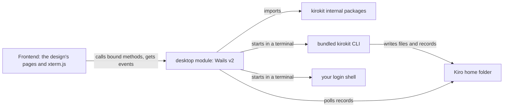
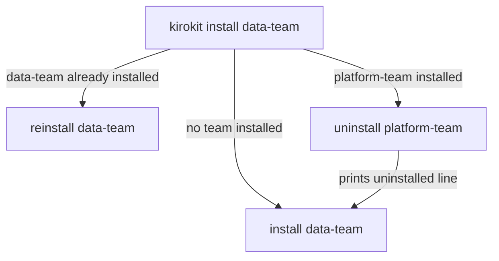
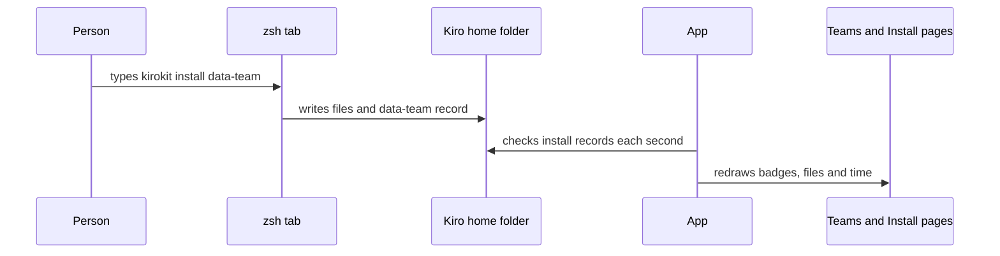
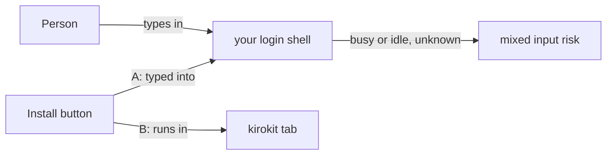
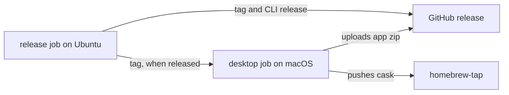

# The kirokit desktop app, built from the approved design

## Summary

First the CLI changes: `kirokit install` and `kirokit sync` keep one team installed, `KIROKIT_REPO` lets kirokit run from any folder, and `kirokit sync --latest-tag` without a team only updates the templates. Then the app is built as a Wails v2 module in `desktop/`, page by page from the design, with `task desktop:dev` and `task desktop:build`. Last, CI builds it on macOS, and each release attaches `kirokit-desktop_<version>_darwin_universal.zip` and updates a new `kirokit-desktop` cask.

## What the Plan rests on

- **Every command resolves repository folders from the working directory.** A Finder-launched app has none, so kirokit learns `KIROKIT_REPO`.
- **Install writes a per-team record of its files.** Those records are the install state every screen shows.
- **An existing test installs two teams side by side.** So the one-team rule lives in the commands, not the install library.
- **A Finder-launched app does not see the terminal PATH.** A login shell started from a bare environment still finds the tools, as the spike showed.
- **Release runs on Linux with CGO off.** The app needs a second release job on macOS.

## Interface

<!-- ql:design desktop-app-build -->
**Design: Desktop app build.** The real kirokit desktop app: first launch clone, real Settings with Update, terminal with action and shell tabs. Shown in QualityLayer, on the author's Mac only.
<!-- /ql:design -->

**What this shows.** The approved mockup with three changed surfaces: first launch, Settings with Update, and both terminal options of the Your call. The switches above the window select them.

## Engineering decisions

### The app is a separate Go module in `desktop/`, built with Wails v2

It reuses kirokit's own packages, and the root `go build ./...` leaves it out, so Linux CI stays as it is. Wails v3 was not chosen: it is still a beta.

**Lens:** architecture



<!-- ql:decide d1 -->
<!-- /ql:decide -->

### The one-team rule lives in the kirokit commands, not the install library

**Look here:** risky · this changes `kirokit install` and `kirokit sync` for every CLI user. Two scheduled syncs of different teams on one machine would now uninstall each other, so the README gets a migration note.

Before installing or syncing a team, both commands uninstall every other installed team and print a line for each. Putting the rule inside the install library was not chosen: it would hide a destructive step from its callers.

**Lens:** flow



<!-- ql:decide d2 -->
<!-- /ql:decide -->

### kirokit reads its folders from `KIROKIT_REPO` when it is set

The app sets it in its terminals, so a typed command works from any folder; unset, nothing changes. Prefixing commands with `cd` was not chosen: a typed command elsewhere would still fail.

<!-- ql:decide d3 -->
<!-- /ql:decide -->

### `kirokit sync --latest-tag` without a team only updates the templates

Update in Settings runs it when no team is installed, and `kirokit sync <team> --latest-tag` otherwise. A hidden git step in the app was not chosen: the terminal shows every command.

<!-- ql:decide d4 -->
<!-- /ql:decide -->

### The screens follow kirokit's install records, whoever changed them

The app checks the records every second and after each command, so typed commands update the screens too. A file-events library was not chosen: it adds a dependency for no gain.

**Lens:** sequence



<!-- ql:decide d5 -->
<!-- /ql:decide -->

### First launch clones in the kirokit tab, then checks out the newest release tag

A private repository's sign-in prompt appears there, and a failed clone keeps the address with the error beside it. A git library was not chosen: the machine's own git and credentials already work for kirokit.

<!-- ql:decide d6 -->
<!-- /ql:decide -->

### The app reads your login shell's environment once at start

The prerequisite checks and both terminal tabs use it, and "Check again" reads it afresh. If the read fails within five seconds, the app adds the Homebrew and local tool folders and says so in Settings.

<!-- ql:decide d7 -->
<!-- /ql:decide -->

### Buttons run their commands in their own kirokit tab, beside your shell

late: true

**A:** Buttons type their command into your own shell, as the approved mockup did. One terminal tab.
**B:** Buttons run in a kirokit tab, each command in its own fresh terminal. Your shell keeps its own zsh tab.
**Recommended:** B

This came up only in the spike: the app cannot tell from outside whether your shell is busy. With A, a button pressed while something runs there mixes into it, while B keeps each command whole. Both are drawn in the design.

**Lens:** architecture



<!-- ql:decide d8 -->
**Your call:** change asked · 17 Oct, 23:44: do B
<!-- /ql:decide -->

### A macOS release job adds the app and its cask after GoReleaser

**Look here:** risky · the release job pushes to your Homebrew tap and runs only on a real tagged release, so no check before merge exercises it end to end.

After a tagged release, a macOS job builds the app, attaches its zip and writes the `kirokit-desktop` cask to your tap, clearing the quarantine flag like the CLI cask. Building it inside GoReleaser was not chosen: that job runs on Linux with CGO off.

**Lens:** services



<!-- ql:decide d9 -->
<!-- /ql:decide -->

## Decided by you

<!-- ql:decided-by-you -->
- Discuss · Where does the app get the teams' templates from? — The app clones the repository itself
- Discuss · Should the app keep the design's one-installed-team rule? — Yes, also enforced in the CLI
- Discuss · How far should this task take building and shipping the app? — also attach to GH releases and a homebrew cask
- Discuss · Which operating systems must the first app run on? — macOS only
- Research · Which repository should the app clone by default? — Asked on first launch
- Research · Which templates should the app's Update action bring in? — The newest release tag
- Research · How should Homebrew offer the desktop app? — A separate kirokit-desktop cask
- Research · What should change before this ships? — where does kirokit clone per default on first setup? can this be configurable
- Research · Add a configurable clone folder to this task? — No: note as a follow-up
- Plan · Buttons run their commands in their own kirokit tab, beside your shell — B · Buttons run in a kirokit tab, each command in its own fresh terminal. Your shell keeps its own zsh tab.
<!-- /ql:decided-by-you -->

## Decisions made for you

- **The app is named kirokit, with bundle id `io.github.mavogel.kirokit`** — the design already says kirokit, and the cask name tells it apart from the CLI.
- **The app bundles its own kirokit CLI, first on its terminals' PATH** — typed commands match the app's version, with no separate install.
- **Its clone and settings live in `~/Library/Application Support/kirokit-desktop/`** — macOS's place for an app's own data.
- **A new repository address clones into a fresh folder and keeps the old one** — nothing is deleted without asking.
- **The frontend is plain JavaScript with Vite and xterm.js 6** — the design is already plain HTML.
- **Agents are read by rendering each team into a temporary folder** — their tools and servers exist only after rendering.
- **Last change is the install record's file time** — kirokit's record holds no time of its own.
- **Wails runs through `go run` at a pinned version, and the minimum macOS is 13** — nobody installs a Wails command, and Go 1.27 needs macOS 13.

## Not doing

- **No change to the install library's own behaviour.** The one-team rule stays in the commands.
- **No signing, notarization or Linux app.** The cask clears the quarantine flag instead.
- **No change to the existing `kirokit` cask or CLI archives.**

## Before the build

| # | Prerequisite | Met by | Status |
|---|---|---|---|
| P1 | Permission to run the agreed build | the user, at approval | granted · approved in the App, 2026-10-17 21:50 UTC |
| P2 | Wails v2.14.0 builds a universal app in a nested module here | spike, 2026-10-17 | met · [records/spike-wails-build.txt](records/spike-wails-build.txt) |
| P3 | Xcode Command Line Tools for CGO builds | present on this Mac | met · [records/spike-wails-build.txt](records/spike-wails-build.txt) |
| P4 | Tap token for the cask push | existing `HOMEBREW_TAP_GITHUB_TOKEN` secret, used by the CLI cask today | met · [records/research-r3-wbvey1e13a8d8.md](records/research-r3-wbvey1e13a8d8.md) |

## Assumptions

- The `HOMEBREW_TAP_GITHUB_TOKEN` token may also write a second cask file in the tap (unconfirmed)
- Your teams' repositories tag releases as `v*`, as kirokit's does; without one, the app falls back to the default branch (unconfirmed)

## How we will know it works

**Oracle:** The app runs with a temporary home and Kiro home folder. It clones this repository from a local path, installs platform-team through the setup dialog, and a typed `kirokit install data-team` in its zsh tab then replaces it on both pages. The files in that Kiro home then match, byte for byte, what a plain `kirokit install data-team` writes into the same folder after a `kirokit uninstall data-team`.

**Size:** about 7 slices and 24 tasks

**Risky:** new dependencies the app ships (Wails, creack/pty, xterm.js); a changed `kirokit install` and `kirokit sync`, which breaks anyone who syncs two teams on one machine; and a release job that pushes to the Homebrew tap.

## Reviewed by

<!-- ql:reviews -->
**Plan review · Sonnet 5.5 (no second vendor installed)** · asked for 8 changes · 8 findings: 8 taken, 0 kept.
- Plan, "Patterns to follow → Repository roots" and "`KIROKIT_REPO` roots every repository path". · Taken: Repository roots now list `onboard.go:17-20` and `skills.go:47,58`, each with a `KIROKIT_REPO` test; an explicit `sync --repo` wins and roots every path at it.
- Plan, "How we will know it works" (the oracle). · Taken: The oracle now compares the app's install with a plain `kirokit install data-team` into the same Kiro home after `kirokit uninstall data-team`, so the baked-in home path is identical.
- Plan, "Engineering decisions" (first-launch clone, sync) vs `sync.go:80-98`. · Taken: The app's Sync and Update always pass `--latest-tag` (its clone sits on a tag). A repository without a `v*` tag keeps the clone, shows a named message on first launch and works from the default branch.
- Plan, "The app bundles its own kirokit CLI, first on its terminals' PATH". · Taken: The zsh tab now starts through a `ZDOTDIR` wrapper that sources the person's own files and then puts the bundled CLI first and re-exports the app's settings; proven in `records/spike-zdotdir-wrapper.txt`, with a `command -v kirokit` test.
- Plan, "Settings" and "`KIROKIT_REPO` roots every repository path". · Taken: The contracts state that both terminals get `KIRO_HOME` from Settings, that Settings defaults to the captured `KIRO_HOME` else `~/.kiro`, and that once saved it wins over the shell's own value (re-exported by the wrapper).
- Plan, "A macOS release job adds the app and its cask" and "Risks". · Taken: The release contract now shows the `outputs:` block, `needs: release`, a `workflow_dispatch` dry run with the existing job gated to pushes, and a separate `desktop.yaml` CI workflow limited to pushes to main and pull requests touching Go or desktop paths.
- Plan, "The one-team rule…" and "Risky". · Taken: The Risky line and decision 2's Look-here name the two-scheduled-syncs case; the README gets a migration note, the commit carries `!`, and `sync`'s `Use`, `Long` and `--latest-tag` help are updated. The project keeps no CHANGELOG file; release notes come from commits.
- Plan, "Trust boundary" and "Engineering decisions". · Taken: Option A drops the kirokit tab, `Run`, `RunWrite` and the `term:kirokit` events.
<!-- /ql:reviews -->

## System design contracts

**Trust boundary:** other processes and two person-entered inputs. The app starts the person's login shell, git and the bundled kirokit.

- **Repository address.** It is passed to git as `git clone -- <address> <folder>`, never through a shell. It must match `https://…`, `ssh://…`, `git@host:path`, `file://…` or an absolute path, and must not start with `-`; anything else is refused beside the field. Its templates become agent configs in the Kiro home folder, which can start commands, exactly as when the person runs `kirokit install` on a clone they chose.
- **Kiro home folder.** It must be an absolute path and neither `/` nor the home folder itself; Save refuses others. Uninstall still removes only the paths kirokit's record lists.

### kirokit keeps one team installed and prints each removal

```
kirokit install <team>          for each other team with a record: Uninstall, print
                                  "uninstalled <other> from <kiroHome>"
                                then Install, print "installed <team> into <kiroHome>"
kirokit sync <team> [...]       same removals first, then today's sync output
```

New in `internal/install`:

```go
// Installed lists the teams with an install record under kiroHome, sorted by name.
func Installed(kiroHome string) ([]Record, error)
type Record struct { Team string; Files int; Modified time.Time }
// UninstallOthers uninstalls every installed team except keep and returns them in order.
func UninstallOthers(kiroHome, keep string) ([]string, error)
```

Invariants: reinstalling the installed team removes nothing. A failed uninstall stops before the install and returns the error. A missing `.kirokit-installed` folder means no team is installed. `install.Install` and its two-team test are unchanged.

### `KIROKIT_REPO` roots every repository path

```
root(rel) = filepath.Join($KIROKIT_REPO, rel)  when KIROKIT_REPO is set and non-empty
          = rel                                 otherwise (today)
```

It applies to `teams`, `global/steerings`, `env/mcp-versions.yaml` and `testdata/golden`, in every command: `render`, `test`, `update`, `install`, `sync`, `onboard` and `skills fetch`. A relative `KIROKIT_REPO` is made absolute once at start. `sync --repo` defaults to `KIROKIT_REPO`, else `.`. An explicit `--repo` wins: sync then roots every path at `--repo`, as it does today after its `cd`.

### `kirokit sync` without a team updates the checkout only

`Args` becomes `cobra.RangeArgs(0, 1)`. Without a team it prints `updated <before> -> <after>` when HEAD moved, then `checked out <tag or branch> at <after>`. It installs nothing and needs no Kiro home. The `--kb-*` flags without a team are an error: `kirokit sync: --kb-agent needs a team`. `Use`, `Long` and the `--latest-tag` help text describe the team-less form.

The app always passes `--latest-tag`, because its clone sits on a tag (a detached HEAD), where plain `sync` fails at `git pull`. A repository with no `v*` tag makes the first sync fail with today's `--latest-tag: no v* tag found after fetch`. The clone itself is kept. First launch then shows "This repository has no release yet (no v* tag). Ask your team lead to tag one." beside the field, and the app works from the default branch until a tag exists.

### The app's Go side binds one service and emits five events

```go
type App struct{ ... }                 // bound with options.App{Bind: []any{app}}
func (a *App) State() AppState         // settings, clone status, env status
func (a *App) Catalog() (Catalog, error)
func (a *App) Installs() ([]install.Record, error)
func (a *App) Prerequisites(team string) []Check
func (a *App) Clone(address string) error           // starts git clone + sync in the kirokit tab
func (a *App) Run(args []string) (int, error)       // kirokit args in the kirokit tab; returns run id
func (a *App) RunWrite(id int, data string)         // keystrokes to the running command (git sign-in)
func (a *App) ShellWrite(data string); func (a *App) ShellResize(cols, rows int)
func (a *App) SaveSettings(s Settings) error
```

| Event | Data | When |
|---|---|---|
| `term:kirokit` | `{id, b64}` | output of a button command |
| `term:kirokit:exit` | `{id, code}` | a button command ended |
| `term:shell` | `{b64}` | output of the zsh tab |
| `installs:changed` | `[]Record` | records differ from the last check |
| `clone:done` | `{ok, error}` | clone and first sync finished |

`Installs` and `Prerequisites` read the Kiro home folder from Settings. Its default is the captured `KIRO_HOME`, else `~/.kiro`. Once saved, Settings wins over the shell's own `KIRO_HOME`.

`Run` refuses a second command while one runs, with the error "kirokit is still running a command". Each run starts a fresh pseudo-terminal with the bundled `kirokit` by absolute path, and the kirokit tab prints `▸ kirokit <args>` before the output. `RunWrite(id, data)` forwards keystrokes to the running command, so a git sign-in prompt is answered in the kirokit tab. Its input is live only while a command runs.

`Catalog()` renders the teams once at start, after a clone, and after each `sync` ends; other calls return the cached result. Option A of the Your call drops the kirokit tab, `Run`, `RunWrite` and the `term:kirokit` events. Buttons then write `kirokit <args>\r` to the shell terminal.

### The zsh tab starts through a wrapper that keeps the app's settings last

The shell tab runs `$SHELL -il` with `ZDOTDIR` set to a wrapper folder in the app's data folder. Each wrapper file sources the person's own file of the same name. The wrapper `.zshrc` then puts the bundled CLI's folder first on `path` and exports `KIROKIT_REPO=<app folder>/repo` and `KIRO_HOME=<Settings>`, so the person's own startup files cannot override them. Proven in `records/spike-zdotdir-wrapper.txt`. For a shell other than zsh, the app sets the same variables in the environment it starts the shell with, and Settings says the bundled CLI may not come first. Test: `command -v kirokit` in the shell tab prints the bundled path.

### Data shapes the pages render

```go
type Catalog struct { Teams []Team; Pins map[string]string; Tag string }
type Team struct { Name string; Agents []Agent; Skills []Skill; Prompts int; Steerings []string }
type Agent struct { Name, Description string; Tools, Servers []string; NeedsKey bool }
type Skill struct { Name, Source string }   // Source: "Written by the team" or "<source> @ <ref>"
type Check struct { Name string; Found bool; Detail string }
type Settings struct { RepoURL, KiroHome string }  // settings.json beside repo/
```

`NeedsKey` is true when the agent has `env/secrets.enc.yaml`. A render error shows on the page with its message instead of the table.

### Prerequisites come from the captured login environment

| Check | Found when |
|---|---|
| SOPS | `sops` resolves on the captured PATH |
| Decryption key | `$SOPS_AGE_KEY_FILE` exists, else `$XDG_CONFIG_HOME/sops/age/keys.txt`, else `~/Library/Application Support/sops/age/keys.txt` |
| Kiro CLI | `kiro-cli` resolves on the captured PATH |

The capture runs `$SHELL -ilc` printing a marker then `env -0`, reads after the marker, and gives up after five seconds. Install stays disabled while one check fails, and the dialog's status names the count.

### The app bundle and release artifacts

```
kirokit.app/Contents/MacOS/kirokit              Wails binary, universal
kirokit.app/Contents/Resources/bin/kirokit      CLI, universal, version ldflags as GoReleaser's
kirokit-desktop_<version>_darwin_universal.zip  ditto -c -k --keepParent
Casks/kirokit-desktop.rb                         version, sha256, url, app "kirokit.app",
                                                 postflight xattr -dr com.apple.quarantine
```

`.github/workflows/release.yaml` changes:

```yaml
on:
  push: { branches: [main] }
  workflow_dispatch: { inputs: { dry_run: { type: boolean, default: true } } }
jobs:
  release:                       # unchanged steps; runs on push only
    if: github.event_name == 'push'
    outputs: { release: "${{ steps.version.outputs.release }}", tag: "${{ steps.version.outputs.tag }}" }
  desktop:
    needs: release
    if: always() && (needs.release.outputs.release == 'true' || github.event_name == 'workflow_dispatch')
    runs-on: macos-latest
```

On a push it builds at the new tag, uploads with `gh release upload <tag>`, and pushes the cask with the tap token, using the commit message `kirokit-desktop <version>`. On a dispatch it builds at `HEAD`, zips the app and prints the cask without uploading or pushing.

`.github/workflows/desktop.yaml` is a new workflow on `macos-latest`. It runs on pushes to `main` and on pull requests that touch `desktop/**`, `cmd/**`, `internal/**`, `go.mod`, `go.sum` or `Taskfile.yml`, so other pull requests do not pay for a universal build.

## Patterns to follow

- **Command shape.** Copy `cmd/kirokit/commands/install.go:10-45`: parse flags, resolve the Kiro home, build `install.Roots`, call the package, then print one line with `fmt.Fprintf(cmd.OutOrStdout(), ...)`. Errors are wrapped as `kirokit <command>: %w`.
- **Repository roots.** Replace the constants at `cmd/kirokit/commands/root.go:14-19` with a function that applies `KIROKIT_REPO`. Every user of them goes through it: `cmd/kirokit/commands/install.go:29-33`, `cmd/kirokit/commands/sync.go:56-60`, `cmd/kirokit/commands/test.go:26-29`, `cmd/kirokit/commands/update.go:26-29`, `cmd/kirokit/commands/render.go:34`, `cmd/kirokit/commands/onboard.go:17-20`, `cmd/kirokit/commands/skills.go:47`, `cmd/kirokit/commands/skills.go:58` and `cmd/kirokit/commands/root.go:51`. Each gets a test with `KIROKIT_REPO` set from another working directory.
- **Install tests.** Extend `internal/install/install_test.go` with `setupFixture(t)` and temp Kiro homes, as `TestUninstall_RemovesExactlyWhatInstallWroteAndNothingElse` at `internal/install/install_test.go:74` does.
- **Agent data and secrets.** An agent is `teams/<team>/agents/<agent>/agent.json.tmpl` with `name`, `description`, `tools` and `mcpServers` (`teams/platform-team/agents/devops/agent.json.tmpl:2-5`, `teams/platform-team/agents/devops/agent.json.tmpl:21`); it needs the key when `teams/<team>/agents/<agent>/env/secrets.enc.yaml` exists (`internal/install/install.go:325-353`). Command tests follow `cmd/kirokit/commands/sync_test.go:27-30`: a temp git repository, with the directory restored in cleanup.
- **Design tokens and markup.** Port `design/desktop-app-build.html` in this task's folder: the `:root` tokens, the layout grid, the page sections, both dialogs and the shortcut handler. Its simulated `run` becomes calls to the bound methods.
- **Pseudo-terminal.** Follow the spike in `records/spike-pty-shell.txt`: `pty.StartWithSize`, a read loop that ends on EOF, `pty.Setsize` on resize, and `cmd.Wait` to reap.
- **How it is tested.** Go unit tests cover the CLI changes, the catalog (against this repository's `teams/`), prerequisites (fake PATH folders and a fake key file), environment capture (a fake shell script) and settings. The terminal package is tested with `/bin/sh`. The rendered app is driven in a browser through `wails dev` at `http://localhost:34115`, with Chrome DevTools, using a temporary `HOME` and `KIRO_HOME`.
- **How to start it.** `task desktop:dev` runs `cd desktop && go run github.com/wailsapp/wails/v2/cmd/wails@v2.14.0 dev`. `task desktop:build` builds `desktop/build/bin/kirokit.app` with the CLI inside.
- **Docs.** `README.md` gets the desktop app, `KIROKIT_REPO`, team-less sync and the one-team rule, with a migration note: one machine now holds one team, so a second scheduled sync from `scripts/kirokit-sync-setup.sh` replaces the first. The commit carries `!` so the release notes flag it. `AGENTS.md` names `desktop/` in its layout list.
- **Build order.** `desktop/main.go` embeds `all:frontend/dist`, which is git-ignored, so the frontend is built before `go vet` or `go test` in `desktop/`. `task desktop:test` does both, and the Project checks below keep that order. npm with a committed `package-lock.json` is Wails' default; the repository has no other JavaScript toolchain.
- **CI.** The new `.github/workflows/desktop.yaml` runs `task desktop:test` and `task desktop:build`. The release's desktop job runs only on a tagged release or a manual dry run.

**Project checks:** `go test ./...` · `go vet ./...` · `golangci-lint run` · `go build ./...` · `node scripts/sync-agent-assets.mjs --check` · `cd desktop/frontend && npm ci && npm run build` · `cd desktop && go vet ./... && go test ./...` · `task desktop:build`

## Proven before the gate

| Depends on | Proven how | Result |
|---|---|---|
| A nested module importing kirokit's internal packages | scratch root module plus `desktop/` module with a `replace` | builds and runs; root `go build ./...` excludes it · [records/spike-nested-module.txt](records/spike-nested-module.txt) |
| Wails v2.14.0 on Go 1.27 | `wails init` and `wails build -platform darwin/universal` in a nested module | `.app` built, binary is `x86_64 arm64` · [records/spike-wails-build.txt](records/spike-wails-build.txt) |
| creack/pty v1.1.24 running zsh | start, stream, resize, exit | output, resize and exit all work; busy detection fails · [records/spike-pty-shell.txt](records/spike-pty-shell.txt) |
| Login-shell environment from a Finder-like start | `env -i … zsh -ilc env` | finds `sops`, `kiro-cli` and `git` in 0.19 s · [records/spike-login-env.txt](records/spike-login-env.txt) |
| The zsh tab's wrapper keeps the bundled CLI and app settings last | `ZDOTDIR` wrapper sourcing the person's own files, then prepending | bundled `kirokit` first, `KIRO_HOME` overridden, Homebrew still on PATH · [records/spike-zdotdir-wrapper.txt](records/spike-zdotdir-wrapper.txt) |

Not proven here: xterm.js inside the Wails webview, and the macOS release runner. The first is the terminal slice's first task. The second runs only on a real release.

## Risks

- **The cask push fails on the first real release.** Mitigation: a manual dry run of the release workflow builds, zips and prints the cask without pushing; the build runs it once and records the output.
- **A slow login shell delays the app's start.** Mitigation: the capture has a five-second limit, the window opens before it finishes, and a test uses a fake shell that sleeps past the limit.
