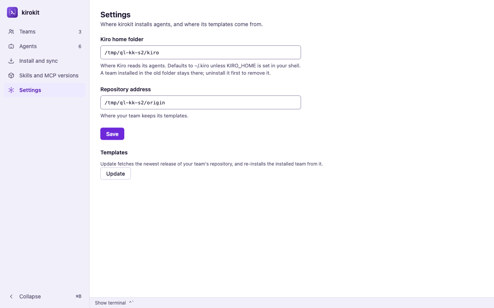
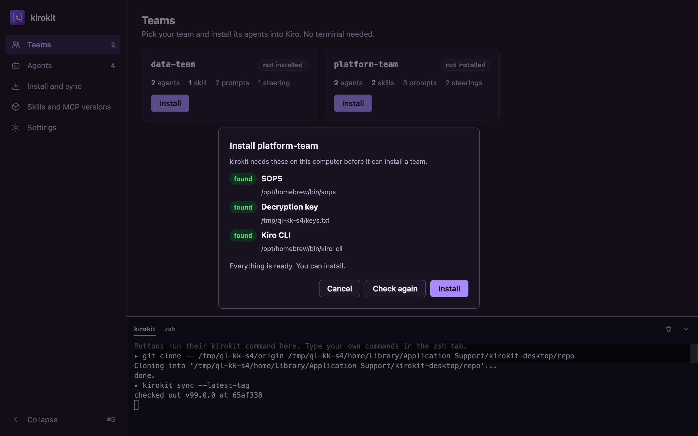
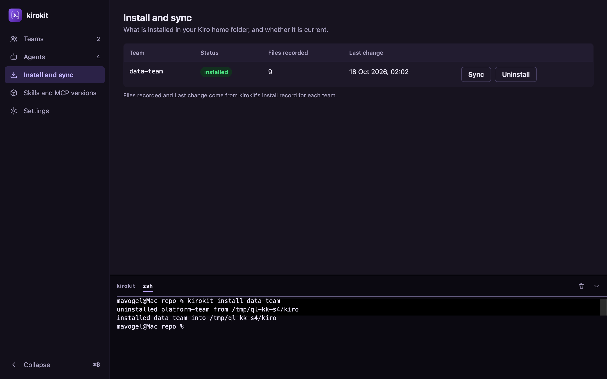

# Desktop app from design · what was checked

## Summary

<!-- ql:summary -->
Round 3: checking after 1 fix round.
<!-- /ql:summary -->

## How it is checked

<!-- ql:lanes -->
- **Polish** · a fresh agent · Sonnet 5.5
  - State: done
  - Result: done · 1 comment-only simplification (8ebce7f) · 0 tests added · docs: no further change needed · 2 screens compared: 2 captured, 0 stale, 0 not captured
- **Security review** · a fresh agent · read-only
  - State: done
  - Result: done · nothing severe in the change · read Polish's 4 commits once more: nothing new (the git environment helper moved unchanged to `externalskills.WithoutRepoGitEnv` and `sync.go` calls it; the rest is tests and one AGENTS.md line; no new path from outside input to a file, command, query or response)
  - Why it runs here: The change crosses a trust boundary: other processes and two person-entered inputs. The app starts the person's login shell, git and the bundled kirokit..
- **Second opinion** · Codex · GPT-6.1 Sol · another vendor
  - State: fail
  - Result: did not finish
  - Why it runs here: Runs because the change crosses a trust boundary (other processes and two person-entered inputs. The app starts the person's login shell, git and the bundled kirokit.), the Plan says it is risky: new dependencies the app ships (Wails, creack/pty, xterm.js); a changed `kirokit install` and `kirokit sync`, which breaks anyone who syncs two teams on one machine; and a release job that pushes to the Homebrew tap and slice 1, 2, 4 and 7 is marked risky.
- **Project checks** · QualityLayer itself · no agent
  - State: done
  - Result: 8 checks pass · 8 reused
- **Independent review** · fresh helper
  - State: fail
  - Result: 0 of 13 points failed
- **Fix rounds** · one fresh fixer per round
  - State: running
  - Result: 1 round
<!-- /ql:lanes -->

## Done means, checked

<!-- ql:proof -->
| Done means | Proof | |
|---|---|---|
| 1. The kirokit desktop app opens a window that matches the design |  | yours to confirm |
| 2. The sidebar collapses to an icon rail and expands again | Carried from iteration 2; the fix touches only the Settings clone path, and scenario 2 re-ran the toggle and Command-B (232 -> 60 -> 232 px). | passed |
| 3. Teams, Agents, and Skills and MCP versions show the repository's real data | Carried from iteration 2; the fix leaves the catalog alone, and scenario 3 re-ran teams, agents and pins. | passed |
| 4. A non-engineer installs a team with buttons only |  | passed |
| 5. Install writes the same files as `kirokit install` | Carried from iteration 2; no install path changed, and steps 9a and 13 gave `diff -r` exit 0 again. | passed |
| 6. Install and sync shows the real install state | Carried from iteration 2; the Install and sync page is unchanged by the fix. | passed |
| 7. A real terminal docks at the bottom, as in VS Code | Carried from iteration 2; the dock code is unchanged by the fix. | passed |
| 8. Each button press appears in the terminal as its `kirokit` command | Carried from iteration 2; the runner and its headers are unchanged. | passed |
| 9. A command typed in the terminal updates the screens |  | passed |
| 10. Settings sets the Kiro home folder and the repository's address | Carried from iteration 2; scenario 2 re-ran it at this commit: both values came back after a restart, and a new address is now stored only once its clone succeeds,. | passed |
| 11. Only one team is ever installed at a time, in the app and the CLI | Carried from iteration 2; the CLI is unchanged, and scenario 1 and scenario 4 steps 9-11 re-ran green. | passed |
| 12. One command builds the macOS app, and CI builds it too | Carried from iteration 2; the build script and CI workflow are unchanged, and scenario 5 re-ran green. | passed |
| 13. The kirokit command line keeps working, apart from the one-team rule | Carried from iteration 2; no CLI or golden file changed, and `go test ./...` exit 0 again. | passed |
| 14. The app fetches the templates itself, with no git knowledge needed | Carried from iteration 2; first launch and Update are unchanged apart from when the address is stored, and scenario 4 steps 4 and 15 re-ran them. | passed |
| 15. Every kirokit release also ships the macOS app | Cut a real tagged release and check that the GitHub release carries `kirokit-desktop_<version>_darwin_universal.zip`; I saw only the local dry run and the workflow's `desktop` job wiring. | yours to confirm |
| 16. A separate `kirokit-desktop` Homebrew cask installs the app, and it opens | After a release, run `brew install --cask mavogel/tap/kirokit-desktop` and open the app; I could not reach the tap. The dry-run zip again has 0 `._*` entries. | yours to confirm |
<!-- /ql:proof -->

## Open items

<!-- ql:open-items -->
- **Found while checking:** When the address clone fails, the Kiro home saved in the same Save gets no confirmation. The status line is emptied and only the address error shows, so a person who changed both fields cannot tell the Kiro home was saved.
- **Found while checking:** A settings write failure after a good clone reports failure while the new clone is in use. `Clone` then emits `ok:false` with the new `repo/` in place and the old address stored, so a retry renames the working clone again; untested fault path (`desktop/clone.go`).
- **Only you can confirm:** The cask lands in your tap.
- **Only you can confirm:** A real tagged release publishes it.
- **Only you can confirm:** It looks like the approved design.
<!-- /ql:open-items -->

## Quality pass

### Polish

**Result:** done · 1 comment-only simplification (8ebce7f) · 0 tests added · docs: no further change needed
- desktop-app-build: the manifest holds two captures (1200 wide, light and dark), but they show only the app shell, because the capture tool's browser gets no data from the Wails backend and the tool cannot click to Agents, Install, Skills, Settings, the dock or first launch. The shell (sidebar, heading, "Show terminal" bar) matches the mockup's structure. The full screens were compared by eye in a normal Chrome tab against `task desktop:dev` (see the real pictures below). Two things to look at: the terminal area inside the open dock is only about three lines tall in the browser (no pty there), and the Update button sits tight under its sentence.
- Settings, repository address (live, Chrome DevTools against `task desktop:dev`): after saving a missing address the page shows "git clone failed (exit 128)…" beside the address field, the field is marked invalid and the status line is empty; after a good address the status reads "Cloned. The new repository is in use." and no field error remains.
**Pictures:**
- `evidence/screen-90c555549832049b9c838f77.png` — recorded capture of desktop-app-build (waited for `#app`, recaptured at HEAD 0074301, seeded HOME /tmp/ql-kk-polish5/home): the app shell at 1200 wide, light: sidebar, heading, "Show terminal" bar, empty Teams grid (the tool's browser gets no data from the Wails backend); not a full Teams screen
- `evidence/screen-ad4a6efee4437ebfbb4ae63f.png` — recorded capture of desktop-app-build, same shell at 1200 wide, dark, empty grid; not a full Teams screen
- desktop-app-build (real pictures through Chrome DevTools at http://localhost:34115 in `task desktop:dev`, 1200 wide, light and dark, not recorded in `records/screens.json`): Teams, Agents, Install and sync, Skills and MCP versions, and Settings with the open dock all render with data and match the mockup's structure (sidebar with counts, five sections, Collapse bar, dock with kirokit and zsh tabs). Same two things as before to look at: the dock's terminal area is only a few lines tall in the browser (no pty there), and the Update button sits tight under its sentence. First launch and widths other than 1200 not compared.
- Settings probe (live, repository address): with a clone of origin A (v99.0.0: data-team, platform-team) in place, Settings saved `/tmp/ql-kk-polish2/origin2` (origin B, v100.0.0: ops-team, platform-team). Within 6 s the app folder held a fresh `repo/` whose `origin` is origin B at v100.0.0, the old clone kept aside as `repo.old-<time>/`, and `settings.json` held the new address. The Teams page then listed ops-team and platform-team (data-team gone). Passes; this is the fix from 65af338 and answers criterion 10.
**Pictures:**
- `evidence/polish2-teams-dark-1200.png` — Teams, 1200 wide, dark
- `evidence/polish2-agents-dark-1200.png` — Agents, 1200 wide, dark
- `evidence/polish2-install-dark-1200.png` — Install and sync, 1200 wide, dark
- `evidence/polish2-skills-mcp-dark-1200.png` — Skills and MCP versions, 1200 wide, dark
- `evidence/polish2-settings-dock-dark-1200.png` — Settings with the dock open, 1200 wide, dark
- `evidence/polish2-teams-light-1200.png` — Teams, 1200 wide, light
- `evidence/polish2-agents-light-1200.png` — Agents, 1200 wide, light
- `evidence/polish2-install-light-1200.png` — Install and sync, 1200 wide, light
- `evidence/polish2-skills-mcp-light-1200.png` — Skills and MCP versions, 1200 wide, light
- `evidence/polish2-settings-dock-light-1200.png` — Settings with the dock open, 1200 wide, light
- `evidence/polish2-settings-newaddress-light-1200.png` — Settings after saving the new address, 1200 wide, light
- `evidence/polish2-teams-neworigin-light-1200.png` — Teams after the new address was cloned (ops-team, platform-team), 1200 wide, light
- `evidence/polish4-settings-clone-failed.png` — Settings after saving a missing address: "git clone failed (exit 128)…" beside the address field, field marked invalid, status empty (Chrome DevTools, `task desktop:dev`)
- `evidence/polish4-settings-clone-ok.png` — Settings after a good address: status "Cloned. The new repository is in use.", no field error (Chrome DevTools, `task desktop:dev`)
**Left alone:** nothing further. The latest commits (7f82ec4, 8ebce7f) were reviewed; the only finding was a comment-only rewrap in `desktop/frontend/src/pages/settings.js`, committed as 8ebce7f. Re-confirmed at HEAD 0074301: the block, the desktop-app-build capture and the Pictures list still hold.
**Not checked:** the Settings states are not in `records/screens.json` because the capture tool cannot click to Settings; the Settings screenshots were not compared with the mockup beyond reading the DOM; the `writeSettings` failure branch after a successful clone has no test (it needs fault injection); the full suite was not run in this pass.

### Security

**Result:** done · nothing severe in the change
**Boundaries:** person-entered repository address and Kiro home (Settings, Clone) to git and the file system; the app to the login shell, git and the bundled kirokit (pseudo-terminal child processes); repository content (teams, agent descriptions) to the page; the release workflow and cask.
**Not checked:** the full frontend page code for every escaped field (spot-checked: views build HTML through `esc`), and the third-party Wails and pty libraries.

### Security re-check

**Result:** done · no findings to re-check · nothing new since 72e379a
- since 72e379a: nothing new (the git environment helper moved unchanged to `externalskills.WithoutRepoGitEnv` and `sync.go` calls it; the rest is tests and one AGENTS.md line; no new path from outside input to a file, command, query or response)

## Checks

<!-- ql:checks -->
- all · 85e150dc917da569a178383b1cbc9eca90d60e4a104ff970557f8084f8fef8c2 · `go test ./...` · exit 0 · 0s · reused
- all · 85e150dc917da569a178383b1cbc9eca90d60e4a104ff970557f8084f8fef8c2 · `go vet ./...` · exit 0 · 0s · reused
- all · 85e150dc917da569a178383b1cbc9eca90d60e4a104ff970557f8084f8fef8c2 · `golangci-lint run` · exit 0 · 0s · reused
- all · 85e150dc917da569a178383b1cbc9eca90d60e4a104ff970557f8084f8fef8c2 · `go build ./...` · exit 0 · 0s · reused
- all · 85e150dc917da569a178383b1cbc9eca90d60e4a104ff970557f8084f8fef8c2 · `node scripts/sync-agent-assets.mjs --check` · exit 0 · 0s · reused
- all · 85e150dc917da569a178383b1cbc9eca90d60e4a104ff970557f8084f8fef8c2 · `cd desktop/frontend && npm ci && npm run build` · exit 0 · 0s · reused
- all · 85e150dc917da569a178383b1cbc9eca90d60e4a104ff970557f8084f8fef8c2 · `cd desktop && go vet ./... && go test ./...` · exit 0 · 0s · reused
- all · 85e150dc917da569a178383b1cbc9eca90d60e4a104ff970557f8084f8fef8c2 · `task desktop:build` · exit 0 · 0s · reused
<!-- /ql:checks -->

## Fix rounds

<!-- ql:fix-rounds -->
None so far.
<!-- /ql:fix-rounds -->

## Second opinion

<!-- ql:reviews -->
**The second opinion on the change could not run:** Codex stopped with an error (tried twice).
<!-- /ql:reviews -->

<!-- optional section here, only when there is content: "Independent review" -->

## Verification

### Iteration 1

**Revision:** 6d332c627b495d8f29cd4656a471d755dd1ca6d5c11827d7d7bfad0a6c382a08

**Assignment:** e107b196-a659-4868-a843-d0f0a0d541c1
**Judge:** fresh helper

- [PASS] check: recorded — all · 5ebc94b · `go test ./...` · exit 0 · 0.6s
- [PASS] check: recorded — all · 5ebc94b · `go vet ./...` · exit 0 · 0.1s
- [PASS] check: recorded — all · 5ebc94b · `golangci-lint run` · exit 0 · 0.6s
- [PASS] check: recorded — all · 5ebc94b · `go build ./...` · exit 0 · 0.3s
- [PASS] check: recorded — all · 5ebc94b · `node scripts/sync-agent-assets.mjs --check` · exit 0 · 0.1s
- [PASS] check: recorded — all · 5ebc94b · `cd desktop/frontend && npm ci && npm run build` · exit 0 · 1.9s
- [PASS] check: recorded — all · 5ebc94b · `cd desktop && go vet ./... && go test ./...` · exit 0 · 6.3s
- [PASS] check: recorded — all · 5ebc94b · `task desktop:build` · exit 0 · 5.7s
- [USER] done 1: open the app and compare it with the approved sidebar-layout design in light and dark; I saw the logo, five sections, main pane and dock in both themes, but the likeness is yours to judge — `evidence/it1-scenario-2-light.png`, `evidence/it1-scenario-2-rail.png`
- [PASS] done 2: the toggle took the sidebar 60 -> 232 -> 60 px (main 1220 -> 1048 -> 1220 px), Command-B twice did the same, Control-B and plain B did nothing — `evidence/it1-scenario-2.txt`
- [PASS] done 3: Teams, Agents and Skills and MCP versions showed the clone's two teams, four agents with tools and the seven pins of `env/mcp-versions.yaml`; after Update the new qa-team appeared with no app change — `evidence/it1-scenario-3.txt`, `evidence/it1-scenario-4-step-15.png`
- [PASS] done 4: Install on platform-team opened the setup dialog with SOPS, Decryption key and Kiro CLI found ("Everything is ready"), Install ran and Teams marked platform-team installed — `evidence/it1-scenario-4-step-6.png`, `evidence/it1-scenario-4-step-7.png`
- [PASS] done 5: after the app's installs, a plain CLI uninstall and reinstall into the same Kiro home gave `diff -r` exit 0 for data-team and for platform-team after Sync, with no leftover files — `evidence/it1-oracle.txt`
- [PASS] done 6: Install and sync listed the installed team with its file count (13, 9), last change, and working Sync and Uninstall buttons; typed changes redrew it — `evidence/it1-scenario-4-step-12.png`
- [PASS] done 7: the dock opened, closed, and resized by dragging (220 -> 370 -> 270 px, main pane shrank), the zsh tab ran the login shell and `stty size` printed 12 130, matching xterm's 12 rows — `evidence/it1-scenario-3.txt`
- [PASS] done 8: the kirokit tab showed `▸ kirokit install platform-team` then `installed platform-team into /tmp/ql-kk-s4/kiro`, and the same for replace, sync, uninstall and Update — `evidence/it1-scenario-4-step-12.png`
- [PASS] done 9: `kirokit install data-team` typed in the zsh tab printed both lines and marked data-team installed on Teams and Install and sync — `evidence/it1-scenario-4-step-9.png`
- [FAIL] done 10: A repository address saved in Settings is remembered but the app never uses it. Kiro home works (refuses `/`, saves, survives a restart, `evidence/it1-scenario-2.txt`). But saving `/tmp/ql-kk-s4/origin2` showed "Saved on this computer", ran nothing, and Update kept syncing the old clone (remote still `/tmp/ql-kk-s4/origin`, no ops-team). `settings.js` Save only calls `SaveSettings`; `Clone` is reachable only from the first-launch page, which hides once a clone exists — `evidence/it1-probe-new-address.txt`, `evidence/it1-probe-new-address.png`
- [PASS] done 11: the CLI printed `uninstalled platform-team …` then `installed data-team …` and kept only `data-team.json`; the app's replace dialog named both teams, Cancel ran nothing, and Replace printed both lines — `evidence/it1-scenario-1.txt`, `evidence/it1-scenario-4-step-10.png`
- [PASS] done 12: `task desktop:build` built a universal `kirokit.app` (main binary and bundled CLI `x86_64 arm64`); `.github/workflows/desktop.yaml` runs `task desktop:test` and `task desktop:build` on macos-latest for pushes to main and matching pull requests — `evidence/it1-scenario-5.txt`
- [PASS] done 13: `go test ./...` exit 0 at the judged commit, CLI scenario 1 passed, and the README states the one-team rule with a migration note — `evidence/it1-scenario-1.txt`
- [PASS] done 14: first launch asked for the address, ran `▸ git clone -- …` and `▸ kirokit sync --latest-tag` (`checked out v99.0.0`) in the kirokit tab; Update ran `▸ kirokit sync --latest-tag` and checked out v99.2.0 — `evidence/it1-scenario-4-step-4.png`, `evidence/it1-scenario-4-step-15.png`
- [USER] done 15: cut a real tagged release and check that the GitHub release carries `kirokit-desktop_<version>_darwin_universal.zip`; I saw only the local dry run and the workflow's `desktop` job wiring
- [USER] done 16: after a release, run `brew install --cask mavogel/tap/kirokit-desktop` and open the app; I could not reach the tap. See the zip note below: an app extracted with plain `unzip` fails `codesign --verify`
- [PASS] scenario 1: all 10 steps as expected at the judged commit; probe: an empty `KIROKIT_REPO` behaves as unset — `evidence/it1-scenario-1.txt`
- [FAIL] scenario 2: Step 2 shows the first-launch page, not the sidebar, for an empty home folder. The scenario predates T18, which hides the pages until a clone exists, and was not amended. After a clone from the first-launch page, steps 3-8 all showed their Expected (rail, Command-B, dark tokens, `/` refused, values kept across a restart) — `evidence/it1-scenario-2.txt`, `evidence/it1-scenario-2-step-2.png`
- [PASS] scenario 3: all steps including 4a: real teams, agents and pins; the dock resized; `command -v kirokit` printed the bundled path; `stty size` matched; typed install and uninstall redrew both pages; output survived hide and show — `evidence/it1-scenario-3.txt`, `evidence/it1-scenario-3-step-5.png`
- [PASS] scenario 4: all 15 steps, 9a and 13 included (`diff -r` exit 0 twice); probe: `-oops` refused beside the field with no process started — `evidence/it1-oracle.txt`, `evidence/it1-scenario-4-step-3.png`
- [PASS] scenario 5: build exit 0, both binaries `x86_64 arm64`, bundled `kirokit version` prints the commit, `macos-latest`, root `go build ./...` exit 0 — `evidence/it1-scenario-5.txt`
- [PASS] scenario 6: the release test passed; the dry run named the zip, its sha256 and `Casks/kirokit-desktop.rb` and said nothing was uploaded or pushed; the zip's top level is `kirokit.app/`; `desktop` needs `release`; probe: a missing `--version` exits 1 with usage — `evidence/it1-scenario-6.txt`
- [PASS] dod T1: render from `/` with `KIROKIT_REPO` works, an empty value changes nothing, an explicit `--repo` wins (scenario 1 step 8); recorded T1 tests exit 0 — `evidence/it1-scenario-1.txt`
- [PASS] dod T2: `Installed` and `UninstallOthers` match the contract in `internal/install/installed.go`; the records poller and CLI used them live; recorded `go test ./internal/install/` exit 0 — `evidence/it1-scenario-1.txt`
- [PASS] dod T3: replace prints both lines and leaves one record; a reinstall prints only `installed`; the unknown-team guard runs `install.Check` before any removal — `evidence/it1-scenario-1.txt`
- [PASS] dod T4: team-less `sync --latest-tag` printed `updated …` and `checked out v0.2.0 at …` and installed nothing; `--kb-agent` without a team fails with the contracted message; help text updated — `evidence/it1-scenario-1.txt`
- [PASS] dod T5: README covers replace-on-install, the migration note pointing at `scripts/kirokit-sync-setup.sh`, `KIROKIT_REPO` and team-less sync — `evidence/it1-scenario-1.txt`
- [PASS] dod T6: separate module with `replace`, bundle id `io.github.mavogel.kirokit` and minimum macOS 13 in the built Info.plist, root build ignores `desktop/`, Taskfile entries present — `evidence/it1-scenario-5.txt`
- [PASS] dod T7: toggle and Command-B collapse and expand, plain B and Control-B do nothing, `aria-current="page"` on the active section, dark tokens follow the scheme, logo shown — `evidence/it1-scenario-2.txt`
- [PASS] dod T8: values survive a restart; `/` refused beside the field with nothing saved; `-oops` refused by the same address pattern — `evidence/it1-scenario-2.txt`
- [PASS] dod T9: the setup dialog read SOPS and Kiro CLI from the captured PATH (`/opt/homebrew/bin`) and the key from `$SOPS_AGE_KEY_FILE`; the window opened before the capture; recorded Capture/Prereq tests exit 0 — `evidence/it1-scenario-4-step-6.png`
- [PASS] dod T10: both teams with agents, descriptions, tools, servers and "needs key" for the three agents with secrets; skill sources and pins shown; the catalog re-rendered after Update — `evidence/it1-scenario-3.txt`
- [PASS] dod T11: typed installs and uninstalls reached both pages within the poll; a Settings Kiro home change took effect on the next install — `evidence/it1-scenario-3.txt`
- [PASS] dod T12: Teams badge and last change, Install page file counts, no team names in page code — `evidence/it1-scenario-3.txt`
- [PASS] dod T13: the dock opens, closes, resizes within 120-480 px, two tabs keep their output, the terminal refits (12 rows after resize) — `evidence/it1-scenario-3.txt`
- [PASS] dod T14: the terminal package streamed, resized (`stty size`) and reaped live; recorded race tests exit 0 — `evidence/it1-scenario-3.txt`
- [PASS] dod T15: `command -v kirokit` printed the bundled path, `KIRO_HOME` from Settings reached typed commands (`installed … into /tmp/ql-kk-s3/kiro`) — `evidence/it1-scenario-3.txt`
- [PASS] dod T16: `▸ kirokit …` header then real output, `▸ git clone …` header for git, one-command lock (button disabled while running), recorded runner race tests exit 0 — `evidence/it1-scenario-4-step-4.png`
- [PASS] dod T17: a local path cloned and checked out the newest `v*` tag; `-oops` refused before any process; `git clone -- <address> <folder>`; rename-and-restore covered by recorded Clone tests exit 0 (its missing Settings trigger is under done 10) — `evidence/it1-scenario-4-step-4.png`
- [PASS] dod T18: pages hidden until a clone exists, field prefilled, refused address kept with its error beside it, Teams after success — `evidence/it1-scenario-4-step-3.png`
- [PASS] dod T19: Install enabled only with all checks found, replace dialog names both teams, Cancel runs nothing, Replace prints both lines — `evidence/it1-scenario-4-step-10.png`
- [PASS] dod T20: Sync ran `sync platform-team --latest-tag`, Uninstall ran `uninstall platform-team`, Update ran team-less `sync --latest-tag` with no team installed, and the next catalog showed qa-team — `evidence/it1-scenario-4-step-15.png`
- [PASS] dod T21: universal app and bundled CLI, `kirokit version` prints version, commit and date from ldflags, `desktop:dev` builds dev-bin first — `evidence/it1-scenario-5.txt`
- [PASS] dod T22: `desktop.yaml` on macos-latest runs `task desktop:test` and `task desktop:build`, same pinned action hashes, the planned path filter — `evidence/it1-scenario-5.txt`
- [PASS] dod T23: zip name and top level, cask fields, `--publish`-only upload and push, the dry-run message, a missing version exits 1 — `evidence/it1-scenario-6.txt`
- [PASS] dod T24: `release` push-only with `release`/`tag` outputs, `desktop` needs it and runs on a release or dispatch, the publish step passes the tag (the script strips `v`), README and AGENTS.md updated — `evidence/it1-scenario-6.txt`
- [PASS] truth oracle: the app cloned a local origin, installed platform-team through the setup dialog, a typed `kirokit install data-team` in its zsh tab replaced it on both pages, and a plain uninstall plus install of data-team into the same Kiro home gave `diff -r` exit 0 — `evidence/it1-oracle.txt`
- [FAIL] review: Settings never triggers the fresh-folder clone the Plan decided, and the README says it does. The Plan's "A new repository address clones into a fresh folder and keeps the old one" and the README ("A second address renames the old clone…") describe behaviour no control reaches: `Clone` is wired only to the first-launch form. The person sees their new address saved while every page and Update keep using the old clone — `evidence/it1-probe-new-address.txt`
- [PASS] review: no swallowed errors on user paths, no races found in the runner lock, files outside Files blocks are covered by the recorded deviations, no stack drift (Wails v2.14.0, creack/pty v1.1.24, xterm.js 6, Vite as planned), the trust-boundary inputs are validated as contracted; docs: updated `README.md`, `AGENTS.md`, `scripts/kirokit-sync-setup.sh`
- [NOTE] review: The release zip carries AppleDouble files that break the app's seal when unzipped. `ditto -c -k --keepParent` stored ten `._*` entries; `unzip` extraction fails `codesign --verify --deep --strict` ("a sealed resource is missing or invalid"), `ditto -x -k` passes. If Homebrew extracts with `unzip`, done 16's "opens without being called damaged" is at risk; `--norsrc --noextattr` would avoid it — `evidence/it1-zip-extract.txt`
- [NOTE] review: The MCP versions table says no agent uses mcp-remote and context7-mcp. platform-team's devops agent uses both (`mcpVersion "mcp-remote"`, `mcpVersion "context7-mcp"`); the Used by column matches only server names — `evidence/it1-scenario-3.txt`
- [NOTE] review: In dev mode the app runs a bundled CLI left by an earlier build, not dev-bin. `BundledCLI` prefers `<exe>/../../Resources/bin/kirokit`, and `wails dev` reuses `desktop/build/bin/kirokit.app`, so after a `task desktop:build` the zsh tab's `kirokit` is that older binary (seen in scenario 3) — `evidence/it1-scenario-3.txt`
- [NOTE] review: Command-B on the first-launch page silently collapses the hidden sidebar. After the clone the sidebar first appears as the icon rail — `evidence/it1-scenario-2.txt`
- [NOTE] review: A Wails dev script throws a console TypeError on every page load. "Cannot read properties of null (reading 'nodes')" comes from Overlay.svelte in `/wails/ipc.js` served by `wails dev`; the app's own sources have no `nodes`; the dev log also repeats "Unknown message from front end: runtime:ready" — `evidence/it1-scenario-2.txt`

**Pictures:**

- `evidence/it1-scenario-4-step-6.png` — the setup dialog with SOPS, Decryption key and Kiro CLI found
- `evidence/it1-scenario-4-step-9.png` — a typed `kirokit install data-team` replacing platform-team, with the Install and sync page updated
- `evidence/it1-scenario-4-step-10.png` — the replace dialog naming data-team and platform-team
- `evidence/it1-scenario-4-step-15.png` — Teams listing the new qa-team after Update
- `evidence/it1-scenario-2-light.png`, `evidence/it1-scenario-2-rail.png` — light theme and the icon rail
- `evidence/it1-probe-new-address.png` — Teams unchanged after a new repository address was saved

**Try it:**

1. Start the app with a scratch home: `mkdir -p /tmp/kk-try/home && env HOME=/tmp/kk-try/home GOPATH="$(go env GOPATH)" GOMODCACHE="$(go env GOMODCACHE)" GOCACHE="$(go env GOCACHE)" task desktop:dev`, then open http://localhost:34115
2. Clone a local path on the first-launch page, set a Kiro home under /tmp in Settings, install a team from Teams, and watch the kirokit tab
3. In Settings, enter a different repository address and press Save; check whether Teams or Update change (they do not, the failing point)

**Result:** fail

### Iteration 2

**Revision:** fa23611e2f1efc9deb21ad741b6221c512e22feee9f62c6b857cb40eb973e369

**Assignment:** e2912f0e-6149-4502-9b4e-b47e0f45ea04
**Judge:** fresh helper

- [PASS] check: recorded — all · fa23611e2f1efc9deb21ad741b6221c512e22feee9f62c6b857cb40eb973e369 · `go test ./...` · exit 0 · 0s · reused
- [PASS] check: recorded — all · fa23611e2f1efc9deb21ad741b6221c512e22feee9f62c6b857cb40eb973e369 · `go vet ./...` · exit 0 · 0s · reused
- [PASS] check: recorded — all · fa23611e2f1efc9deb21ad741b6221c512e22feee9f62c6b857cb40eb973e369 · `golangci-lint run` · exit 0 · 0s · reused
- [PASS] check: recorded — all · fa23611e2f1efc9deb21ad741b6221c512e22feee9f62c6b857cb40eb973e369 · `go build ./...` · exit 0 · 0s · reused
- [PASS] check: recorded — all · fa23611e2f1efc9deb21ad741b6221c512e22feee9f62c6b857cb40eb973e369 · `node scripts/sync-agent-assets.mjs --check` · exit 0 · 0s · reused
- [PASS] check: recorded — all · fa23611e2f1efc9deb21ad741b6221c512e22feee9f62c6b857cb40eb973e369 · `cd desktop/frontend && npm ci && npm run build` · exit 0 · 0s · reused
- [PASS] check: recorded — all · fa23611e2f1efc9deb21ad741b6221c512e22feee9f62c6b857cb40eb973e369 · `cd desktop && go vet ./... && go test ./...` · exit 0 · 0s · reused
- [PASS] check: recorded — all · fa23611e2f1efc9deb21ad741b6221c512e22feee9f62c6b857cb40eb973e369 · `task desktop:build` · exit 0 · 0s · reused
- [USER] done 1: open the app and compare it with the approved sidebar-layout design in light and dark; I saw the logo, five sections, main pane and dock in both themes again, but the likeness is yours to judge — `evidence/it2-scenario-2-light.png`, `evidence/it2-scenario-2-step-7.png`
- [PASS] done 2: carried from iteration 1; the fix only makes Command-B ignore the hidden sidebar, and scenario 2 re-ran the toggle and Command-B (232 -> 60 -> 232 px) — `evidence/it1-scenario-2.txt`
- [PASS] done 3: carried from iteration 1; the fix adds agent pins to the catalog but leaves teams and agents as they were, and scenario 3 re-ran them — `evidence/it1-scenario-3.txt`
- [PASS] done 4: carried from iteration 1; the fix leaves the setup dialog and Install alone, and scenario 4 step 6-7 re-ran them — `evidence/it1-scenario-4-step-6.png`
- [PASS] done 5: carried from iteration 1; the fix changes no install path, and steps 9a and 13 gave `diff -r` exit 0 again — `evidence/it1-oracle.txt`
- [PASS] done 6: carried from iteration 1; the Install and sync page is unchanged by the fix — `evidence/it1-scenario-4-step-12.png`
- [PASS] done 7: carried from iteration 1; the dock code is unchanged by the fix — `evidence/it1-scenario-3.txt`
- [PASS] done 8: carried from iteration 1; the runner and its headers are unchanged by the fix — `evidence/it1-scenario-4-step-12.png`
- [PASS] done 9: carried from iteration 1; the records poller is unchanged by the fix — `evidence/it1-scenario-4-step-9.png`
- [PASS] done 10: Saving the new address `/tmp/ql-kk-s2/origin2` (v100.0.0, adds ops-team) in Settings cloned it into `repo/` with `▸ git clone -- …` and `▸ kirokit sync --latest-tag` (`checked out v100.0.0`), kept the old clone as `repo.old-1792281511`, and Teams listed ops-team within a second without leaving the pages; Kiro home `/` refused, both values survived a restart — `evidence/it2-scenario-2.txt`, `evidence/it2-done-10-new-address.png`
- [PASS] done 11: carried from iteration 1; the CLI is unchanged by the fix, and scenario 1 and scenario 4 steps 9-11 re-ran green — `evidence/it1-scenario-1.txt`
- [PASS] done 12: carried from iteration 1; the build script and CI workflow are unchanged, and scenario 5 re-ran green — `evidence/it1-scenario-5.txt`
- [PASS] done 13: carried from iteration 1; no CLI or golden file changed in the fix, and `go test ./...` exit 0 again — `evidence/it1-scenario-1.txt`
- [PASS] done 14: carried from iteration 1; first launch and Update re-ran in scenario 4 steps 4 and 15 — `evidence/it1-scenario-4-step-4.png`
- [USER] done 15: cut a real tagged release and check that the GitHub release carries `kirokit-desktop_<version>_darwin_universal.zip`; I saw only the local dry run and the workflow's `desktop` job wiring
- [USER] done 16: after a release, run `brew install --cask mavogel/tap/kirokit-desktop` and open the app; I could not reach the tap. The release zip now has no `._*` entries and the app passes `codesign --verify --deep --strict` after a plain `unzip` — `evidence/it2-scenarios-1-5-6.txt`
- [PASS] scenario 1: all 10 steps as expected at the judged commit (step 8 printed `checked out v0.2.0 at 9a919bf`, only `data-team.json` left); probe: `install no-such-team` exits 1 and keeps `data-team.json` — `evidence/it2-scenarios-1-5-6.txt`
- [PASS] scenario 2: all steps of the amended scenario: first-launch page for an empty home, clone, toggle and Command-B 232 -> 60 -> 232 px (main 1048 -> 1220 px), Control-B nothing, light and dark tokens, `/` refused with nothing saved, a saved confirmation, both values back after a restart by pid; probe: Command-B on the first-launch page did nothing and the sidebar appeared expanded after the clone — `evidence/it2-scenario-2.txt`, `evidence/it2-scenario-2-step-2.png`, `evidence/it2-scenario-2-step-8.png`
- [PASS] scenario 3: real teams, four agents with tools and "needs key", the seven pins with Used by now naming platform-team for mcp-remote and context7-mcp; dock 220 -> 370 px; `command -v kirokit` printed `desktop/build/dev-bin/kirokit` although a fresh `kirokit.app` with its bundled CLI sat in `build/bin`; `stty size` 12 130 matched 12 rows; typed install and uninstall redrew both pages; output kept after hide and show — `evidence/it2-scenario-3.txt`, `evidence/it2-scenario-3-skills.png`
- [PASS] scenario 4: all 15 steps, 9a and 13 with `diff -r` exit 0; `-oops` refused beside the field with no process; Cancel on the replace dialog ran nothing; Update checked out v99.2.0 and Teams listed qa-team — `evidence/it2-scenario-4.txt`, `evidence/it2-scenario-4-step-6.png`, `evidence/it2-scenario-4-step-15.png`
- [PASS] scenario 5: build exit 0, both binaries `x86_64 arm64`, bundled `kirokit version` prints commit 65af338, `macos-latest`, root `go build ./...` exit 0 — `evidence/it2-scenarios-1-5-6.txt`
- [PASS] scenario 6: release test ok, dry run names the zip, sha256 and `Casks/kirokit-desktop.rb` and uploads nothing, top level `kirokit.app/`, `desktop` needs `release`; the real app's zip has 0 `._*` entries (the old `ditto` flags stored 10) and its `unzip` extraction is "valid on disk"; probe: a missing `--version` exits 1 with usage — `evidence/it2-scenarios-1-5-6.txt`
- [PASS] dod T1: carried from iteration 1; the fix touches no `cmd/kirokit` file — `evidence/it1-scenario-1.txt`
- [PASS] dod T2: carried from iteration 1; the fix touches no `internal/install` file — `evidence/it1-scenario-1.txt`
- [PASS] dod T3: carried from iteration 1; `install.go` unchanged, scenario 1 re-ran green — `evidence/it1-scenario-1.txt`
- [PASS] dod T4: carried from iteration 1; `sync.go` unchanged — `evidence/it1-scenario-1.txt`
- [PASS] dod T5: README states replace-on-install, the migration note pointing at `scripts/kirokit-sync-setup.sh`, `KIROKIT_REPO` and team-less sync, and now that a new Settings address clones the same way — `evidence/it2-cards.txt`
- [PASS] dod T6: carried from iteration 1; module, plists and Taskfile unchanged — `evidence/it1-scenario-5.txt`
- [PASS] dod T7: toggle and Command-B collapse and expand, Control-B does nothing, dark and light tokens switch, logo shown; plain B and `aria-current` covered by the 40 passing node tests — `evidence/it2-scenario-2.txt`, `evidence/it2-cards.txt`
- [PASS] dod T8: values survive a restart, `/` refused beside the field with nothing saved, the default Kiro home is `~/.kiro` (`/tmp/ql-kk-s2/home/.kiro`), an address starting with `-` refused — `evidence/it2-scenario-2.txt`
- [PASS] dod T9: the setup dialog found SOPS and Kiro CLI on the captured PATH and the key at `$SOPS_AGE_KEY_FILE`; `Capture|Prereq` tests pass with `-race` — `evidence/it2-scenario-4.txt`, `evidence/it2-cards.txt`
- [PASS] dod T10: both teams with agents, descriptions, tools and servers; "needs key" exactly for javadev, devops and platformdev (the three with `secrets.enc.yaml`); skill sources and pins; the catalog re-rendered after Update and after a Settings clone — `evidence/it2-scenario-3.txt`
- [PASS] dod T11: carried from iteration 1; `installs.go` unchanged — `evidence/it1-scenario-3.txt`
- [PASS] dod T12: Teams badge, Install page file counts (13, 9) and last change, Used by from the agents' pins; render-error and no-team-names tests pass — `evidence/it2-scenario-4.txt`, `evidence/it2-cards.txt`
- [PASS] dod T13: dock opens, closes and resizes within 120-480 px, both tabs keep output, terminal refits (12 rows at 270 px) — `evidence/it2-scenario-3.txt`
- [PASS] dod T14: carried from iteration 1; the terminal package is unchanged — `evidence/it1-scenario-3.txt`
- [PASS] dod T15: `command -v kirokit` printed the dev-bin CLI (the one under test), `KIROKIT_REPO` and `KIRO_HOME` echoed the app clone and the Settings value; Shell and BundledCLI tests pass with `-race` — `evidence/it2-scenario-3.txt`
- [PASS] dod T16: carried from iteration 1; `runner.go` unchanged — `evidence/it1-scenario-4-step-4.png`
- [PASS] dod T17: carried from iteration 1; `clone.go` unchanged, and the Settings clone renamed the old folder to `repo.old-<time>` live — `evidence/it1-scenario-4-step-4.png`
- [PASS] dod T18: pages hidden until a clone exists, a refused address stays with its error beside it, Teams after success; a Settings clone no longer hides the pages — `evidence/it2-scenario-4.txt`, `evidence/it2-scenario-2.txt`
- [PASS] dod T19: Install enabled with all three found, `▸ kirokit install platform-team` and its line, the replace dialog names both teams, Cancel runs nothing, Replace prints both lines; the disabled-while-running bullet is covered by the passing node tests — `evidence/it2-scenario-4.txt`
- [PASS] dod T20: Sync ran `sync platform-team --latest-tag`, Uninstall ran `uninstall platform-team`, Update ran team-less `sync --latest-tag` and the next catalog showed qa-team — `evidence/it2-scenario-4.txt`
- [PASS] dod T21: carried from iteration 1; the build script is unchanged and scenario 5 re-ran green — `evidence/it1-scenario-5.txt`
- [PASS] dod T22: carried from iteration 1; `desktop.yaml` is unchanged — `evidence/it1-scenario-5.txt`
- [PASS] dod T23: zip name and top level, cask fields, `--publish`-only upload and push, the dry-run message, a missing version exits 1; the zip now carries no AppleDouble entries — `evidence/it2-scenarios-1-5-6.txt`
- [PASS] dod T24: `release` push-only with `release` and `tag` outputs, `desktop` needs it on a release or dispatch on macos-latest, dry-run and publish steps, README and AGENTS.md describe the app — `evidence/it2-cards.txt`
- [PASS] truth oracle: the app cloned a local origin, installed platform-team through the setup dialog, a typed `kirokit install data-team` in its zsh tab replaced it on both pages, and a plain uninstall plus install of data-team into the same Kiro home gave `diff -r` exit 0 — `evidence/it2-oracle.txt`
- [FAIL] review: A failed clone from Settings keeps the unused address and Save cannot retry it. Saving `/tmp/ql-kk-s2/origin` (missing) showed "Saved. Cloning the new repository…", git failed with exit 128 and `repo/` was restored, but `settings.json` now holds the failed address. Settings kept the "Cloning" status: the error went only to the kirokit tab and the Teams page's notice, and nothing appeared beside the field. A second Save of the same address said "Saved on this computer" and ran nothing, because `saveAndMaybeClone` compares with the address `Clone` already wrote. The person sees an address the app is not using, while Update keeps syncing the old clone. A failed sign-in can only be retried by typing another address first. This is the iteration 1 symptom on the failure path of the new code — `evidence/it2-scenario-2.txt`, `evidence/it2-scenario-2-step-7.png`
- [PASS] review: the four judge notes are fixed (zip has no `._*` entries and verifies after `unzip`; Used by follows `mcpVersion` keys; `wails dev` prefers dev-bin; Command-B ignored on first launch); the fix stays inside the Files blocks of T5, T7, T8, T10, T12, T15, T18, T20, T23; no stack drift (only `regexp` and `slices` from the standard library); new tests would reject the old behaviour (old `ditto` flags stored 10 `._*` entries; server-name matching gives devops no pins; the old candidate order returns the stale bundled CLI); the Settings address reaches git only through `Clone`'s existing validation, as the Security review's boundary describes; docs: updated `README.md`
- [NOTE] review: The Settings status still says a clone is running after it finished. After the successful origin2 clone it kept "Saved. Cloning the new repository; follow it in the kirokit tab." until the next Save — `evidence/it2-scenario-2.txt`

**Pictures:**

- `evidence/it2-done-10-new-address.png` — Teams with ops-team after a new address was saved in Settings
- `evidence/it2-scenario-2-step-7.png` — Settings still saying "Cloning" after the clone of a missing address failed
- `evidence/it2-scenario-3-skills.png` — MCP versions with Used by naming platform-team for mcp-remote and context7-mcp
- `evidence/it2-scenario-4-step-6.png` — the setup dialog with SOPS, Decryption key and Kiro CLI found
- `evidence/it2-scenario-4-step-9.png` — a typed `kirokit install data-team` replacing platform-team
- `evidence/it2-scenario-4-step-15.png` — Teams listing qa-team after Update

**Try it:**

1. Start the app with a scratch home: `mkdir -p /tmp/kk-try/home && env HOME=/tmp/kk-try/home GOPATH="$(go env GOPATH)" GOMODCACHE="$(go env GOMODCACHE)" GOCACHE="$(go env GOCACHE)" task desktop:dev`, then open http://localhost:34115 and clone this repository's path on the first-launch page
2. In Settings, save a path that does not exist as the repository address; look at the status beside Save and at the kirokit tab
3. Press Save again without changing anything; nothing runs, and the address stays saved although the app still uses the old clone (the failing point)

**Result:** fail

### Iteration 3

**Assignment:** bd5d8774-78e2-463c-b8e1-c9e07909c299
**Judge:** fresh helper

- [PASS] check: recorded — all · 85e150dc917da569a178383b1cbc9eca90d60e4a104ff970557f8084f8fef8c2 · `go test ./...` · exit 0 · 0s · reused
- [PASS] check: recorded — all · 85e150dc917da569a178383b1cbc9eca90d60e4a104ff970557f8084f8fef8c2 · `go vet ./...` · exit 0 · 0s · reused
- [PASS] check: recorded — all · 85e150dc917da569a178383b1cbc9eca90d60e4a104ff970557f8084f8fef8c2 · `golangci-lint run` · exit 0 · 0s · reused
- [PASS] check: recorded — all · 85e150dc917da569a178383b1cbc9eca90d60e4a104ff970557f8084f8fef8c2 · `go build ./...` · exit 0 · 0s · reused
- [PASS] check: recorded — all · 85e150dc917da569a178383b1cbc9eca90d60e4a104ff970557f8084f8fef8c2 · `node scripts/sync-agent-assets.mjs --check` · exit 0 · 0s · reused
- [PASS] check: recorded — all · 85e150dc917da569a178383b1cbc9eca90d60e4a104ff970557f8084f8fef8c2 · `cd desktop/frontend && npm ci && npm run build` · exit 0 · 0s · reused
- [PASS] check: recorded — all · 85e150dc917da569a178383b1cbc9eca90d60e4a104ff970557f8084f8fef8c2 · `cd desktop && go vet ./... && go test ./...` · exit 0 · 0s · reused
- [PASS] check: recorded — all · 85e150dc917da569a178383b1cbc9eca90d60e4a104ff970557f8084f8fef8c2 · `task desktop:build` · exit 0 · 0s · reused
- [USER] done 1: open the app and compare it with the approved sidebar-layout design in light and dark; I saw the logo, five sections, main pane and dock again, but the likeness is yours to judge — `evidence/it3-scenario-2-step-8.png`, `evidence/it3-scenario-4-step-15.png`
- [PASS] done 2: carried from iteration 2; the fix touches only the Settings clone path, and scenario 2 re-ran the toggle and Command-B (232 -> 60 -> 232 px) — `evidence/it2-scenario-2.txt`
- [PASS] done 3: carried from iteration 2; the fix leaves the catalog alone, and scenario 3 re-ran teams, agents and pins — `evidence/it2-scenario-3.txt`
- [PASS] done 4: carried from iteration 2; the setup dialog and Install are unchanged, and scenario 4 steps 6-7 re-ran them — `evidence/it2-scenario-4-step-6.png`
- [PASS] done 5: carried from iteration 2; no install path changed, and steps 9a and 13 gave `diff -r` exit 0 again — `evidence/it2-oracle.txt`
- [PASS] done 6: carried from iteration 2; the Install and sync page is unchanged by the fix — `evidence/it2-scenario-4.txt`
- [PASS] done 7: carried from iteration 2; the dock code is unchanged by the fix — `evidence/it2-scenario-3.txt`
- [PASS] done 8: carried from iteration 2; the runner and its headers are unchanged — `evidence/it2-scenario-4.txt`
- [PASS] done 9: carried from iteration 2; the records poller is unchanged — `evidence/it2-scenario-4-step-9.png`
- [PASS] done 10: carried from iteration 2; scenario 2 re-ran it at this commit: both values came back after a restart, and a new address is now stored only once its clone succeeds — `evidence/it2-scenario-2.txt`, `evidence/it2-done-10-new-address.png`
- [PASS] done 11: carried from iteration 2; the CLI is unchanged, and scenario 1 and scenario 4 steps 9-11 re-ran green — `evidence/it2-scenarios-1-5-6.txt`
- [PASS] done 12: carried from iteration 2; the build script and CI workflow are unchanged, and scenario 5 re-ran green — `evidence/it2-scenarios-1-5-6.txt`
- [PASS] done 13: carried from iteration 2; no CLI or golden file changed, and `go test ./...` exit 0 again — `evidence/it2-scenarios-1-5-6.txt`
- [PASS] done 14: carried from iteration 2; first launch and Update are unchanged apart from when the address is stored, and scenario 4 steps 4 and 15 re-ran them — `evidence/it2-scenario-4.txt`
- [USER] done 15: cut a real tagged release and check that the GitHub release carries `kirokit-desktop_<version>_darwin_universal.zip`; I saw only the local dry run and the workflow's `desktop` job wiring
- [USER] done 16: after a release, run `brew install --cask mavogel/tap/kirokit-desktop` and open the app; I could not reach the tap. The dry-run zip again has 0 `._*` entries — `evidence/it3-scenarios-5-6.txt`
- [PASS] scenario 1: all 10 steps as expected (both lines on replace, only `data-team.json`, render from `/`, team-less sync `checked out v0.2.0 at 9a919bf`, `--kb-agent needs a team` exit 1, `go test ./...` exit 0); probe: `install no-such-team` exits 1 and keeps `data-team.json` — `evidence/it3-scenario-1.txt`
- [FAIL] scenario 2: Step 7 expects a saved confirmation, but its address does not exist, so none shows. Step 1 removes `/tmp/ql-kk-s2`, so `/tmp/ql-kk-s2/origin` is missing; since Save clones a new address, the app now rightly shows "git clone failed (exit 128)…" beside the field with an empty status (Kiro home is saved silently). The scenario was not amended for the clone-on-save behaviour. Everything else held: first-launch page, clone, toggle and Command-B 232 -> 60 -> 232 px, Control-B nothing, dark tokens, `/` refused with nothing saved; a retry Save ran a second `▸ git clone`; with a valid origin created at that path Save showed "Saved. Cloning…" then "Cloned. The new repository is in use." and stored it; after a restart by pid both values were filled in. Amend step 7 (create the origin first, or expect the failure beside the field) — `evidence/it3-scenario-2.txt`, `evidence/it3-scenario-2-step-7-failed.png`
- [PASS] scenario 3: real teams, four agents with tools and "needs key", the seven pins; dock 220 -> 370 px; `command -v kirokit` printed the dev-bin CLI `task desktop:dev` had just built; `stty size` 12 130 at 12 rows; typed install and uninstall redrew both pages; output kept after hide and show — `evidence/it3-scenario-3.txt`, `evidence/it3-scenario-3-step-5.png`
- [PASS] scenario 4: all 15 steps, 9a and 13 with `diff -r` exit 0; `-oops` refused beside the field with nothing run; Cancel on the replace dialog ran nothing; Update checked out v99.2.0 and Teams listed qa-team — `evidence/it3-scenario-4.txt`, `evidence/it3-oracle.txt`, `evidence/it3-scenario-4-step-15.png`
- [PASS] scenario 5: build exit 0, both binaries `x86_64 arm64`, bundled `kirokit version` prints commit 0074301, `macos-latest`, root `go build ./...` exit 0 — `evidence/it3-scenarios-5-6.txt`
- [PASS] scenario 6: release test ok, dry run names the zip, sha256 and `Casks/kirokit-desktop.rb` and uploads nothing, top level `kirokit.app/` with 0 `._*` entries, `desktop` needs `release`; probe: a missing `--version` exits 1 with usage — `evidence/it3-scenarios-5-6.txt`
- [PASS] dod T1: carried from iteration 2; the fix touches no `cmd/kirokit` file — `evidence/it1-scenario-1.txt`
- [PASS] dod T2: carried from iteration 2; the fix touches no `internal/install` file — `evidence/it1-scenario-1.txt`
- [PASS] dod T3: carried from iteration 2; `install.go` unchanged, scenario 1 re-ran green — `evidence/it1-scenario-1.txt`
- [PASS] dod T4: carried from iteration 2; `sync.go` unchanged — `evidence/it1-scenario-1.txt`
- [PASS] dod T5: README states replace-on-install, the migration notes pointing at `scripts/kirokit-sync-setup.sh`, `KIROKIT_REPO` and team-less sync; the rewritten desktop paragraph (old address kept, failure beside the field, Save retries) matches what the app did — `evidence/it3-scenario-2.txt`
- [PASS] dod T6: carried from iteration 2; module, plists and Taskfile unchanged — `evidence/it1-scenario-5.txt`
- [PASS] dod T7: toggle and Command-B collapse and expand, Control-B does nothing, dark tokens switch, logo shown; plain B and `aria-current` covered by the 42 passing node tests — `evidence/it3-scenario-2.txt`, `evidence/it3-scenario-1.txt`
- [PASS] dod T8: values survive a restart, `/` refused beside the field with nothing saved, default Kiro home `~/.kiro` (`/tmp/ql-kk-s2/home/.kiro`), `-oops` refused — `evidence/it3-scenario-2.txt`, `evidence/it3-scenario-4.txt`
- [PASS] dod T9: the setup dialog found SOPS and Kiro CLI on the captured PATH and the key at `$SOPS_AGE_KEY_FILE`; `Capture|Prereq` tests pass with `-race` — `evidence/it3-scenario-4.txt`, `evidence/it3-scenario-1.txt`
- [PASS] dod T10: carried from iteration 2; `catalog.go` unchanged — `evidence/it2-scenario-3.txt`
- [PASS] dod T11: carried from iteration 2; `installs.go` unchanged — `evidence/it1-scenario-3.txt`
- [PASS] dod T12: Teams badge with Last change, Install page file counts (13, 9), Used by from pins; render-error and no-team-names node tests pass — `evidence/it3-scenario-4.txt`, `evidence/it3-scenario-1.txt`
- [PASS] dod T13: dock opens, closes and resizes within 120-480 px (220 -> 370 -> 270), both tabs keep output, 12 rows at 270 px matched `stty size` — `evidence/it3-scenario-3.txt`
- [PASS] dod T14: carried from iteration 2; the terminal package is unchanged — `evidence/it1-scenario-3.txt`
- [PASS] dod T15: carried from iteration 2; `shell.go` unchanged, and scenario 3 again printed the dev-bin CLI and the app's `KIROKIT_REPO` and `KIRO_HOME` — `evidence/it2-scenario-3.txt`
- [PASS] dod T16: carried from iteration 2; `runner.go` unchanged — `evidence/it1-scenario-4-step-4.png`
- [PASS] dod T17: a local origin cloned and checked out the newest `v*` tag; `-oops` refused before any process; `▸ git clone -- <address> <folder>` then `▸ kirokit sync --latest-tag`; a second address renamed the old clone to `repo.old-1792283038`; a failed clone put `repo/` back, kept the address in the field with the error beside it and left the old address stored; Clone tests pass with `-race` — `evidence/it3-scenario-2.txt`
- [PASS] dod T18: pages hidden until a clone exists; a failed first-launch address stayed in the field with the error beside it and stored nothing; Teams after success; a Settings clone never hid the pages — `evidence/it3-scenario-2.txt`
- [PASS] dod T19: Install enabled with all three found, `▸ kirokit install platform-team` and its line, the replace dialog names both teams, Cancel ran nothing, Replace printed both lines; disabled-while-running covered by the node tests — `evidence/it3-scenario-4.txt`
- [PASS] dod T20: Sync ran `sync platform-team --latest-tag`, Uninstall ran `uninstall platform-team`, Update ran team-less `sync --latest-tag`, and the next catalog showed qa-team — `evidence/it3-scenario-4.txt`
- [PASS] dod T21: carried from iteration 2; the build script is unchanged and scenario 5 re-ran green — `evidence/it1-scenario-5.txt`
- [PASS] dod T22: carried from iteration 2; `desktop.yaml` is unchanged — `evidence/it1-scenario-5.txt`
- [PASS] dod T23: carried from iteration 2; the release script is unchanged and scenario 6 re-ran green — `evidence/it2-scenarios-1-5-6.txt`
- [PASS] dod T24: `release` push-only with `release` and `tag` outputs, `desktop` needs it on a release or dispatch on macos-latest, `gh release upload` and the `kirokit-desktop <version>` cask commit; README and AGENTS.md describe the app — `evidence/it3-scenarios-5-6.txt`
- [PASS] truth oracle: the app cloned a local origin, installed platform-team through the setup dialog, a typed `kirokit install data-team` in its zsh tab replaced it on both pages, and a plain uninstall plus install of data-team into the same Kiro home gave `diff -r` exit 0 — `evidence/it3-oracle.txt`
- [PASS] review: the iteration 2 finding is fixed live: a missing address failed beside the field, the old address stayed stored, the same Save retried, and a valid one cloned and was stored; the "Cloning" status now ends. The fix stays inside the Files blocks of T5, T8, T12, T17, T18 and T20 with the T20 deviation; no stack drift; the new Go tests reject storing before the clone, and the node tests reject the old `saved.repoUrl` update and missing `cloneDone`; docs: updated `README.md`
- [NOTE] review: When the address clone fails, the Kiro home saved in the same Save gets no confirmation. The status line is emptied and only the address error shows, so a person who changed both fields cannot tell the Kiro home was saved — `evidence/it3-scenario-2-step-7-failed.png`
- [NOTE] review: A settings write failure after a good clone reports failure while the new clone is in use. `Clone` then emits `ok:false` with the new `repo/` in place and the old address stored, so a retry renames the working clone again; untested fault path (`desktop/clone.go`)

**Pictures:**

- `evidence/it3-scenario-2-step-7-failed.png` — Settings after saving a missing address: the git failure beside the field, status empty
- `evidence/it3-scenario-2-step-7-cloned.png` — Settings after a valid origin at the same address: "Cloned. The new repository is in use."
- `evidence/it3-scenario-2-step-8.png` — Settings after a restart with both values kept
- `evidence/it3-scenario-4-step-6.png` — the setup dialog with SOPS, Decryption key and Kiro CLI found
- `evidence/it3-scenario-4-step-10.png` — the replace dialog naming data-team and platform-team
- `evidence/it3-scenario-4-step-15.png` — Teams listing qa-team after Update

**Try it:**

1. Start the app with a scratch home: `mkdir -p /tmp/kk-try/home && env HOME=/tmp/kk-try/home GOPATH="$(go env GOPATH)" GOMODCACHE="$(go env GOMODCACHE)" GOCACHE="$(go env GOCACHE)" task desktop:dev`, then open http://localhost:34115 and clone this repository's path on the first-launch page
2. In Settings, save `/tmp/kk-try/origin` (not there yet) as the repository address: the git failure shows beside the field; press Save again and a second `git clone` runs in the kirokit tab
3. Run `git clone -q "$PWD" /tmp/kk-try/origin && git -C /tmp/kk-try/origin tag v100.0.0`, press Save again: "Cloned. The new repository is in use."

**Result:** fail
