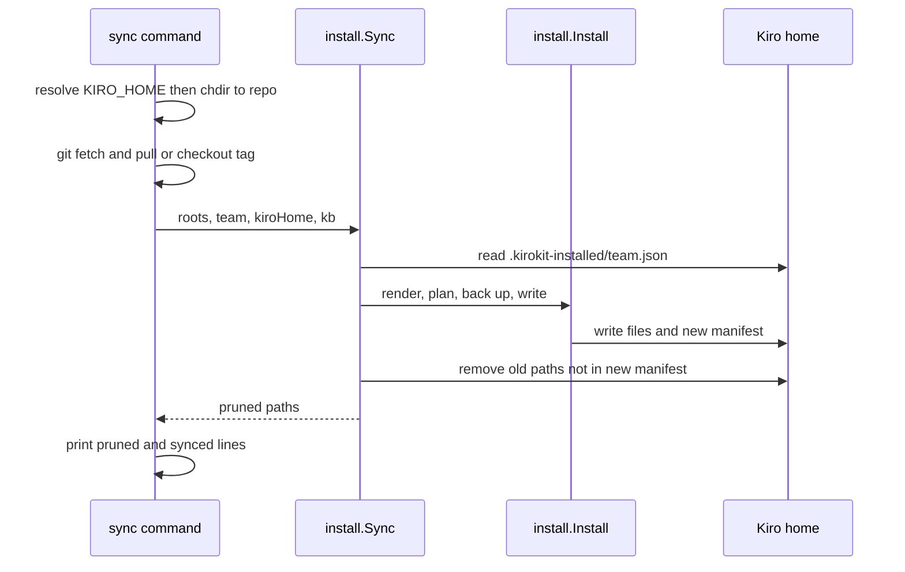

# How kirokit finds its folders, exposes team data and records installs

## Findings

### Every command resolves repository folders from the working directory, with no discovery

**Answers:** 1

The four repository paths are constants, relative to the current working directory (`cmd/kirokit/commands/root.go:11-19`): `teams`, `global/steerings`, `env/mcp-versions.yaml` and `testdata/golden`. The comment says kirokit has no repository-root discovery in v1. `install` copies them into `install.Roots` (`cmd/kirokit/commands/install.go:29-33`); `sync`, `test` and `update` do the same (`sync.go:56-60`, `test.go:26-29`, `update.go:26-29`). `render` passes them straight to `render.RenderTeam` (`render.go:34`).

`sync` is the only command that changes directory. It runs `os.Chdir(repo)` (`cmd/kirokit/commands/sync.go:43`) with `--repo` defaulting to `.` (`sync.go:72`), then runs git and the install from there. `install` and `uninstall` never chdir.

The Kiro home comes from one function. `ResolveKiroHome` returns `$KIRO_HOME` when set and non-empty (`internal/install/install.go:47-48`). Otherwise it returns `$HOME/.kiro` via `os.UserHomeDir` (`install.go:50-54`). It does not make the path absolute. `install`, `sync` and `uninstall` each call it (`install.go:24`, `sync.go:37`, `uninstall.go:18`). `render`, `test` and `update` do not; they render with the fixed sentinel `/kiro-home` (`internal/render/context.go:15`, applied at `context.go:48-50`).

```
cwd + env dependencies (non-test code)
├── root.go:15-18        teams, global/steerings, env/mcp-versions.yaml, testdata/golden  -> cwd
├── root.go:51           teamNames: os.ReadDir("teams")                                   -> cwd
├── sync.go:43           os.Chdir(--repo)                                                 -> moves cwd
├── install.go:47        os.Getenv("KIRO_HOME")
├── install.go:50        os.UserHomeDir()                                                 -> $HOME
└── install.go:135       filepath.Abs(kb.Source)                                          -> cwd at call time
```

An exhaustive search for `Getenv|Getwd|Chdir|Setenv|LookupEnv|UserHomeDir|Executable` over non-test Go files under `cmd/` and `internal/` found only the lines above. No other environment variable is read.

Order matters in `sync`. `ResolveKiroHome` runs at `sync.go:37`, before the chdir at `sync.go:43`, but returns the string unchanged. A relative `$KIRO_HOME`, and relative `--kb-source` or `--kb-mount` values, are therefore used after the chdir (`sync.go:61`) and resolve against `--repo`, not the shell's directory. That follows from the code; no test was run to confirm it.

### Teams, agents and pins are read as files; only manifests and pins have a typed loader

**Answers:** 2

There is no exported "list teams" or "list agents" function. `teamNames` is unexported and lists directories under `teams/` (`cmd/kirokit/commands/root.go:47-62`). Agents are discovered by directory walk: `planSecrets` reads `teams/<team>/agents/*` (`internal/install/install.go:325-353`) and `mapOutputPath` turns `agents/<name>/agent.json.tmpl` into `agents/<name>.json` (`internal/render/render.go:229-230`). Both teams today hold two agents (`teams/platform-team/agents/{devops,platformdev}`, `teams/data-team/agents/{godev,javadev}`).

```
Exported surface a same-module caller can use
manifest      Manifest{Team, GlobalSteerings, ExternalSkills}   manifest.go:16-20
              ExternalSkill{Name, Source, Ref, Paths, All, Exclude, Path}   manifest.go:33-43
              Load(path) (*Manifest, error)                     manifest.go:58
              ExternalSkill.Expand / Validate / EffectiveName / IsCollection
mcpversions   Versions map[string]string; Load(path)            mcpversions.go:13,16
render        Context{Team, Env, Global, KiroHome}              context.go:18-23
              BuildContext(teamsRoot, team, globalRoot, envVersionsPath, kiroHome)   context.go:27
              RenderTeam(teamsRoot, team, globalRoot, envVersionsPath, outDir, kiroHome)   render.go:25
              FuncMap(ctx); DefaultKiroHomeSentinel             funcs.go:13, context.go:15
externalskills  Lock{Skills []LockEntry}; ReadLock, WriteLock, HashDir, SkillsDir, LockPath   lock.go:20-102
              Fetch(teamDir, entries) (Lock, error)             fetch.go:23
              Verify(teamDir, entries) error; Resolve(teamDir, entries) ([]string, error)   verify.go:18,27
```

`manifest.Load` fails when `team` is empty (`manifest.go:68-70`) and expands `paths:` into one entry per path (`manifest.go:81-90`, `94-117`). The two shipped manifests are small: `teams/data-team/manifest.yaml` holds `team` and an empty `globalSteerings`; `teams/platform-team/manifest.yaml` opts into `security-baseline` and has `externalSkills` commented out. `mcpversions.Load` parses a flat string map (`mcpversions.go:16-27`), and `env/mcp-versions.yaml` holds eight entries (for example `pipeline-mcp: "3.0.0"`). Templates read a pin through `mcpVersion`, which errors on an undefined key (`internal/render/funcs.go:23-31`).

An agent template is JSON with Go template actions (`teams/data-team/agents/godev/agent.json.tmpl:1-32`). It uses `.KiroHome` (line 20) and `mcpVersion ... | jsonString` (line 27). The render context carries the whole manifest and the pins, but the agent's own fields (name, tools, MCP servers) exist only as rendered text. The only Go parsing of agent JSON is validation (`internal/render/render.go:196-199`, `kiroconfig.ValidateAgentJSON`) and the resources splice (`render.go:92-97`). Nothing returns an agent as a struct.

### Install writes files, then a per-team JSON manifest that uninstall and sync replay

**Answers:** 3

`Install` renders into a temp directory with the real Kiro home baked in (`internal/install/install.go:63-70`). It plans every file before writing: the rendered tree (`planRenderedTree`, `install.go:289-321`) plus each agent's `env/secrets.enc.yaml` (`planSecrets`, `install.go:325-353`). It backs up changed folders, writes, creates the optional knowledge-base symlink, and finally writes the manifest (`install.go:96-120`).

```
$KIRO_HOME
├── agents/<agent>.json                         rendered, 0600
├── hooks/ prompts/ skills/ steering/...        rendered tree (mapOutputPath)
├── kirokit-secrets/<team>/<agent>/secrets.enc.yaml   0600   install.go:347
├── .kirokit-installed/<team>.json              0600   install.go:260-262, 273
└── YYYYMMDD-HHmmss-<folder>.backup/            not recorded in the manifest
```

The manifest struct is `{files: [...], symlinks: [...]}` (`install.go:39-42`), pretty-printed JSON with absolute paths. Its own path is appended to `files`, so uninstall removes it too (`install.go:114-115`). Files are written 0600, or 0700 when the source had the owner-execute bit (`install.go:310-313`).

`Uninstall` reads the manifest, removes symlinks then files, ignores already-missing paths, and prints nothing itself (`install.go:232-258`). A missing manifest is an error, `no install manifest found for team %q` (`install.go:237`). It does not remove emptied directories.

`Sync` reads the previous manifest (a missing one is zero), runs `Install`, reads the new one, and removes every previous path absent from the new one (`internal/install/sync.go:16-49`). It then removes empty parent directories up to, but excluding, the Kiro home (`sync.go:55-62`).

Backups come from `internal/backup`, not an `install/backup.go` (that file does not exist). `backupChangedFolders` makes a sibling copy of each top-level folder in which an existing file would change (`install.go:379-408`). `backup.Differs` is true only for an existing file with different content, a symlink or a folder (`internal/backup/backup.go:107-117`). Unchanged re-installs therefore create no backups. The name is `<stamp>-<folder>.backup`, or `<stamp>-<n>-<folder>.backup` on a same-second clash (`backup.go:25-34`).

| Command | Printed on stdout | Source |
|---|---|---|
| `install <team>` | `installed <team> into <kiroHome>` | `cmd/kirokit/commands/install.go:37` |
| `uninstall <team>` | `uninstalled <team> from <kiroHome>` | `cmd/kirokit/commands/uninstall.go:26` |
| `sync <team>` | `updated <before> -> <after>` only if HEAD moved; `pruned <path>` per removed path; `synced <team> into <kiroHome> at <after>` | `cmd/kirokit/commands/sync.go:53,66,68` |

Errors are returned wrapped as `kirokit <command>: ...`; the root command silences cobra's own usage and error output (`root.go:30-31`). `install` and `sync` do not print the backup names or the written paths, so the backup folders are visible only on disk. `sync`'s `before` and `after` come from `git rev-parse --short HEAD` with the error ignored (`sync.go:47,51`). `--latest-tag` checks out the newest `v*` tag (`sync.go:88-96`).



## Change surface

| Area | Commits in last 90 days | Notes |
|---|---|---|
| `cmd/kirokit/commands` | 7 | root constants are shared by 6 commands |
| `internal/install` | 8 | `Roots`, `Install`, `Sync`, `Uninstall`, `ResolveKiroHome`, `AttachKnowledgeBase` are exported |
| `internal/render` | 8 | `BuildContext` and `RenderTeam` are the only entry points to the manifest plus pins |
| `internal/manifest`, `mcpversions`, `externalskills`, `backup` | 3, 1, 2, 1 | small, single-purpose |

Hard-to-change points, as facts: the folder names are package-level constants in `commands`, so a caller outside that package cannot read them. `manifest` (the install record) and `plannedFile` are unexported, so nothing outside `internal/install` can read an install record. `sync` changes the process working directory, so code run after it in the same process sees the repository, not the original directory.

## How it is tested today

- Go `testing`, no extra framework. Whole suite from the repository root: `go test ./...` (also `task ci`, per `AGENTS.md`). One package: `go test ./internal/install`; one test: `go test ./internal/install -run TestSync_PrunesFilesNoLongerShippedAndKeepsUnrelatedOnes`. These commands were not run in this research.
- `internal/install/install_test.go` and `sync_test.go` exercise install, uninstall, knowledge base, backups and pruning against temp directories (for example `install_test.go:74`, `424`, `521`; `sync_test.go:10`).
- `cmd/kirokit/commands/{install,sync,skills,version}_test.go` cover flag parsing and `updateCheckout`; `sync_test.go:27-30` chdirs into a temp repository and restores the directory in cleanup.
- `internal/backup/backup_test.go` covers backups. Package test files for `manifest`, `render`, `mcpversions` and `externalskills` were not opened. There is no test of the `commands` package that runs `ResolveKiroHome` with `KIRO_HOME` unset (not found by name; not exhaustively searched).

## Open questions

Question 2: No exported function returns agents or teams as data; whether another helper's area (golden, scaffold) offers one was not checked.

## Code references

- Folder constants and team listing: `cmd/kirokit/commands/root.go:11-19`, `47-62`
- Kiro home: `internal/install/install.go:44-55`
- Chdir: `cmd/kirokit/commands/sync.go:43`
- Install, manifest, uninstall: `internal/install/install.go:22-121`, `229-277`, `379-408`
- Sync: `internal/install/sync.go:16-78`
- Backup: `internal/backup/backup.go:19-117`
- Data loaders: `internal/manifest/manifest.go:16-117`, `internal/mcpversions/mcpversions.go:13-27`, `internal/render/context.go:18-58`, `internal/render/funcs.go:13-31`, `internal/externalskills/verify.go:18-27`
- Agent template: `teams/data-team/agents/godev/agent.json.tmpl`
- Exhaustive for the files named in the questions and for env/cwd calls in non-test Go under `cmd/` and `internal/`; not exhaustive for `externalskills` internals, `kiroconfig`, `golden`, `scaffold`.
