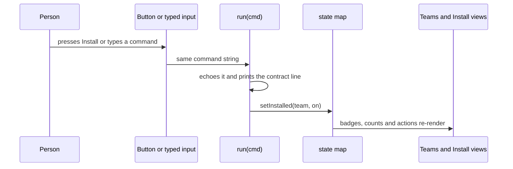

# Sidebar design page, Wails, pty/xterm.js and macOS environment

## Findings

### The design page is one self-contained HTML file with a violet-from-the-logo token set

**Answers:** 4

The page is a single file with inline CSS and script (`docs/plans/2026-10-17-desktop-app-sidebar-layout/design/sidebar-layout.html:9-174`, `317-472`). The plan states this as a decision (`docs/plans/2026-10-17-desktop-app-sidebar-layout/03-plan.md:32-34`). It is a fixed 1180x760 "window" that scrolls sideways instead of reflowing (`sidebar-layout.html:64`, `03-plan.md:144`). No Go, Wails or build files change (`03-plan.md:148`).

```
.window (grid: 36px titlebar / 1fr)            sidebar-layout.html:64
├── .titlebar  traffic-light dots + title      :67-71
└── .app (grid: auto sidebar / 1fr)            :72
    ├── aside.sidebar  232px, 60px as .rail    :75, :91
    │   ├── .brand  inline logo + "kirokit"    :182-185
    │   ├── nav ul.nav  5 buttons[data-page]   :186-194
    │   └── button.collapse  kbd "⌘B"           :196
    └── .work (grid: 1fr / auto)               :98
        ├── main  5 <section id="page-*">      :200-276
        ├── button.term-toggle (hidden)        :278
        └── section.terminal 220px (120-480)   :279-291
dialog#replace, dialog#setup (outside .window) :297-315
```

Pages: Teams (cards), Agents, Install and sync, Skills and MCP versions (tables), Settings (two inputs) (`:201-275`). Everything but install state, file counts, times and the two paths is copied from the repo (`03-plan.md:88-90`, `sidebar-layout.html:215`, `240`).

**Colour tokens** are CSS variables on `:root` (`:10-39`). Light: bg `#f4f2fa`, window `#ffffff`, sidebar `#f1eff9`, text `#1d1730`, muted `#574f6e`, accent `#6d28d9`, accent-soft `#ede9fe`, ok `#15803d`, warn `#854d0e`. Terminal tokens (`--term-bg #15111f`, `--term-text`, `--term-prompt`, `--term-ok`, `--term-err`) are defined once and are not overridden in dark, so the terminal looks the same in both themes (`:30-35`, `40-55`). Dark values (accent `#a78bfa`, bg `#0d0b13`) are declared twice: under `prefers-color-scheme: dark` guarded by `:root:not([data-theme="light"])` (`:40-48`) and under `:root[data-theme="dark"]` (`:49-55`). The plan calls the accent "taken from the logo's violet" and no product design system exists (`03-plan.md:17`, `139`).

**Fonts**: no webfont is loaded. `--font` is `ui-sans-serif, system-ui, -apple-system, "Segoe UI", sans-serif`; `--mono` is `ui-monospace, "SF Mono", Menlo, Consolas, monospace` (`:37-38`). Team, agent, skill and server names use mono (`03-plan.md:141`; `.card h3` at `:107`, `.mono` at `:125`).

**Icons**: hand-inlined 24x24 stroke SVGs, `stroke="currentColor"` width 1.8, one per nav item, collapse chevron, clear (trash) and hide (chevron) buttons (`:188-192`, `196`, `282-283`). Icon-only buttons carry `title`/`aria-label`. In rail mode `.label` becomes visually hidden, so the name stays accessible (`:93`).

**Theme handling**: the script reads `data-theme` on `<html>` and listens for the host's `ql:design-mode` event (`:320-322`). Only values `light` or `dark` are applied. There is no in-page toggle and no storage; the viewer's choice comes from the host or `prefers-color-scheme`.

**Keyboard shortcuts** (one document-level handler, `:397-400`): Cmd or Ctrl+B toggles the rail; Ctrl+backtick toggles the terminal. The resize separator is focusable (`tabindex=0`), and ArrowUp/ArrowDown change height by 20px within 120-480 (`:394`, `387`). The dialogs are native `<dialog>` with `showModal()` and focus return (`:431`, `439`, `453-457`). Plan contract: `03-plan.md:81-83`, `209-211`. Note the plan names Control-backtick only, while the code also accepts Ctrl+B.

**Simulated terminal**: input `keydown` Enter calls `run(cmd)` (`:382`). `run` echoes the line, handles `clear`, answers any non-`kirokit` word with `zsh: command not found` and switches on `help|install|uninstall|sync|test|render|version` (`:364-381`). A page-level `state` map holds `{platform-team: false, data-team: true}` (`:351`), and `setInstalled` rewrites both the Teams card and the Install row (`:403-419`). Buttons call the same `run` (`:426-427`, `464-465`). Installing a second team runs `uninstall` of the first (`:361-363`, `464`), matching option A (`03-plan.md:119-120`, `207`). The output region is `aria-live="polite"` (`:285`). The printed lines mirror real sources cited at `03-plan.md:185-192`.

**Logo**: `assets/logo.svg:1-20` is a 512x512 rounded square (`rx=112`) with a linear gradient `#8b5cf6` to `#4c1d95` (`:4-9`), two translucent `#ede9fe` curly braces (`:11-14`) and a white prompt chevron plus cursor bar (`:16-19`). The page inlines it with identical paths at `sidebar-layout.html:183`; the plan says to copy `assets/logo.svg:1-20` (`03-plan.md:219`).



**Change-readiness.** `git log --since=90.days` shows one commit touching `assets` or this plan folder (`440b841`). The plan said the draft page was excluded from git (`03-plan.md:223`), but commit `440b841` began tracking design folders (`.gitignore:9-11`), and `git ls-files` lists `sidebar-layout.html`. Hard to change: all behaviour is one 150-line IIFE with global-ish `let` state and no tests. The only checks named are `qualitylayer design check` / `design shot` and a manual browser run (`03-plan.md:221`).

### Wails v2 is stable and binds a struct; Wails v3 is a beta that registers services

**Answers:** 5

Current releases from the GitHub API on 2026-10-17: v2 latest `v2.14.0`; v3 is `v3.0.0-beta.30`, a prerelease published 2026-10-15 (v3 docs live under `v3alpha.wails.io`).

| | Wails v2 | Wails v3 (beta) |
|---|---|---|
| Layout | `build/`, `frontend/`, `go.mod`, `main.go`, `wails.json` ([firstproject](https://wails.io/docs/gettingstarted/firstproject)) | `build/` with per-OS Taskfiles, `frontend/`, `main.go`, `greetservice.go`, `Taskfile.yml`, `go.mod` ([first app](https://v3alpha.wails.io/getting-started/your-first-app/)) |
| Config | `wails.json` (`frontend:install`, `frontend:build`, `wailsjsdir`, `outputfilename`, hooks) ([project config](https://wails.io/docs/reference/project-config)) | `build/config.yml` plus Taskfiles |
| Bindings | `Bind: []interface{}{app}` in `options.App`; public methods exposed; JS imports `../wailsjs/go/main/App` ([app dev](https://wails.io/docs/guides/application-development)) | `application.NewService(...)` in `Options.Services`; exported methods only, services are singletons shared by all windows; JS imports `./bindings/<module>/<Service>` ([services](https://v3alpha.wails.io/features/bindings/services/)) |
| Events | Go `runtime.EventsEmit(ctx, name, data...)` / `EventsOn(ctx, ...)`; JS `EventsOn/EventsEmit` ([events](https://wails.io/docs/reference/runtime/events)) | `app.Event.Emit/On`; JS `Events.On/Emit` from `@wailsio/runtime`; per-window `window.EmitEvent` ([events](https://v3alpha.wails.io/features/events/system/)) |
| Window options | `options.App`: Title, Width, Height, MinWidth, Frameless, StartHidden, HideWindowOnClose, OnStartup/OnShutdown/OnBeforeClose, `mac.Options` ([options](https://wails.io/docs/reference/options)) | Multiple `WebviewWindow`s via `app.Window.New()`; `SetSize/SetMinSize/Hide/Show/Close` and `WindowClosing` hook ([window API](https://v3alpha.wails.io/reference/window/)) |
| Build | `wails build` (`-clean`, `-platform`, `-nopackage`, `-ldflags`, `-obfuscated`) ([CLI](https://wails.io/docs/reference/cli)) | `wails3 build` (debug); `wails3 package GOOS=darwin` for a `.app` ([macOS](https://v3alpha.wails.io/guides/build/macos/)) |
| macOS bundle | not confirmed from the pages read; the `-clean` flag refers to `build/bin` | `bin/<AppName>.app` with binary in `Contents/MacOS`, icon and `Info.plist`; universal task `wails3 task darwin:package:universal`; `Info.plist` under `build/darwin/` |

**Fit with this module.** The module is `github.com/mavogel/kirokit` on `go 1.27` with the CLI in `cmd/kirokit/` (`go.mod:1-3`, `AGENTS.md` project section). Both toolchains scaffold a root `main.go` and `go.mod` (fact above), and the repo already has a CLI built from `cmd/kirokit`. Whether a Wails app can live in a subfolder (for example `cmd/kirokit-desktop`) inside the same module without a second `go.mod` is not stated on the pages read (inference only). The repo has no Wails, frontend or `package.json` today (`git ls-files` shows none). The existing packages return errors and only `commands` prints (`03-plan.md:19`), so Go code in `internal/` could be called by a bound service; that is an observation about the layout, not a tested path. Tooling: `wails` is not installed on this machine (`which wails` found nothing). v3 changes between betas every few days (beta.25 on 2026-09-22 to beta.30 on 2026-10-15).

### A Go pty plus xterm.js is a two-way byte pipe whose resize and shutdown the app must wire itself

**Answers:** 6

Versions: `creack/pty` latest `v1.1.24` (2024-10-31), `@xterm/xterm` latest `6.0.0` (npm and GitHub, 2025-12-22), beta tag `6.1.0-beta.315`. xterm.js "is not `bash`"; it is connected to a process through a pty library (README, [xterm.js](https://github.com/xtermjs/xterm.js/blob/master/README.md)). Its documented wiring is `pty.onData(d => term.write(d))` and `term.onData(d => pty.write(d))`.

`creack/pty` API ([pkg.go.dev](https://pkg.go.dev/github.com/creack/pty)): `Start(cmd)` attaches the tty to the command's stdin/stdout/stderr, starts it in a new session with a controlling terminal and returns the master `*os.File`; `StartWithSize(cmd, *Winsize)` sets the size before start; `Setsize(f, *Winsize)` resizes; `InheritSize` is meant for `SIGWINCH` in a terminal program. The README shell example defers `ptmx.Close()` and copies with `io.Copy` both ways; its own caveat is that the stdin-to-pty goroutine "will keep reading until the next keystroke" ([README](https://raw.githubusercontent.com/creack/pty/master/README.md)).

```
Input:    xterm onData -> bound Go method / event -> ptmx.Write(bytes)
Output:   goroutine ptmx.Read(buf) -> Events.Emit("term:data", chunk) -> term.write(chunk)
Resize:   FitAddon.fit() (ResizeObserver) -> term.onResize({cols,rows}) -> Go -> pty.Setsize(ptmx,&Winsize{Rows,Cols})
Shutdown: cmd.Process.Signal/Kill, ptmx.Close(), cmd.Wait() to reap -> read loop gets EOF -> emit "term:exit"
```

In the xterm.js repo, `addon-fit` computes cols and rows from the container (recent commits to `addons/addon-fit` dated 2026-03 and 2026-06 touch `fit()` behaviour with ResizeObserver) ([addon-fit](https://github.com/xtermjs/xterm.js/tree/master/addons/addon-fit)). The Go-to-frontend transport choices map to section 5: v2 `EventsEmit` and v3 `Event.Emit` carry JSON data, so raw bytes need encoding (for example string or base64). Whether either transport preserves arbitrary binary unmodified was not tested here.

Gap: I did not find a Wails v3 `examples/terminal` (the path returns 404), and I did not locate a specific open-source Wails app that streams a shell; the wiring above is composed from the library docs, not from such an app. Unix-only: `creack/pty` returns `ErrUnsupported` where a function is unavailable, which matters only for non-macOS/Linux targets.

### A Finder-launched app does not see the terminal PATH, and the tools here live in places outside it

**Answers:** 7

Observed on this machine (a Terminal login shell, not a Finder launch): `launchctl getenv PATH` printed nothing, and `/etc/paths` lists `/usr/local/bin`, `/System/Cryptexes/App/usr/bin`, `/usr/bin`, `/bin`, `/usr/sbin`, `/sbin` (no `/opt/homebrew/bin`). The login shell PATH starts with `~/.pilot/bin`, `~/.bun/bin`, `/usr/local/bin`, set by the user's shell startup files. `sops` is at `/opt/homebrew/bin/sops`; `kiro-cli` is at both `/opt/homebrew/bin` and `~/.local/bin`; an age key exists at `~/Library/Application Support/sops/age/keys.txt` (existence only; contents not read).

Documented behaviour in the repo that depends on it:
- `sopswrap` emits the bare command name `sops` as the executable (`internal/sopswrap/sopswrap.go:14`), so it is found through the PATH of whatever process starts the agent.
- `ResolveKiroHome` uses `$KIRO_HOME` if set, else `~/.kiro` (`internal/install/install.go:44-55`). A Finder-launched app will not see `KIRO_HOME` set in a shell profile.
- README names `SOPS_AGE_KEY_FILE` as the key-file variable (`README.md:168`).
- sops' age key source reads `SOPS_AGE_KEY_FILE`, otherwise `sops/age/keys.txt` under the user config dir, with macOS handling `XDG_CONFIG_HOME` manually (`age/keysource.go:32`, `48-50`, `393` in the sops repo, raw file fetched from `getsops/sops` main).

Not verified in this session: Apple's page on launchd jobs was fetched but is generic (it describes launchd as parent of user agents) and does not state the GUI app default PATH; the `LSEnvironment` page returned an error. The statement that apps launched from Finder or Dock inherit launchd's minimal environment (typically `/usr/bin:/bin:/usr/sbin:/sbin`, not shell profile exports) is community knowledge that I did not check against a primary source here. Commonly used approaches (inference, unverified here): run the user's login shell once (`$SHELL -ilc 'env'`) and read its environment; probe known directories (`/opt/homebrew/bin`, `/usr/local/bin`, `~/.local/bin`); let the user set paths in an in-app setting; use `/usr/libexec/path_helper` output. The design's Settings page currently exposes only the Kiro home and repository paths (`sidebar-layout.html:272-273`).

## How it is tested today

- Go suite, whole repo from the root: `go test ./...` (`AGENTS.md` Commands); one package: `go test ./internal/install` or `go test ./internal/sopswrap`. Fixtures are the committed goldens in `testdata/golden/<team>/`. `internal/golden` also runs `kiro-cli agent validate` and skips without a logged-in `kiro-cli` unless `KIROKIT_REQUIRE_KIRO_CLI=1`.
- No tests exist for any Wails, pty, xterm or desktop code; none of that code exists in the repo.
- The design page has no automated test in the repo. The plan names `qualitylayer design check sidebar-layout`, `qualitylayer design shot sidebar-layout --width 1440 --theme light|dark`, and a manual browser click-through (`03-plan.md:221`). I did not run them.
- I did not run any Wails, pty or xterm code; web findings come from the cited pages and the GitHub/npm/`go list` version queries.

## Open questions

Question 5: Where Wails v2's macOS `.app` lands (the CLI page was truncated before the platform section), and whether either Wails version supports a main package in a subfolder of an existing CLI module without its own `go.mod`.
Question 6: No existing Wails or webview app that streams a shell was located; binary-safety of Wails events for raw pty bytes was not tested.
Question 7: No primary Apple source was read for the GUI-app default environment or `LSEnvironment`; the Finder-launch PATH and the login-shell workaround are unverified here.

## Code references

- `docs/plans/2026-10-17-desktop-app-sidebar-layout/design/sidebar-layout.html:10-55` tokens and themes; `:64-98` layout; `:181-296` markup; `:317-471` script (theme `:320-322`, shortcuts `:397-400`, terminal `:364-382`, state `:403-419`, dialogs `:424-468`).
- `docs/plans/2026-10-17-desktop-app-sidebar-layout/03-plan.md:32-34`, `39-60`, `81-83`, `95-120`, `181-211` decisions and contracts.
- `assets/logo.svg:1-20`.
- `internal/sopswrap/sopswrap.go:14`, `internal/install/install.go:44-55`, `README.md:9`, `168`, `go.mod:1-3`.
- Exhaustiveness: the design page and plan were read in full; repo references are those relevant to the environment question only; web sources are those linked above.
