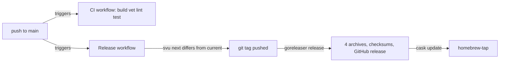

# Build, lint, CI and release setup for the kirokit binary

## Findings

### One pure-Go binary is built for four targets, only at release time

**Answers:** 8

The only shipped binary is `kirokit`, built from `./cmd/kirokit`. GoReleaser sets `CGO_ENABLED=0` (`.goreleaser.yaml:13-14`) and builds darwin and linux for amd64 and arm64 (`.goreleaser.yaml:15-20`), four targets. Windows is not built. No Go file uses `import "C"`, and the only `//go:embed` is `//go:embed all:starter` in `internal/scaffold/scaffold.go:20`. `go list` reports zero cgo files in all 12 packages. The two dependencies are cobra and yaml.v3 (`go.mod:5-13`). `go.mod:3` says `go 1.27`, and the local toolchain is go1.27.2 darwin/arm64 with `CGO_ENABLED=1` by default.

Ldflags strip symbols (`-s -w`) and inject three variables into `cmd/kirokit/commands` (`.goreleaser.yaml:21-25`). Those variables are `version = "dev"`, `commit` and `date` (`cmd/kirokit/commands/version.go:12-16`). When version stays `dev`, `buildInfo` falls back to `debug.ReadBuildInfo` (`cmd/kirokit/commands/version.go:40-51`). Archives are `tar.gz` named `kirokit_<ver>_<os>_<arch>` plus `checksums.txt` (`.goreleaser.yaml:27-36`).

A Homebrew cask is pushed to `mavogel/homebrew-tap` (`.goreleaser.yaml:56-62`). Its post-install hook strips the macOS quarantine attribute because the binaries are not notarized (`.goreleaser.yaml:64-71`). Nothing signs or notarizes binaries. A local `dist/` holds snapshot archives for all four targets, and `.gitignore:1-2` ignores `/dist/` and `/kirokit`.

```
task build -> go build -o kirokit ./cmd/kirokit      (local, host platform, CGO default)
CI         -> go build ./...                          (ubuntu, no output binary)
release    -> goreleaser release --clean              (CGO=0, 2 OS x 2 arch)
```

### CI builds, vets, lints and tests on one Linux runner

**Answers:** 8

`ci.yaml` runs on pull requests and on pushes to `main` (`.github/workflows/ci.yaml:3-6`). It uses a single `ubuntu-latest` job (`.github/workflows/ci.yaml:12-13`). Go is `stable`, not read from `go.mod` (`.github/workflows/ci.yaml:18-21`). The steps run in this order:

1. `go build ./...`
2. `go vet ./...`
3. golangci-lint v2.14.0 through the action
4. `go test ./... -v`
5. `node scripts/sync-agent-assets.mjs --check`

(`.github/workflows/ci.yaml:23-38`). CI has no OS or architecture matrix and sets no CGO variable, so the Linux runner uses the default `CGO_ENABLED=1`. It never builds the CGO-disabled darwin or arm64 targets that release ships. `KIROKIT_REQUIRE_KIRO_CLI` appears nowhere in `.github` or `Taskfile.yml` (grep). The kiro-cli validation tests therefore skip in CI, through `skipUnlessRequired` in `internal/golden/kirocli_test.go:12-24`.

`task ci` mirrors CI except for the asset-sync check. It runs build, vet, lint, then `go test ./... -v` (`Taskfile.yml:24-30`). Its `build` step writes `./kirokit`, while CI's step builds all packages without output.

### Release runs on every push to main and tags with svu

**Answers:** 8

`release.yaml` fires on pushes to `main` with `contents: write` (`.github/workflows/release.yaml:3-8`). A `release` concurrency group queues releases (`.github/workflows/release.yaml:11-13`). The job checks out full history and installs svu v3.4.1 (`.github/workflows/release.yaml:19-30`). It computes `svu next --v0` and compares it with `svu current` (`.github/workflows/release.yaml:35-47`). If they differ, it pushes the tag (`.github/workflows/release.yaml:49-53`) and runs goreleaser-pro `~> v2` with `release --clean` (`.github/workflows/release.yaml:55-61`). Secrets used are `GITHUB_TOKEN`, `GORELEASER_KEY` and `HOMEBREW_TAP_GITHUB_TOKEN` (`.github/workflows/release.yaml:62-67`).

The release job does not run build, vet, lint or tests. It only runs `go mod tidy` before the build (`.goreleaser.yaml:5-7`). The release runs on a different Go: `stable`, as in CI. `distribution: goreleaser-pro` is used although `.goreleaser.yaml` uses only open-source keys.



The CI and release workflows are independent; neither waits on the other.

### Lint is four linters, hooks cover hygiene and commit messages

**Answers:** 8

`.golangci.yml` is v2 with `default: none` and four linters enabled: govet, staticcheck, errcheck, unused (`.golangci.yml:1-8`). There is no formatter section, no build tags and no path exclusions. Lint runs through `golangci-lint run` locally (`Taskfile.yml:14-17`) and through the pinned action in CI.

lefthook runs on pre-commit: trailing-whitespace, end-of-file-fixer, check-yaml, check-json and gitleaks on staged files (`lefthook.yml:14-47`). On commit-msg it runs `cz check` (`lefthook.yml:49-52`). Golden files, `*.enc.yaml`, PNGs and vendored `teams/*/external/**` are excluded from the fixers (`lefthook.yml:7-12`, `18-22`). Hooks do not run `go build`, `go vet`, lint or tests. Commit messages feed svu, so Conventional Commits drive the release version.

### What the Go commands cover

**Answers:** 8

`go build ./...` and `go test ./...` span 12 packages: `cmd/kirokit`, `cmd/kirokit/commands`, and ten under `internal/` (backup, externalskills, golden, install, kiroconfig, manifest, mcpversions, render, scaffold, sopswrap; from `go list ./...`). `go build ./...` succeeded locally with the exit code unchecked beyond the printed `BUILD_OK`. `go test` was not run. `cmd/kirokit` has no test files. The rest each have 1 to 4. There are no build-tag-gated files (grep for `go:build` found none), so both commands cover all source on any platform. Neither command covers `teams/`, `global/`, `env/` or `scripts/`. Those are covered indirectly: the golden tests render every team and compare to `testdata/golden`, per `AGENTS.md`.

**Change history, last 90 days** (`git log --oneline --since=90.days` across these config files): 12 commits touched them. Recent ones are `440b841`, `8c86d79` (pin dependencies), `bcd9d8c` (module rename) and `8a27d60` (golangci-lint bump).

## How it is tested today

Suite: Go `testing`, with 19 `_test.go` files in 11 packages and none in `cmd/kirokit`. Golden comparison and temp-dir fixtures live under `internal/golden` (3 test files) and `testdata/golden/<team>/`.

- All tests from the repository root: `go test ./...` (`task test` adds `-v`).
- One package: `go test ./internal/render`.
- One file's tests: `go test ./internal/render -run <TestName>`. Go selects by test name, not file, so name the tests in that file.
- kiro-cli validation: `internal/golden/kirocli_test.go` skips without a logged-in `kiro-cli`, unless `KIROKIT_REQUIRE_KIRO_CLI` is set (`internal/golden/kirocli_test.go:12-24`).
- Version injection: `cmd/kirokit/commands/version_test.go` sets the variables directly and does not exercise ldflags.
- Nothing tests the GoReleaser config, the workflows or the cross-compiled targets.

## Open questions

Question 8: Whether `go test ./...` passes today. I did not run it, only `go build ./...`.
Question 8: Whether the CGO-disabled darwin and linux arm64 and amd64 builds succeed in practice. I read the config and found local `dist/` snapshot archives, but did not rebuild them.

## Code references

Exhaustive for the named files; the Go-source greps cover the whole repository.

- Task runner: `Taskfile.yml:1-30`
- GoReleaser: `.goreleaser.yaml:5-77` (builds `9-25`, archives `27-36`, cask `56-71`)
- CI: `.github/workflows/ci.yaml:1-38`
- Release: `.github/workflows/release.yaml:1-67`
- Hooks: `lefthook.yml:14-52`
- Lint: `.golangci.yml:1-8`
- Module: `go.mod:1-13`
- Version variables: `cmd/kirokit/commands/version.go:12-51`
- Embed: `internal/scaffold/scaffold.go:20`
- kiro-cli skip logic: `internal/golden/kirocli_test.go:12-24`
