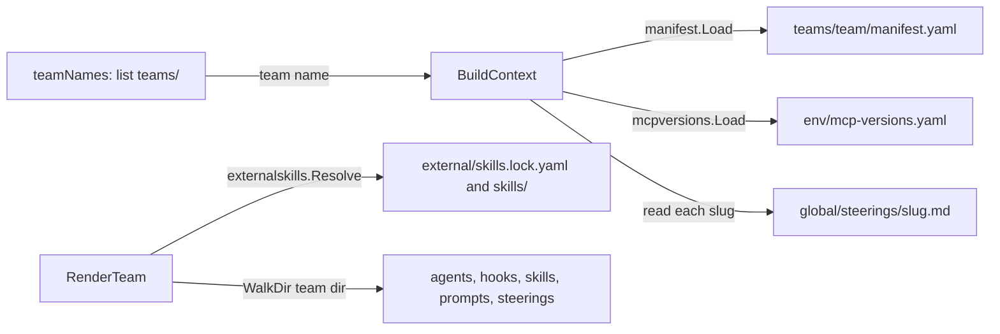
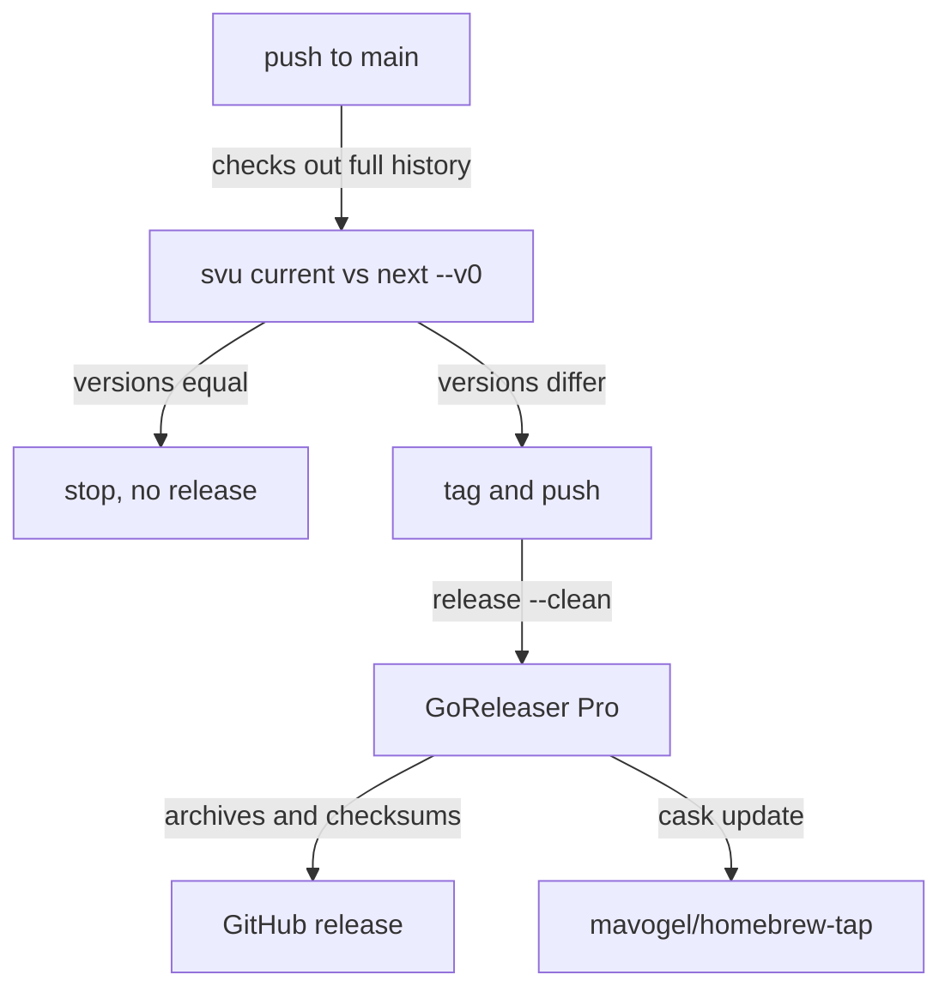

# Research: Desktop app sidebar layout

## Summary

**kirokit is a terminal tool with no screen, styling or design system today.** Its only visual identity is a violet rounded-square logo, used once in the README. The existing desktop-app design page is an empty stub.

**Everything a sidebar section would show already exists as files in the repository.** Teams are folders, agents are folders inside them, and MCP versions sit in one shared file. Install state is a per-team record in the Kiro home folder.

**Commands print; the packages underneath only return results and errors.** Each action maps to exactly one `kirokit` command, which makes it easy to show the command behind a button.

**Installing a team needs more than kirokit.** Three of the four agents start their MCP servers through SOPS, so the person installing needs SOPS and a decryption key.

## The questions

1. **How does the kirokit binary wire its entry point to the cobra command tree?** Look at `cmd/kirokit/main.go` and `cmd/kirokit/commands/root.go`: what each command's `RunE` does itself and what it hands to `internal/*`.
2. **How does kirokit discover teams, agents, skills and MCP version pins?** Trace `teamNames` in `cmd/kirokit/commands/root.go`, `internal/manifest`, `internal/mcpversions` and `internal/externalskills`: inputs, returned types and errors.
3. **Where do `internal/*` packages resolve paths, and what do they read from the environment?** Look for uses of the working directory, `teams/`, `global/`, `env/`, `$KIRO_HOME` and the `/kiro-home` sentinel across `internal/render`, `internal/install` and `cmd/kirokit/commands`.
4. **How do install, uninstall and sync record what is on the machine?** Read `internal/install`, `internal/manifest`, `internal/backup` and `cmd/kirokit/commands/sync.go`: which files they write under `$KIRO_HOME`, and what a reader could learn from them afterwards.
5. **How do the packages report progress, warnings and errors today?** Check whether `internal/*` functions write to stdout or stderr directly, take an `io.Writer`, or return errors only.
6. **How is kirokit built, tested and released today?** Read `Taskfile.yml`, `.goreleaser.yaml`, `.github/workflows/ci.yaml`, `.github/workflows/release.yaml` and `lefthook.yml`: targets, CGO setting, artefacts and required checks.
7. **What visual identity and design system does the project have today?** Look at `assets/logo.svg`, `assets/logo.png`, the README and `.qualitylayer/designs/`: colours, type and any layout or component conventions.

**Key context pointers:**

- `.qualitylayer/designs/desktop-app/index.html`
- `docs/prd/2026-09-28-kiro-cli-kit-multi-team.md`
- `assets/logo.svg`

## Findings

<!-- ql:folded -->
### A thin main hands one cobra tree to commands that mostly delegate to internal packages
**Answers:** 1

`main` calls `commands.Execute()` and prints any returned error to stderr with exit code 1 (`cmd/kirokit/main.go:12-17`). The root command silences cobra's own usage and error printing, so `main` is the only place an error is shown (`cmd/kirokit/commands/root.go:26-32`). Nine subcommands are registered in `newRootCmd` (`root.go:33-41`).

```
main (cmd/kirokit/main.go:12)
└── commands.Execute (root.go:22) -> newRootCmd().Execute()
    ├── render [team] --out   -> teamNames; render.RenderTeam per team        (render.go:17-40)
    ├── test [team]           -> teamNames; golden.Compare per team            (test.go:15-52)
    ├── update [team]         -> teamNames; golden.Update per team             (update.go:15-39)
    ├── onboard <team>        -> scaffold.Scaffold(teamsRoot, team)            (onboard.go:17)
    ├── install <team>        -> parseKnowledgeBaseFlags; install.ResolveKiroHome; install.Install (install.go:19-34)
    ├── uninstall <team>      -> install.ResolveKiroHome; install.Uninstall    (uninstall.go:18-23)
    ├── sync <team>           -> os.Chdir(repo); git fetch/pull|checkout; install.Sync (sync.go:43-61)
    ├── skills fetch [team]   -> manifest.Load; externalskills.Fetch           (skills.go:47-58)
    └── version               -> buildInfo (ldflags, else debug.ReadBuildInfo) (version.go:24,40-64)
```

What each `RunE` does itself:
- **Argument shaping.** Every command turns an optional positional into `team` and loops over `teamNames` results (`render.go:21-29`).
- **Output directory choice.** `render` appends the team name to `--out` only when no team was given (`render.go:30-33`).
- **Flag validation.** `parseKnowledgeBaseFlags` requires `--kb-agent`, `--kb-source` and `--kb-mount` together or not at all (`install.go:49-63`); `install` and `sync` share it.
- **Git handling in `sync`.** `sync` runs git itself (`gitOutput`, `sync.go:100-107`): `fetch --tags --prune`, then `pull --ff-only` or checkout of the newest `v*` tag (`sync.go:80-98`).
- **Pass/fail aggregation in `test`.** It prints mismatches to stderr, keeps going over teams, then returns one error (`test.go:32-50`).
- **Everything else** (rendering, golden comparison, install, scaffolding, fetching) lives in `internal/*`.

Change surface: `commands` files changed 2-4 times in 90 days each (`git log --since=90.days`); `root.go` four times. `commands` unit tests cover only helpers (`parseKnowledgeBaseFlags`, `updateCheckout`, `buildInfo`, skills fetch), not `Execute`.

### Discovery is directory listing plus file loaders; there is no registry
**Answers:** 2

- **Teams.** `teamNames(team)` returns `[]string{team}` unchecked when given. Otherwise it lists `teams/` and keeps directories only (`root.go:47-61`). Returns `([]string, error)`; the error is `kirokit: read teams: ...` (`root.go:53`). A given name is not checked for existence or path characters here. `install`, `uninstall` and `sync` take the team directly and skip `teamNames` (`install.go:17`).
- **Manifest.** `manifest.Load(path) (*Manifest, error)` reads `manifest.yaml` (`internal/manifest/manifest.go:58`). The struct holds `Team`, `GlobalSteerings` and `ExternalSkills` (`manifest.go:16-20`). It errors if `team` is empty (`manifest.go:68-70`). It then validates every external skill entry and expands `paths:` into one entry per path (`manifest.go:71-75`, `94-117`). It rejects duplicate single-skill names (`manifest.go:110-112`). Sources with a leading dash, transport helpers or embedded credentials are refused (`manifest.go:194-217`). The manifest `team` field is not compared with the directory name.
- **MCP version pins.** `mcpversions.Load(path) (Versions, error)` parses a flat YAML string map (`internal/mcpversions/mcpversions.go:13-27`). The template function `mcpVersion` returns an error for a missing key, so the render fails (`internal/render/funcs.go:23-30`).
- **Agents.** There is no agent list. `render` walks `teams/<team>` and maps `agents/<agent>/agent.json[.tmpl]` to `agents/<agent>.json`. Files under `agents/<agent>/env/` are skipped. Anything else under `agents/<agent>/` is an error (`internal/render/render.go:218-232`). `install` separately lists `agents/*/env/secrets.enc.yaml` (`internal/install/install.go:325-352`).
- **Skills.** Team-authored skills are plain files under `skills/` (`render.go:239-240`). External skills are declared in the manifest and resolved by `externalskills.Resolve(teamDir, entries) ([]string, error)` (`internal/externalskills/verify.go:27`). It reads `external/skills.lock.yaml` (`lock.go:26,49-62`; a missing file is an empty lock) and checks manifest, lock and vendored hash (`verify.go:145-156`). It returns one multi-line error listing all problems (`verify.go:93-96`) or the sorted names. Collections (`all: true`) get their names from the lock (`verify.go:105-141`).
- **Global steerings.** `BuildContext` reads `global/steerings/<slug>.md` for each manifest slug; a missing file fails (`internal/render/context.go:38-46`).



### Paths are fixed repository-relative strings resolved against the working directory
**Answers:** 3

- **Roots are constants.** `teams`, `global/steerings`, `env/mcp-versions.yaml` and `testdata/golden` are constants in `commands` (`root.go:14-19`). Only `commands` knows them; `internal/render`, `golden` and `install` receive them as arguments (`render.RenderTeam` params, `render.go:25`; `golden.Inputs`, `golden.go:20-25`; `install.Roots`, `install.go:22-26`). No `internal` package calls `os.Getwd`.
- **Relative to the working directory.** Nothing resolves a repository root, as the comment says (`root.go:11-13`). `sync` is the only command that changes directory, with `os.Chdir(repo)` (`sync.go:43`); `--repo` defaults to `.`. `skills fetch` makes `teamDir` absolute with `filepath.Abs` because git runs in a scratch directory (`internal/externalskills/fetch.go:32-36`).
- **`$KIRO_HOME`.** The only environment read in `internal/` is `os.Getenv("KIRO_HOME")`, falling back to `~/.kiro` via `os.UserHomeDir` (`install.go:46-55`). `install`, `uninstall` and `sync` call `ResolveKiroHome` (`install.go:24`, `uninstall.go:18`, `sync.go:37`).
- **The `/kiro-home` sentinel.** `render`, `test` and `update` pass an empty `kiroHome`, and `BuildContext` substitutes `/kiro-home` (`render.go:34`, `context.go:15,48-50`). `golden.renderForGolden` does the same (`golden.go:81,97`). `Install` passes the real path (`install.go:70`), and it is baked into global steering and skill URIs (`globalsteerings.go:48`, `externalskills.go:19`) and available to templates as `.KiroHome`.
- **Subprocess environment.** `runGit` in `fetch.go` inherits the process environment and stdin (`fetch.go:256-262`). `sync.go` git calls inherit the environment and capture combined output (`sync.go:101`).
- **Temp directories.** Rendering stages in `.kirokit-render-*` beside the output directory (`render.go:43`); install stages in the OS temp dir (`install.go:63`).

### Install records files in a per-team JSON manifest; sync diffs two of them
**Answers:** 4

```
$KIRO_HOME/
├── agents/<agent>.json, hooks/, prompts/, skills/, steering/    (rendered tree, 0600; exec bit kept as 0700)
├── kirokit-steerings/<team>/<slug>.md
├── kirokit-secrets/<team>/<agent>/secrets.enc.yaml
├── .kirokit-installed/<team>.json   {"files": [...], "symlinks": [...]}
└── <YYYYMMDD-HHmmss>-<folder>.backup/   (not recorded)
```

- **What `Install` writes.** It renders to a temp dir, plans all files (rendered tree, secrets, optional knowledge-base edit), backs up, writes, then writes `.kirokit-installed/<team>.json` (`install.go:62-121`, path `install.go:260-262`). The JSON holds absolute `files` (including the manifest path itself) and `symlinks` (`install.go:39-42,114-117`). It contains no timestamp, version, commit or content hash.
- **Backups.** `backupChangedFolders` copies each top-level folder where an existing file would change to `<stamp>-<folder>.backup` before any write (`install.go:379-408`; `internal/backup/backup.go:49-84`). Unchanged re-installs make none (`backup.Differs`, `backup.go:107-117`). Backups are not in the manifest, so uninstall leaves them (`install.go:376-378`). `render --out` instead moves a changed output directory aside (`render.go:132-173`, `backup.MoveAside`).
- **Uninstall.** It reads the manifest (error if missing, `install.go:233-240`), removes symlinks then files, which includes the manifest (`install.go:247-256`). Empty directories are left behind.
- **Sync.** `install.Sync` reads the previous manifest (a missing one is empty, `sync.go:65-77`), runs `Install`, reads the new one, and removes paths that are in the old record and not the new one, then empty parent directories up to `$KIRO_HOME` (`sync.go:16-49`). It returns pruned paths, which `commands/sync.go:65-67` prints. The `commands` side records nothing itself: it prints the short before/after commit (`sync.go:47-54`) but does not save it.
- **What a reader learns later.** From the manifest: which paths each team's last install wrote. Backup folder names give the time of a changing install. The installed commit or kirokit version is not recorded anywhere under `$KIRO_HOME` (fact from `install.manifest`, `install.go:39-42`).

### Packages return errors; only `commands` prints, and only to cobra's writers
**Answers:** 5

- **`internal/*` never print.** A search of non-test `internal` and `cmd` code for `fmt.Print*`, `log.`, `os.Stdout` and `io.Writer` found no hits in `internal/`. The one stderr use there is `exec.Cmd.Stderr` capturing into a buffer that becomes error text (`fetch.go:260-266`). The only direct `os.Stderr` use in the repo is `main.go:14`. No function in `internal/*` takes an `io.Writer`.
- **Progress lines** come from `commands` through `cmd.OutOrStdout()` (`render.go:37`, `install.go:37`, `sync.go:53,66,68`, `skills.go:44-70`). Mismatch detail from `test` goes to `cmd.ErrOrStderr()` (`test.go:40-43`).
- **Warnings** do not exist as a category. `install.Sync` returns pruned paths as data (`sync.go:16`); `externalskills.Fetch` returns a `Lock` and the command prints it (`skills.go:58-64`).
- **Error style.** Errors are wrapped with a package prefix (`install:`, `render:`, `manifest:`) and `%w`; `commands` adds `kirokit <cmd>:` (`render.go:35`, `install.go:35`). Multi-problem errors are joined into one string (`verify.go:95`). `sync` ignores errors from the two `rev-parse` calls (`sync.go:47,51`).
- **Interactive inheritance.** `runGit` passes `os.Stdin` to git so credential prompts work (`fetch.go:259-262`).

### Local build and the CI gate are the same four checks

**Answers:** 6

`task ci` runs build, vet, lint and test in that order (`Taskfile.yml:24-30`). Build writes the `./kirokit` binary (`Taskfile.yml:6-7`), which is gitignored (`.gitignore:2`). Lint is `golangci-lint run` (`Taskfile.yml:17`) with only govet, staticcheck, errcheck and unused enabled (`.golangci.yml:3-8`). Tests run `go test ./... -v` (`Taskfile.yml:22`).

The CI job `build-vet-lint-test` runs on ubuntu-latest for every pull request and every push to main (`.github/workflows/ci.yaml:3-13`). Its steps are `go build ./...`, `go vet ./...`, golangci-lint v2.14.0 through its action, `go test ./... -v`, and `node scripts/sync-agent-assets.mjs --check` (`.github/workflows/ci.yaml:23-38`). The Go version is `stable` (`.github/workflows/ci.yaml:21`), while `go.mod` declares `go 1.27` (`go.mod:3`). Actions are pinned by commit digest (`.github/workflows/ci.yaml:16`).

Differences between `task ci` and CI: CI builds with `go build ./...` (no binary output) and adds the agent-assets check, which `task ci` lacks. CI does not set `KIROKIT_REQUIRE_KIRO_CLI` (`.github/workflows/ci.yaml:34-35`), so the `kiro-cli agent validate` tests skip there when `kiro-cli` is absent (`internal/golden/kirocli_test.go:15-33`).

```
task ci
├── build  go build -o kirokit ./cmd/kirokit
├── vet    go vet ./...
├── lint   golangci-lint run
└── test   go test ./... -v   (golden comparisons included)
CI adds: agent-assets check; uses go build ./... ; no kiro-cli gate
```

### Releases are automatic on every push to main, via svu and GoReleaser Pro

**Answers:** 6

The release workflow triggers on push to main only, with `contents: write` and a single-slot concurrency group that queues rather than cancels (`.github/workflows/release.yaml:3-13`). It does not depend on the CI workflow: it is a separate workflow with no `needs` or `workflow_run` link, so a release can run even if CI fails (inference from `.github/workflows/release.yaml:15-67`).

`svu current` and `svu next --v0` compare versions. If they are equal, nothing is tagged or released (`.github/workflows/release.yaml:35-47`). Otherwise the workflow tags and pushes the new tag (`.github/workflows/release.yaml:49-53`) and runs `goreleaser release --clean` with distribution `goreleaser-pro` (`.github/workflows/release.yaml:55-61`). It needs three secrets: `GITHUB_TOKEN`, `GORELEASER_KEY` and `HOMEBREW_TAP_GITHUB_TOKEN` (`.github/workflows/release.yaml:62-67`). svu is installed at v3.4.1 (`.github/workflows/release.yaml:30`).



### Artefacts are CGO-free tarballs for four platforms plus a Homebrew cask

**Answers:** 6

The single build `kirokit` compiles `./cmd/kirokit` with `CGO_ENABLED=0` for darwin and linux on amd64 and arm64 (`.goreleaser.yaml:9-20`). Ldflags strip symbols (`-s -w`) and inject `version`, `commit` and `date` into `cmd/kirokit/commands` (`.goreleaser.yaml:21-25`). Those variables default to `"dev"`, `""` and `""` (`cmd/kirokit/commands/version.go:13-15`). A plain `task build` therefore reports `dev`.

Archives are `tar.gz` named `kirokit_<version>_<os>_<arch>` (`.goreleaser.yaml:27-33`), with a `checksums.txt` (`.goreleaser.yaml:35-36`). Before building, `go mod tidy` runs (`.goreleaser.yaml:5-7`). The changelog uses GitHub, groups feat and fix, and excludes docs, test and chore commits (`.goreleaser.yaml:38-54`). The Homebrew cask is pushed to `mavogel/homebrew-tap` and strips the macOS quarantine attribute on install because binaries are not notarized (`.goreleaser.yaml:56-71`). The release mode is `append` (`.goreleaser.yaml:73-77`). Windows is not built (`.goreleaser.yaml:15-17`).

### Local hooks enforce hygiene and commit format, not tests

**Answers:** 6

lefthook pre-commit runs trailing-whitespace and end-of-file fixers (re-staging fixes), check-yaml, check-json and gitleaks on staged files (`lefthook.yml:13-44`). The fixers skip `testdata/golden/**`, `*.enc.yaml` and `teams/*/external/**` (`lefthook.yml:17-21`). The commit-msg hook runs `cz check` (`lefthook.yml:46-49`), which keeps messages in the Conventional Commits form that svu reads. No hook runs the Go tests, vet or lint. Hooks are installed per clone with `lefthook install` (`lefthook.yml:1-3`).

Renovate keeps the dependencies current: it pins action digests, auto-merges minor and patch Go modules and Actions, and bumps the golangci-lint version in `ci.yaml` (`renovate.json:3`, `renovate.json:16-23`, `renovate.json:26-31`).

Change frequency (`git log --since=90.days` over Taskfile, goreleaser, workflows, lefthook): 11 commits, the latest being dependency pinning (`8c86d79`) and the module rename (`bcd9d8c`). The release and CI files are small single-job files, so the area is easy to change.

### The only visual identity is a violet rounded-square logo

**Answers:** 7

The project ships one mark, drawn as a 512x512 SVG (`assets/logo.svg:1`). A rounded square (`rx="112"`) is filled with a diagonal gradient from `#8b5cf6` to `#4c1d95` (`assets/logo.svg:4-9`). Two faint brace shapes in `#ede9fe` at 55% opacity suggest template braces (`assets/logo.svg:10-14`). A white prompt chevron and a short cursor bar sit on top (`assets/logo.svg:15-19`). The logo reads as "templates plus a terminal prompt".

| Element | Value | Source |
|---|---|---|
| Canvas | 512x512, corner radius 112 | `assets/logo.svg:1`, `assets/logo.svg:9` |
| Background | linear gradient `#8b5cf6` to `#4c1d95` (top-left to bottom-right) | `assets/logo.svg:4-7` |
| Braces | stroke `#ede9fe`, opacity .55, width 22, round caps | `assets/logo.svg:11-14` |
| Chevron and cursor | stroke `#fff`, width 34, round caps | `assets/logo.svg:16-18` |

`assets/logo.png` is a 512x512 RGBA PNG (checked with `file`); fact: it is not referenced anywhere in the repository, only the SVG is (`README.md:1`). Inference: the PNG is a raster export of the SVG; I did not compare pixels.

```
assets/
├── logo.svg   (963 bytes, vector source, used by README)
└── logo.png   (32.4 KB, 512x512 raster, unreferenced)
```

### The README is the only place the identity appears

**Answers:** 7

The README opens with the logo centred at 120px width and alt text "kirokit" (`README.md:1`), then a plain `# kirokit` heading (`README.md:3`). No badges, no custom colours, no images other than the logo were found (grep for `logo|img|badge|shields` over the README hit only line 1). Sections are standard Markdown H2s: Quickstart, Taskfile, Directory Layout and others (`README.md:7`, `README.md:41`, `README.md:53`). The PRD contains no colour, type or design guidance; its only "design" hits concern MCP configuration (`docs/prd/2026-09-28-kiro-cli-kit-multi-team.md:96`).

### The CLI has no styled output and the desktop-app design is an empty stub

**Answers:** 7

The only design page is `.qualitylayer/designs/desktop-app/index.html`. It declares a "sidebar layout" purpose in its metadata (`.qualitylayer/designs/desktop-app/design.json:3-4`, `.qualitylayer/designs/desktop-app/index.html:6`). Its body is empty. The stylesheet sets only `color-scheme: light dark` and body `margin: 0; padding: 48px; font: 15px/1.5 system-ui, sans-serif` (`.qualitylayer/designs/desktop-app/index.html:8-11`). So the stated type is the system UI font stack at 15px/1.5, and it does not use the logo's violet. There are no tokens, components, sidebar markup or layout conventions defined anywhere. The repository also contains no Go source that uses a colour or terminal-styling library (grep for lipgloss, fatih/color, termenv and ANSI escapes found no files), so the CLI emits unstyled text. No CSS, HTML (other than the stub), or web assets are tracked besides the logo files.

```
.qualitylayer/designs/desktop-app/
├── design.json   {v:1, title, purpose, entry}
└── index.html    empty body, system-ui 15px
```

Change surface: `assets/` and `.qualitylayer/designs` were touched by 2 commits in the last 90 days (`dabb3eb`, `8e7c6dc`, per `git log --since=90.days`). `README.md` changed in 20 commits in that window. The logo has exactly one consumer (`README.md:1`), so a later change to it affects one file.
<!-- /ql:folded -->

## What the goal puts at risk

- **Reuse the existing design stub rather than starting a second page.** `.qualitylayer/designs/desktop-app/` is tracked in git (`git ls-files`) and its purpose already names the sidebar layout (`.qualitylayer/designs/desktop-app/design.json:3-4`).
- **Real data for the mockup is small and stable.** It covers two teams and four agents (`teams/data-team/agents/godev`, `teams/data-team/agents/javadev`, `teams/platform-team/agents/devops`, `teams/platform-team/agents/platformdev`). It also covers seven MCP pins (`env/mcp-versions.yaml:3-13`) and three team skills (`teams/data-team/skills/sql-helper`, `teams/platform-team/skills/confluence-lookup`, `teams/platform-team/skills/jira-search`). No external skills are declared: platform-team's `externalSkills` block is commented out (`teams/platform-team/manifest.yaml`).
- **Agent descriptions and MCP use are readable straight from the templates.** For example, devops uses `mcp-remote` and `context7-mcp` (`teams/platform-team/agents/devops/agent.json.tmpl:3,24,29`). The mockup can quote them verbatim.
- **Install state has no real example in the repository.** It exists only as `$KIRO_HOME/.kirokit-installed/<team>.json` on a machine (`internal/install/install.go:260-262`). The mockup's "installed" state is therefore illustrative, and the record holds no version or time (`internal/install/install.go:39-42`).
- **A non-engineer's setup depends on SOPS and a key.** Three agents launch through `sopsCommand` (`teams/platform-team/agents/devops/agent.json.tmpl:23`, `teams/platform-team/agents/platformdev/agent.json.tmpl:22`, `teams/data-team/agents/javadev/agent.json.tmpl:24`). Nothing in kirokit checks that SOPS or a key exists before install. **Look here:** risky · a click-through that hides this promises a setup the real app cannot deliver.
- **Settings needs a repository path because kirokit resolves everything from the working directory.** No package locates the repository root (`cmd/kirokit/commands/root.go:11-19`), and `sync` changes into `--repo` (`cmd/kirokit/commands/sync.go:43`).
- **The mockup touches no Go code, so the golden suite and CI are unaffected.** The design area changed in two commits in the last 90 days (`dabb3eb`, `8e7c6dc`).

## Open questions

None.

## Decided with you

<!-- ql:decided -->
| # | Question | Your answer |
|---|---|---|
| 8 | What does the engineers' command-line option look like? | no i want a full terminal experience like in vscode. down at the bottom. qualitylayer app has it as well |
| 9 | Should setup check SOPS and the key before installing? | Yes, a prerequisites step first |
<!-- /ql:decided -->

## Code references

<!-- ql:folded references -->
Read in full or in the relevant range; not an exhaustive listing of tests.
- Entry and commands: `cmd/kirokit/main.go:12-17`, `cmd/kirokit/commands/root.go:14-62`, `render.go`, `test.go`, `update.go`, `install.go`, `uninstall.go`, `sync.go`, `skills.go`, `onboard.go`, `version.go`.
- Discovery: `internal/manifest/manifest.go:58-232`, `internal/mcpversions/mcpversions.go:13-27`, `internal/externalskills/lock.go`, `internal/externalskills/verify.go:27-156`, `internal/externalskills/fetch.go:23-60,256-269`, `internal/render/context.go:27-58`.
- Rendering: `internal/render/render.go:25-250`, `internal/render/globalsteerings.go:14-70`, `internal/render/externalskills.go`, `internal/render/funcs.go`.
- Install records: `internal/install/install.go:39-121,229-262,379-428`, `internal/install/sync.go:16-78`, `internal/backup/backup.go:25-117`.
- Golden: `internal/golden/golden.go:20-110`.

Exhaustive for the five named files plus supporting files:
- `Taskfile.yml:1-30`
- `.goreleaser.yaml:1-77`
- `.github/workflows/ci.yaml:1-38`
- `.github/workflows/release.yaml:1-67`
- `lefthook.yml:1-49`
- `.golangci.yml:1-8`, `go.mod:1-13`, `renovate.json`
- `cmd/kirokit/commands/version.go:13-15`
- `internal/golden/kirocli_test.go:15-33`

- `assets/logo.svg:1-20` logo geometry and colours
- `assets/logo.png` raster logo (binary, unreferenced)
- `README.md:1-3` the only use of the logo
- `.qualitylayer/designs/desktop-app/design.json:1-5`, `.qualitylayer/designs/desktop-app/index.html:1-14` the empty design stub
- `docs/prd/2026-09-28-kiro-cli-kit-multi-team.md` searched for design terms, none found

Exhaustive for the visual assets listed in the question; the repository was searched for logo, colour-library and CSS/HTML mentions.

**How it is tested today**
- **Suite.** Go tests sit beside each package (`*_test.go`), plus the golden harness in `internal/golden`. `task ci` runs build, vet, lint and test (`AGENTS.md`).
- **All tests:** `go test ./...` from the repository root.
- **One package:** `go test ./internal/install`. **One test:** `go test ./internal/install -run TestName`; same for `./cmd/kirokit/commands`.
- **Isolation.** `commands` tests change the working directory with `os.Chdir` and restore it in `t.Cleanup` (`cmd/kirokit/commands/sync_test.go:27-30`), so they are not parallel-safe. `golden` tests build a root under a temp dir with `teams/` inside (`internal/golden/golden_test.go:24`). Committed fixtures are `testdata/golden/<team>/` for teams `data-team` and `platform-team`, and `testdata/knowledgebase/`.
- **`kiro-cli agent validate`** runs in `go test ./internal/golden` and is skipped unless `KIROKIT_REQUIRE_KIRO_CLI=1` forces it (`internal/golden/kirocli_test.go:15,22`).
- **Gaps.** No test runs `Execute` end to end; `commands` tests cover helpers only. I did not run the suite for this report.
- Whole suite: `go test ./...` (or `task test`, which adds `-v`).
- One package: `go test ./internal/golden` (I ran it; 10 tests passed).
- One test file's tests: `go test ./internal/render -run <TestName>`; Go selects by package and name, not by file.
- Golden diff only: `task build && ./kirokit test`; regenerate with `./kirokit update [team]` (`AGENTS.md`).
- kiro-cli validation: set `KIROKIT_REQUIRE_KIRO_CLI=1` to turn skips into failures (`internal/golden/kirocli_test.go:15-23`). Without it, tests skip when `kiro-cli` is not on PATH (`internal/golden/kirocli_test.go:27-30`).
- Agent assets parity: `node scripts/sync-agent-assets.mjs --check`.
<!-- /ql:folded -->
