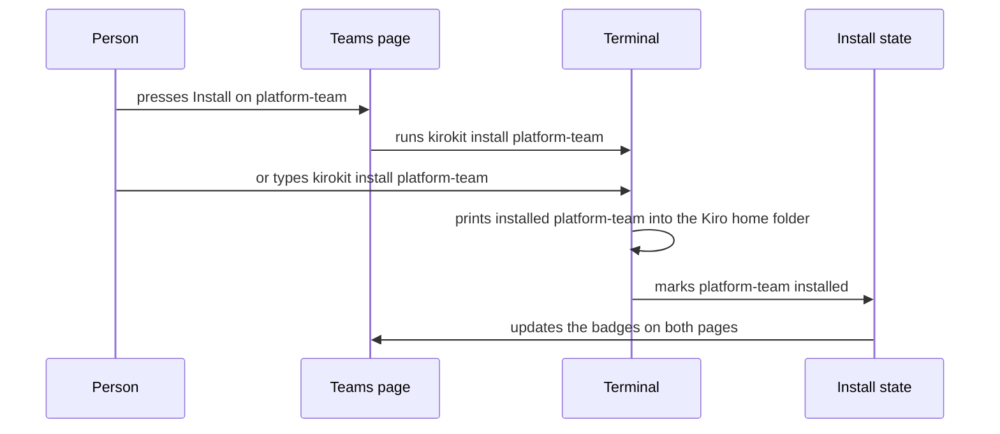
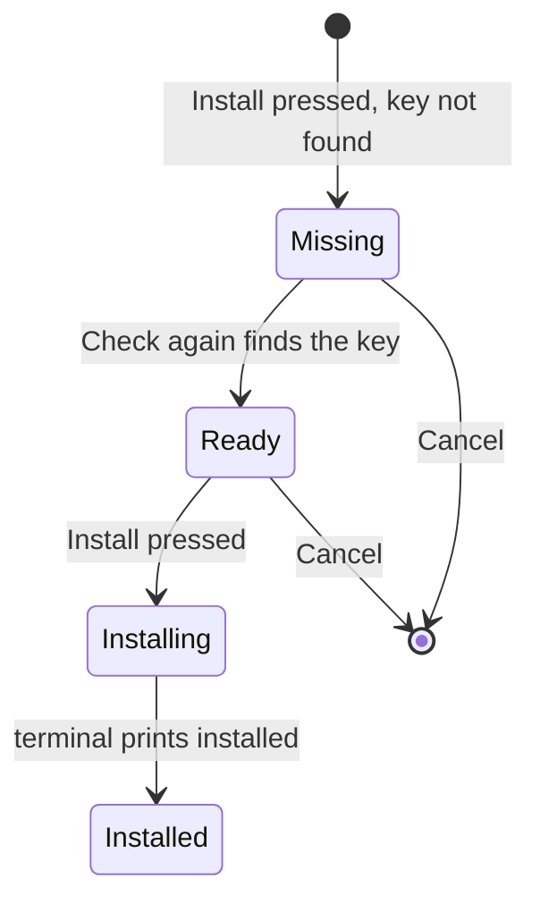
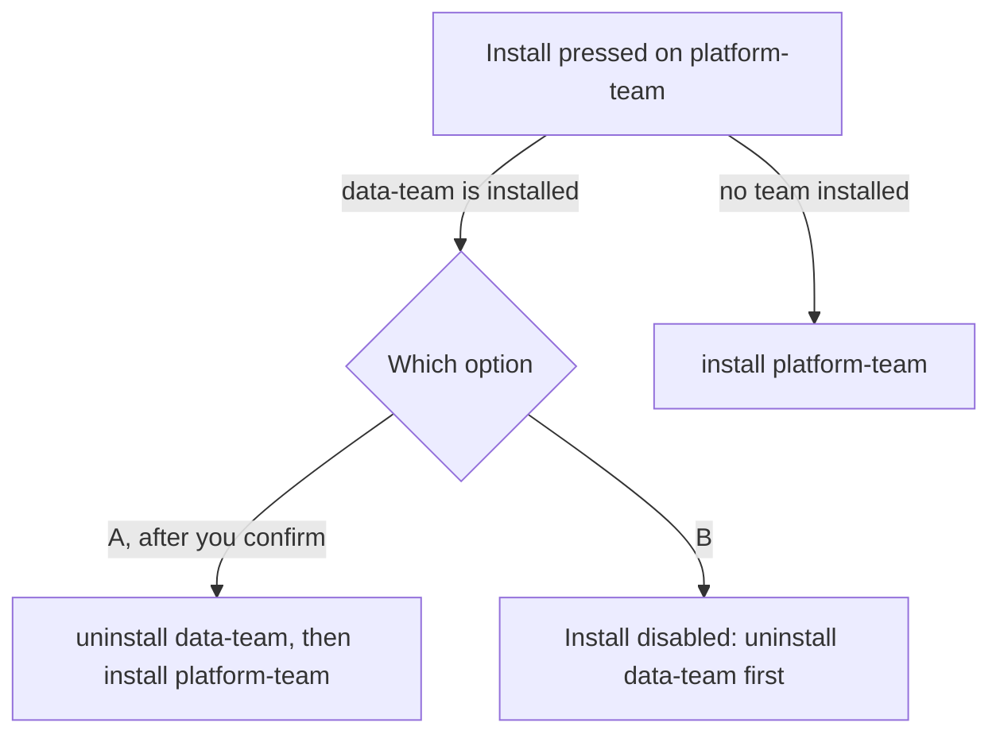

# A clickable mockup of the kirokit desktop app

## Summary

The build finishes one clickable design page, `sidebar-layout`, that shows the kirokit desktop window. It has a sidebar of five sections that collapses to an icon rail, a terminal docked at the bottom, and a setup flow that checks prerequisites before Install. It first completes the five pages with real repository data, then the terminal, then the setup flow, and kirokit's own code does not change.

## What the Plan rests on

- **The only visual identity is a violet rounded-square logo.** The mockup takes its accent colour from the logo and sets everything else as neutral surfaces.
- **Discovery is directory listing plus file loaders; there is no registry.** Every team, agent, skill and version the mockup shows is copied from the repository, so the data is real without any code.
- **Packages return errors; only `commands` prints, and only to cobra's writers.** Each action matches one `kirokit` command with one output line, which the terminal can show word for word.
- **Install records files in a per-team JSON manifest; sync diffs two of them.** The record holds no time or version, so install state in the mockup is sample data and labelled as such.

## Interface

<!-- ql:design sidebar-layout -->
**Design: kirokit desktop: sidebar layout.** Sidebar layout of the kirokit desktop app: five sections, icon rail, docked terminal, team setup with prerequisites. Shown in QualityLayer, on the author's Mac only.
<!-- /ql:design -->

**What this shows.** The Teams page with the sidebar expanded and the terminal open, in light and dark. The other four pages, the icon rail and the setup dialog are reachable by clicking. Install state, the Kiro home folder and the repository path are sample values.

## Engineering decisions

### The mockup is one self-contained design page that can replace the empty desktop-app design

It is a single HTML file with inline styles and script, kept with this task. At Review you can make it the content of the empty `desktop-app` design. A runnable Wails shell was not chosen, because you picked a mockup with no app code for this release.

<!-- ql:decide d1 -->
<!-- /ql:decide -->

### Buttons and typed commands share one path through the terminal

A button echoes its `kirokit` command in the terminal, and a command typed there runs the same way, so both print kirokit's real output and update every screen. A separate activity log, or a terminal that leaves the screens untouched, was not chosen: you want the terminal usable on its own with the UI following it.

**Lens:** sequence



<!-- ql:decide d2 -->
<!-- /ql:decide -->

### Install opens a two-step setup that blocks until prerequisites are found

The dialog first lists SOPS, the decryption key and Kiro CLI as found or missing, and Install stays disabled while one is missing. Showing an error only after a failed install was not chosen, as you decided in Research.

**Lens:** state



<!-- ql:decide d3 -->
<!-- /ql:decide -->

### The sidebar and terminal follow familiar editor shortcuts

The sidebar collapses to a 60-pixel icon rail with its toggle or Command-B, keeping each icon's name as its tooltip and accessible name. The terminal hides with Control-backtick, and you resize it by dragging or with the arrow keys, between 120 and 480 pixels.

<!-- ql:decide d4 -->
<!-- /ql:decide -->

### Real repository data everywhere, sample data only for install state

Teams, agents, descriptions, tools, skills and MCP versions are copied verbatim from this repository. Install state, file counts, times and the two folder paths are sample values, labelled on the page.

<!-- ql:decide d5 -->
<!-- /ql:decide -->

### A second team either replaces the installed one or waits for its uninstall

late: true

**A:** Switch: Install on another team asks "Replace data-team with platform-team?", then runs `kirokit uninstall data-team` and `kirokit install platform-team`. A typed install of another team does the same.
**B:** Block: Install is disabled on other teams with "Uninstall data-team first". A typed install of another team prints `Error: data-team is installed; uninstall it first`.
**Recommended:** A

This came up only from your comment, after the design was drawn. kirokit itself allows several teams side by side, so the rule lives in the app, and both options are equally cheap to draw.

**Lens:** flow



<!-- ql:decide d6 -->
**Your call:** change asked · 17 Oct, 22:18: do A uninstall data-team then
<!-- /ql:decide -->

> [!ADDED] build · your comment on this call asked for A
> Build option A. Install on another team asks to replace the installed team. It then runs `kirokit uninstall` on that team before `kirokit install` on the new one, and a typed install does the same. The B row under *Decided by you* came before your comment and no longer applies.

## Decided by you

<!-- ql:decided-by-you -->
- Discuss · What should the first release of this be? — Clickable design mockup, no app code
- Discuss · How will you know the desktop app was worth it? — non-engineers can setup kirokit without cli, engineer still have a cli option in the desktop app
- Discuss · Which sections should the sidebar list? — Teams + Agents + Install and sync status + Skills and MCP versions + Settings (KIRO_HOME, repo path)
- Discuss · What stays out of the first release? — Editing templates or manifests
- Discuss · Where should the desktop app's code live? — Inside this kirokit repository
- Discuss · Which desktop technology should the app use? — Wails (Go backend, web UI)
- Discuss · How should the sidebar behave? — Collapsible to an icon rail
- Research · What does the engineers' command-line option look like? — no i want a full terminal experience like in vscode. down at the bottom. qualitylayer app has it as well
- Research · Should setup check SOPS and the key before installing? — Yes, a prerequisites step first
- Plan · A second team either replaces the installed one or waits for its uninstall — B · Block: Install is disabled on other teams with "Uninstall data-team first". A typed install of another team prints `Error: data-team is installed; uninstall it first`.
<!-- /ql:decided-by-you -->

## Decisions made for you

- **One accent colour, taken from the logo's violet.** No product design system exists, so neutral surfaces keep the violet for the current section and the main action.
- **Light and dark themes follow the viewer's choice.** Each theme has its own colour set, checked for contrast on every surface.
- **Team, agent, skill and server names use a monospace font.** They are names a person also types in the terminal, so they look the same in both places.
- **The setup's "Check again" always finds the key on the second try.** A mockup cannot look at a real key, so this shows both states in one click.
- **Typed commands support only kirokit's own commands, plus clear.** Anything else prints the shell's "command not found", which keeps the simulation honest.
- **The desktop window keeps its desktop width on narrow screens.** It scrolls sideways instead of reflowing, because the app is desktop only.

## Not doing

- **No Go, Wails or build changes.** Nothing under `cmd`, `internal` or the release setup changes, and no binary is produced.
- **No real checks of SOPS, keys or Kiro CLI.** The prerequisites are simulated; detecting them belongs to the later app.
- **No change to kirokit to enforce one team.** The real CLI still allows several installed teams; the mockup's terminal applies the app's rule.
- **No editing of templates or manifests in the mockup.** This is your Discuss decision, and it holds for every page.
- **No phone layout.** The mockup is a desktop window only.

## Before the build

| # | Prerequisite | Met by | Status |
|---|---|---|---|
| P1 | Permission to run the agreed build | the user, at approval | granted · approved in the App, 2026-10-17 20:19 UTC |

## Assumptions

- The later app records its own install time, since kirokit's install record holds none (unconfirmed)

## How we will know it works

**Oracle:** In a browser, one scripted run of the design page collapses and expands the sidebar, opens all five pages, installs platform-team through the prerequisites check and sees the terminal print `installed platform-team into /Users/you/.kiro`. Then a typed `kirokit uninstall platform-team` flips both badges back, and at no point do two teams show Installed, while `git status` shows no change outside this task's documents.

**Size:** about 1 slice and 3 tasks

**Risky:** none

## Reviewed by

<!-- ql:reviews -->
<!-- /ql:reviews -->

## System design contracts

**Trust boundary:** none — the mockup is a local HTML page that sends and stores nothing.

### The terminal echoes each command and prints kirokit's exact output format

Every simulated command prints the same text the real command prints, with the sample paths below. The input accepts `kirokit <command> [team]` and `clear`; a team name outside `platform-team` and `data-team` prints an error line.

| Command | Printed line | Real source |
|---|---|---|
| `kirokit install <team>` | `installed <team> into /Users/you/.kiro` | `cmd/kirokit/commands/install.go:37` |
| `kirokit uninstall <team>` | `uninstalled <team> from /Users/you/.kiro` | `cmd/kirokit/commands/uninstall.go:26` |
| `kirokit sync <team>` | `synced <team> into /Users/you/.kiro at 9a919bf` | `cmd/kirokit/commands/sync.go:68` |
| `kirokit test [team]` | `<team>: ok` per team | `cmd/kirokit/commands/test.go:46` |
| `kirokit render [team]` | `rendered <team> -> out/<team>` | `cmd/kirokit/commands/render.go:37` |
| `kirokit version` | `kirokit v0.4.0`, then `commit: 9a919bf…` (sample values) | `cmd/kirokit/commands/version.go:25-31` |
| anything else | `zsh: command not found: <word>` or `Error: unknown command "<sub>" for "kirokit"` | — |

Invariants: a button press and a typed command produce the same lines; the input keeps focus after each command; the output region is `aria-live="polite"`.

### Install state is one map that both pages render

```
state = { "platform-team": false, "data-team": true }   // sample start
setInstalled(team, on) → updates the Teams card badge and actions
                       → updates the Install and sync row: badge, files, last change, actions
```

Install, uninstall and sync, whether from a button or typed, go through `setInstalled`, so the two pages never disagree. A per-page copy of the state was rejected, because the pages would drift.

Invariant: at most one team is `true`. An install of a second team follows option A of the Your call, which you picked. From a button, it first asks "Replace data-team with platform-team?". It then runs `kirokit uninstall <installed team>` before `kirokit install <new team>`, and a typed install does the same without the question. Cancelling the question leaves the state unchanged.

### The setup dialog is a native modal with focus return

`<dialog>` opened with `showModal()`; Escape and Cancel close it; focus returns to the button that opened it. The key's text names the agents that need it: devops and platformdev for platform-team, and javadev for data-team. Install is `disabled` with the visible reason "1 prerequisite missing" until the key is found. While installing, it keeps its size and reads "Installing…".

## Patterns to follow

- **The draft page is the starting point.** `docs/plans/2026-10-17-desktop-app-sidebar-layout/design/sidebar-layout.html` already holds the layout, tokens and most interactions. Extend it in place rather than restarting it.
- **Copy data from these lines, word for word:**
  - agent descriptions and tools from `teams/platform-team/agents/devops/agent.json.tmpl:3-5`, `teams/platform-team/agents/platformdev/agent.json.tmpl:3-5`, `teams/data-team/agents/godev/agent.json.tmpl:3-5` and `teams/data-team/agents/javadev/agent.json.tmpl:3-5`;
  - MCP pins from `env/mcp-versions.yaml:3-13`;
  - the logo SVG from `assets/logo.svg:1-20`.
- **Theme bridge.** Read `document.documentElement.dataset.theme` and listen for `ql:design-mode`; CSS tokens sit on `:root`, with a `prefers-color-scheme` fallback and `[data-theme]` overrides.
- **How it is tested.** `qualitylayer design check sidebar-layout` validates the source. `qualitylayer design shot sidebar-layout --width 1440 --theme light|dark` renders it. A browser driver (Chrome DevTools) loads the page file and runs the oracle's click-through, plus keyboard checks: Tab order, Command-B, Control-backtick, Escape in the dialog, arrow keys on the resize handle.
- **How to start it.** `qualitylayer design show sidebar-layout` opens it in the QualityLayer App; the file also opens directly in a browser.
- **The Go suite proves nothing changed.** The draft is excluded from git (`.git/info/exclude:8`), so the repository checks run on an unchanged tree.

**Project checks:** `go test ./...` · `golangci-lint run` · `go vet ./...` · `go build ./...` · `node scripts/sync-agent-assets.mjs --check`

## Proven before the gate

Nothing new: everything this design uses already runs in this repository.

The draft page rendered in both themes with `qualitylayer design shot` and passed `qualitylayer design check`.
