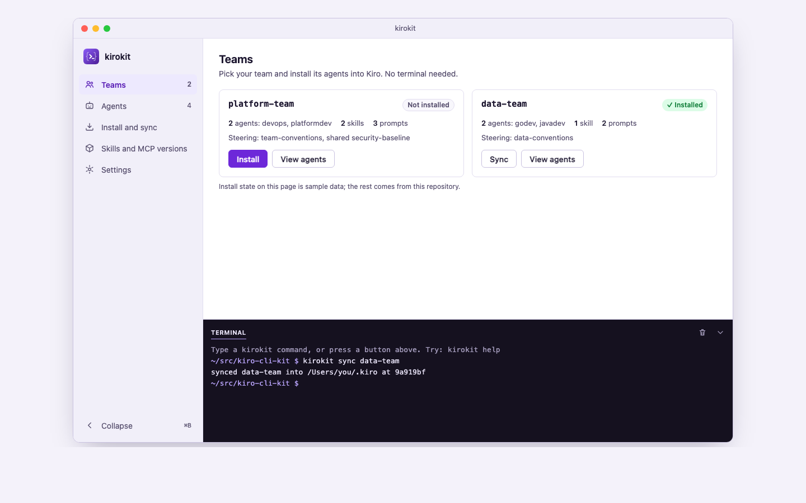

# Desktop app sidebar layout · what was checked

## Summary

<!-- ql:summary -->
Passed after 1 judge run.
<!-- /ql:summary -->

## How it is checked

<!-- ql:lanes -->
- **Polish** · a fresh agent · Sonnet 5.5
  - State: done
  - Result: done · 0 simplifications · 0 tests added · docs: no doc impact · UI: 1 screen captured in light and dark · 2 screens compared: 2 captured, 0 stale, 0 not captured
- **Security review** · a fresh agent · read-only
  - State: skipped
  - Result: not run
  - Why it runs here: The Plan's trust boundary line says nothing crosses it.
- **Second opinion** · another vendor's agent
  - State: skipped
  - Result: not run
  - Why it runs here: Not run: the change is not risky, and Settings say When risky.
- **Project checks** · QualityLayer itself · no agent
  - State: done
  - Result: 5 checks pass · 5 reused
- **Independent review** · the build session itself · not risky, so not independent (Settings › Independent review)
  - State: done
  - Result: 8 of 8 points pass · 1 only you can confirm
- **Fix rounds** · one fresh fixer per round
  - State: done
  - Result: none needed
<!-- /ql:lanes -->

## Done means, checked

<!-- ql:proof -->
| Done means | Proof | |
|---|---|---|
| 1. The mockup opens full size in the QualityLayer App |  | passed |
| 2. The sidebar lists all five sections, and each opens its page | Five sidebar buttons each show only their own page. | passed |
| 3. The sidebar collapses to an icon rail and expands again | Toggle and Command-B switch between a 60 pixel rail and the 232 pixel sidebar. | passed |
| 4. A non-engineer can click through setting up a team | Prerequisites check blocks Install until Check again, then the team shows Installed. | passed |
| 5. Engineers get a full terminal docked at the bottom | Terminal docks at the bottom, hides, resizes between 120 and 480, and shows the command for each button and typed commands update the screens. | passed |
| 6. The mockup shows kirokit's real teams, agents and versions | Agents, tools, skills and MCP versions equal the repository files. | passed |
| 7. The mockup reads well in light and dark mode | Look fits kirokit; both themes render readably in the captured pictures, only you can judge the look. | yours to confirm |
| 8. kirokit's code and behaviour stay unchanged | No change under cmd, internal, teams, global, env, testdata or assets — `go test ./...` and `git status` check recorded. | passed |
| 9. Only one team is installed at a time | No button or typed sequence showed two teams Installed. | passed |
<!-- /ql:proof -->

## Open items

<!-- ql:open-items -->
- **Found while checking:** The 390 pixel width was not checked, and the page is desktop only by the Plan.
- **Only you can confirm:** The look fits kirokit.
<!-- /ql:open-items -->

## Quality pass

### Polish

**Result:** done · 0 simplifications · 0 tests added · docs: no doc impact · UI: 1 screen captured in light and dark
- sidebar-layout (1440, light): matches the Plan and Discuss description (five sections with counts, collapse toggle, Teams cards with Install/Sync, docked terminal, violet accent); the built page is the mockup itself
- sidebar-layout (1440, dark): same layout, dark surfaces, violet accent visible and text legible
**Pictures:**
- `evidence/screen-3decee0f3e9494573da4a3f4.png` — Teams page with docked terminal, 1440 wide, light theme
- `evidence/screen-78eda45e414b09249fccad67.png` — same page, 1440 wide, dark theme
**Left alone:** the diff outside docs/plans is empty (the design page is git-excluded), so there was no code to simplify, test or document.
**Not checked:** the 390 px width and the other four sections' screens; only the Teams landing view was captured.

## Checks

<!-- ql:checks -->
- all · 935d74581db6308b84307b9bd70d01b911b8f05fa7567633acf2eb969fd6cd42 · `go test ./...` · exit 0 · 0s · reused
- all · 935d74581db6308b84307b9bd70d01b911b8f05fa7567633acf2eb969fd6cd42 · `golangci-lint run` · exit 0 · 0s · reused
- all · 935d74581db6308b84307b9bd70d01b911b8f05fa7567633acf2eb969fd6cd42 · `go vet ./...` · exit 0 · 0s · reused
- all · 935d74581db6308b84307b9bd70d01b911b8f05fa7567633acf2eb969fd6cd42 · `go build ./...` · exit 0 · 0s · reused
- all · 935d74581db6308b84307b9bd70d01b911b8f05fa7567633acf2eb969fd6cd42 · `node scripts/sync-agent-assets.mjs --check` · exit 0 · 0s · reused
<!-- /ql:checks -->

## Fix rounds

<!-- ql:fix-rounds -->
None so far.
<!-- /ql:fix-rounds -->

## Second opinion

<!-- ql:reviews -->
Not run: the change is not risky, and Settings say When risky.
<!-- /ql:reviews -->

<!-- optional section here, only when there is content: "Independent review" -->

## Verification

### Iteration 1

**Revision:** 935d74581db6308b84307b9bd70d01b911b8f05fa7567633acf2eb969fd6cd42

**Assignment:** c11e5381-1ffb-4a99-9c71-6d7adb0fccf5
**Judge:** build session, no helpers available

- [PASS] check: recorded — all · 935d74581db6308b84307b9bd70d01b911b8f05fa7567633acf2eb969fd6cd42 · `go test ./...` · exit 0 · 0s · reused
- [PASS] check: recorded — all · 935d74581db6308b84307b9bd70d01b911b8f05fa7567633acf2eb969fd6cd42 · `golangci-lint run` · exit 0 · 0s · reused
- [PASS] check: recorded — all · 935d74581db6308b84307b9bd70d01b911b8f05fa7567633acf2eb969fd6cd42 · `go vet ./...` · exit 0 · 0s · reused
- [PASS] check: recorded — all · 935d74581db6308b84307b9bd70d01b911b8f05fa7567633acf2eb969fd6cd42 · `go build ./...` · exit 0 · 0s · reused
- [PASS] check: recorded — all · 935d74581db6308b84307b9bd70d01b911b8f05fa7567633acf2eb969fd6cd42 · `node scripts/sync-agent-assets.mjs --check` · exit 0 · 0s · reused
- [PASS] done 1: the page opens as one desktop window with sidebar and main pane at 1440 wide — `evidence/screen-3decee0f3e9494573da4a3f4.png`
- [PASS] done 2: five sidebar buttons each show only their own page — `records/it1-browser-run.txt`
- [PASS] done 3: toggle and Command-B switch between a 60 pixel rail and the 232 pixel sidebar — `records/it1-browser-run.txt`
- [PASS] done 4: prerequisites check blocks Install until Check again, then the team shows Installed — `records/it1-browser-run.txt`
- [PASS] done 5: terminal docks at the bottom, hides, resizes between 120 and 480, and shows the command for each button and typed commands update the screens — `records/it1-browser-run.txt`
- [PASS] done 6: Agents, tools, skills and MCP versions equal the repository files — `records/it1-browser-run.txt`
- [USER] done 7: look fits kirokit; both themes render readably in the captured pictures, only you can judge the look
- [PASS] done 8: no change under cmd, internal, teams, global, env, testdata or assets — `go test ./...` and `git status` check recorded
- [PASS] done 9: no button or typed sequence showed two teams Installed — `records/it1-browser-run.txt`
- [PASS] scenario 1: all 5 steps as expected — `records/it1-browser-run.txt`
- [PASS] scenario 2: all 6 steps as expected — `records/it1-browser-run.txt`
- [PASS] scenario 3: all 9 steps as expected — `records/it1-browser-run.txt`
- [PASS] scenario 4: light and dark pictures render — `evidence/screen-3decee0f3e9494573da4a3f4.png`, `evidence/screen-78eda45e414b09249fccad67.png`
- [PASS] scenario 5: slice validation ran the git status test and `go test ./...`, both exit 0 — `records/it1-scenario-5.txt`
- [PASS] dod T1: pages, rail and counts verified — `records/it1-browser-run.txt`
- [PASS] dod T2: output lines, errors, shortcuts and resize limits verified — `records/it1-browser-run.txt`
- [PASS] dod T3: replace question, cancel, typed switch, prerequisites and focus return verified — `records/it1-browser-run.txt`
- [PASS] truth oracle: install through prerequisites prints `installed platform-team into /Users/you/.kiro`, uninstall flips both badges, never two Installed — `records/it1-browser-run.txt`
- [PASS] review: only the design page changed, no stack drift, no trust boundary crossed; docs: no doc impact
- [NOTE] review: the 390 pixel width was not checked, and the page is desktop only by the Plan

**Pictures:**

- `evidence/screen-3decee0f3e9494573da4a3f4.png` — Teams page with the docked terminal, light theme
- `evidence/screen-78eda45e414b09249fccad67.png` — same page, dark theme

**Try it:**

1. Open the page: `qualitylayer design show sidebar-layout`
2. Press Install on platform-team, then Check again, then Install; read the terminal line
3. Type `kirokit install data-team` in the terminal and see only data-team marked Installed

**Result:** pass
