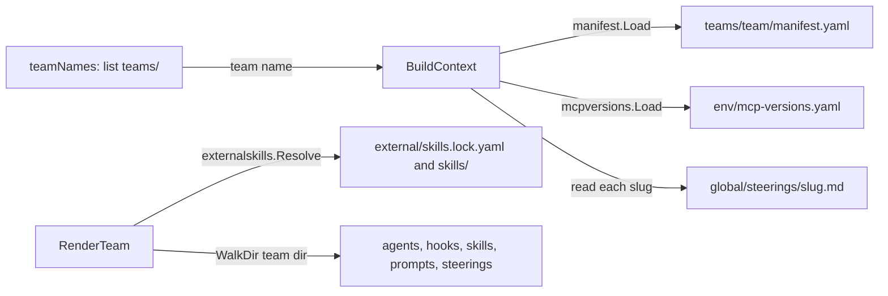

# How kirokit wires commands, discovery, paths, install records and output

## Findings

### A thin main hands one cobra tree to commands that mostly delegate to internal packages
**Answers:** 1

`main` calls `commands.Execute()` and prints any returned error to stderr with exit code 1 (`cmd/kirokit/main.go:12-17`). The root command silences cobra's own usage and error printing, so `main` is the only place an error is shown (`cmd/kirokit/commands/root.go:26-32`). Nine subcommands are registered in `newRootCmd` (`root.go:33-41`).

```
main (cmd/kirokit/main.go:12)
└── commands.Execute (root.go:22) -> newRootCmd().Execute()
    ├── render [team] --out   -> teamNames; render.RenderTeam per team        (render.go:17-40)
    ├── test [team]           -> teamNames; golden.Compare per team            (test.go:15-52)
    ├── update [team]         -> teamNames; golden.Update per team             (update.go:15-39)
    ├── onboard <team>        -> scaffold.Scaffold(teamsRoot, team)            (onboard.go:17)
    ├── install <team>        -> parseKnowledgeBaseFlags; install.ResolveKiroHome; install.Install (install.go:19-34)
    ├── uninstall <team>      -> install.ResolveKiroHome; install.Uninstall    (uninstall.go:18-23)
    ├── sync <team>           -> os.Chdir(repo); git fetch/pull|checkout; install.Sync (sync.go:43-61)
    ├── skills fetch [team]   -> manifest.Load; externalskills.Fetch           (skills.go:47-58)
    └── version               -> buildInfo (ldflags, else debug.ReadBuildInfo) (version.go:24,40-64)
```

What each `RunE` does itself:
- **Argument shaping.** Every command turns an optional positional into `team` and loops over `teamNames` results (`render.go:21-29`).
- **Output directory choice.** `render` appends the team name to `--out` only when no team was given (`render.go:30-33`).
- **Flag validation.** `parseKnowledgeBaseFlags` requires `--kb-agent`, `--kb-source` and `--kb-mount` together or not at all (`install.go:49-63`); `install` and `sync` share it.
- **Git handling in `sync`.** `sync` runs git itself (`gitOutput`, `sync.go:100-107`): `fetch --tags --prune`, then `pull --ff-only` or checkout of the newest `v*` tag (`sync.go:80-98`).
- **Pass/fail aggregation in `test`.** It prints mismatches to stderr, keeps going over teams, then returns one error (`test.go:32-50`).
- **Everything else** (rendering, golden comparison, install, scaffolding, fetching) lives in `internal/*`.

Change surface: `commands` files changed 2-4 times in 90 days each (`git log --since=90.days`); `root.go` four times. `commands` unit tests cover only helpers (`parseKnowledgeBaseFlags`, `updateCheckout`, `buildInfo`, skills fetch), not `Execute`.

### Discovery is directory listing plus file loaders; there is no registry
**Answers:** 2

- **Teams.** `teamNames(team)` returns `[]string{team}` unchecked when given. Otherwise it lists `teams/` and keeps directories only (`root.go:47-61`). Returns `([]string, error)`; the error is `kirokit: read teams: ...` (`root.go:53`). A given name is not checked for existence or path characters here. `install`, `uninstall` and `sync` take the team directly and skip `teamNames` (`install.go:17`).
- **Manifest.** `manifest.Load(path) (*Manifest, error)` reads `manifest.yaml` (`internal/manifest/manifest.go:58`). The struct holds `Team`, `GlobalSteerings` and `ExternalSkills` (`manifest.go:16-20`). It errors if `team` is empty (`manifest.go:68-70`). It then validates every external skill entry and expands `paths:` into one entry per path (`manifest.go:71-75`, `94-117`). It rejects duplicate single-skill names (`manifest.go:110-112`). Sources with a leading dash, transport helpers or embedded credentials are refused (`manifest.go:194-217`). The manifest `team` field is not compared with the directory name.
- **MCP version pins.** `mcpversions.Load(path) (Versions, error)` parses a flat YAML string map (`internal/mcpversions/mcpversions.go:13-27`). The template function `mcpVersion` returns an error for a missing key, so the render fails (`internal/render/funcs.go:23-30`).
- **Agents.** There is no agent list. `render` walks `teams/<team>` and maps `agents/<agent>/agent.json[.tmpl]` to `agents/<agent>.json`. Files under `agents/<agent>/env/` are skipped. Anything else under `agents/<agent>/` is an error (`internal/render/render.go:218-232`). `install` separately lists `agents/*/env/secrets.enc.yaml` (`internal/install/install.go:325-352`).
- **Skills.** Team-authored skills are plain files under `skills/` (`render.go:239-240`). External skills are declared in the manifest and resolved by `externalskills.Resolve(teamDir, entries) ([]string, error)` (`internal/externalskills/verify.go:27`). It reads `external/skills.lock.yaml` (`lock.go:26,49-62`; a missing file is an empty lock) and checks manifest, lock and vendored hash (`verify.go:145-156`). It returns one multi-line error listing all problems (`verify.go:93-96`) or the sorted names. Collections (`all: true`) get their names from the lock (`verify.go:105-141`).
- **Global steerings.** `BuildContext` reads `global/steerings/<slug>.md` for each manifest slug; a missing file fails (`internal/render/context.go:38-46`).



### Paths are fixed repository-relative strings resolved against the working directory
**Answers:** 3

- **Roots are constants.** `teams`, `global/steerings`, `env/mcp-versions.yaml` and `testdata/golden` are constants in `commands` (`root.go:14-19`). Only `commands` knows them; `internal/render`, `golden` and `install` receive them as arguments (`render.RenderTeam` params, `render.go:25`; `golden.Inputs`, `golden.go:20-25`; `install.Roots`, `install.go:22-26`). No `internal` package calls `os.Getwd`.
- **Relative to the working directory.** Nothing resolves a repository root, as the comment says (`root.go:11-13`). `sync` is the only command that changes directory, with `os.Chdir(repo)` (`sync.go:43`); `--repo` defaults to `.`. `skills fetch` makes `teamDir` absolute with `filepath.Abs` because git runs in a scratch directory (`internal/externalskills/fetch.go:32-36`).
- **`$KIRO_HOME`.** The only environment read in `internal/` is `os.Getenv("KIRO_HOME")`, falling back to `~/.kiro` via `os.UserHomeDir` (`install.go:46-55`). `install`, `uninstall` and `sync` call `ResolveKiroHome` (`install.go:24`, `uninstall.go:18`, `sync.go:37`).
- **The `/kiro-home` sentinel.** `render`, `test` and `update` pass an empty `kiroHome`, and `BuildContext` substitutes `/kiro-home` (`render.go:34`, `context.go:15,48-50`). `golden.renderForGolden` does the same (`golden.go:81,97`). `Install` passes the real path (`install.go:70`), and it is baked into global steering and skill URIs (`globalsteerings.go:48`, `externalskills.go:19`) and available to templates as `.KiroHome`.
- **Subprocess environment.** `runGit` in `fetch.go` inherits the process environment and stdin (`fetch.go:256-262`). `sync.go` git calls inherit the environment and capture combined output (`sync.go:101`).
- **Temp directories.** Rendering stages in `.kirokit-render-*` beside the output directory (`render.go:43`); install stages in the OS temp dir (`install.go:63`).

### Install records files in a per-team JSON manifest; sync diffs two of them
**Answers:** 4

```
$KIRO_HOME/
├── agents/<agent>.json, hooks/, prompts/, skills/, steering/    (rendered tree, 0600; exec bit kept as 0700)
├── kirokit-steerings/<team>/<slug>.md
├── kirokit-secrets/<team>/<agent>/secrets.enc.yaml
├── .kirokit-installed/<team>.json   {"files": [...], "symlinks": [...]}
└── <YYYYMMDD-HHmmss>-<folder>.backup/   (not recorded)
```

- **What `Install` writes.** It renders to a temp dir, plans all files (rendered tree, secrets, optional knowledge-base edit), backs up, writes, then writes `.kirokit-installed/<team>.json` (`install.go:62-121`, path `install.go:260-262`). The JSON holds absolute `files` (including the manifest path itself) and `symlinks` (`install.go:39-42,114-117`). It contains no timestamp, version, commit or content hash.
- **Backups.** `backupChangedFolders` copies each top-level folder where an existing file would change to `<stamp>-<folder>.backup` before any write (`install.go:379-408`; `internal/backup/backup.go:49-84`). Unchanged re-installs make none (`backup.Differs`, `backup.go:107-117`). Backups are not in the manifest, so uninstall leaves them (`install.go:376-378`). `render --out` instead moves a changed output directory aside (`render.go:132-173`, `backup.MoveAside`).
- **Uninstall.** It reads the manifest (error if missing, `install.go:233-240`), removes symlinks then files, which includes the manifest (`install.go:247-256`). Empty directories are left behind.
- **Sync.** `install.Sync` reads the previous manifest (a missing one is empty, `sync.go:65-77`), runs `Install`, reads the new one, and removes paths that are in the old record and not the new one, then empty parent directories up to `$KIRO_HOME` (`sync.go:16-49`). It returns pruned paths, which `commands/sync.go:65-67` prints. The `commands` side records nothing itself: it prints the short before/after commit (`sync.go:47-54`) but does not save it.
- **What a reader learns later.** From the manifest: which paths each team's last install wrote. Backup folder names give the time of a changing install. The installed commit or kirokit version is not recorded anywhere under `$KIRO_HOME` (fact from `install.manifest`, `install.go:39-42`).

### Packages return errors; only `commands` prints, and only to cobra's writers
**Answers:** 5

- **`internal/*` never print.** A search of non-test `internal` and `cmd` code for `fmt.Print*`, `log.`, `os.Stdout` and `io.Writer` found no hits in `internal/`. The one stderr use there is `exec.Cmd.Stderr` capturing into a buffer that becomes error text (`fetch.go:260-266`). The only direct `os.Stderr` use in the repo is `main.go:14`. No function in `internal/*` takes an `io.Writer`.
- **Progress lines** come from `commands` through `cmd.OutOrStdout()` (`render.go:37`, `install.go:37`, `sync.go:53,66,68`, `skills.go:44-70`). Mismatch detail from `test` goes to `cmd.ErrOrStderr()` (`test.go:40-43`).
- **Warnings** do not exist as a category. `install.Sync` returns pruned paths as data (`sync.go:16`); `externalskills.Fetch` returns a `Lock` and the command prints it (`skills.go:58-64`).
- **Error style.** Errors are wrapped with a package prefix (`install:`, `render:`, `manifest:`) and `%w`; `commands` adds `kirokit <cmd>:` (`render.go:35`, `install.go:35`). Multi-problem errors are joined into one string (`verify.go:95`). `sync` ignores errors from the two `rev-parse` calls (`sync.go:47,51`).
- **Interactive inheritance.** `runGit` passes `os.Stdin` to git so credential prompts work (`fetch.go:259-262`).

## How it is tested today

- **Suite.** Go tests sit beside each package (`*_test.go`), plus the golden harness in `internal/golden`. `task ci` runs build, vet, lint and test (`AGENTS.md`).
- **All tests:** `go test ./...` from the repository root.
- **One package:** `go test ./internal/install`. **One test:** `go test ./internal/install -run TestName`; same for `./cmd/kirokit/commands`.
- **Isolation.** `commands` tests change the working directory with `os.Chdir` and restore it in `t.Cleanup` (`cmd/kirokit/commands/sync_test.go:27-30`), so they are not parallel-safe. `golden` tests build a root under a temp dir with `teams/` inside (`internal/golden/golden_test.go:24`). Committed fixtures are `testdata/golden/<team>/` for teams `data-team` and `platform-team`, and `testdata/knowledgebase/`.
- **`kiro-cli agent validate`** runs in `go test ./internal/golden` and is skipped unless `KIROKIT_REQUIRE_KIRO_CLI=1` forces it (`internal/golden/kirocli_test.go:15,22`).
- **Gaps.** No test runs `Execute` end to end; `commands` tests cover helpers only. I did not run the suite for this report.

## Open questions

Question 2: Whether a mismatch between a manifest `team` field and its directory name is checked anywhere else was not traced beyond `manifest.Load` and `BuildContext`.
Question 3: Whether `install`/`uninstall`/`sync` reject team names containing path separators was not checked; `teamNames` and `install.Install` do no such check, and only `writeGlobalSteerings` uses `plainName` (`globalsteerings.go:39-41,58`).
Question 4: Backup naming under `render --out` versus install was read but not exercised by running commands.

## Code references

Read in full or in the relevant range; not an exhaustive listing of tests.
- Entry and commands: `cmd/kirokit/main.go:12-17`, `cmd/kirokit/commands/root.go:14-62`, `render.go`, `test.go`, `update.go`, `install.go`, `uninstall.go`, `sync.go`, `skills.go`, `onboard.go`, `version.go`.
- Discovery: `internal/manifest/manifest.go:58-232`, `internal/mcpversions/mcpversions.go:13-27`, `internal/externalskills/lock.go`, `internal/externalskills/verify.go:27-156`, `internal/externalskills/fetch.go:23-60,256-269`, `internal/render/context.go:27-58`.
- Rendering: `internal/render/render.go:25-250`, `internal/render/globalsteerings.go:14-70`, `internal/render/externalskills.go`, `internal/render/funcs.go`.
- Install records: `internal/install/install.go:39-121,229-262,379-428`, `internal/install/sync.go:16-78`, `internal/backup/backup.go:25-117`.
- Golden: `internal/golden/golden.go:20-110`.
