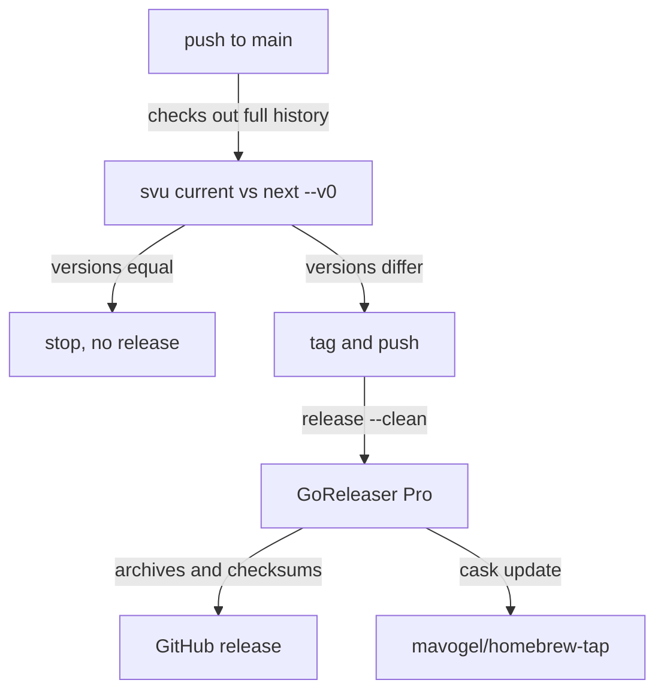

# How kirokit is built, tested and released

## Findings

### Local build and the CI gate are the same four checks

**Answers:** 6

`task ci` runs build, vet, lint and test in that order (`Taskfile.yml:24-30`). Build writes the `./kirokit` binary (`Taskfile.yml:6-7`), which is gitignored (`.gitignore:2`). Lint is `golangci-lint run` (`Taskfile.yml:17`) with only govet, staticcheck, errcheck and unused enabled (`.golangci.yml:3-8`). Tests run `go test ./... -v` (`Taskfile.yml:22`).

The CI job `build-vet-lint-test` runs on ubuntu-latest for every pull request and every push to main (`.github/workflows/ci.yaml:3-13`). Its steps are `go build ./...`, `go vet ./...`, golangci-lint v2.14.0 through its action, `go test ./... -v`, and `node scripts/sync-agent-assets.mjs --check` (`.github/workflows/ci.yaml:23-38`). The Go version is `stable` (`.github/workflows/ci.yaml:21`), while `go.mod` declares `go 1.27` (`go.mod:3`). Actions are pinned by commit digest (`.github/workflows/ci.yaml:16`).

Differences between `task ci` and CI: CI builds with `go build ./...` (no binary output) and adds the agent-assets check, which `task ci` lacks. CI does not set `KIROKIT_REQUIRE_KIRO_CLI` (`.github/workflows/ci.yaml:34-35`), so the `kiro-cli agent validate` tests skip there when `kiro-cli` is absent (`internal/golden/kirocli_test.go:15-33`).

```
task ci
├── build  go build -o kirokit ./cmd/kirokit
├── vet    go vet ./...
├── lint   golangci-lint run
└── test   go test ./... -v   (golden comparisons included)
CI adds: agent-assets check; uses go build ./... ; no kiro-cli gate
```

### Releases are automatic on every push to main, via svu and GoReleaser Pro

**Answers:** 6

The release workflow triggers on push to main only, with `contents: write` and a single-slot concurrency group that queues rather than cancels (`.github/workflows/release.yaml:3-13`). It does not depend on the CI workflow: it is a separate workflow with no `needs` or `workflow_run` link, so a release can run even if CI fails (inference from `.github/workflows/release.yaml:15-67`).

`svu current` and `svu next --v0` compare versions. If they are equal, nothing is tagged or released (`.github/workflows/release.yaml:35-47`). Otherwise the workflow tags and pushes the new tag (`.github/workflows/release.yaml:49-53`) and runs `goreleaser release --clean` with distribution `goreleaser-pro` (`.github/workflows/release.yaml:55-61`). It needs three secrets: `GITHUB_TOKEN`, `GORELEASER_KEY` and `HOMEBREW_TAP_GITHUB_TOKEN` (`.github/workflows/release.yaml:62-67`). svu is installed at v3.4.1 (`.github/workflows/release.yaml:30`).



### Artefacts are CGO-free tarballs for four platforms plus a Homebrew cask

**Answers:** 6

The single build `kirokit` compiles `./cmd/kirokit` with `CGO_ENABLED=0` for darwin and linux on amd64 and arm64 (`.goreleaser.yaml:9-20`). Ldflags strip symbols (`-s -w`) and inject `version`, `commit` and `date` into `cmd/kirokit/commands` (`.goreleaser.yaml:21-25`). Those variables default to `"dev"`, `""` and `""` (`cmd/kirokit/commands/version.go:13-15`). A plain `task build` therefore reports `dev`.

Archives are `tar.gz` named `kirokit_<version>_<os>_<arch>` (`.goreleaser.yaml:27-33`), with a `checksums.txt` (`.goreleaser.yaml:35-36`). Before building, `go mod tidy` runs (`.goreleaser.yaml:5-7`). The changelog uses GitHub, groups feat and fix, and excludes docs, test and chore commits (`.goreleaser.yaml:38-54`). The Homebrew cask is pushed to `mavogel/homebrew-tap` and strips the macOS quarantine attribute on install because binaries are not notarized (`.goreleaser.yaml:56-71`). The release mode is `append` (`.goreleaser.yaml:73-77`). Windows is not built (`.goreleaser.yaml:15-17`).

### Local hooks enforce hygiene and commit format, not tests

**Answers:** 6

lefthook pre-commit runs trailing-whitespace and end-of-file fixers (re-staging fixes), check-yaml, check-json and gitleaks on staged files (`lefthook.yml:13-44`). The fixers skip `testdata/golden/**`, `*.enc.yaml` and `teams/*/external/**` (`lefthook.yml:17-21`). The commit-msg hook runs `cz check` (`lefthook.yml:46-49`), which keeps messages in the Conventional Commits form that svu reads. No hook runs the Go tests, vet or lint. Hooks are installed per clone with `lefthook install` (`lefthook.yml:1-3`).

Renovate keeps the dependencies current: it pins action digests, auto-merges minor and patch Go modules and Actions, and bumps the golangci-lint version in `ci.yaml` (`renovate.json:3`, `renovate.json:16-23`, `renovate.json:26-31`).

Change frequency (`git log --since=90.days` over Taskfile, goreleaser, workflows, lefthook): 11 commits, the latest being dependency pinning (`8c86d79`) and the module rename (`bcd9d8c`). The release and CI files are small single-job files, so the area is easy to change.

## How it is tested today

Test files exist in `cmd/kirokit/commands` (install, skills, sync, version), `internal/backup`, `externalskills`, `golden`, `install`, `kiroconfig`, `manifest`, `mcpversions`, `render`, `scaffold` and `sopswrap`. Standard `go test` with the standard library; the golden harness compares rendered output byte-for-byte against `testdata/golden/<team>/` (`data-team`, `platform-team`).

From the repository root:

- Whole suite: `go test ./...` (or `task test`, which adds `-v`).
- One package: `go test ./internal/golden` (I ran it; 10 tests passed).
- One test file's tests: `go test ./internal/render -run <TestName>`; Go selects by package and name, not by file.
- Golden diff only: `task build && ./kirokit test`; regenerate with `./kirokit update [team]` (`AGENTS.md`).
- kiro-cli validation: set `KIROKIT_REQUIRE_KIRO_CLI=1` to turn skips into failures (`internal/golden/kirocli_test.go:15-23`). Without it, tests skip when `kiro-cli` is not on PATH (`internal/golden/kirocli_test.go:27-30`).
- Agent assets parity: `node scripts/sync-agent-assets.mjs --check`.

## Open questions

Question 6: I did not run `task ci` or `golangci-lint`, so lint status is unverified. Whether branch protection makes CI a required check on main is not visible from the repository files.

## Code references

Exhaustive for the five named files plus supporting files:
- `Taskfile.yml:1-30`
- `.goreleaser.yaml:1-77`
- `.github/workflows/ci.yaml:1-38`
- `.github/workflows/release.yaml:1-67`
- `lefthook.yml:1-49`
- `.golangci.yml:1-8`, `go.mod:1-13`, `renovate.json`
- `cmd/kirokit/commands/version.go:13-15`
- `internal/golden/kirocli_test.go:15-33`
