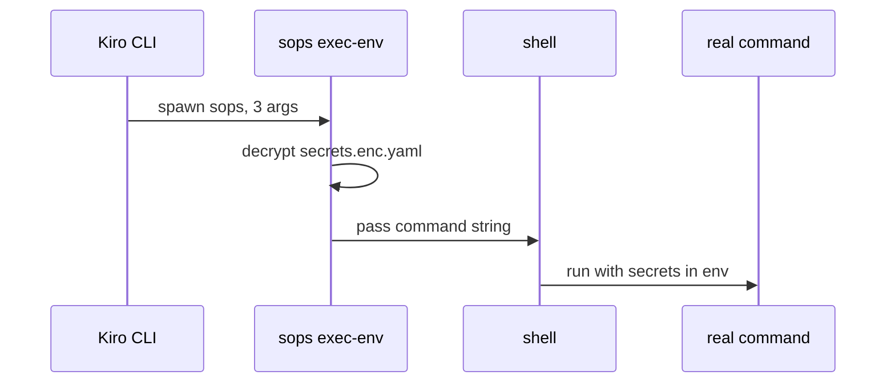
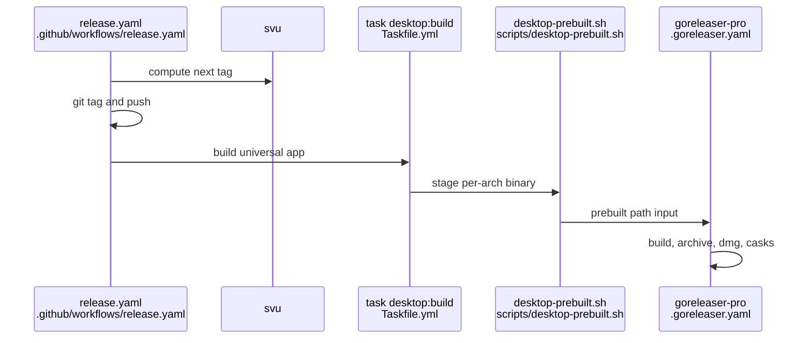

# Research: Ship CLI and desktop app for Linux and Windows

## Summary

On Linux, the CLI already builds and is released as a tar.gz, and the Homebrew cask GoReleaser
generates already has a Linux section. The desktop code compiles for Linux too. What Linux lacks is
packaging (.deb/.rpm, the app build on a Linux runner) and app defaults that assume a Mac: the data
folder, the age-key path, Homebrew tool folders and the `.app` layout used to find the bundled CLI.

Windows needs more. The app's terminal library does not run on Windows, and two files use Unix-only
process-group kills, so the app does not compile there. The shell tab, environment capture and PATH
handling assume a POSIX login shell. On the CLI side, the main risk is that MCP servers needing
secrets are started through `sops exec-env`. On Windows, sops passes the command to `cmd.exe`, so
the POSIX single-quote quoting baked into rendered configs would break there. Other CLI risks on
Windows: mixed `\` and `/` in baked paths and `file://` URIs, knowledge-base symlinks needing
Developer Mode, execute bits that Windows does not keep, and CRLF checkouts that would break
byte-for-byte goldens and lock hashes, since there is no `.gitattributes`.

The release runs as one macOS job. GoReleaser Pro's split/merge and prebuilt import make room for
Linux and Windows jobs that build the app on their own runners, which Wails needs, because it does
not cross-compile.

## What the goal puts at risk

- Reuse: `terminal.Session` is the single process wrapper for both tabs (`desktop/terminal/terminal.go:33`), so one per-OS backend there covers runner and shell tab.
- Reuse: `resolveCLI` (`desktop/shell.go:41-69`), `homeDir`/`NewApp` (`desktop/app.go:54,137`) and `ageKeyCandidate` (`desktop/prereq.go:44-56`) are the single places that decide paths.
- Reuse: GoReleaser Pro `prebuilt` import is already in use (`.goreleaser.yaml:30-39`); split/merge (`--split`, `continue --merge`) is the documented multi-runner path.
- Churn: `README.md` 25 commits in 90 days, `.goreleaser.yaml` 7, `release.yaml` 6; desktop Go files 1 each (one commit, `6c19579`).
- Hard to change: rendered MCP launch strings are committed goldens (`testdata/golden/platform-team/rendered/agents/devops.json:26-27`); any per-OS quoting changes what `install` bakes in, not the golden sentinel render.
  **Look here:** risky · `internal/sopswrap/sopswrap.go:13-40` quotes for `/bin/sh`, but sops hands the string to `cmd.exe /C` on Windows.
- Hard to change: the desktop terminal has no Windows backend; `creack/pty` returns `ErrUnsupported` there and `Session.Close` uses Unix process-group kills.
  **Look here:** risky · `desktop/terminal/terminal.go:33,81`, the one wrapper both tabs use.
- Hard to change: the tag is pushed before the app build (`.github/workflows/release.yaml:69-82`), so a failed Linux/Windows job after tagging leaves a tag with no release.
  **Look here:** unsure · `.github/workflows/release.yaml:54-96` order of tag, build and GoReleaser once the release spans several runners.
- Hard to change: goldens and the external-skills lock hash are byte-exact with no `.gitattributes` (`internal/golden/golden.go:115,148`; `internal/externalskills/lock.go:127-130`), so a Windows checkout with CRLF fails them.
- Untouched by the questions: how Kiro CLI on Windows itself starts MCP `command`s (directly or via a shell), and its Windows shell for agent commands (open upstream issue kirodotdev/Kiro#9537 asks to configure it).
- Untouched: `scripts/kirokit-sync-setup.sh` registers launchd or systemd timers (`README.md:271`); no Windows scheduler path exists.

## Open questions

- Question 5: how `${ATLASSIAN_AUTH}`-style placeholders in an MCP command reach the real process on Windows (`cmd.exe` uses `%VAR%`), and whether Kiro CLI on Windows starts the `sops` command directly; needs a run on a Windows runner with sops.
- Question 6: whether Kiro CLI on Windows defaults to `%USERPROFILE%\.kiro`; Kiro documents `KIRO_HOME` and `~/.kiro` without a Windows-specific path (https://kiro.dev/docs/configuration/).
- Question 7: the CRLF effects on goldens and lock hashes are inferred from the missing `.gitattributes` and Git for Windows defaults; no Windows checkout was run.
- Question 9: the Wails v2.17 Windows assets (`build/windows/icon.ico`, manifest, NSIS installer scripts) that `wails init` generates, and whether `webkit2_41` is the default build tag, were not confirmed.

## Findings

<!-- ql:folded -->
### Every terminal process goes through one wrapper, `terminal.Session`, built on creack/pty
**Answers:** 1

`terminal.Start` is the only place a process gets a pseudo-terminal: it calls `pty.StartWithSize(cmd, &pty.Winsize{...})` (`desktop/terminal/terminal.go:33`). Both callers use it: button commands in the kirokit tab (`desktop/runner.go:114`) and the long-lived `$SHELL -il` tab (`desktop/shell.go:257`).

```
App.Run / runProgram -> launchLocked -> terminal.Start   (desktop/runner.go:45,56,101,114)
App.ShellResize/ShellWrite -> startShellLocked -> shellCommand -> terminal.Start   (desktop/shell.go:233,219,252,190,257)
terminal.Start -> pty.StartWithSize -> (Setsid+Setctty set by creack/pty) -> exec.Cmd.Start
```

The library's non-Windows `StartWithSize` forces `SysProcAttr.Setsid = true` and `Setctty = true` (creack/pty v1.1.24, `start.go:20-23`, module cache). On Windows the same function is `return nil, ErrUnsupported` (`start_windows.go`, same module; `go.mod:6` pins v1.1.24). So Windows fails at runtime in the library even if our own code compiled.

### Stopping is a Unix process-group SIGKILL
**Answers:** 1

`Session.Close` does `syscall.Kill(-s.cmd.Process.Pid, syscall.SIGKILL)` (`desktop/terminal/terminal.go:81`). The negative pid works only because pty made the child a session and group leader (comment at `terminal.go:80`). It then calls `Wait` (reaps via `cmd.Wait`, `terminal.go:63`) and closes the pty file (`terminal.go:84`). `Close` and `Wait` are guarded by `sync.Once` (`terminal.go:22,26`). There is no graceful SIGTERM or SIGHUP step; the kill is immediate.

Callers of `Close`: `finishRun` after output ends (`desktop/runner.go:144`), `runHost.close` at app shutdown (`runner.go:187`), the shell goroutine (`shell.go:268`) and `shellHost.close` (`shell.go:287`). Exit code: `ExitError.ExitCode()`, which is -1 when a signal ended the process (`terminal.go:68`, doc `terminal.go:59-60`).

### EOF detection depends on Unix pty errno EIO
**Answers:** 1

`Session.Read` maps `syscall.EIO` to `io.EOF` (`desktop/terminal/terminal.go:45-46`). `stream` (`desktop/shell.go:296-307`) stops on any read error, so the output loops of `finishRun` and the shell goroutine end this way. `syscall.EIO` itself exists on Windows, but the semantic (closed slave reads as EIO on a master) is Unix pty behaviour.

### Resize uses `pty.Setsize`
**Answers:** 1

`Session.Resize` calls `pty.Setsize` (`desktop/terminal/terminal.go:56`). The library has `winsize_unix.go` and a Windows stub `winsize_unsupported.go` (build-tagged `windows`). I did not read what the stub returns.

### Which files fail to compile with GOOS=windows or GOOS=linux
**Answers:** 1

Commands run in `desktop/`:
- `GOOS=windows go vet ./...` and `GOOS=windows go build ./...` report only `terminal/terminal.go:81:16: undefined: syscall.Kill`. Only that error is reported because the main package depends on `terminal` and is not type-checked after it fails.
- `GOOS=linux go build ./...` and `GOOS=linux go vet ./...` print nothing (clean). `GOOS=darwin go vet ./...` is also clean.
- Inference, with partial evidence: `desktop/envcapture.go` also would not compile on Windows. It uses `&syscall.SysProcAttr{Setpgid: true}` (`envcapture.go:103`) and `syscall.Kill(-cmd.Process.Pid, syscall.SIGKILL)` (`envcapture.go:104`). `GOOS=windows go doc syscall.Kill` says "no symbol Kill", and `go doc syscall.SysProcAttr` for windows lists no `Setpgid` field. I did not compile the main package on its own, so these errors are hidden behind the `terminal` failure in the vet output.
- No other non-test file in `desktop/` imports `syscall` or has a `go:build` constraint (grep of `desktop/**/*.go` excluding frontend). `runner.go` and `shell.go` themselves do not import `syscall`; they compile on Linux, and on Windows their only blocker is the dependency on `terminal`.
- `GOOS=windows` also leaves in place runtime assumptions that do not stop compilation, all fact from source:
  - default shell `/bin/zsh` (`desktop/shell.go:85`, `desktop/envcapture.go:95`);
  - PATH joined with `":"` (`desktop/shell.go:122`);
  - login-shell capture via `-ilc ... exec env -0` (`desktop/envcapture.go:100`);
  - zsh `ZDOTDIR` wrapper files (`desktop/shell.go:139-176`, used only when `isZsh`, `shell.go:197`);
  - macOS bundle layout `../Resources/bin/kirokit`, with no `.exe` suffix (`desktop/shell.go:57-58`);
  - fallback PATH `/usr/bin:/bin:/usr/sbin:/sbin` (`desktop/envcapture.go:83`) and tool folders `/opt/homebrew/bin` etc. (`desktop/envcapture.go:48`).
- On Linux the code compiles. `creack/pty` supports linux (`pty_linux.go`). `/bin/zsh` and the `Resources/bin` lookup are macOS-biased defaults, so Linux relies on `$KIROKIT_DESKTOP_CLI` or `build/dev-bin`.

### Change history and ownership
**Answers:** 1

`git log --oneline --since=90.days -- desktop/terminal desktop/runner.go desktop/shell.go` returns a single commit: `6c19579 feat(desktop)!: add the kirokit desktop app ... (#6)`. These files are new and have not been modified since.

### The login shell is run as `$SHELL -ilc`, and the capture is a NUL-separated `env -0` after a marker
**Answers:** 2

The app starts a capture in a goroutine at startup (`desktop/app.go:74`) and again on every `Prerequisites` call (`desktop/prereq.go:22` via `refreshEnv`, `desktop/app.go:102-108`). `NewAppAt` wires `captureFn` to `Capture(os.Getenv("SHELL"), 5s)` (`desktop/app.go:62`, `desktop/envcapture.go:19`).

```
Capture(shell, timeout)               desktop/envcapture.go:75
 └ runLoginShell                      :93
    ├ shell == "" -> "/bin/zsh"       :94-96
    ├ exec <shell> -ilc "printf '%s' '__KIROKIT_ENV_BEGIN__'; exec env -0"   :100
    ├ Setpgid + Cancel = kill(-pid, SIGKILL), WaitDelay 1s                   :103-105
    ├ bytes.Cut at marker; split on 0x00; Cut each at first "="              :115-124
    └ on failure/timeout -> nil + Note
 fallback: os.Environ() with PATH="/usr/bin:/bin:/usr/sbin:/sbin"            :77-84
 always: PATH = withToolFolders(PATH, HOME)                                  :89
```

- Fact: output before the marker (startup-file chatter) is discarded (`desktop/envcapture.go:115`; test `desktop/envcapture_test.go:24`). Stdin is not set and stderr is not captured (`desktop/envcapture.go:106-108`).
- Fact: the shell is chosen only from `$SHELL` of the app process, with `/bin/zsh` as the default (`desktop/envcapture.go:94-96`). The `-ilc` flag set is POSIX-shell style. `exec env -0` needs an `env` that supports `-0`, a GNU/BSD feature; the macOS `env` has it. The command string is passed to any shell, so fish or nushell would receive a POSIX-syntax string (`printf ...; exec env -0`) — inference, untested.
- macOS assumptions: `syscall.Setpgid` and `syscall.Kill(-pid, SIGKILL)` (`desktop/envcapture.go:10,103-104`) are Unix-only. `desktop/terminal/terminal.go:11,63,87` also uses `syscall.EIO`/`Kill`, and `github.com/creack/pty` is the pty layer (`desktop/terminal/terminal.go:13,33`). No build tags or `_windows.go` files exist in `desktop/` (`find` listing shows only `desktop/*.go` and `desktop/terminal/terminal.go`), so `desktop/` as written cannot compile for GOOS=windows (inference from the Unix-only `syscall` members; not compiled).
- `toolFolders` hardcodes `/opt/homebrew/bin`, `/opt/homebrew/sbin`, `/usr/local/bin` and `~/.local/bin` and appends any missing to `PATH` using `":"` as separator (`desktop/envcapture.go:47-68`). `Lookup` uses `filepath.SplitList` but never adds `.exe`/`PATHEXT` (`desktop/envcapture.go:33-44`); it accepts any non-directory with an execute bit (`:39`), a Unix permission test.

### Tool lookup and age-key path: PATH search, three tools, and a macOS default key location
**Answers:** 2

`Prerequisites` returns three `Check`s: SOPS (`sops`), "Decryption key", Kiro CLI (`kiro-cli`) (`desktop/prereq.go:25-31`). Hints are macOS/Homebrew wording: `"Install it with: brew install sops"` (`desktop/prereq.go:25`).

`ageKeyCandidate` order (`desktop/prereq.go:44-56`): `SOPS_AGE_KEY_FILE`, else `$XDG_CONFIG_HOME/sops/age/keys.txt`, else `$HOME/Library/Application Support/sops/age/keys.txt` (the macOS default; `HOME` falls back to `os.UserHomeDir()` via `homeDir`, `desktop/app.go:137-143`). The existence check is `os.Stat` non-directory (`desktop/prereq.go:58-62`). There is no `runtime.GOOS` branch anywhere in `desktop/*.go` (grep for `runtime.GOOS` found none), so Linux without `XDG_CONFIG_HOME` is pointed at the macOS path, and Windows is not represented. SOPS itself reads `SOPS_AGE_KEY_FILE`, else `os.UserConfigDir()` + `sops/age/keys.txt`, handling `XDG_CONFIG_HOME` by hand on macOS (sops `age/keysource.go`, `SopsAgeKeyUserConfigPath`, fetched 2026-10-25), so its defaults are `~/.config/sops/age/keys.txt` on Linux and `%AppData%\sops\age\keys.txt` on Windows (Go `os.UserConfigDir` semantics). Test `desktop/prereq_test.go:62` pins the order and the mac path (`:65`).

### The data folder is a hardcoded macOS Application Support path; the CLI is found only inside a `.app` bundle, the dev-bin folder, or by override
**Answers:** 3

- Data folder: `NewApp` = `<home>/Library/Application Support/kirokit-desktop` (`desktop/app.go:54-56`). Under it: `settings.json` (`desktop/settings.go:26`), `repo/` default clone (`desktop/app.go:126`), `zdotdir/` wrapper (`desktop/shell.go:198`). `NewAppAt(dir)` accepts any folder (tests use it, `desktop/app.go:59`). `homeDir()` returns `"/"` if `UserHomeDir` fails (`desktop/app.go:137-143`).
- `repoDir()`: saved `Settings.RepoDir` else the default (`desktop/app.go:130-135`). `kiroHome()`: saved `Settings.KiroHome`, else captured `KIRO_HOME`, else `<home>/.kiro` (`desktop/settings.go:117-137`). `State()` stats `<repoDir>/.git` for `Cloned` (`desktop/app.go:113`).
- Path validators use `filepath.IsAbs`, `clean == "/"` and the home folder (`desktop/settings.go:139-166`); `"/"` as the root test is Unix-only. `repoURLPattern` accepts `/\S+` absolute paths and not Windows drive paths (`desktop/settings.go:24`). Examples in messages say `~/.kiro`-style (`desktop/settings.go:141,155`).
- `installs.go` has no path logic of its own: the poller calls `install.Installed(a.kiroHome)` every second (`desktop/installs.go:32,54,89`).
- `resolveCLI` order (`desktop/shell.go:41-69`): (1) `$KIROKIT_DESKTOP_CLI` returned as is, not stat'ed (`:42-44`); (2) if the executable lies under `<cwd>/build/bin/`, `<cwd>/build/dev-bin/kirokit` first (`:53-55`); (3) `<dir(exe)>/../Resources/bin/kirokit` — the macOS bundle layout `kirokit.app/Contents/MacOS/kirokit` -> `Contents/Resources/bin/kirokit` (`:56-59`); (4) `<cwd>/build/dev-bin/kirokit` (`:60-62`). A candidate must exist and not be a directory (`:63-66`). The error text says "start the app from kirokit.app" (`:68`).
- Consequences today: the literal name is `kirokit` with no `.exe` (`:48,58`); a Linux or Windows non-bundle layout (binary beside `kirokit`, or `bin/` next to the exe) would not be found without `KIROKIT_DESKTOP_CLI` or a working directory containing `build/dev-bin/kirokit`. `desktop/build/dev-bin/kirokit` is built by `task desktop:dev` (`Taskfile.yml:42`). Test `TestBundledCLI_FixedOrder` pins the order with `kirokit.app/Contents/...` paths (`desktop/shell_test.go:170-194`).
- Callers: `runner.go` (`desktop/runner.go:46,108`), `clone.go` (`desktop/clone.go:30`), `shell.go:192`. A missing CLI makes `runner`/`clone` fail, but the shell tab only skips `KIROKIT_BIN` (`desktop/shell.go:194-196`).
- Terminal PATH is built as `dir(cli) + ":" + PATH` (`desktop/shell.go:122`): the `:` separator is Unix-only.

### The shell tab runs `$SHELL -il` on a pty; zsh gets a ZDOTDIR wrapper, other shells get only environment variables
**Answers:** 4

```
frontend tab "zsh" (index.html:88)  -> terminal.js onData -> api.shellWrite -> App.ShellWrite   (shell.go:219)
                                       onResize -> api.shellResize -> App.ShellResize           (shell.go:233)
ShellResize: size 1..1000 only; first sizing starts the shell (startShellLocked, shell.go:252)
startShellLocked -> shellCommand (shell.go:190) -> terminal.Start(creack/pty) -> stream -> event "term:shell" (base64)
shell exit -> prints "shell ended (exit N). Type to start a new one." ; typing restarts (shell.go:224,274)
```

- Shell choice: captured `SHELL`, else the app's `SHELL`, else `/bin/zsh` (`desktop/shell.go:73-86`). Command: `exec.Command(shell, "-il")`, `Dir` = repoDir else home (`:209-214`).
- Environment for every terminal: the whole login env + `TERM=xterm-256color`, `COLORTERM=truecolor`, `KIROKIT_REPO`, `KIRO_HOME`, bundled-CLI folder first on `PATH` (`desktop/shell.go:112-133`).
- zsh only (`isZsh` = base name `zsh`, `:88`): `writeWrapper` writes `.zshenv`, `.zprofile`, `.zshrc`, `.zlogin` into `<data>/zdotdir` (`:139-144,166-176`). Each sources the user's file of the same name from `KIROKIT_USER_ZDOTDIR` or `$HOME`, then restores `ZDOTDIR` (`:155-163`). `.zshrc` and `.zlogin` then re-prepend `$KIROKIT_BIN` to `path` and re-export `KIROKIT_REPO` and `KIRO_HOME` (`:146-148`); `.zlogin` also restores the user's `ZDOTDIR` (`:152`). Env vars set: `ZDOTDIR`, `KIROKIT_APP_REPO`, `KIROKIT_APP_KIRO_HOME`, `KIROKIT_USER_ZDOTDIR` (when the login env has one) (`:202-207`), plus `KIROKIT_BIN` (`:195`). The wrapper uses zsh syntax (`path=(...)`, `${path:#...}`).
- Non-zsh shells: nothing is injected beyond the env vars above; the person's startup files may reorder `PATH` or reset `KIRO_HOME`. `shellNote` returns "Your shell is <name>, so the bundled kirokit may not come first on its PATH..." shown in Settings via `State().Env.Note` (`desktop/shell.go:91-96`, `desktop/app.go:117`).
- Where "zsh" is named in user-visible text: tab label `zsh` (`desktop/frontend/index.html:88`); dock hint "Type your own commands in the zsh tab." (`desktop/frontend/src/terminal.js:60`); comments at `terminal.js:2`, `api.js:52`; README (`README.md:288`). The internal tab id is `shell` (`desktop/frontend/src/tabs.js:5`), and Go names the host `shellHost`; the "zsh" naming is in the label and prose only. Error text for failed start: "could not start your shell" (`desktop/shell.go:260`).
- Pty layer is `creack/pty` + `syscall` (`desktop/terminal/terminal.go:13,63,87`), Unix only.
- Dependency note: `desktop/go.mod` has `creack/pty v1.1.24` and `wails/v2 v2.17.0` (`desktop/go.mod:6,8`); `go-webview2` is already an indirect dependency (`desktop/go.mod:89`).

### Wails v2.17 builds on Linux and Windows but needs per-platform packages, tags, and assets that the repository lacks
**Answers:** 9

Repository today: `desktop/wails.json` (name, `outputfilename: kirokit`, npm commands, `info` block; `desktop/wails.json:1-20`), `desktop/build/appicon.png`, `desktop/build/darwin/Info.plist` and `Info.dev.plist`, nothing under `desktop/build/windows/` or `desktop/build/linux/` (`find desktop/build -type f` shows only appicon.png and `darwin/*`, besides ignored output under `bin/` and `dev-bin/`). `desktop/main.go` has no `Windows`/`Linux`/`Mac` options (`desktop/main.go:18-31`). Only macOS is built in CI and release: `runs-on: macos-latest` (`.github/workflows/desktop.yaml:23`, `.github/workflows/release.yaml:27`); `scripts/desktop-build.sh:34` passes `-platform darwin/universal`.

From Wails docs (cited; not run here):
- Platforms: Windows 10/11 AMD64/ARM64, Linux AMD64/ARM64; `-platform` takes `windows/amd64`, `windows/arm64`, `linux/amd64`, `linux/arm64` (https://wails.io/docs/gettingstarted/installation, https://wails.io/docs/reference/cli). Go 1.21+ and npm required.
- Linux: build needs GTK3 and WebKit2GTK dev packages, gcc, pkg-config, npm (apt package list shown on https://wails.io/docs/guides/linux-distro-support). Runtime: Debian 12/Ubuntu 22.04+ `libgtk-3-0 libwebkit2gtk-4.1-0`; ABI 4.1 needs `-tags webkit2_41`, ABI 4.0 (Debian 11, Ubuntu 20.04, RHEL 8-9) needs `-tags webkit2_40`. `wails doctor` reports missing packages.
- Windows: runtime needs the WebView2 runtime (preinstalled on Windows 11); `wails build -webview2 download|embed|browser|error` (default `download`) (https://wails.io/docs/guides/windows). `-nsis` builds an NSIS installer into `build/bin`, needs `makensis` on PATH, and reads `build/windows/installer` generated at `wails init` (https://wails.io/docs/guides/windows-installer); this project did not generate those files. Docs also note spawned child programs show a console window unless `SysProcAttr{HideWindow, CreationFlags: 0x08000000}` is set. The `-windowsconsole` flag keeps a console.
- Icons/manifest: Wails projects normally keep `build/windows/icon.ico`, `wails.exe.manifest` and `info.json` for Windows; this is not on the pages fetched, so it is a gap/inference, not confirmed here.
- arm64: `-platform linux/arm64` or `windows/arm64`. Cross-compiling Wails is not supported by the pages read; the docs' cross-platform guide builds each OS on its own runner (matrix `ubuntu-latest`, `windows-latest`, `macos-latest`) (https://wails.io/docs/guides/crossplatform-build). cgo is needed on Linux (GTK/WebKit); `scripts/desktop-build.sh` sets `CGO_CFLAGS`/`CGO_LDFLAGS` with `-mmacosx-version-min=13.0` (`scripts/desktop-build.sh:30-31`), which is macOS-only. No existing `webkit2_41` tag is passed anywhere (grep of `scripts/`, `Taskfile.yml`, workflows: none).
- Separately, the CLI target list in `.goreleaser.yaml` is `darwin` and `linux`, `amd64`/`arm64` (`.goreleaser.yaml:12-17`), no windows; the desktop builder is `prebuilt` for `darwin` only (`.goreleaser.yaml:30-40`); `app_bundles`, `dmg`, and `homebrew_casks` with `xattr` follow (`:44-64,98-134`).

### Docs, release config, and showcase scripts call the app macOS-only in many places
**Answers:** 10

| Where | What it says |
|---|---|
| `README.md:17,20-21,244` | Homebrew install of the CLI (`brew install --cask mavogel/tap/kirokit`); `brew install sops` (`:17`) |
| `README.md:64,67` | "The macOS app bundles `kirokit`"; `brew install --cask mavogel/tap/kirokit-desktop` |
| `README.md:271` | sync-setup registers launchd (macOS) or systemd user timer (Linux): the only place naming Linux |
| `README.md:283` | "a macOS app (Wails)"; DMG names `darwin_arm64`/`darwin_amd64`; macOS 13+; unsigned, cask clears quarantine, manual `xattr -dr com.apple.quarantine kirokit.app` |
| `README.md:285` | default repo folder `~/Library/Application Support/kirokit-desktop/repo` |
| `README.md:288` | the "zsh" tab |
| `CONTRIBUTING.md:55` | `brew install go go-task golangci-lint lefthook uv gitleaks commitizen node` |
| `CONTRIBUTING.md:99-108` | showcase "on a Mac"; `brew install tmux asciinema agg ffmpeg node`; needs Google Chrome in `/Applications`, SOPS age key at its default location |
| `scripts/showcase/record.sh:43,61,62,121` | `Library/Application Support/sops/age/keys.txt`; `/Applications/Google Chrome.app` check |
| `scripts/showcase/showcase.test.mjs:19,287` | Chrome path `/Applications/Google Chrome.app`; caption text includes the brew cask line |
| `scripts/showcase/caption.mjs:37-38` | caption lines `brew install --cask mavogel/tap/kirokit` and `...kirokit-desktop` |
| `Taskfile.yml:46` | `desktop:build` described as "universal, macOS 13 or later" |
| `.goreleaser.yaml:73,102-134` | `xattr` quarantine steps in both casks; `homebrew_casks` is macOS-oriented |
| `scripts/desktop-build.sh`, `scripts/desktop-prebuilt.sh` | `lipo`, `codesign`, `.app` layout; macOS only |
| `desktop/build/darwin/Info.plist:20` | `LSMinimumSystemVersion` 13.0 |

Fact: README line 21 and the context-pointer lines (`README.md:21,67,244,283`) are Homebrew install lines or the macOS app paragraph. Changes in `README.md` happened 25 times in 90 days, the most volatile of these files.

### Churn and hard-to-change spots
**Answers:** 2, 3, 4, 9, 10

`git log --oneline --since=90.days -- <path>` counts: every file in `desktop/*.go`, `desktop/frontend/src`, `desktop/terminal`, `desktop/build`: 1 commit each (the app arrived in one change); `scripts/desktop-build.sh`: 2; `.goreleaser.yaml`: 7; `README.md`: 25. Callers already used by others: `BundledCLI` (runner, clone, shell), `terminalEnv`, `Capture`/`refreshEnv`/`loginEnv`, `homeDir()` (`desktop/app.go:137`, used in `settings.go`, `envcapture.go`, `prereq.go`, `shell.go`). Hardest to change: `terminal.Start/Close` and `Capture` (Unix `syscall`), `.goreleaser.yaml` (7 commits, prebuilt/DMG/cask chain), the zsh wrapper (tested with real zsh, `desktop/shell_test.go:87,116`).

### A rendered secret-needing MCP server is launched as `sops exec-env <file> "<one command string>"`
**Answers:** 5

- The template emits `"command": "sops"` via `sopsCommand` and an `args` array via `sopsArgsJSON` (`teams/platform-team/agents/devops/agent.json.tmpl:23-24`). `sopsCommandFunc` returns the literal `"sops"` (`internal/render/funcs.go:56-58`); `sopsArgsJSONFunc` JSON-marshals the args from `BuildWrapper` (`internal/render/funcs.go:63-71`).
- `BuildWrapper` returns exactly three args: `exec-env`, the secrets path, and the real command plus its args joined into one string (`internal/sopswrap/sopswrap.go:13-15`). There is deliberately no `--` (`internal/sopswrap/sopswrap.go:3-5`).
- The joined string is quoted for a POSIX shell: a token is left bare unless it contains one of ` \t\n'"\$`!*?[]{}();&|<>~#` (`internal/sopswrap/sopswrap.go:33-40`); otherwise it is wrapped in single quotes with `'` written as `'\''`.
- Golden result Kiro CLI receives (`testdata/golden/platform-team/rendered/agents/devops.json:26-27`): command `sops`, args `["exec-env","/kiro-home/kirokit-secrets/platform-team/devops/secrets.enc.yaml","npx -y mcp-remote@0.15.1 https://mcp.atlassian.com/v2/mcp --header 'Authorization: ${ATLASSIAN_AUTH}'"]`. `${ATLASSIAN_AUTH}` is single-quoted so the outer shell does not expand it, yet it stays literal text for the inner process; expansion therefore depends on how the receiving program treats `${...}` (not established here; gap).



**Shell per OS (sops source, `getsops/sops` main branch, fetched via raw.githubusercontent.com; version bundled by the user not checked):**
- Unix (`!windows` build tag): `exec.Command("/bin/sh", "-c", command)` (`cmd/sops/subcommand/exec/exec_unix.go:19-20`), and `syscall.Exec("/bin/sh", ["/bin/sh","-c",command], env)` at line 16.
- Windows: `exec.Command("cmd.exe", "/C", command)` (`cmd/sops/subcommand/exec/exec_windows.go:13-14`). **Inference:** the single-quote quoting emitted by `quoteIfNeeded` is not understood by `cmd.exe`, which treats `'` as a literal character and `&|<>` unquoted as operators. A rendered string containing `'Authorization: ${ATLASSIAN_AUTH}'` would reach `cmd.exe` with literal quotes, and `${VAR}` is not `cmd` syntax (`%VAR%` is). Not executed on Windows; unverified.
- The only quoting test runs the string through `/bin/sh -c` (`internal/sopswrap/sopswrap_test.go:38-49`); nothing tests a Windows shell. `/bin/sh` does not exist on Windows.

### The `.KiroHome` secrets path is built with `printf "%s/..."` and the install sentinel `/kiro-home`
**Answers:** 5

- Template: `printf "%s/kirokit-secrets/platform-team/devops/secrets.enc.yaml" .KiroHome` (`teams/platform-team/agents/devops/agent.json.tmpl:24`); the separator is a literal `/`.
- `KiroHome` is `/kiro-home` for render/golden (`internal/render/context.go:15`, fallback at `:49`); `Install` passes the real `kiroHome` into `RenderTeam` (`internal/install/install.go:82`). So on Windows the baked string would be e.g. `C:\Users\x\.kiro/kirokit-secrets/...` (mixed separators; **inference** from `ResolveKiroHome` returning a `filepath.Join` result, `internal/install/install.go:54`).
- The file install writes to is `filepath.Join(kiroHome, "kirokit-secrets", team, agent, "secrets.enc.yaml")` (`internal/install/install.go:358-361`), so the two forms name the same file only if Windows tolerates the mixed form (it normally does for file APIs; whether sops/Kiro do is untested).
- Other URIs are built with `path.Join` (forward slashes): `"file://"+path.Join(ctx.KiroHome, ...)` (`internal/render/globalsteerings.go:48`), `"skill://"+path.Join(kiroHome,"skills",...)` (`internal/render/externalskills.go:19`). A `C:\...` KiroHome is not a valid `file://` URI body (inference).

### `kirokit install` writes via `filepath`, requires Unix mode bits for execute, and uses a symlink only for the knowledge base
**Answers:** 6

- Target resolution: `ResolveKiroHome` returns `$KIRO_HOME` if set, else `filepath.Join(os.UserHomeDir(), ".kiro")` (`internal/install/install.go:46-55`). `os.UserHomeDir` reads `%USERPROFILE%` on Windows (Go standard library behaviour; not re-run). Where Kiro CLI looks on Windows is **not established**: the installation page fetched (kiro.dev/docs/cli/installation) yielded no matching text for a Windows config location in my grep; this is a gap.
- Paths: all target paths use `filepath.Join` / `filepath.Rel` (`internal/install/install.go:326,359,273`); `ToSlash` is used only to split the first path element (`:403`). Manifest records OS-native strings (`:39-42`, written `:276-289`).
- Modes: files are written `0o600`, or `0o700` when the rendered file has the owner-execute bit (`internal/install/install.go:322-325`), then forced with `os.Chmod` (`:434`). Directories `0o755` (`:427`). On Windows, Go reports no execute bit for regular files, so vendored scripts would lose `0o700` (inference; Go `os.FileMode` semantics on Windows, not run). The test asserting `0o700` on a skill script (`internal/install/install_test.go:367`) and `0o600` (`:384`) would therefore differ on Windows.
- Same bit drives hashing and tree equality: `backup.snapshot` (`internal/backup/backup.go:170`) and `externalskills.HashDir` (`internal/externalskills/lock.go:127-130`).
- Symlinks: `ensureKnowledgeBaseSymlink` calls `os.Symlink(absSource, mountPoint)` (`internal/install/install.go:173`) after replacing an existing symlink (`:159-165`); it errors if the mount exists and is not a symlink (`:161`). It runs only when `kb != nil` (`:119-124`). On Windows `os.Symlink` needs Developer Mode or elevation (Windows OS rule; not run here). Backups also copy symlinks via `os.Symlink` (`internal/backup/backup.go:72`) and refuse other non-regular files (`:76`).
- The resource URI is `"file://" + mountPoint` with an OS-native `mountPoint` (`internal/install/install.go:217`).
- Backups: `backupChangedFolders` copies each changed top-level folder to `<stamp>-<folder>.backup` with `CopyAside` (`internal/install/install.go:391-420`; `internal/backup/backup.go:49-84`, name format `:21`, `:23-34`). Rename-based `MoveAside` (`backup.go:38-44`) is used by callers outside install.
- Sync prunes files no longer written and removes empty parents with `strings.HasPrefix(dir, stop+string(filepath.Separator))` (`internal/install/sync.go:55-61`), which is separator-aware, but prune paths are compared as raw manifest strings (`:40`), so a manifest written on one OS/casing is not portable.
- Desktop: env capture runs a login shell, defaulting to `/bin/zsh`, with `PATH` fallback `/usr/bin:/bin:/usr/sbin:/sbin` (`desktop/envcapture.go:83,92-95`); it reads `HOME` (`:85`). Windows behaviour there is not covered by this research (desktop is outside the listed files).

### Goldens compare raw bytes and rely on LF, `/` sentinel paths, and no `.gitattributes`
**Answers:** 7

- `diffDirs` uses `bytes.Equal` on file bytes, byte-for-byte (`internal/golden/golden.go:115,148`); `context.json` is the only trimmed comparison (`:51`). Relative names are normalised with `filepath.ToSlash` (`:173`).
- There is no `.gitattributes` in the repository root (`ls -a` shows `.git .github .gitignore` only; `cat .gitattributes` fails). With Git for Windows' default `core.autocrlf=true`, committed goldens and `*.tmpl` sources would be checked out with CRLF. **Inference:** rendered output keeps whatever the template bytes contain, so template and golden would both be CRLF and still match each other, but any generated literal (Go `"\n"`, `json.MarshalIndent`, `append(contextJSON, '\n')` at `golden.go:99`) stays LF and would not. Not run on Windows.
- The lock hash is over raw content bytes (`sha256.Sum256(content)`, `internal/externalskills/lock.go:127`), with slash-separated relative path and exec flag (`:115,127-130`). CRLF conversion on checkout of `teams/*/external/**` would change the hash and make render fail on drift (per repository rule in `AGENTS.md`); the exec flag would also read `-` on Windows, differing from a lock computed on macOS/Linux (inference).
- The `/kiro-home` sentinel is a constant independent of OS (`internal/render/context.go:15`) and rendered with `path.Join`, so rendered text is separator-stable; the golden harness itself passes `""` as KiroHome (`golden.go:108`). Goldens written with mode `0o600` (`golden.go:80,210`) are harmless on Windows.
- Tests that shell out: `git` in `cmd/kirokit/commands/sync_test.go:14`, `internal/externalskills/fetch_test.go:15,143`, `desktop/clone_test.go:18`; `/bin/sh` in `internal/sopswrap/sopswrap_test.go:41`; `kiro-cli` via `exec.LookPath` in `internal/golden/kirocli_test.go:27,52`, skipped unless `KIROKIT_REQUIRE_KIRO_CLI=1` (`:14-22`); desktop tests use fake `git`/`sops`/`kiro-cli` scripts (`desktop/runner_test.go:171`, `desktop/prereq_test.go:40`) and macOS paths (`desktop/prereq_test.go:65`). The `git` helper uses `core.hooksPath=/dev/null` (`sync_test.go:14`), a Unix device path. The tests do not invoke `sops` itself.
- CI runs only on `ubuntu-latest` (`.github/workflows/ci.yaml:13`); no Windows job exists in that file.

### The release is one macOS job: tag, build the app, then one GoReleaser Pro run
**Answers:** 8

Order of steps in `.github/workflows/release.yaml` (job `release`, `runs-on: macos-latest`, `.github/workflows/release.yaml:26-27`):



1. Trigger is push to `main` or a manual `workflow_dispatch` dry run (`.github/workflows/release.yaml:3-13`); one release at a time via `concurrency` (`:19-21`).
2. Checkout with full history, Go stable, Node lts, Task v3.54.0 (`:29-45`); `svu` only on push (`:47-49`).
3. `svu next --v0` decides if there is a release; equal to current means `release=false` (`:54-67`).
4. Tag and push the tag (`:69-73`).
5. Build the desktop app, when releasing or on dry run: `task desktop:build` then `scripts/desktop-prebuilt.sh`, `VERSION` from the tag or `0.0.0-dryrun` (`:76-82`).
6. `release --clean` with `distribution: goreleaser-pro`, `version: "~> v2"`, using `GORELEASER_KEY` and `HOMEBREW_TAP_GITHUB_TOKEN` (`:84-96`). Dry run runs `release --snapshot --clean` and prints the casks (`:98-114`).

`task desktop:build` only calls `scripts/desktop-build.sh` (`Taskfile.yml:45-48`). That script builds the CLI for darwin amd64 and arm64 with `CGO_ENABLED=0`, joins them with `lipo` (`scripts/desktop-build.sh:23-27`), runs `go tool wails build -platform darwin/universal -clean` (`:34`), copies the CLI into `Contents/Resources/bin` and re-signs ad hoc (`:36-40`). It sets macOS 13 as minimum (`:29-31`).

`scripts/desktop-prebuilt.sh` stages the single universal app binary twice, as `kirokit_darwin_amd64/kirokit` and `kirokit_darwin_arm64/kirokit`, re-signs each ad hoc (`scripts/desktop-prebuilt.sh:21-29`), and copies `Info.plist`, the icon and the bundled CLI to `prebuilt/bundle` (`:31-33`). Reason given: a cask only takes DMGs labelled amd64 or arm64 (`:6-8`).

`desktop.yaml` (`.github/workflows/desktop.yaml`) is a PR/main check on macOS: `task desktop:test`, `task desktop:build`, and on PRs with a key, stage plus `release --snapshot --clean` (`:46-69`). Its snapshot is skipped without `GORELEASER_KEY` (`:25,57,61`).

### `.goreleaser.yaml` builds the CLI for darwin/linux only, imports the app via `prebuilt`, and publishes two casks
**Answers:** 8

- CLI build `kirokit`: `CGO_ENABLED=0`, goos darwin and linux, goarch amd64 and arm64, version ldflags (`.goreleaser.yaml:10-25`). No windows target.
- App build `kirokit-desktop-bin`: `builder: prebuilt`, darwin amd64 and arm64, path `desktop/build/bin/prebuilt/kirokit_{{ .Os }}_{{ .Arch }}/kirokit` (`:30-39`).
- `app_bundles` wraps it into `kirokit.app` with the three staged extra files (`:43-55`); `dmg` with `use: appbundle` named `kirokit-desktop_<ver>_darwin_<arch>` (`:57-63`).
- `archives`: only the CLI build, `tar.gz` only, no `format_overrides` (`:65-71`). `checksum` -> `checksums.txt` (`:73-74`).
- No `nfpms`, `scoops` or `winget` sections exist (grep of the file; the file ends at `:135`).
- `homebrew_casks`: `kirokit` for archive id `default` with a macOS-only quarantine `postflight_steps` (`:94-112`), and `kirokit-desktop` for the DMG id with `app: kirokit.app` (`:114-129`). Both push to `mavogel/homebrew-tap` (`:98-101,119-121`). `release.mode: append` (`:131-135`).
- `before.hooks` runs `go mod tidy` (`:5-7`).

Evidence from a local snapshot (git-ignored `dist/`, from an earlier run, not re-run by me): the generated `kirokit` cask already has `on_macos` and `on_linux` blocks with `linux_arm64`/`linux_amd64` tarball URLs and `binary "kirokit"` (`dist/homebrew/Casks/kirokit.rb:11-40`). The desktop cask is DMG-only.

### GoReleaser Pro docs: what each feature offers (docs fetched 2026-10-25)
**Answers:** 8

- **prebuilt builder** (docs page "Import pre-built binaries"; the brief's `Prebuilt` is listed as a Pro-style feature there, the page itself carries no Pro label in the fetched text): no defaults for goos/goarch/goamd64/targets, so they must be given; `prebuilt.path` is templated and must exist or GoReleaser fails; `dist` is wiped, so binaries live elsewhere. Suggested pattern: build per machine with `goreleaser build --single-target`, then release in a second config that imports them. This repo already uses it with `path` outside `dist`.
- **Split and merge** (Pro, https://goreleaser.com/customization/partial/): `goreleaser release --clean --split` builds the current GOOS (or `GOOS=...`; `GGOOS=...` only filters targets) into `dist/$GOOS`; `partial.by: target` splits on GOOS+GOARCH (default `goos`). `goreleaser continue --merge` merges contexts and artifacts, then checksums, signs, SBOMs, runs publishers and announcers. It does not rebuild or rerun hooks. `publish --merge` and `announce --merge` run those steps separately. `dockers_v2` images are built in the merge step. Docs name CGO and native Windows/macOS packaging as use cases and link `goreleaser/example-split-merge-real`, stressing a release-specific cache key.
- **nfpms** (https://goreleaser.com/customization/package/nfpm/): formats apk, deb, rpm, termux.deb, archlinux, ipk, and `msix` for Windows binaries; `ids` filters builds; default `bindir` `/usr/bin`. Needs a Linux build in `builds`.
- **Windows zip archives** (https://goreleaser.com/customization/archive/): `format_overrides` with `goos: windows`, `formats: ["zip"]`; `zip` is also valid as a normal format.
- **scoops** (https://goreleaser.com/customization/scoop/): publishes a manifest to a bucket repo; `use` defaults to `archive` (zip only), Pro adds `msi`/`nsis`; needs a Windows zip archive.
- **winget** (https://goreleaser.com/customization/winget/): needs `publisher`, `short_description`, `license`; default `use` is archives (zip), Pro adds `msi`, `nsis`, `binary`; can open a PR to `winget-pkgs`.
- **homebrew_casks on Linux**: the casks docs page (https://goreleaser.com/customization/homebrew_casks/) shows `ids` over archives, `binaries`, and `app` (DMG-only). Evidence that Linux is emitted comes from the repo's own generated cask (above), which has an `on_linux` block. Homebrew's Cask Cookbook states that `binary` works on either operating system and cross-platform casks scope artifacts in `on_macos`/`on_linux` blocks, with `arm64_linux`/`x86_64_linux` checksums (https://docs.brew.sh/Cask-Cookbook, fetched 2026-10-25); not run with `brew`.

### What a later change would meet
**Answers:** 8

- Release config churn in the last 90 days (`git log --oneline --since=90.days -- <path>`): `.goreleaser.yaml` 7 commits, `release.yaml` 6, `Taskfile.yml` 4, `desktop.yaml` 3, `desktop-build.sh` 2, `desktop-prebuilt.sh` 1.
- Hard to change: the app build, staging script and `app_bundles` are macOS-specific (`lipo`, `codesign`, `-mmacosx-version-min`: `scripts/desktop-build.sh:27,30,40`); release is a single job, so the app build must precede GoReleaser on the same runner (`.github/workflows/release.yaml:75-82`). The tag is pushed before the build, so a failed build leaves a tag (`:69-73` before `:76`).
- Same release command is duplicated in `release.yaml` and `desktop.yaml`; `desktop.yaml` triggers on `.goreleaser.yaml` and `scripts/**` changes (`.github/workflows/desktop.yaml:5-14`).
- README states the release shape: "GoReleaser attaches ... DMGs ... in one macOS job" (`README.md:283`) and the CLI cask install (`README.md:20-21,244`).
<!-- /ql:folded -->

## Decided with you

<!-- ql:decided -->
| # | Question | Your answer |
|---|---|---|
| 6 | How should secret-reading MCP servers start on Windows? | cmd.exe-safe string on Windows |
| 7 | Scheduled sync on Windows? | Not in this task |
| 8 | Which token publishes to mavogel/scoop-bucket? | New SCOOP_BUCKET_GITHUB_TOKEN secret |
| 10 | Add the SCOOP_BUCKET_GITHUB_TOKEN secret? | I added it now |
<!-- /ql:decided -->

## The questions

1. **How does the desktop app's terminal start and stop processes?** Trace `desktop/terminal/terminal.go`, `desktop/runner.go` and `desktop/shell.go`: which calls rely on `creack/pty`, Unix signals, process groups or `syscall` types, and which files would not compile with `GOOS=windows` or `GOOS=linux` (try `GOOS=windows go vet ./...` in `desktop/`).
2. **How does the app read the person's environment and find tools?** Trace `desktop/envcapture.go`, `desktop/prereq.go` and `EnvCapture.Lookup`: how the login shell is chosen and run, what the capture parses (`env -0`), how `PATH` lookups and the age-key path are decided, and what each assumes about macOS.
3. **How does the app find its data folder and the bundled `kirokit` CLI?** `desktop/app.go` (`NewApp`, `homeDir`, `repoDir`), `desktop/settings.go`, `desktop/installs.go` and `resolveCLI` in `desktop/shell.go`: which paths are macOS bundle paths, and how `.exe` suffixes or a non-bundle layout would be found today.
4. **How does the shell tab work end to end?** `desktop/shell.go` (`shellPath`, ZDOTDIR wrapper, `shellCommand`, `ShellWrite`, `ShellResize`) and `desktop/frontend/src/tabs.js`, `terminal.js`, `main.js`: what it injects into zsh, what non-zsh shells get, and where the tab's label and text name zsh.
5. **How do rendered MCP servers that need secrets get launched?** `internal/sopswrap/sopswrap.go`, `internal/render/funcs.go` (`sopsCommand`, `sopsArgsJSON`) and a rendered golden under `testdata/golden/platform-team/`: the exact command line Kiro CLI receives, which shell `sops exec-env` hands it to on each OS (check the sops source or docs for Windows), and how the `.KiroHome` secrets path is formed.
6. **How does `kirokit install` place files in `$KIRO_HOME`?** `internal/install/install.go` (target paths, file modes, `ensureKnowledgeBaseSymlink`, manifest), `internal/install/sync.go`, `internal/backup/backup.go`: where paths are built with `/` or `filepath`, where symlinks and Unix permissions are required, and how `KIRO_HOME` defaults are resolved compared with where Kiro CLI looks on Windows.
7. **How do the tests and goldens behave off macOS/Linux?** `internal/golden/golden.go`, `cmd/kirokit` tests, `internal/externalskills` (lock hash over file content), `.gitattributes` if present: whether byte-for-byte comparisons, hashes and `/kiro-home` sentinel paths would hold on a Windows checkout (line endings, path separators), and which tests shell out to `git`, `sops` or `kiro-cli`.
8. **How is the release assembled today, and what does GoReleaser Pro offer for multi-runner builds?** `.goreleaser.yaml`, `.github/workflows/release.yaml`, `desktop.yaml`, `scripts/desktop-build.sh`, `scripts/desktop-prebuilt.sh`, `Taskfile.yml`: the order of steps and artifacts; then GoReleaser Pro docs for `prebuilt` builds, `--split`/`continue --merge`, `nfpms`, Windows `zip` archives, `scoops`/`winget`, and whether `homebrew_casks` install on Linux.
9. **What does Wails v2 (v2.17.0, pinned in `desktop/go.mod`) need to build on Linux and Windows?** Wails docs and `desktop/wails.json`, `desktop/build/` (if any platform assets exist): Linux WebKitGTK packages and build tags (`webkit2_41`), Windows WebView2 runtime and NSIS installer output, arm64 cross-compiling, icons and manifest files.
10. **What do the README, CONTRIBUTING and showcase say about platforms?** `README.md` install and desktop sections, `CONTRIBUTING.md`, `scripts/showcase/`: every place that says macOS-only, Homebrew, `xattr`, or Mac paths.

**Key context pointers:**

- Kiro CLI requirements: https://kiro.dev/docs/cli/installation/ (macOS, Windows 11 PowerShell, Linux glibc 2.34+ or musl)
- `.goreleaser.yaml`, `.github/workflows/{ci,desktop,release}.yaml`, `scripts/desktop-build.sh`, `scripts/desktop-prebuilt.sh`, `Taskfile.yml`
- `desktop/` (own Go module, `creack/pty`, Wails v2.17.0), `desktop/terminal/`, `desktop/frontend/src/`
- `internal/sopswrap/`, `internal/install/`, `internal/render/`, `internal/golden/`, `testdata/golden/`
- `README.md:21,67,244,283`

## How it is tested today

- **CLI suite:** `go test ./...` from the repository root (includes every team's golden comparison); full gate `task ci` (build, vet, golangci-lint, test). One package: `go test ./internal/sopswrap -run TestShellQuote -v` or `go test ./internal/install`. CI runs it on `ubuntu-latest` only (`.github/workflows/ci.yaml:13`).
- **Goldens:** `./kirokit test` after `task build`; regenerate with `./kirokit update <team>`. `kiro-cli agent validate` runs inside `go test ./internal/golden` and skips without a logged-in `kiro-cli` unless `KIROKIT_REQUIRE_KIRO_CLI=1` (`internal/golden/kirocli_test.go:14-22`).
- **Desktop module:** `task desktop:test` (frontend `npm ci && npm run build`, `node --test "src/**/*.test.js"`, then `cd desktop && go vet ./... && go test ./...`). One package: `cd desktop && go test ./terminal`; one test: `cd desktop && go test ./terminal -run TestCloseWhileRunningEndsTheProcess`. CI runs it on `macos-latest` only (`.github/workflows/desktop.yaml:23`).
- **Fixtures:** `t.TempDir()` homes with `t.Setenv("KIRO_HOME", …)`; `NewAppAt(t.TempDir())`; generated `#!/bin/sh` fake `kirokit`/`git`/`sops`/`kiro-cli` scripts (`desktop/shell_test.go:58`, `desktop/runner_test.go:85,171`, `desktop/prereq_test.go:40`); real pty with `/bin/sh` (`desktop/terminal/terminal_test.go:44`); real zsh for the wrapper, skipped without it (`desktop/shell_test.go:87-118`).
- **Release config:** no unit tests; covered by `goreleaser release --snapshot --clean` on pull requests with `GORELEASER_KEY` (`.github/workflows/desktop.yaml:57-69`) and the manual `workflow_dispatch` dry run (`.github/workflows/release.yaml:98-114`).
- **Showcase:** `node --test scripts/showcase/`.

## Code references

- **Desktop terminal and processes:** `desktop/terminal/terminal.go:11-95`; `desktop/runner.go:45-189`; `desktop/shell.go:31-307`; `desktop/envcapture.go:16-126`
- **Desktop paths and checks:** `desktop/app.go:52-143`; `desktop/settings.go:24-166`; `desktop/prereq.go:20-62`; `desktop/installs.go:30-103`; `desktop/clone.go:30`; `desktop/main.go:15-35`; `desktop/wails.json`; `desktop/build/` (`appicon.png`, `darwin/Info.plist`, `darwin/Info.dev.plist`)
- **Desktop frontend:** `desktop/frontend/index.html:88`; `desktop/frontend/src/tabs.js:5`; `desktop/frontend/src/terminal.js:2,60`; `desktop/frontend/src/api.js:52`
- **CLI secrets and render:** `internal/sopswrap/sopswrap.go:13-40`; `internal/render/funcs.go:54-71`; `internal/render/context.go:15,49`; `internal/render/globalsteerings.go:48`; `internal/render/externalskills.go:19,62-72`; `teams/platform-team/agents/devops/agent.json.tmpl:23-24`; `testdata/golden/platform-team/rendered/agents/devops.json:26-27`
- **CLI install:** `internal/install/install.go:46-55,82,146-217,301-440`; `internal/install/sync.go:30-61`; `internal/backup/backup.go:21-177`; `internal/externalskills/lock.go:97-142`
- **Tests and goldens:** `internal/golden/golden.go:51-210`; `internal/golden/kirocli_test.go:14-60`; `internal/sopswrap/sopswrap_test.go:38-49`; `cmd/kirokit/commands/sync_test.go:14`; `desktop/terminal/terminal_test.go`; `desktop/shell_test.go:58-194`; `desktop/prereq_test.go:40-65`
- **Release:** `.goreleaser.yaml:5-135`; `.github/workflows/release.yaml:1-114`; `.github/workflows/desktop.yaml:1-69`; `.github/workflows/ci.yaml:1-30`; `scripts/desktop-build.sh:1-41`; `scripts/desktop-prebuilt.sh:1-34`; `Taskfile.yml:1-53`
- **Docs:** `README.md:17-21,64-67,244,271,283-288`; `CONTRIBUTING.md:55,97-108`; `scripts/showcase/record.sh:43,61-62,121`; `scripts/showcase/caption.mjs:37-38`
- **External:** sops `cmd/sops/subcommand/exec/exec_{unix,windows}.go`, `age/keysource.go`; creack/pty v1.1.24 `start_windows.go`; Wails, GoReleaser, Homebrew and Kiro docs linked in the findings.
- Exhaustive for non-test Go under `desktop/`, for `internal/sopswrap`, `internal/install`, `internal/golden`, and for the release files; test files and `scripts/showcase/` were read only at the cited lines.

<!-- ql:folded references -->
- `desktop/terminal/terminal.go:33` (pty start), `:45` (EIO to EOF), `:56` (Setsize), `:61-74` (Wait), `:77-87` (Close, `syscall.Kill` at 81)
- `desktop/runner.go:101-129` (launchLocked, `terminal.Start` at 114), `:134-165` (finishRun), `:182-189` (close)
- `desktop/shell.go:190-216` (shellCommand), `:252-277` (startShellLocked), `:279-289` (close), `:296-307` (stream)
- `desktop/envcapture.go:100-104` (separate Unix-only `Setpgid`/`syscall.Kill`)
- creack/pty v1.1.24 in the Go module cache: `start.go`, `start_windows.go`, `pty_unsupported.go`
- Exhaustive for syscall/build-tag/`exec.Command` use in non-test, non-frontend Go files under `desktop/`.
- `desktop/envcapture.go:16-126` (Capture, runLoginShell, Lookup, toolFolders); `desktop/prereq.go:20-62`; `desktop/app.go:52-143`; `desktop/settings.go:24-166`; `desktop/installs.go:30-103`; `desktop/shell.go:31-307`; `desktop/terminal/terminal.go:11-95`; `desktop/runner.go:46,100-125`; `desktop/clone.go:30`; `desktop/main.go:15-35`; `desktop/wails.json`; `desktop/build/` (only `appicon.png`, `darwin/Info.plist`, `darwin/Info.dev.plist` tracked inputs)
- `desktop/frontend/index.html:88`; `desktop/frontend/src/{tabs.js:5,terminal.js:2,60-73,138,api.js:52}`
- `scripts/desktop-build.sh:23-41`; `scripts/desktop-prebuilt.sh`; `Taskfile.yml:32-48`; `.goreleaser.yaml:12-134`; `.github/workflows/{desktop,release,ci}.yaml`
- `README.md:17-21,64-67,244,271,283-288`; `CONTRIBUTING.md:55,97-108`; `scripts/showcase/{record.sh:43,61-62,121; caption.mjs:37-38; showcase.test.mjs:19,287}`
- Wails docs: https://wails.io/docs/gettingstarted/installation, /reference/cli, /guides/windows, /guides/windows-installer, /guides/linux-distro-support, /guides/crossplatform-build
- Exhaustiveness: all of `desktop/*.go` non-test files and the listed scripts and docs were read; test files were read only by name and the lines cited; `scripts/showcase/*.mjs` were searched by keyword, not read in full.
- `internal/sopswrap/sopswrap.go:13-40`, `internal/sopswrap/sopswrap_test.go:38-49`
- `internal/render/funcs.go:54-71`, `internal/render/context.go:15,49`, `internal/render/globalsteerings.go:48`, `internal/render/externalskills.go:19`
- `teams/platform-team/agents/devops/agent.json.tmpl:23-24`, `testdata/golden/platform-team/rendered/agents/devops.json:26-27`
- `internal/install/install.go:46-55,146-177,301-333,358-361,391-440`, `internal/install/sync.go:55-61`, `internal/backup/backup.go:21-84,103-117,148-177`
- `internal/golden/golden.go:115-180`, `internal/golden/kirocli_test.go:14-60`, `internal/externalskills/lock.go:97-142`
- `cmd/kirokit/commands/sync_test.go:14`, `internal/externalskills/fetch_test.go:15,143`, `desktop/envcapture.go:80-95`, `.github/workflows/ci.yaml:13`
- sops source (external): `cmd/sops/subcommand/exec/exec_unix.go`, `exec_windows.go`
- Exhaustiveness: complete for the files named in questions 5-7; `desktop/` and `cmd/kirokit` tests were only grepped for process spawns. 90-day churn: 9 commits touching sopswrap, install, backup, golden and externalskills combined (`git log --since=90.days`).
- `.goreleaser.yaml:5-135` (whole file read)
- `.github/workflows/release.yaml:1-114`, `.github/workflows/desktop.yaml:1-69` (whole files read)
- `scripts/desktop-build.sh:1-41`, `scripts/desktop-prebuilt.sh:1-34` (whole files read)
- `Taskfile.yml:1-53` (build, test, ci, desktop tasks), `README.md:20-21,244,283`
- `dist/homebrew/Casks/kirokit.rb:11-40` (local ignored snapshot)
- Docs: goreleaser.com pages `builds/builders/prebuilt`, `partial`, `package/nfpm`, `archive`, `scoop`, `winget`, `homebrew_casks`. Exhaustive for the files named in the question.

**How it is tested today**
- `desktop/terminal/terminal_test.go`: four tests, run on a real pty with `/bin/sh` (`exec.Command("/bin/sh", "-c", ...)`, line 44): output and EOF (43), exit code (57), resize (73), close-while-running ends the process (90). Helpers `readAll` and `waitCode` (10s timeout).
- `desktop/runner_test.go` and `desktop/shell_test.go` use `shellApp(t, "/bin/sh")` and generate small `#!/bin/sh` scripts as fake CLIs (`shell_test.go:58`, `runner_test.go:85`). All tests are Unix-only in practice, as they need `/bin/sh` and a pty.
- One package: `cd desktop && go test ./terminal` ; one test: `cd desktop && go test ./terminal -run TestCloseWhileRunningEndsTheProcess`; one file's package: `cd desktop && go test . -run 'TestRunner|TestShell'`. Whole module: `cd desktop && go vet ./... && go test ./...` (this is the last step of `task desktop:test`, `Taskfile.yml:32-37`, which also builds and tests the frontend with `node --test`).
- Not run by me: the tests. I ran only build/vet for linux, darwin and windows.
- Go (desktop module): `cd desktop && go vet ./... && go test ./...` (`Taskfile.yml:37`). One file: `cd desktop && go test -run TestCapture ./ -count=1` with the file's tests such as `envcapture_test.go` (`TestCapture_ReadsOnlyAfterMarker`, `_SlowShellFallsBack`, `_AppendsToolFolders`; fake shell scripts via temp dirs), `prereq_test.go` (`TestPrerequisites_*`, `TestKiroHome_*`), `shell_test.go` (wrapper and `TestBundledCLI_FixedOrder`, real zsh, skipped when `zsh` is absent, `desktop/shell_test.go:89,118`). Tests use `NewAppAt(t.TempDir())`-style isolation and `writeScript` fixtures (`desktop/shell_test.go:70`), and some assert mac paths (`desktop/prereq_test.go:65`, `desktop/shell_test.go:172-176`, `desktop/envcapture_test.go:55,73`).
- Frontend: `cd desktop/frontend && npm ci && npm run build` then `node --test "src/**/*.test.js"` (`Taskfile.yml:35-36`; `desktop/frontend/package.json` `test` script). One file: `cd desktop/frontend && node --test src/tabs.test.js`.
- Full desktop check from the repository root: `task desktop:test` (`Taskfile.yml:32-37`); CI runs it on `macos-latest` only (`.github/workflows/desktop.yaml:23,46-47`); the main CI is `ubuntu-latest` (`.github/workflows/ci.yaml:13`).
- Showcase scripts: `node --test scripts/showcase/` (`CONTRIBUTING.md:108`). CLI/golden: `go test ./...`. I did not run any of these commands.
- Go tests beside code (`*_test.go`), table/temp-dir based (`t.TempDir`, `t.Setenv("KIRO_HOME", home)`, `cmd/kirokit/commands/install_test.go:67`).
- One file: `go test ./internal/sopswrap -run TestShellQuote -v` (package-level), or `go test ./internal/install`. Suite from repository root: `go test ./...` (`Taskfile.yml:19-22`); full gate `task ci`. Desktop: `cd desktop && go vet ./... && go test ./...` (`Taskfile.yml:37`), frontend `cd desktop/frontend && node --test "src/**/*.test.js"`.
- Goldens: committed under `testdata/golden/<team>/` and diffed by `internal/golden/golden_test.go:38-73` plus `./kirokit test`.
- Real-tool checks: kiro-cli validation is opt-in (`internal/golden/kirocli_test.go:14-22,60,84`). I did not run any test; all claims above are from source.
- No unit tests for the release config or scripts; coverage is the CI snapshot: `release --snapshot --clean` in `.github/workflows/desktop.yaml:60-69` (PRs with `GORELEASER_KEY`) and the manual dry run in `.github/workflows/release.yaml:98-114`.
- From the repository root: `task desktop:test` (frontend build and `node --test`, `go vet`/`go test` in `desktop`: `Taskfile.yml:32-37`), `task desktop:build`, `task ci` (`Taskfile.yml:25-30`), `go test ./...`. Locally, with a Pro key, `scripts/desktop-prebuilt.sh` then `goreleaser release --snapshot --clean` reproduces CI (`dist/` is git-ignored). I did not run any of these.
<!-- /ql:folded -->
