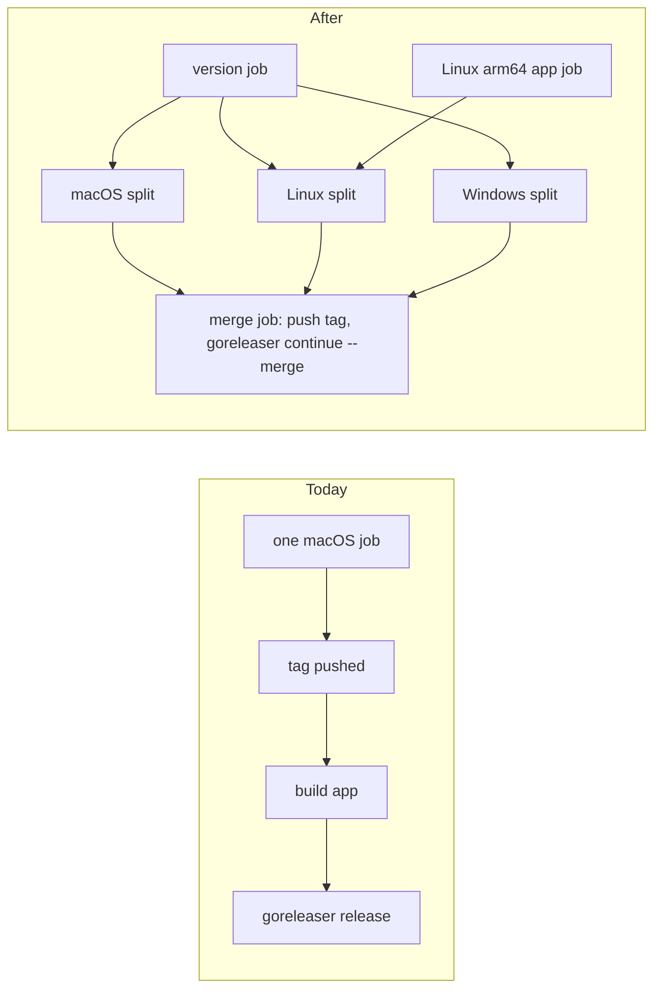
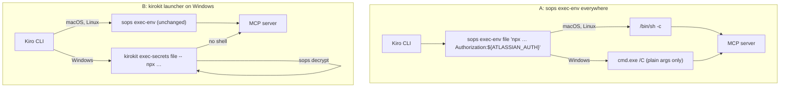

# Ship CLI and desktop app for Linux and Windows

## Summary

After this change, every kirokit release also ships for Linux and Windows, on amd64 and arm64.
Linux users install the CLI with `.deb`, `.rpm`, tar.gz or `brew install --cask mavogel/tap/kirokit`,
and the app from a `.deb` or `.rpm`. Windows users install the CLI with `scoop install kirokit` or a
zip, and the app with a setup `.exe`. The Mac release stays exactly as it is.

- **The CLI installs teams on Windows that start their SOPS-protected MCP servers.** On Windows,
  `kirokit install` writes a launch command that `sops exec-env` can pass through `cmd.exe`.
- **The desktop app runs on Windows and Linux with working terminals.** Both tabs run on a Windows
  pseudo console, and the shell tab opens PowerShell there.
- **The app finds its data, the bundled CLI and the age key where each OS keeps them.** macOS keeps
  today's folders and words.
- **One release builds on macOS, Linux and Windows runners and publishes together.** The version tag
  is pushed only after every build has succeeded.
- **Pull requests run the CLI and desktop tests on all three systems.** The README describes the
  install and the unsigned-app warnings for each.

## How we will know it works

**Oracle:** On a Windows runner, an MCP server that `kirokit install` wrote into a fresh `KIRO_HOME`
starts through the real `sops exec-env`, exactly as Kiro CLI would launch it, and receives every
argument and its decrypted secret unchanged. The same test runs on Linux and macOS.

**Size:** about 8 slices and 24 tasks.

**Risky:** yes. The shipped app loads a new dependency (a Windows ConPTY library), secrets cross a
new shell (`cmd.exe`), and the release now spans three runners and a second package repository.

## Interface

The app's window, pages and dialogs stay the same. Two things change, and only on Linux and
Windows. The shell tab is named after the shell it runs: PowerShell on Windows, the login shell on
Linux. The setup check's hints and key path follow the OS. On macOS the label stays `zsh`, and every
word stays as it is today.

<!-- ql:artifact artifacts/windows-linux-app.html#dock -->
**Artifact: Desktop app on Windows and Linux.** The desktop app's terminal dock and setup check on Windows and Linux: the shell tab is named after the shell it runs, and setup hints and key paths match the OS. Shown in QualityLayer, on the author's Mac only.
<!-- /ql:artifact -->

<!-- ql:artifact artifacts/windows-linux-app.html#setup -->
**Artifact: Desktop app on Windows and Linux.** The desktop app's terminal dock and setup check on Windows and Linux: the shell tab is named after the shell it runs, and setup hints and key paths match the OS. Shown in QualityLayer, on the author's Mac only.
<!-- /ql:artifact -->

## Today and after the change

| | macOS | Linux | Windows |
|---|---|---|---|
| CLI today | cask (tar.gz) | tar.gz | none |
| CLI after | unchanged | `.deb`, `.rpm`, tar.gz, the same cask | zip, Scoop |
| App today | cask (DMG) | none | none |
| App after | unchanged | `.deb`, `.rpm` | setup `.exe` |
| Tests today | desktop only | CLI only | none |
| Tests after | CLI and desktop | CLI and desktop, app start | CLI and desktop, app start, SOPS launch |



## Engineering decisions

### On Windows, secrets reach MCP servers through `cmd.exe` with plain arguments only

late: true

**Look here:** risky · Arguments with a space or a double quote cannot pass through `sops exec-env` on Windows, and platform-team has one.

You chose to keep `sops exec-env` on Windows and write a `cmd.exe`-safe string there. Drawing the
design showed a limit. sops runs the string as `cmd.exe /C <string>` via Go's standard escaping,
which turns every `"` into `\"`, a form `cmd.exe` does not understand. So on Windows, no argument
can contain a space or a double quote
([evidence](records/evidence-windows-sops-quoting.txt)). platform-team's Atlassian server passes
`--header 'Authorization: ${ATLASSIAN_AUTH}'`, and the space in that header breaks it.

**A:** Keep sops on Windows. Windows installs refuse any argument with a space, a quote or a
`cmd.exe` special character, with an error that names the agent and the argument. platform-team's
header moves to mcp-remote's documented form `Authorization:${ATLASSIAN_AUTH}` (no space), which
changes that one line in the platform-team golden on every OS. On macOS and Linux the server
receives the same header value as today.

**B:** On Windows only, a small `kirokit exec-secrets <file> -- <command> <args…>` launcher replaces
the shell step. It decrypts with `sops decrypt`, then starts the server with no shell, so any
argument works. macOS and Linux output, and every golden, stay as today. kirokit then holds the
decrypted values in its own process for a moment, and Windows configs need kirokit on `PATH`.

**Recommended:** A. It keeps sops as the only process that sees decrypted secrets, which is your
earlier answer. It also uses the header form mcp-remote recommends for Windows.

**Decided:** A. The build changes platform-team's header to `Authorization:${ATLASSIAN_AUTH}` and
adds the Windows argument check; no launcher is built.



<!-- ql:decide d1 -->
**Your call:** agreed · 25 Oct, 18:57: A
<!-- /ql:decide -->

### The desktop terminal gets a Windows pseudo-console backend behind the same API

**Look here:** risky · The new ConPTY library is the one piece no test has run on Windows yet.

`desktop/terminal` keeps its `Session` API (`Start`, `Read`, `Write`, `Resize`, `Wait`, `Close`).
The current creack/pty file becomes the non-Windows backend unchanged, and a Windows backend uses
`github.com/UserExistsError/conpty` v0.1.4. On Windows, `Close` ends the whole process tree with
`taskkill /T /F`, then releases the pseudo console. The runner, the shell tab and their callers do
not change.

<!-- ql:decide d2 -->
<!-- /ql:decide -->

### One release builds on three runners and publishes at once

**Look here:** unsure · The order of tag, split builds and merge is new, and only a real release on `main` exercises the merge job's publishing.

The release workflow uses GoReleaser Pro's split and merge. A version job computes the tag with
`svu`. Split jobs run on macOS, Linux and Windows: each tags locally, builds its OS's app and runs
`goreleaser release --split`. A Linux arm64 job builds that app on an arm64 runner. A merge job then
pushes the tag and runs `goreleaser continue --merge`, so a failed build leaves no tag.
Pull-request snapshots run the same split builds without merging.

<!-- ql:decide d3 -->
<!-- /ql:decide -->

### Paths, tools and the shell follow the OS; macOS stays byte-for-byte the same

The app's data folder becomes `os.UserConfigDir()/kirokit-desktop`. That is today's folder on macOS,
`~/.config/kirokit-desktop` on Linux and `%AppData%\kirokit-desktop` on Windows. The age-key
default follows sops's own rule. `PATH` uses the OS list separator, tool lookup honours `.exe` and
`PATHEXT` on Windows, and the shell tab runs `pwsh` (or `powershell`) on Windows and `$SHELL`
elsewhere, named after that shell.

<!-- ql:decide d4 -->
<!-- /ql:decide -->

### Linux and Windows packages put the app beside a private copy of the CLI

On Linux and Windows, the app binary is named `kirokit-desktop`, so it never collides with the
`kirokit` CLI package. The Linux `.deb` and `.rpm` install `/usr/bin/kirokit-desktop`, the CLI at
`/usr/lib/kirokit-desktop/kirokit`, a menu entry and an icon, and they depend on GTK 3 and
WebKitGTK 4.1. The Windows setup `.exe` (Wails' NSIS installer) installs `kirokit-desktop.exe` with
`bin\kirokit.exe` beside it. The macOS `.app` layout does not change.

<!-- ql:decide d5 -->
<!-- /ql:decide -->

### Windows checkouts stay byte-exact, and the tests run on all three systems

A `.gitattributes` keeps every text file LF on checkout. It marks goldens, vendored skills and
`*.enc.yaml` as `-text`, so Git never rewrites them, and the byte-for-byte goldens and lock hashes
hold on Windows. Unix-only tests (real pty with `/bin/sh`, zsh wrapper, `0o700` modes) skip off
their OS, with a Windows counterpart where the behaviour exists there. CI runs `go test ./...` and
`task desktop:test` on Ubuntu, Windows and macOS.

<!-- ql:decide d6 -->
<!-- /ql:decide -->

### CI proves the built app starts on each OS

With `KIROKIT_DESKTOP_SMOKE=1`, the app quits with exit code 0 once its page has loaded (Wails'
`OnDomReady`). It exits 1 when the page has not loaded within 60 seconds. The desktop workflow
builds the app on each OS and runs it this way: under `xvfb-run` on Linux, directly on Windows and
macOS.

<!-- ql:decide d7 -->
<!-- /ql:decide -->

## Not doing

- **No signing or notarization.** The README explains SmartScreen and the existing macOS quarantine note.
- **No winget, AppImage, Flathub, Snap or Microsoft Store.**
- **No scheduled sync on Windows.** `scripts/kirokit-sync-setup.sh` stays macOS and Linux only.
- **No auto-update inside the app.**
- **No manual testing on real machines.** CI runners are the proof, as you chose.
- **No change to the showcase recording.** `scripts/showcase/` stays Mac-only.

## Decisions made for you

- **ConPTY library: `github.com/UserExistsError/conpty` v0.1.4** — small, Windows-only, maps one-to-one onto `Session`; it compiled into the app for windows/amd64 and windows/arm64 in the spike.
- **creack/pty stays for macOS and Linux** — the Mac behaviour must not change; only a build tag is added.
- **Windows shell: `pwsh.exe` when on `PATH`, else `powershell.exe`, started with `-NoLogo`** — PowerShell is where Kiro CLI runs on Windows.
- **Windows environment: the app's own environment, no login-shell capture** — Windows apps inherit the user's full environment; there is no login shell to read.
- **Linux login shell: `$SHELL`, else `/bin/bash`, else `/bin/sh`; macOS keeps `/bin/zsh`** — Linux desktops do not default to zsh.
- **Tool folders per OS** — macOS keeps the Homebrew folders; Linux adds `/home/linuxbrew/.linuxbrew/bin`, `/usr/local/bin`, `~/.local/bin`; Windows adds `%USERPROFILE%\scoop\shims`.
- **Rendered paths use forward slashes on every OS** — `install` renders with `filepath.ToSlash(kiroHome)`, so Windows configs read `C:/Users/…/.kiro/…`, which Windows, sops and `file://` resources accept; macOS and Linux paths do not change.
- **Knowledge-base link on Windows** — `os.Symlink` first; when Windows refuses it for lack of privilege, a directory junction (`mklink /J`), which uninstall and reinstall recognise as kirokit's own.
- **Child processes on Windows open no console window** — `git` and other helpers get `CREATE_NO_WINDOW`.
- **App arm64 builds** — Windows arm64 cross-compiles on the Windows runner (no cgo there); Linux arm64 builds on GitHub's `ubuntu-24.04-arm` runner, free for this public repository.
- **WebKitGTK 4.1 (`-tags webkit2_41`)** — the ABI of Ubuntu 22.04+, Debian 12+ and Fedora 40+, which also covers Kiro CLI's glibc 2.34+ floor.
- **Scoop publishes the CLI only** — the app ships as the setup `.exe`; the Scoop step is skipped when `SCOOP_BUCKET_GITHUB_TOKEN` is empty, so a missing secret cannot fail a release after tagging.
- **The Linux CLI cask needs no new config** — GoReleaser already generates its `on_linux` block; the README's `brew install --cask mavogel/tap/kirokit` line is documented for Linux too.
- **Settings paths accept Windows drive paths** — the root check uses `filepath.VolumeName`; repository addresses accept `C:\…` and `C:/…`.

## Assumptions

- Kiro CLI on Windows reads `%USERPROFILE%\.kiro` by default and accepts forward-slash `C:/…` paths and `file://C:/…` resources in agent JSON (unconfirmed)
- `scoop install sops` works from Scoop's main bucket, so the Windows setup hint can name it (unconfirmed)
- Kiro CLI on Windows starts an MCP `command` with its `args` as a normal process, without a shell of its own (unconfirmed)

## Before the build

| # | Prerequisite | Met by | Status |
|---|---|---|---|
| P1 | Permission to run the agreed build | the user, at approval | granted · approved in the App, 2026-10-25 18:03 UTC |
| P2 | GoReleaser Pro key available to every release job | the existing `GORELEASER_KEY` secret · [records/p-secrets.txt](records/p-secrets.txt) | met · [records/p-secrets.txt](records/p-secrets.txt) |
| P3 | `mavogel/scoop-bucket` exists, and the repo is public, so arm64 runners are free | probe · [records/p-repos.txt](records/p-repos.txt) | met · [records/p-repos.txt](records/p-repos.txt) |
| P4 | `SCOOP_BUCKET_GITHUB_TOKEN` secret with contents write on `mavogel/scoop-bucket` | your answer: you added the token as a repository secret | met · [records/p4-scoop-secret.txt](records/p4-scoop-secret.txt) |

## Risks

- **The ConPTY backend misbehaves at runtime: no output, a hang on exit, or a leftover process.** Mitigation: the first desktop slice runs the terminal package's tests on `windows-latest` (output and EOF, exit code, resize, close ends the process), and CI fails on any of them.
- **`cmd.exe` mangles an argument the checker let through.** Mitigation: the Oracle test runs the installed command through the real sops on Windows with arguments covering every allowed character class (URL, `@`, `=`, `${VAR}`, `:`), and asserts the server's argv byte for byte.
- **Split builds produce artifacts the merge job does not publish, or publishes twice.** Mitigation: pull requests run the split snapshot on all three runners and list `dist/` per OS; after merging, the first `workflow_dispatch` dry run prints the casks and the Scoop manifest before any tag exists.
- **A Windows checkout still rewrites a golden or a lock-hashed file.** Mitigation: CI's Windows job runs `go test ./...`, which includes every team's golden comparison and the external-skills drift check.
- **The Linux app needs a library the package does not declare.** Mitigation: the Linux desktop job installs the built `.deb` on a clean Ubuntu runner with `apt install ./kirokit-desktop_*.deb` and runs the smoke start from `/usr/bin/kirokit-desktop`.
- **A failed job after the tag is pushed leaves a tag without a release.** Mitigation: the tag is pushed only in the merge job, after every split job has succeeded.

## Decided by you

<!-- ql:decided-by-you -->
- Discuss · How should Windows be supported? — Native Windows 11, CLI and app
- Discuss · How should Linux users install? — .deb and .rpm packages + Homebrew on Linux (CLI) + Plain tar.gz download
- Discuss · How should Windows users install? — Zip plus setup .exe on release + Scoop bucket
- Discuss · Sign the Windows builds? — Unsigned, README explains SmartScreen
- Discuss · Who checks it on real machines? — CI runners only
- Research · How should secret-reading MCP servers start on Windows? — cmd.exe-safe string on Windows
- Research · Scheduled sync on Windows? — Not in this task
- Research · Which token publishes to mavogel/scoop-bucket? — New SCOOP_BUCKET_GITHUB_TOKEN secret
- Research · Add the SCOOP_BUCKET_GITHUB_TOKEN secret? — I added it now
- Plan · On Windows, secrets reach MCP servers through `cmd.exe` with plain arguments only — A · Keep sops on Windows. Windows installs refuse any argument with a space, a quote or a
<!-- /ql:decided-by-you -->

## What the Plan rests on

- Every terminal process goes through one wrapper, `terminal.Session`, built on creack/pty
- Which files fail to compile with GOOS=windows or GOOS=linux
- The login shell is run as `$SHELL -ilc`, and the capture is a NUL-separated `env -0` after a marker
- Tool lookup and age-key path: PATH search, three tools, and a macOS default key location
- The data folder is a hardcoded macOS Application Support path; the CLI is found only inside a `.app` bundle, the dev-bin folder, or by override
- The shell tab runs `$SHELL -il` on a pty; zsh gets a ZDOTDIR wrapper, other shells get only environment variables
- Wails v2.17 builds on Linux and Windows but needs per-platform packages, tags, and assets that the repository lacks
- A rendered secret-needing MCP server is launched as `sops exec-env <file> "<one command string>"`
- `kirokit install` writes via `filepath`, requires Unix mode bits for execute, and uses a symlink only for the knowledge base
- Goldens compare raw bytes and rely on LF, `/` sentinel paths, and no `.gitattributes`
- The release is one macOS job: tag, build the app, then one GoReleaser Pro run
- GoReleaser Pro docs: what each feature offers (docs fetched 2026-10-25)

## Reviewed by

<!-- ql:reviews -->
**Design reviewed** · 2 findings fixed.
<!-- /ql:reviews -->

## System design contracts

**Trust boundary:** secrets and other processes. Decrypted SOPS values reach MCP servers through a
new launch path on Windows (`cmd.exe`); the app starts shells and child processes through a new
Windows API; release jobs gain the `SCOOP_BUCKET_GITHUB_TOKEN` secret.

### `sopswrap` gains a `cmd.exe` flavour that refuses what it cannot pass

Today `BuildWrapper(secretsFilePath, realCommand, realArgs)` returns `"sops", ["exec-env", file, posixQuoted]` (`internal/sopswrap/sopswrap.go:13-15`). After:

```go
type Shell int
const (
    POSIX Shell = iota // sops runs the string with /bin/sh -c (macOS, Linux)
    Cmd                // sops runs the string with cmd.exe /C (Windows)
)
// BuildWrapper keeps its signature and behaviour (POSIX).
func BuildWrapperFor(sh Shell, secretsFilePath, realCommand string, realArgs []string) (command string, args []string, err error)
// ErrUnsafeForCmd wraps the first token that contains whitespace, '"', or one of & | < > ^ % ! ( ).
var ErrUnsafeForCmd = errors.New("cannot pass through cmd.exe")
```

`Cmd` joins the tokens with single spaces and no quoting. On error, render reports
`render: <team>/<agent>: argument "<arg>" cannot pass through sops exec-env on Windows (cmd.exe): use a form without spaces or quotes, such as Authorization:${VAR}`.
Rejected: a Windows-only `kirokit exec-secrets` launcher (option B of the first decision, not
chosen). Also rejected: `^`-escaping metacharacters, because `npx.cmd` and other batch files parse `%*` a second
time, so a single escape layer does not hold.

### Render takes the launch shell as an option; goldens always use POSIX

```go
type Options struct { KiroHome string; LaunchShell sopswrap.Shell }
func RenderTeamWith(teamsRoot, team, globalRoot, envVersionsPath, outDir string, opts Options) error
// RenderTeam(…, kiroHome) keeps its signature: Options{KiroHome: kiroHome, LaunchShell: sopswrap.POSIX}
```

`sopsArgsJSON` reads the shell from the render context. `install.Install` calls `RenderTeamWith`
with `KiroHome: filepath.ToSlash(kiroHome)`, using `sopswrap.Cmd` when `runtime.GOOS == "windows"`,
else POSIX. The golden harness and `kirokit render` keep the `/kiro-home` sentinel and POSIX, so
goldens are the same on every OS. `teams/platform-team/agents/devops/agent.json.tmpl:24`
passes `Authorization:${ATLASSIAN_AUTH}`, and `./kirokit update platform-team` rewrites that one
golden line.

### Terminal backends share one API

```go
func Start(cmd *exec.Cmd, cols, rows uint16) (*Session, error) // cmd.Path, Args, Dir, Env are honoured
func (s *Session) Read(p []byte) (int, error)   // io.EOF once the process and terminal are gone
func (s *Session) Write(p []byte) (int, error)
func (s *Session) Resize(cols, rows uint16) error
func (s *Session) Wait() (int, error)           // exit code; callable more than once
func (s *Session) Close() error                 // ends the process tree, reaps, releases the terminal
```

`terminal_unix.go` (`//go:build !windows`) is today's `terminal.go`, unchanged.
`terminal_windows.go` builds the command line with `syscall.EscapeArg` over `cmd.Path` and
`cmd.Args[1:]`, starts it with `conpty.Start(line, ConPtyDimensions, ConPtyWorkDir, ConPtyEnv)`,
maps a read error after the process exits to `io.EOF`, and ends the tree with
`taskkill /T /F /PID <pid>` before `ConPty.Close`. `desktop/procgroup_{unix,windows}.go` hold
`killTreeOnCancel(cmd)` (today's `Setpgid` and `Kill(-pid)` on Unix, `taskkill` on Windows) for
`envcapture.go:103-104`, and `hideConsole(cmd)` (`CREATE_NO_WINDOW` on Windows, a no-op elsewhere)
for `catalog.go:214` and `clone.go`.

### The app's paths, tools and shell per OS

| Concern | macOS (unchanged) | Linux | Windows |
|---|---|---|---|
| Data folder (`NewApp`) | `~/Library/Application Support/kirokit-desktop` | `~/.config/kirokit-desktop` | `%AppData%\kirokit-desktop` |
| Env capture (`Capture`) | `$SHELL -ilc …`, default `/bin/zsh` | `$SHELL -ilc …`, default `/bin/bash`, then `/bin/sh` | `os.Environ()`, no shell |
| Tool lookup (`Lookup`) | execute bit | execute bit | `PATHEXT` suffixes, no mode check |
| Bundled CLI (`resolveCLI`) | `<exe>/../Resources/bin/kirokit` | `<exe>/../lib/kirokit-desktop/kirokit` | `<exe dir>\bin\kirokit.exe` |
| Age key default | `SOPS_AGE_KEY_FILE`, `$XDG_CONFIG_HOME/sops/age/keys.txt`, `os.UserConfigDir()/sops/age/keys.txt` | same rule | `SOPS_AGE_KEY_FILE`, `os.UserConfigDir()/sops/age/keys.txt` |
| Shell tab | `$SHELL -il`, zsh wrapper | `$SHELL -il`, zsh wrapper when zsh | `pwsh.exe -NoLogo`, else `powershell.exe -NoLogo` |

`EnvStatus` gains `Shell string \`json:"shell"\``: `zsh`, `bash`, `PowerShell`. The frontend sets the
tab label and the kirokit tab's first line from it (`desktop/frontend/index.html:88`, `desktop/frontend/src/terminal.js:60`), and falls
back to today's `zsh` until the state arrives. Setup hints and the CLI-missing error use the strings
in the Interface artifact's *Words per OS* table. The development `build/dev-bin` candidates stay
first under `wails dev` on every OS, with `kirokit.exe` on Windows.

### Release layout and file names

- **CLI builds:** `darwin`, `linux`, `windows` × `amd64`, `arm64`, `CGO_ENABLED=0`.
- **CLI archives:** tar.gz, with `format_overrides` zip on Windows.
- **CLI packages:** `nfpms` id `kirokit`: `kirokit_<v>_linux_<arch>.deb` and `.rpm`, binary at `/usr/bin/kirokit`.
- **Desktop packages:** `nfpms` id `kirokit-desktop` from a `prebuilt` build `kirokit-desktop-linux`. Contents: `/usr/bin/kirokit-desktop`, `/usr/lib/kirokit-desktop/kirokit`, `/usr/share/applications/kirokit-desktop.desktop`, `/usr/share/icons/hicolor/512x512/apps/kirokit-desktop.png`. Dependencies: deb `libgtk-3-0, libwebkit2gtk-4.1-0`; rpm `gtk3, webkit2gtk4.1`.
- **Windows app:** `kirokit-desktop_<v>_windows_<arch>-setup.exe`, built by `wails build -nsis` with `bin\kirokit.exe` added after `!insertmacro wails.files` in `desktop/build/windows/installer/project.nsi`, and attached with `release.extra_files`.
- **Scoop:** `scoops` publishes `kirokit` to `mavogel/scoop-bucket` with `SCOOP_BUCKET_GITHUB_TOKEN`, skipped when the token is empty.
- **Unchanged:** the casks, DMG and `app_bundles`.

### Release workflow jobs

`release.yaml` on push to `main` and `workflow_dispatch`:

1. `version` (ubuntu): `svu next --v0`, outputs `release` and `tag`.
2. `app-linux-arm64` (ubuntu-24.04-arm): builds `kirokit-desktop` for linux/arm64 and uploads it.
3. `split` matrix:
   - macos-latest: `task desktop:build` and `scripts/desktop-prebuilt.sh`, as today.
   - ubuntu-latest: downloads the arm64 app, builds the amd64 app.
   - windows-latest: builds the amd64 and arm64 apps and their installers.

   Each split job runs `git tag <tag>` locally, then `GGOOS=<os> goreleaser release --clean --split`, and uploads `dist/<os>`.
4. `merge` (ubuntu): downloads every `dist`, pushes the tag, runs `goreleaser continue --merge`.

Dry run: the same jobs with `--snapshot`, and the merge job prints the casks and the Scoop manifest
instead of publishing. `desktop.yaml` on pull requests runs `task desktop:test`, the OS build and the
smoke start on all three runners, plus the split snapshot when `GORELEASER_KEY` is present.
`ci.yaml` gains an OS matrix, with the lint and agent-asset steps on Ubuntu only.

## Patterns to follow

- **Build-tagged OS files:** none exist yet in `desktop/`. Use `//go:build windows` and `//go:build !windows` pairs, as the spike did ([records/spike-conpty-build.txt](records/spike-conpty-build.txt)), and keep each pair's exported shape identical.
- **Shell-launch test:** `internal/sopswrap/sopswrap_test.go:38-49` runs the joined string through `/bin/sh -c` and compares argv. The Windows test does the same through `exec.Command("cmd.exe", "/C", s)`, which is sops's exact call, with a Go helper that prints `os.Args` as JSON.
- **Oracle test:** model it on `cmd/kirokit/commands/install_test.go:67`. Set `t.Setenv("KIRO_HOME", t.TempDir())`, install a fixture team from `testdata/`, then exec the installed agent's `command` and `args` as Kiro would, with `SOPS_AGE_KEY_FILE` pointing at a committed test-only age key. It skips without `sops` unless `KIROKIT_REQUIRE_SOPS=1`, which CI sets on all three OSes.
- **Desktop tests:** use `NewAppAt(t.TempDir())` isolation and fake tools written per OS (`desktop/shell_test.go:58,70`, `desktop/runner_test.go:85`). On Windows they are `.cmd` files, and tests that need `/bin/sh`, zsh or a Unix pty use `if runtime.GOOS == "windows" { t.Skip(...) }`.
- **Prebuilt import:** `.goreleaser.yaml:30-39` and `scripts/desktop-prebuilt.sh` show the import shape the Linux and Windows app builds follow.
- **Build script:** `scripts/desktop-build.sh` branches on `$(go env GOOS)`. The darwin branch is today's script unchanged. The linux branch runs `wails build -platform linux/$ARCH -tags webkit2_41 -o kirokit-desktop` and copies the CLI to `desktop/build/bin/kirokit`. The windows branch runs in Git Bash on the runner, does `wails build -platform windows/$ARCH -nsis -o kirokit-desktop.exe` per arch, and renames the installers.
- **Goldens:** after the template change, run `./kirokit update platform-team` and review the one-line diff; never edit `testdata/golden/**` by hand.
- **Commits:** use Conventional Commits; `qualitylayer commit slice <n>` needs `--message "feat(...): …"`, because the `cz check` hook rejects its default message.
- **Run the app:** `task desktop:dev` on macOS. On Linux and Windows, `go build -o desktop/build/dev-bin/kirokit ./cmd/kirokit`, then `cd desktop && go tool wails dev` (Linux with `-tags webkit2_41`).

**Project checks:** `go test ./...` · `golangci-lint run` · `go vet ./...` · `go build ./...` · `task desktop:test` · `node scripts/sync-agent-assets.mjs --check`

## Proven before the gate

| Depends on | Proven how | Result |
|---|---|---|
| `github.com/UserExistsError/conpty` v0.1.4 in the desktop module | Scratch copy with a Windows `Session` backend: `go vet` for windows/amd64, windows/arm64, linux/amd64 and darwin/arm64, plus `go build` for both Windows arches | all exit 0 · [records/spike-conpty-build.txt](records/spike-conpty-build.txt) |
| Wails v2.17 Windows build and assets | `go tool wails build -platform windows/arm64` and `-nsis` from macOS in the scratch copy | app built; generated `icon.ico`, `info.json`, `wails.exe.manifest`, `installer/project.nsi` with the `wails.files` hook; `makensis` is needed on the runner · [records/spike-wails-windows.txt](records/spike-wails-windows.txt) |
| GoReleaser Pro config: partial split, Windows zip, two `nfpms`, `scoops`, `release.extra_files`, a Linux `prebuilt` build | `goreleaser check` (v2.19.0 Pro) on a draft config | 1 configuration file validated · [records/spike-goreleaser-check.txt](records/spike-goreleaser-check.txt) |
| How sops on Windows hands the string to `cmd.exe` | sops `exec_windows.go` and Go's `appendEscapeArg` source; mcp-remote README | `cmd.exe /C` via standard escaping; no cmd special case; mcp-remote documents `Authorization:${VAR}` · [records/evidence-windows-sops-quoting.txt](records/evidence-windows-sops-quoting.txt) |
| ConPTY at runtime, `cmd.exe` argument passing, the Linux WebKitGTK build, NSIS on the runner | cannot run on this Mac | first slices run them on `windows-latest`, `ubuntu-latest` and `ubuntu-24.04-arm` |
