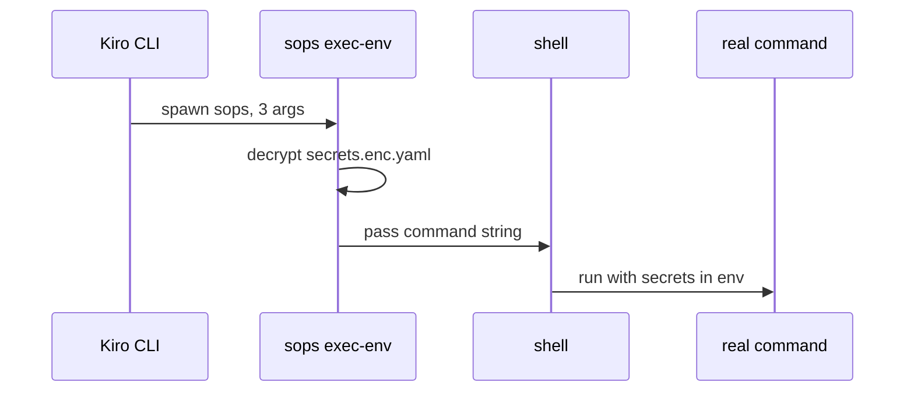

# Secrets launch, install placement and test portability today (questions 5-7)

Scope note: the person answered that Windows support means native Windows 11 for the CLI and the app. Findings are framed against that target. No non-test Go file in `cmd/`, `internal/` or `desktop/` branches on `runtime.GOOS` or "windows" (grep, no matches); the code is OS-neutral by omission.

## Findings

### A rendered secret-needing MCP server is launched as `sops exec-env <file> "<one command string>"`
**Answers:** 5

- The template emits `"command": "sops"` via `sopsCommand` and an `args` array via `sopsArgsJSON` (`teams/platform-team/agents/devops/agent.json.tmpl:23-24`). `sopsCommandFunc` returns the literal `"sops"` (`internal/render/funcs.go:56-58`); `sopsArgsJSONFunc` JSON-marshals the args from `BuildWrapper` (`internal/render/funcs.go:63-71`).
- `BuildWrapper` returns exactly three args: `exec-env`, the secrets path, and the real command plus its args joined into one string (`internal/sopswrap/sopswrap.go:13-15`). There is deliberately no `--` (`internal/sopswrap/sopswrap.go:3-5`).
- The joined string is quoted for a POSIX shell: a token is left bare unless it contains one of ` \t\n'"\$`!*?[]{}();&|<>~#` (`internal/sopswrap/sopswrap.go:33-40`); otherwise it is wrapped in single quotes with `'` written as `'\''`.
- Golden result Kiro CLI receives (`testdata/golden/platform-team/rendered/agents/devops.json:26-27`): command `sops`, args `["exec-env","/kiro-home/kirokit-secrets/platform-team/devops/secrets.enc.yaml","npx -y mcp-remote@0.15.1 https://mcp.atlassian.com/v2/mcp --header 'Authorization: ${ATLASSIAN_AUTH}'"]`. `${ATLASSIAN_AUTH}` is single-quoted so the outer shell does not expand it, yet it stays literal text for the inner process; expansion therefore depends on how the receiving program treats `${...}` (not established here; gap).

**Shell per OS (sops source, `getsops/sops` main branch, fetched via raw.githubusercontent.com; version bundled by the user not checked):**
- Unix (`!windows` build tag): `exec.Command("/bin/sh", "-c", command)` (`cmd/sops/subcommand/exec/exec_unix.go:19-20`), and `syscall.Exec("/bin/sh", ["/bin/sh","-c",command], env)` at line 16.
- Windows: `exec.Command("cmd.exe", "/C", command)` (`cmd/sops/subcommand/exec/exec_windows.go:13-14`). **Inference:** the single-quote quoting emitted by `quoteIfNeeded` is not understood by `cmd.exe`, which treats `'` as a literal character and `&|<>` unquoted as operators. A rendered string containing `'Authorization: ${ATLASSIAN_AUTH}'` would reach `cmd.exe` with literal quotes, and `${VAR}` is not `cmd` syntax (`%VAR%` is). Not executed on Windows; unverified.
- The only quoting test runs the string through `/bin/sh -c` (`internal/sopswrap/sopswrap_test.go:38-49`); nothing tests a Windows shell. `/bin/sh` does not exist on Windows.

### The `.KiroHome` secrets path is built with `printf "%s/..."` and the install sentinel `/kiro-home`
**Answers:** 5

- Template: `printf "%s/kirokit-secrets/platform-team/devops/secrets.enc.yaml" .KiroHome` (`teams/platform-team/agents/devops/agent.json.tmpl:24`); the separator is a literal `/`.
- `KiroHome` is `/kiro-home` for render/golden (`internal/render/context.go:15`, fallback at `:49`); `Install` passes the real `kiroHome` into `RenderTeam` (`internal/install/install.go:82`). So on Windows the baked string would be e.g. `C:\Users\x\.kiro/kirokit-secrets/...` (mixed separators; **inference** from `ResolveKiroHome` returning a `filepath.Join` result, `internal/install/install.go:54`).
- The file install writes to is `filepath.Join(kiroHome, "kirokit-secrets", team, agent, "secrets.enc.yaml")` (`internal/install/install.go:358-361`), so the two forms name the same file only if Windows tolerates the mixed form (it normally does for file APIs; whether sops/Kiro do is untested).
- Other URIs are built with `path.Join` (forward slashes): `"file://"+path.Join(ctx.KiroHome, ...)` (`internal/render/globalsteerings.go:48`), `"skill://"+path.Join(kiroHome,"skills",...)` (`internal/render/externalskills.go:19`). A `C:\...` KiroHome is not a valid `file://` URI body (inference).

### `kirokit install` writes via `filepath`, requires Unix mode bits for execute, and uses a symlink only for the knowledge base
**Answers:** 6

- Target resolution: `ResolveKiroHome` returns `$KIRO_HOME` if set, else `filepath.Join(os.UserHomeDir(), ".kiro")` (`internal/install/install.go:46-55`). `os.UserHomeDir` reads `%USERPROFILE%` on Windows (Go standard library behaviour; not re-run). Where Kiro CLI looks on Windows is **not established**: the installation page fetched (kiro.dev/docs/cli/installation) yielded no matching text for a Windows config location in my grep; this is a gap.
- Paths: all target paths use `filepath.Join` / `filepath.Rel` (`internal/install/install.go:326,359,273`); `ToSlash` is used only to split the first path element (`:403`). Manifest records OS-native strings (`:39-42`, written `:276-289`).
- Modes: files are written `0o600`, or `0o700` when the rendered file has the owner-execute bit (`internal/install/install.go:322-325`), then forced with `os.Chmod` (`:434`). Directories `0o755` (`:427`). On Windows, Go reports no execute bit for regular files, so vendored scripts would lose `0o700` (inference; Go `os.FileMode` semantics on Windows, not run). The test asserting `0o700` on a skill script (`internal/install/install_test.go:367`) and `0o600` (`:384`) would therefore differ on Windows.
- Same bit drives hashing and tree equality: `backup.snapshot` (`internal/backup/backup.go:170`) and `externalskills.HashDir` (`internal/externalskills/lock.go:127-130`).
- Symlinks: `ensureKnowledgeBaseSymlink` calls `os.Symlink(absSource, mountPoint)` (`internal/install/install.go:173`) after replacing an existing symlink (`:159-165`); it errors if the mount exists and is not a symlink (`:161`). It runs only when `kb != nil` (`:119-124`). On Windows `os.Symlink` needs Developer Mode or elevation (Windows OS rule; not run here). Backups also copy symlinks via `os.Symlink` (`internal/backup/backup.go:72`) and refuse other non-regular files (`:76`).
- The resource URI is `"file://" + mountPoint` with an OS-native `mountPoint` (`internal/install/install.go:217`).
- Backups: `backupChangedFolders` copies each changed top-level folder to `<stamp>-<folder>.backup` with `CopyAside` (`internal/install/install.go:391-420`; `internal/backup/backup.go:49-84`, name format `:21`, `:23-34`). Rename-based `MoveAside` (`backup.go:38-44`) is used by callers outside install.
- Sync prunes files no longer written and removes empty parents with `strings.HasPrefix(dir, stop+string(filepath.Separator))` (`internal/install/sync.go:55-61`), which is separator-aware, but prune paths are compared as raw manifest strings (`:40`), so a manifest written on one OS/casing is not portable.
- Desktop: env capture runs a login shell, defaulting to `/bin/zsh`, with `PATH` fallback `/usr/bin:/bin:/usr/sbin:/sbin` (`desktop/envcapture.go:83,92-95`); it reads `HOME` (`:85`). Windows behaviour there is not covered by this research (desktop is outside the listed files).

### Goldens compare raw bytes and rely on LF, `/` sentinel paths, and no `.gitattributes`
**Answers:** 7

- `diffDirs` uses `bytes.Equal` on file bytes, byte-for-byte (`internal/golden/golden.go:115,148`); `context.json` is the only trimmed comparison (`:51`). Relative names are normalised with `filepath.ToSlash` (`:173`).
- There is no `.gitattributes` in the repository root (`ls -a` shows `.git .github .gitignore` only; `cat .gitattributes` fails). With Git for Windows' default `core.autocrlf=true`, committed goldens and `*.tmpl` sources would be checked out with CRLF. **Inference:** rendered output keeps whatever the template bytes contain, so template and golden would both be CRLF and still match each other, but any generated literal (Go `"\n"`, `json.MarshalIndent`, `append(contextJSON, '\n')` at `golden.go:99`) stays LF and would not. Not run on Windows.
- The lock hash is over raw content bytes (`sha256.Sum256(content)`, `internal/externalskills/lock.go:127`), with slash-separated relative path and exec flag (`:115,127-130`). CRLF conversion on checkout of `teams/*/external/**` would change the hash and make render fail on drift (per repository rule in `AGENTS.md`); the exec flag would also read `-` on Windows, differing from a lock computed on macOS/Linux (inference).
- The `/kiro-home` sentinel is a constant independent of OS (`internal/render/context.go:15`) and rendered with `path.Join`, so rendered text is separator-stable; the golden harness itself passes `""` as KiroHome (`golden.go:108`). Goldens written with mode `0o600` (`golden.go:80,210`) are harmless on Windows.
- Tests that shell out: `git` in `cmd/kirokit/commands/sync_test.go:14`, `internal/externalskills/fetch_test.go:15,143`, `desktop/clone_test.go:18`; `/bin/sh` in `internal/sopswrap/sopswrap_test.go:41`; `kiro-cli` via `exec.LookPath` in `internal/golden/kirocli_test.go:27,52`, skipped unless `KIROKIT_REQUIRE_KIRO_CLI=1` (`:14-22`); desktop tests use fake `git`/`sops`/`kiro-cli` scripts (`desktop/runner_test.go:171`, `desktop/prereq_test.go:40`) and macOS paths (`desktop/prereq_test.go:65`). The `git` helper uses `core.hooksPath=/dev/null` (`sync_test.go:14`), a Unix device path. The tests do not invoke `sops` itself.
- CI runs only on `ubuntu-latest` (`.github/workflows/ci.yaml:13`); no Windows job exists in that file.

## How it is tested today

- Go tests beside code (`*_test.go`), table/temp-dir based (`t.TempDir`, `t.Setenv("KIRO_HOME", home)`, `cmd/kirokit/commands/install_test.go:67`).
- One file: `go test ./internal/sopswrap -run TestShellQuote -v` (package-level), or `go test ./internal/install`. Suite from repository root: `go test ./...` (`Taskfile.yml:19-22`); full gate `task ci`. Desktop: `cd desktop && go vet ./... && go test ./...` (`Taskfile.yml:37`), frontend `cd desktop/frontend && node --test "src/**/*.test.js"`.
- Goldens: committed under `testdata/golden/<team>/` and diffed by `internal/golden/golden_test.go:38-73` plus `./kirokit test`.
- Real-tool checks: kiro-cli validation is opt-in (`internal/golden/kirocli_test.go:14-22,60,84`). I did not run any test; all claims above are from source.

## Open questions

- Question 5: Whether Kiro CLI on Windows hands the `sops` command string to `cmd.exe` unchanged and how `${ATLASSIAN_AUTH}` is expanded there is unverified (no Windows run).
- Question 6: Where Kiro CLI looks for its home/config on Windows (`%USERPROFILE%\.kiro` vs other) was not found in the installation page; needs the Kiro docs or a Windows install.
- Question 7: No Windows checkout was exercised, so the CRLF effects are inference from the absence of `.gitattributes` and Git's default behaviour.

## Code references

- `internal/sopswrap/sopswrap.go:13-40`, `internal/sopswrap/sopswrap_test.go:38-49`
- `internal/render/funcs.go:54-71`, `internal/render/context.go:15,49`, `internal/render/globalsteerings.go:48`, `internal/render/externalskills.go:19`
- `teams/platform-team/agents/devops/agent.json.tmpl:23-24`, `testdata/golden/platform-team/rendered/agents/devops.json:26-27`
- `internal/install/install.go:46-55,146-177,301-333,358-361,391-440`, `internal/install/sync.go:55-61`, `internal/backup/backup.go:21-84,103-117,148-177`
- `internal/golden/golden.go:115-180`, `internal/golden/kirocli_test.go:14-60`, `internal/externalskills/lock.go:97-142`
- `cmd/kirokit/commands/sync_test.go:14`, `internal/externalskills/fetch_test.go:15,143`, `desktop/envcapture.go:80-95`, `.github/workflows/ci.yaml:13`
- sops source (external): `cmd/sops/subcommand/exec/exec_unix.go`, `exec_windows.go`
- Exhaustiveness: complete for the files named in questions 5-7; `desktop/` and `cmd/kirokit` tests were only grepped for process spawns. 90-day churn: 9 commits touching sopswrap, install, backup, golden and externalskills combined (`git log --since=90.days`).
