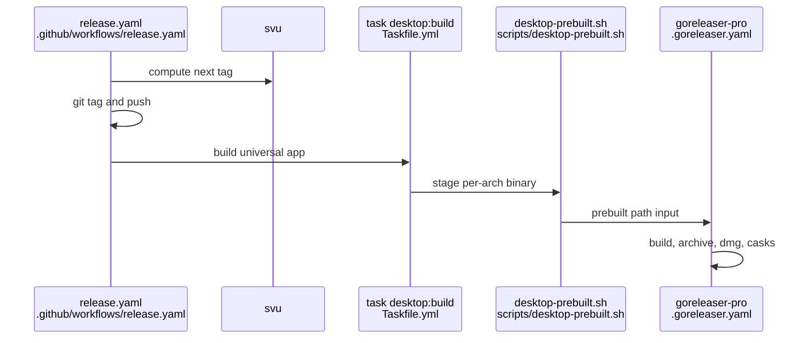

# Release assembly today and GoReleaser Pro multi-runner options

## Findings

### The release is one macOS job: tag, build the app, then one GoReleaser Pro run
**Answers:** 8

Order of steps in `.github/workflows/release.yaml` (job `release`, `runs-on: macos-latest`, `.github/workflows/release.yaml:26-27`):

1. Trigger is push to `main` or a manual `workflow_dispatch` dry run (`.github/workflows/release.yaml:3-13`); one release at a time via `concurrency` (`:19-21`).
2. Checkout with full history, Go stable, Node lts, Task v3.54.0 (`:29-45`); `svu` only on push (`:47-49`).
3. `svu next --v0` decides if there is a release; equal to current means `release=false` (`:54-67`).
4. Tag and push the tag (`:69-73`).
5. Build the desktop app, when releasing or on dry run: `task desktop:build` then `scripts/desktop-prebuilt.sh`, `VERSION` from the tag or `0.0.0-dryrun` (`:76-82`).
6. `release --clean` with `distribution: goreleaser-pro`, `version: "~> v2"`, using `GORELEASER_KEY` and `HOMEBREW_TAP_GITHUB_TOKEN` (`:84-96`). Dry run runs `release --snapshot --clean` and prints the casks (`:98-114`).

`task desktop:build` only calls `scripts/desktop-build.sh` (`Taskfile.yml:45-48`). That script builds the CLI for darwin amd64 and arm64 with `CGO_ENABLED=0`, joins them with `lipo` (`scripts/desktop-build.sh:23-27`), runs `go tool wails build -platform darwin/universal -clean` (`:34`), copies the CLI into `Contents/Resources/bin` and re-signs ad hoc (`:36-40`). It sets macOS 13 as minimum (`:29-31`).

`scripts/desktop-prebuilt.sh` stages the single universal app binary twice, as `kirokit_darwin_amd64/kirokit` and `kirokit_darwin_arm64/kirokit`, re-signs each ad hoc (`scripts/desktop-prebuilt.sh:21-29`), and copies `Info.plist`, the icon and the bundled CLI to `prebuilt/bundle` (`:31-33`). Reason given: a cask only takes DMGs labelled amd64 or arm64 (`:6-8`).

`desktop.yaml` (`.github/workflows/desktop.yaml`) is a PR/main check on macOS: `task desktop:test`, `task desktop:build`, and on PRs with a key, stage plus `release --snapshot --clean` (`:46-69`). Its snapshot is skipped without `GORELEASER_KEY` (`:25,57,61`).

### `.goreleaser.yaml` builds the CLI for darwin/linux only, imports the app via `prebuilt`, and publishes two casks
**Answers:** 8

- CLI build `kirokit`: `CGO_ENABLED=0`, goos darwin and linux, goarch amd64 and arm64, version ldflags (`.goreleaser.yaml:10-25`). No windows target.
- App build `kirokit-desktop-bin`: `builder: prebuilt`, darwin amd64 and arm64, path `desktop/build/bin/prebuilt/kirokit_{{ .Os }}_{{ .Arch }}/kirokit` (`:30-39`).
- `app_bundles` wraps it into `kirokit.app` with the three staged extra files (`:43-55`); `dmg` with `use: appbundle` named `kirokit-desktop_<ver>_darwin_<arch>` (`:57-63`).
- `archives`: only the CLI build, `tar.gz` only, no `format_overrides` (`:65-71`). `checksum` -> `checksums.txt` (`:73-74`).
- No `nfpms`, `scoops` or `winget` sections exist (grep of the file; the file ends at `:135`).
- `homebrew_casks`: `kirokit` for archive id `default` with a macOS-only quarantine `postflight_steps` (`:94-112`), and `kirokit-desktop` for the DMG id with `app: kirokit.app` (`:114-129`). Both push to `mavogel/homebrew-tap` (`:98-101,119-121`). `release.mode: append` (`:131-135`).
- `before.hooks` runs `go mod tidy` (`:5-7`).

Evidence from a local snapshot (git-ignored `dist/`, from an earlier run, not re-run by me): the generated `kirokit` cask already has `on_macos` and `on_linux` blocks with `linux_arm64`/`linux_amd64` tarball URLs and `binary "kirokit"` (`dist/homebrew/Casks/kirokit.rb:11-40`). The desktop cask is DMG-only.

### GoReleaser Pro docs: what each feature offers (docs fetched 2026-10-25)
**Answers:** 8

- **prebuilt builder** (docs page "Import pre-built binaries"; the brief's `Prebuilt` is listed as a Pro-style feature there, the page itself carries no Pro label in the fetched text): no defaults for goos/goarch/goamd64/targets, so they must be given; `prebuilt.path` is templated and must exist or GoReleaser fails; `dist` is wiped, so binaries live elsewhere. Suggested pattern: build per machine with `goreleaser build --single-target`, then release in a second config that imports them. This repo already uses it with `path` outside `dist`.
- **Split and merge** (Pro, https://goreleaser.com/customization/partial/): `goreleaser release --clean --split` builds the current GOOS (or `GOOS=...`; `GGOOS=...` only filters targets) into `dist/$GOOS`; `partial.by: target` splits on GOOS+GOARCH (default `goos`). `goreleaser continue --merge` merges contexts and artifacts, then checksums, signs, SBOMs, runs publishers and announcers. It does not rebuild or rerun hooks. `publish --merge` and `announce --merge` run those steps separately. `dockers_v2` images are built in the merge step. Docs name CGO and native Windows/macOS packaging as use cases and link `goreleaser/example-split-merge-real`, stressing a release-specific cache key.
- **nfpms** (https://goreleaser.com/customization/package/nfpm/): formats apk, deb, rpm, termux.deb, archlinux, ipk, and `msix` for Windows binaries; `ids` filters builds; default `bindir` `/usr/bin`. Needs a Linux build in `builds`.
- **Windows zip archives** (https://goreleaser.com/customization/archive/): `format_overrides` with `goos: windows`, `formats: ["zip"]`; `zip` is also valid as a normal format.
- **scoops** (https://goreleaser.com/customization/scoop/): publishes a manifest to a bucket repo; `use` defaults to `archive` (zip only), Pro adds `msi`/`nsis`; needs a Windows zip archive.
- **winget** (https://goreleaser.com/customization/winget/): needs `publisher`, `short_description`, `license`; default `use` is archives (zip), Pro adds `msi`, `nsis`, `binary`; can open a PR to `winget-pkgs`.
- **homebrew_casks on Linux**: the casks docs page (https://goreleaser.com/customization/homebrew_casks/) shows `ids` over archives, `binaries`, and `app` (DMG-only). Evidence that Linux is emitted comes from the repo's own generated cask (above), which has an `on_linux` block. Homebrew's Cask Cookbook states that `binary` works on either operating system and cross-platform casks scope artifacts in `on_macos`/`on_linux` blocks, with `arm64_linux`/`x86_64_linux` checksums (https://docs.brew.sh/Cask-Cookbook, fetched 2026-10-25); not run with `brew`.

### What a later change would meet
**Answers:** 8

- Release config churn in the last 90 days (`git log --oneline --since=90.days -- <path>`): `.goreleaser.yaml` 7 commits, `release.yaml` 6, `Taskfile.yml` 4, `desktop.yaml` 3, `desktop-build.sh` 2, `desktop-prebuilt.sh` 1.
- Hard to change: the app build, staging script and `app_bundles` are macOS-specific (`lipo`, `codesign`, `-mmacosx-version-min`: `scripts/desktop-build.sh:27,30,40`); release is a single job, so the app build must precede GoReleaser on the same runner (`.github/workflows/release.yaml:75-82`). The tag is pushed before the build, so a failed build leaves a tag (`:69-73` before `:76`).
- Same release command is duplicated in `release.yaml` and `desktop.yaml`; `desktop.yaml` triggers on `.goreleaser.yaml` and `scripts/**` changes (`.github/workflows/desktop.yaml:5-14`).
- README states the release shape: "GoReleaser attaches ... DMGs ... in one macOS job" (`README.md:283`) and the CLI cask install (`README.md:20-21,244`).

## How it is tested today

- No unit tests for the release config or scripts; coverage is the CI snapshot: `release --snapshot --clean` in `.github/workflows/desktop.yaml:60-69` (PRs with `GORELEASER_KEY`) and the manual dry run in `.github/workflows/release.yaml:98-114`.
- From the repository root: `task desktop:test` (frontend build and `node --test`, `go vet`/`go test` in `desktop`: `Taskfile.yml:32-37`), `task desktop:build`, `task ci` (`Taskfile.yml:25-30`), `go test ./...`. Locally, with a Pro key, `scripts/desktop-prebuilt.sh` then `goreleaser release --snapshot --clean` reproduces CI (`dist/` is git-ignored). I did not run any of these.

## Open questions

None. (Limit: the prebuilt docs page carries no Pro label in the fetched text.)

## Code references

- `.goreleaser.yaml:5-135` (whole file read)
- `.github/workflows/release.yaml:1-114`, `.github/workflows/desktop.yaml:1-69` (whole files read)
- `scripts/desktop-build.sh:1-41`, `scripts/desktop-prebuilt.sh:1-34` (whole files read)
- `Taskfile.yml:1-53` (build, test, ci, desktop tasks), `README.md:20-21,244,283`
- `dist/homebrew/Casks/kirokit.rb:11-40` (local ignored snapshot)
- Docs: goreleaser.com pages `builds/builders/prebuilt`, `partial`, `package/nfpm`, `archive`, `scoop`, `winget`, `homebrew_casks`. Exhaustive for the files named in the question.
