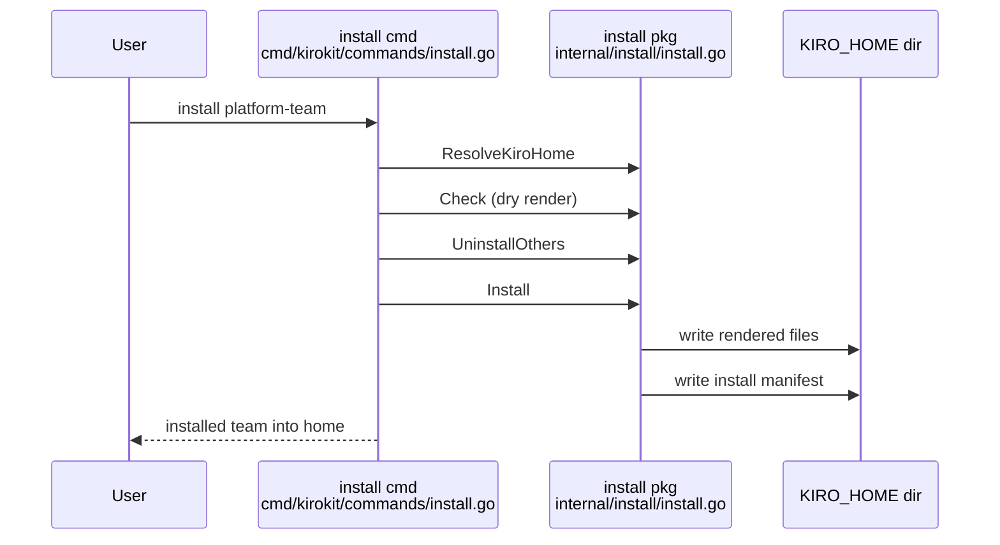
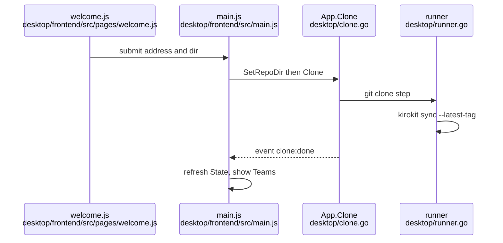
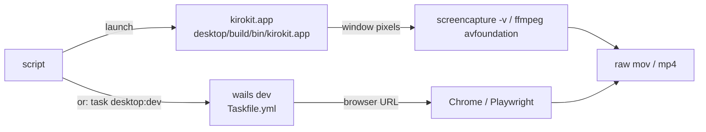

# Research: Showcase video of kirokit CLI and app for the README

## Summary

Both halves of the story can be recorded from real runs, in a throwaway setup that never touches the person's own Kiro home or app settings.

- **CLI:** `kirokit setup` and `kirokit install platform-team` each print one or two short lines into a temporary Kiro home. `kiro-cli chat --agent devops --v3` starts without any secret.
  - On first start it asks "Trust this workspace?", and Enter accepts.
  - The skill does not appear on the start screen. It shows when you type `/jir`: the completion list offers `/jira-search` (the skill) and `/jira-triage` (a prompt), exactly as the existing CLI screenshot shows.
  - `/quit` exits cleanly.
- **Desktop app:** started with a throwaway `HOME`, the app shows its first-launch page, clones into that folder and installs into a Kiro home there.
  - The Install dialog checks for SOPS, the decryption key and Kiro CLI. It blocks Install unless all three are found, so the key has to be reachable from the throwaway home.
  - Each button command prints in the kirokit tab of the terminal dock, and the team card flips to "installed".

**Recording tools:**
- `asciinema`, `agg` and `ffmpeg` are installed. `vhs` is not, but Homebrew has it.
- This ffmpeg cannot draw text, so captions have to be images laid over the video.
- Recording the native app window needs macOS Screen Recording permission, which the agent's shell does not have. Clicking by script also needs Accessibility permission.
- The app can instead run in a normal browser tab through Wails dev mode, where a script can click and record it without those permissions, but without the macOS window frame.

**GitHub:**
- Shows an in-repo GIF inline up to 10 MB.
- Plays an MP4 inline only from an uploaded attachment. GitHub CLI's `--attach` can do that upload from the command line.

**The repository's pre-commit hooks** rewrite binary files that are not PNGs. They would corrupt a committed GIF or MP4.

## What the goal puts at risk

- **Look here:** risky · the pre-commit `trailing-whitespace` and `end-of-file-fixer` jobs exclude only `**/*.png`, and a test run changed a GIF's bytes. A GIF or MP4 committed without new excludes is silently corrupted (`lefthook.yml:15-34`).
- **Look here:** risky · private details on screen:
  - the absolute target path printed by `kirokit setup` (`cmd/kirokit/commands/setup.go:75,81`)
  - the `KIRO_HOME` path printed by `kirokit install` (`cmd/kirokit/commands/install.go:46`)
  - the working directory in Kiro's status line and trust screen
  - the decryption-key path in the app's prerequisite row (`desktop/prereq.go:44-56`)
  - the shell prompt

  All of them need neutral, short paths.
- **Look here:** unsure · the app runs every command with the environment its login shell captured (`desktop/envcapture.go:19,100`). A throwaway `HOME` drops the person's shell PATH additions, and `kiro-cli` login under a different `HOME` was not checked. The app only checks that `kiro-cli` exists, so its install is not affected.
- **Reuse:**
  - `scripts/desktop-build.sh:7,20-21` has the script pattern (`set -euo pipefail`, `mktemp -d`, guarded `trap` cleanup), and `Taskfile.yml:45-48` shows how a task wraps it.
  - `desktop/build/bin/kirokit.app` and `task desktop:dev` already launch the app.
- **Churn (90 days):**
  - `README.md` 23 commits: the most edited file, so the embed should be a small, separate hunk near the top.
  - `scripts/` 4, `Taskfile.yml` 3, `assets/` 3, `CONTRIBUTING.md` 1, `.github/workflows` 10.
  - `desktop/frontend/src` 1: young, rarely changed UI, so a recording should stay valid for a while.
- **CI scope:** a change under `scripts/**` or to `Taskfile.yml` triggers the macOS desktop workflow (`.github/workflows/desktop.yaml:4-16`). Assets alone trigger only `ci.yaml`.
- **Repository size:** git history is about 21 MB today. A GIF of up to 10 MB plus an MP4 adds that much again on every re-record, because git keeps every version.
- **README accuracy:** `README.md:36-38` calls `jira-triage` "the example skill". The skill is `jira-search`, and `jira-triage` is a prompt. Captions should use the right name.
- **Not covered by any question:** Kiro's chat needs a moment before it accepts keystrokes. Keys sent too early were submitted to the model as chat text and spent credits, so the CLI recording must wait for the prompt.

## Open questions

- Question 1: What Kiro's chat shows when the `atlassian` MCP server cannot start for lack of a SOPS key; not reproducible here because this machine has a key.
- Question 4: Whether `screencapture -v` can record one window by id, and the exact Wails dev browser URL with live bindings; neither was run (no Screen Recording grant, dev server not started).
- Question 5: Whether `vhs` can drive Kiro's full-screen chat UI and quit it; `vhs` is not installed.
- Question 6: How GitHub treats a relative `<video>` tag in a README; from documentation knowledge only.

## Findings

<!-- ql:folded -->
### `kirokit setup` clones the repo and checks out the newest `v*` tag, printing the absolute target path twice
**Answers:** 1

- `--source` must match an https/ssh/file URL, `git@host:path`, or an absolute path (`cmd/kirokit/commands/setup.go:20`, checked at `:42`). `--target` is made absolute (`:49`) and is cloned into with `git clone -- <source> <dir>` (`:58`).
- Without `--branch`, it `chdir`s into the clone and calls `updateCheckout(true)` (`cmd/kirokit/commands/setup.go:69-72`). That fetches tags, lists `v*` tags sorted newest first and runs `git checkout --quiet <tag>` (`cmd/kirokit/commands/sync.go:125-143`). The result is a detached HEAD.
- With no `v*` tag it stays on the default branch and prints the "no release yet" notice (`cmd/kirokit/commands/setup.go:22,76-77`).
- Output I observed (ran `setup` from a build of this checkout, with the local repo path as `--source`):
  - git's own `Cloning into '<abs target>'...` and `done.`
  - `checked out v0.4.1 in <abs target>`
  - `next: export KIROKIT_REPO=<abs target>`
  - Formats are in `cmd/kirokit/commands/setup.go:66,75,77,81`.
- Private detail: the first two lines print the absolute target path. In the README flow that is `~/.kirokit-config` expanded by the shell, so it contains the user's home directory and user name. The `git clone` line also echoes the path. `--source` is not echoed by kirokit, but git may print it on errors.
- The Quickstart's `--target ~/.kirokit-config` and `KIROKIT_REPO` export are at `README.md:19-22`.

### `kirokit install platform-team` renders with the real `$KIRO_HOME` baked in and prints one line with that path
**Answers:** 1

- Kiro home is `$KIRO_HOME` if set, else `~/.kiro` (`internal/install/install.go:46-55`; called at `cmd/kirokit/commands/install.go:25`). `README.md:26-34` sets `KIRO_HOME=$(mktemp -d)` first, so the real `~/.kiro` is untouched.
- Order: a dry render into a scratch folder (`cmd/kirokit/commands/install.go:36`, `internal/install/install.go:60-67`), then removal of other installed teams (`cmd/kirokit/commands/install.go:40`; each prints `uninstalled <team> from <home>`, `:61`), then the real install (`:43`).
- Install renders with `KiroHome=kiroHome` (`internal/install/install.go:82`). It plans every file (`:89-97`), backs up changed folders (`:110`), writes files at mode 0600 (`:322-326,430-435`), then writes `<home>/.kirokit-installed/<team>.json` (`:126-131,273`).
- Only line printed on success: `installed platform-team into <KIRO_HOME>` (`cmd/kirokit/commands/install.go:46`). In a fresh home no "uninstalled" or backup line appears.
- Observed tree under the temporary home:
  - `agents/{devops,platformdev}.json`
  - `hooks/lint-on-save.json`
  - `prompts/{confluence-search,create-steering,jira-triage}.md`
  - `skills/{confluence-lookup,jira-search}/SKILL.md`
  - `steering/team-conventions.md`
  - `kirokit-steerings/platform-team/security-baseline.md`
  - `kirokit-secrets/platform-team/{devops,platformdev}/secrets.enc.yaml`
  - `.kirokit-installed/platform-team.json`
- Secrets files are copied from `teams/platform-team/agents/<agent>/env/secrets.enc.yaml` to `<home>/kirokit-secrets/<team>/<agent>/secrets.enc.yaml` (`internal/install/install.go:350-361`). They stay SOPS-encrypted.
- Private detail: the installed `agents/devops.json` contains the absolute home path in three places:
  - the skill resource URI
  - the steering resource URI
  - the `sops exec-env` secrets path
  - Template source: `teams/platform-team/agents/devops/agent.json.tmpl:19,24`.
  - These are visible if the video shows `cat agents/devops.json`. Goldens use the sentinel `/kiro-home` instead (`AGENTS.md`, "Repository rules").
- The age recipient in `secrets.enc.yaml` is a public key (`age1…`). It is visible in the `sops` error below and is not secret.

### The `devops` agent has one skill resource, `jira-search`; there is no `jira-triage` skill (it is a prompt)
**Answers:** 1

- `agents/devops.json` loads `skill://<home>/skills/jira-search/SKILL.md` (`teams/platform-team/agents/devops/agent.json.tmpl:19`). Its prompt is `file://../prompts/jira-triage.md` (`:4`). Template files: `teams/platform-team/skills/jira-search/SKILL.md.tmpl`, `teams/platform-team/prompts/jira-triage.md.tmpl`.
- `README.md:36` and the alt text at `README.md:38` call `jira-triage` "the example skill". The installed skill is named `jira-search`. `jira-triage` exists only as the agent prompt and a steering ("Jira Triage steering you have loaded", agent reply in my run).
- The agent JSON also adds the workspace globs `skill://.kiro/skills/**/SKILL.md` and `file://.kiro/steering/**/*.md`, which the global steering rendering appends (observed in the rendered JSON). The source for those two lines was not traced.

### `kiro-cli chat --agent devops --v3` starts without SOPS or a key; the secret is only needed when the `atlassian` MCP server launches
**Answers:** 1

- Observed with a pseudo-terminal, `KIRO_HOME` set to the temporary home and Kiro CLI's v3 mode:
  - The chat reached its input prompt (`devops · auto`, `ask a question or describe a task`) with no error. The banner area shows "Welcome to Kiro CLI V3!", a tip, and a Kiro 3.0 notice.
  - On this machine the Atlassian server connected, because this user has a SOPS age key. When the agent was asked "mcp", it listed `atlassian` and `context7` as connected servers.
- Without a key, `sops exec-env` on the shipped secrets file fails (observed: "Failed to get the data key required to decrypt the SOPS file ... failed to load age identities"). The `devops` MCP command is `sops exec-env <secrets> '<npx mcp-remote ...>'` (`teams/platform-team/agents/devops/agent.json.tmpl:23-24`). So the key is a runtime need of the `atlassian` server only.
- `context7` runs plain `npx` and needs no secret (`teams/platform-team/agents/devops/agent.json.tmpl:27-30`).
- What happens in the chat UI when `atlassian` fails to start was NOT observed (see Open questions). `README.md:12` states `sops` and a decrypting key are required "before starting the agent".

### First start asks to trust the working directory, and the startup screen does not list skills
**Answers:** 1

- On first launch in a directory with a fresh `KIRO_HOME`, the screen is a blocking menu: "Trust this workspace?" with `Trust, continue` / `Don't trust, exit`. It prints the working directory and the path `<KIRO_HOME>/workspace-roots/<hash>/permissions.yaml`. Enter selects `Trust, continue`.
- The trust record is written inside the temporary `KIRO_HOME`, so it is thrown away with it. The README flow does not mention this prompt.
- After trust, the startup screen shows: logo, "Welcome to Kiro CLI V3!", a rotating tip, a Kiro 3.0 notice, a status line `devops · auto · ◔ 1%`, the working directory, and a prompt `›  ask a question or describe a task ↵`.
- A search of the captured startup text found no occurrence of "skill", "jira", "sops", "atlassian" or "mcp". So no `jira-triage`/`jira-search` text is on the startup screen itself.
- The skill becomes visible through slash completion: `assets/kirokit-cli.png` (opened 2026-10-25) shows the prompt `› /jir` with a completion list `/jira-search  Search and summarize Jira tickets for platform-team, using the atlassian server.` and `/jira-triage  (file prompt) (prompt)`, plus `esc to cancel · ↑↓ to navigate · ↵ to select`. The same still shows the working directory `~/Developer/projects/kirokit` and git branch in the status line and terminal title. Slash commands such as `/skills` and `/mcp` are not verified: my keystrokes were sent while the UI was still initializing and were submitted as chat text (`mcp` reached the model), which also spent about 0.08 credits.

### Exit is clean with `/quit` (exit status 0)
**Answers:** 1

- `/quit` followed by Enter ended the session with exit status 0 and printed `Session ended.` and `Resume with: kiro-cli --resume-id sess_<uuid>`. The session id is a random identifier, not private.
- Ctrl+C or Ctrl+D handling was not tested.
- Cleanup per README: `rm -rf $KIRO_HOME` and restoring `KIRO_HOME_BACKUP` (`README.md:42-49`). If `KIRO_HOME` was unset before, `export KIRO_HOME=$KIRO_HOME_BACKUP` sets it to an empty string, which `ResolveKiroHome` treats as unset (`internal/install/install.go:47`).

### Private details printed or visible in this path
**Answers:** 1

| Where | What is printed |
|---|---|
| `setup` output (3 lines) | absolute target path (home dir and user name if under `~`) |
| `install` output | absolute `KIRO_HOME` (a `mktemp -d` path like `/var/folders/<xx>/<hash>/T/tmp.<rand>` on macOS, includes a per-user hash, not the user name) |
| `echo $KIRO_HOME` (README step) | same temporary path |
| Trust screen | current working directory plus `<KIRO_HOME>/workspace-roots/<hash>/permissions.yaml` |
| Chat footer | current working directory on every frame (wraps across two lines in 110 columns) |
| Session end | resume id (random) |
| `cat agents/devops.json` | `KIRO_HOME` path in three places |
| Terminal prompt / shell | whatever the user's shell prompt shows (user name, host) |

- No email address was seen in the output of any step. `kiro-cli` was logged in on this machine, but no account name appeared on the startup screen.
- Running from a neutral directory (for example a short `mktemp -d` folder) would keep the user's name out of the working-directory lines. In my run it was a long scratch path.

### First launch versus Teams page is decided by `.git` in the repo folder, plus a busy flag
**Answers:** 2

- Backend: `State()` stats `<repoDir>/.git` and returns `Cloned: err == nil` (`desktop/app.go:112-123`, backend).
- Frontend: `showWelcome` is true when the clone is not from Settings and (`!view.cloned` or `welcome.busy`) (`desktop/frontend/src/pages/welcome.js:10-11`, client). `setup = () => view.loaded && showWelcome(view)` (`desktop/frontend/src/main.js:36`), so nothing is decided until the first `State()` arrives (`main.js:151-153`).
- When welcoming, `render` shows `#page-welcome`, hides every sidebar page and adds class `setup` (`main.js:38-47`). CSS makes `.app.setup` one column and hides the sidebar (`desktop/frontend/src/style.css:118-119`).
- The page stays up while the clone runs, because git creates the folder before the first sync ends (`welcome.js:6-7`). After `clone:done` the view sets `busy:false` and refreshes (`main.js:196-201`), `cloned` turns true, and the Teams page appears.
- A clone started from Settings sets `fromSettings`, which keeps the pages visible and the old clone in use (`welcome.js:8-11`, `main.js:110-125`).
- Welcome page shows: heading "Set up kirokit", a "Repository address" field (placeholder `https://github.com/your-org/kiro-configs.git`), a "Repository folder" field (placeholder is `defaultRepoDir`), and a "Clone" button that reads "Cloning…" and is disabled while busy (`welcome.js:13-22`).

### Clone validates, reserves the kirokit tab, runs `git clone` then `kirokit sync --latest-tag`
**Answers:** 2

- `startClone` first calls `api.setRepoDir(dir)` (a refusal shows as the folder error with the `RepoDir: ` prefix stripped), then `api.clone(address)` (`main.js:92-109`).
- `Clone` trims the address, rejects it unless it matches `repoURLPattern` (https/ssh/file URL, `git@host:path`, or absolute path), finds the bundled CLI, then `reserve()`s the tab (`desktop/clone.go:25-36`, `desktop/settings.go:24`). It then runs in a goroutine and emits `clone:done` (`clone.go:38-51`).
- `cloneAndSync` moves any existing repo folder to `<repo>.old-<unix>` (`clone.go:57-69`), runs `git clone -- <address> <repo>` with git taken from the login PATH (`clone.go:78-82`), then `kirokit sync --latest-tag` (`clone.go:90`). Both steps run in the "kirokit" terminal tab, so the viewer sees the output.
- Outcomes: exit 0 gives OK. Output containing "no v* tag found" gives OK plus the notice "This repository has no release yet (no v* tag). Ask your team lead to tag one." (`clone.go:19, 94-97`). Any failure restores the old copy (`clone.go:70-76`).
- The address is written to `settings.json` only after a successful clone (`clone.go:41-48`).
- Git sign-in prompts are answered in the kirokit tab, which takes keystrokes only while a command runs (`desktop/frontend/src/terminal.js:57-62`).

### Settings and the repository folder live under `~/Library/Application Support/kirokit-desktop`, derived from `$HOME`
**Answers:** 2

- `NewApp()` uses `filepath.Join(homeDir(), "Library", "Application Support", "kirokit-desktop")` (`desktop/app.go:54-56`). `homeDir()` is `os.UserHomeDir()`, falling back to `/` (`app.go:137-143`). On macOS that reads `$HOME` (Go standard library behaviour, inferred, not run here).
- `settings.json` is `<dataDir>/settings.json` (`desktop/settings.go:26`), with fields `repoUrl`, `kiroHome`, `repoDir` (`settings.go:15-19`). Writes are atomic, mode 0600 (`settings.go:90-115`). A missing or unparsable file reads as empty settings, which means first launch (`settings.go:28-38`).
- Default repository folder is `<dataDir>/repo` (`app.go:126`). A saved `repoDir` wins (`app.go:130-135`). `checkRepoDir` refuses relative paths, `/`, the home folder, and a non-empty folder without `.git` (`settings.go:153-166`).
- The same data folder also holds the `zdotdir` wrapper for the zsh tab (`desktop/shell.go:198`).
- Observed on this machine: `~/Library/Application Support/kirokit-desktop` already holds `settings.json` and `zdotdir`. Contents were not read. A recording against the real home would meet the person's real settings and clone.

### A throwaway `HOME` isolates settings and the clone; there is no dedicated data-folder flag or env var
**Answers:** 2

- `main.go` calls `NewApp()` with no argument, and no environment variable overrides `dataDir` (`desktop/main.go:16`). `NewAppAt(dir)` exists but only tests and code can call it (`app.go:58-64`).
- Starting the app with `HOME=<empty temp dir>` moves the data folder, `settings.json` and the default clone under that HOME, because `dataDir` comes from `os.UserHomeDir()`. The clone then runs the same `README`-style first-launch path. This follows from the source above and was not run.
- Login environment: the app runs `$SHELL -ilc 'printf marker; exec env -0'` with a 5 s timeout and uses its environment for every command (`desktop/envcapture.go:19, 100`). The child inherits the app's `HOME`, so zsh reads the throwaway HOME's startup files (none) instead of the person's. The PATH is then topped up with `/opt/homebrew/bin`, `/opt/homebrew/sbin`, `/usr/local/bin`, `$HOME/.local/bin` (`envcapture.go:47-68, 89`). SOPS and Kiro CLI under Homebrew are still found. Note that a PATH from the person's rc files (for example a `~/.local/bin` or mise shim) is lost.
- The decryption key check uses `SOPS_AGE_KEY_FILE`, else `$XDG_CONFIG_HOME/sops/age/keys.txt`, else `$HOME/Library/Application Support/sops/age/keys.txt` (`desktop/prereq.go:44-56`), where `HOME` is the captured one. With a throwaway HOME and no `SOPS_AGE_KEY_FILE` exported to the app, the "Decryption key" row will show missing. Exporting `SOPS_AGE_KEY_FILE` to the app avoids this (inherited by the login shell).
- Kiro home: the saved `kiroHome` setting wins, else the captured `KIRO_HOME`, else `$HOME/.kiro` (`desktop/settings.go:117-137`). Every terminal gets `KIROKIT_REPO` and `KIRO_HOME` set from these (`desktop/shell.go:119-120`). So a throwaway HOME also redirects installs to `<throwaway>/.kiro`, unless `KIRO_HOME` is set in the app's environment.
- Unverified: whether `kiro-cli` still reports a logged-in session under a different HOME (its credential location was not inspected), and whether the Wails webview writes its own state under the real `~/Library`.
- Bundled CLI lookup: `$KIROKIT_DESKTOP_CLI`, else `<exe>/../../Resources/bin/kirokit`, else `desktop/build/dev-bin/kirokit` (`desktop/shell.go:32-69`). `desktop/build/bin/kirokit.app/Contents/Resources/bin/kirokit` exists locally.

### Install: replace dialog if another team is installed, then a setup check dialog, then `kirokit install <team>` in the dock
**Answers:** 3

Step by step (`desktop/frontend/src/main.js:80-90`):
1. Teams page card has an "Install" button, disabled while a command runs (`desktop/frontend/src/pages/teams.js:22, 28-33`).
2. `installPlan` (`desktop/frontend/src/dialogs.js:28-32`): the team already installed gives a "skip" error line "<team> is already installed." beside the button (`main.js:82-86`). Another team installed gives the replace dialog. None installed goes straight to setup.
3. Replace dialog ("Replace the installed team?"), text "X is installed. A Kiro home holds one team, so installing Y uninstalls X first.", buttons Cancel and Replace (`dialogs.js:34-36`, `desktop/frontend/index.html:102-108`).
4. Setup dialog titled "Install <team>" with the note "kirokit needs these on this computer before it can install a team." (`dialogs.js:60`, `index.html:110-118`). On open it calls `Prerequisites(team)` (`dialogs.js:72-84`, `api.js:24`). Rows are a badge `found` (ok) or `missing` (warn), the bold name and a detail line (`dialogs.js:20-24`).
5. Checks, fixed order (`desktop/prereq.go:20-33`): "SOPS" (detail is the found path, else "Install it with: brew install sops"), "Decryption key" (path, else "Ask your team lead for the age key and save it as <path>"), "Kiro CLI" (looks up `kiro-cli`; else "Install Kiro CLI from kiro.dev, then sign in"). Only presence is checked: `kiro-cli` login state is not tested, and the key file is only stat-ed. Each call re-reads the login shell, so "Check again" sees new installs (`prereq.go:16-22`).
6. Status line: "Checking...", then "Everything is ready. You can install." or "N of 3 checks needs/need attention. Fix them, then press Check again." (`dialogs.js:7-18`). The Install button is disabled unless all checks are found (`dialogs.js:70, 10`).
7. On Install, `runCommand(['install', team])` calls `App.Run` (`main.js:89, 68-78`). Run starts the bundled kirokit under a pseudo-terminal (`desktop/runner.go:45-51, 107-114`; `desktop/terminal/terminal.go:32-38`), prints the header `▸ kirokit install <team>` and streams bytes as base64 `term:kirokit` events (`runner.go:122-123, 136-142`). The frontend selects the kirokit tab and opens the dock when output arrives (`terminal.js:139-145`). A non-zero exit appends "exited with code N" (`terminal.js:147-151`).
8. Working directory is the repo folder (home if missing) (`runner.go:110-113`). Env includes the login environment, `KIROKIT_REPO` and `KIRO_HOME` (`shell.go:109-133`).
9. The CLI then does `Check`, uninstalls other teams ("uninstalled X from <home>"), `Install`, and prints `installed <team> into <kiroHome>` (`cmd/kirokit/commands/install.go:25-46, 58-61`). The home is `$KIRO_HOME`, else `$HOME/.kiro` (`internal/install/install.go:46-55`), which in the app is the Settings value, else the captured `KIRO_HOME`, else `~/.kiro` (`settings.go:129-137`).
10. At exit the runner re-reads install records (`runner.go:155-162`), the frontend refreshes (`main.js:191-195`), and the card's badge changes from "not installed" to "installed" and the Install page lists a row with Sync and Uninstall (`teams.js:14-17`, `pages/install.js:13-21`).

### When a prerequisite is missing, the dialog stays open with a red `missing` row and a disabled Install button
**Answers:** 3

- The row shows the badge `missing` (class `warn`), the name and the hint text (`dialogs.js:22`; hints in `prereq.go:25, 29, 31`). Status reads "1 of 3 checks needs attention. Fix them, then press Check again." (`dialogs.js:15`). The Install button stays disabled (`dialogs.js:70`) while Cancel and "Check again" remain usable. No terminal output is produced and the install does not start.
- If `Prerequisites` itself throws, rows are cleared and the error text is shown in the status line (`dialogs.js:78-81`).
- Other refusals show as an error line beside the Install button: another command is running gives "kirokit is still running a command" (`desktop/runner.go:14`, `main.js:73-76`); the bundled CLI is missing gives the "command-line tool was not found" message (`shell.go:68`).

### The terminal dock has two tabs: "kirokit" for button commands and "zsh" for the person's shell
**Answers:** 3

- `initDock` builds two xterm.js terminals (`terminal.js:50-53`). The kirokit tab prints a dim intro line, "Buttons run their kirokit command here. Type your own commands in the zsh tab." (`terminal.js:60`). The dock opens and toggles with Ctrl+` and a button (`terminal.js:94-110`).
- The kirokit tab uses a fixed 120x30 pty and the front end wraps to its width (`runner.go:16-21`). Only one command runs at a time (`runner.go:60-62`).
- The zsh tab starts a login shell through a generated ZDOTDIR wrapper that sources the person's own startup files and then puts the app's `KIRO_HOME`, `KIROKIT_REPO` and the bundled CLI first on PATH (`shell.go:140-163, 190-216`). It starts when the tab is first sized (`shell.go:233-248`).

### The native Wails window can be recorded by screencapture or ffmpeg, but both need Screen Recording permission that this session lacks
**Answers:** 4

- The window is a plain Wails v2 window: title "kirokit", 1180x760, minimum 720x480, background colour RGB 23,19,31 (`desktop/main.go:19-27`). The window title is the only handle for AppleScript/System Events lookups.
- `screencapture` on this machine (macOS 27.0.1) offers `-v` video, `-V<seconds>` limit, `-k` show clicks, `-C` cursor (documented as non-interactive modes only), `-R<x,y,w,h>` rectangle, `-l<windowid>` window, `-o` no shadow, `-g/-G/-A` audio (from `screencapture` usage output). A window capture needs a CGWindowID, which `screencapture` does not look up; `-l` is documented for stills, and `-v` with `-l` was not tested (gap).
- Observed: `screencapture -x -R0,0,200,200 out.png` failed with "could not create image from rect" (exit 1) from this agent shell, i.e. no Screen Recording grant for the process tree. An `ffmpeg -f avfoundation ... -i "3:none"` probe hung until stopped. Device listing works: `[3] Capture screen 0`, `[4] Capture screen 1`, cameras and microphones (ffmpeg 9.0.2 `-list_devices`). The terminal app that runs the script needs System Settings > Privacy & Security > Screen Recording (inference from the failure; not toggled here).
- Retina: a still of the desktop app already committed is 2358x1576 (`assets/kirokit-desktop.png`, via `file`), i.e. about 2x the 1180x760 window. `screencapture -R`/`-v` and avfoundation record in pixels of the display, so a 1180x760 point window is about 2360x1520 px and must be scaled down for a GIF/MP4 (inference).
- Cursor: `screencapture -C` and `-k` (clicks) exist; ffmpeg avfoundation has `-capture_cursor 1` and `-capture_mouse_clicks 1` (ffmpeg option names, not run successfully here).
- Option "run `task desktop:dev` and record its browser dev server": `desktop:dev` builds the CLI to `desktop/build/dev-bin/kirokit` then runs `go tool wails dev` (`Taskfile.yml:39-43`); `wails.json` sets `frontend:dev:watcher` to `npm run dev` and `frontend:dev:serverUrl` to `auto` (`desktop/wails.json:7-8`). The frontend's only Go access is `window.go.main.App`, and it throws "kirokit is not running inside its window" when absent (`desktop/frontend/src/api.js:5-9`); events use `window.runtime.EventsOn` and degrade to a no-op (`desktop/frontend/src/api.js:58-61`). The `wailsjs` bindings folder is gitignored and generated (`desktop/.gitignore:8`, `git check-ignore`). Plain `vite` or `npm run dev` in a browser therefore has no bindings and every `api.*` call fails. Wails v2 dev mode additionally serves the app on a browser-reachable dev server (default http://localhost:34115) that injects the bindings and runtime over websocket; this is from Wails documentation knowledge and was not run here (unverified). Under that server the page renders in a normal browser tab, which Playwright/Chrome DevTools can drive and record (Playwright video, or DevTools screenshots), but it is a browser frame, not the native window chrome.
- Driving clicks: `osascript` exists (`/usr/bin/osascript`); `cliclick` is not installed; `npx` and `node` exist, so Playwright can be fetched on demand (not installed globally). AppleScript/System Events clicking needs Accessibility permission for the controlling app in addition to Screen Recording (macOS rule; not exercised). The built app exists locally at `desktop/build/bin/kirokit.app` (`ls`), produced by `scripts/desktop-build.sh:34-40` (universal, ad-hoc codesigned), so a scripted `open` of that bundle is possible without the dev server.

### Terminal: asciinema + agg are installed and scriptable; vhs is not installed
**Answers:** 5

- Installed: `asciinema` 3.2.1, `agg`, `ffmpeg`; not found: `vhs`, `gifski`, `gifsicle`, `ttyd` (`which`). vhs needs `ttyd` and ffmpeg and is installed via Homebrew (`brew install vhs`); its tape language can `Type`, `Enter`, `Sleep`, `Hide`/`Show`, `Set FontFamily/FontSize/Theme/Width/Height/TypingSpeed` and `Output` .gif/.mp4/.webm/frames, and a TUI can be driven with `Type`/`Ctrl+C`/`Ctrl+D` keys (vhs documentation knowledge; not run here since not installed).
- asciinema 3.2.1 `rec` options: `--command`, `--window-size COLSxROWS`, `--idle-time-limit`, `--headless`, `--capture-input`, `--capture-env VARS`, `--title`, `--output-format` asciicast-v3/v2/raw/txt, `--overwrite`/`--append` (`asciinema rec --help`). It records whatever the command does; keystrokes are not synthesized, so typing must come from a driver (for example a wrapper script, `expect`, or tmux `send-keys`) or a hand-edited .cast (inference).
- `agg` renders .cast to GIF only: `--font-family`/`--text-font-family` (default list JetBrains Mono, Fira Code, SF Mono, Menlo, ...), `--font-size` (16), `--font-dir`, `--line-height` (1.4), `--theme` (asciinema, dracula, github-dark, github-light, kanagawa*, monokai, nord, solarized-*, gruvbox-dark, custom), `--speed`, `--idle-time-limit` (5), `--fps-cap` (30), `--cols`/`--rows`, `--no-loop`, `--last-frame-duration` (3), `--select` ranges/markers, `--renderer swash|resvg` (`agg --help`). MP4 comes from converting the GIF or from frames via ffmpeg (inference). Menlo, Monaco and SF Mono exist under `/System/Library/Fonts/` (`ls`).
- Hiding setup: asciinema has no hide primitive; do setup before `rec` (environment exported in the parent, recording starts at the interesting command) or trim with `agg --select`. vhs has `Hide`/`Show`.
- Env: asciinema passes the parent environment to `--command`; `--capture-env` only records named variables into metadata (default SHELL), so `KIRO_HOME=/scratch asciinema rec -c "kiro-cli chat"` works; the value would only be visible in the cast if captured or echoed. vhs runs a shell in ttyd, so variables are set with `Env KIRO_HOME ...` or `Hide`-d `export` lines (vhs documentation knowledge). `demo-runbook-v1.md` is the prior scratch-`KIRO_HOME` demo script; it is gitignored (`.gitignore`, pattern `demo-runbook-*`).

### GitHub renders in-repo GIFs inline; MP4 plays inline only via user-attachments or a linked page
**Answers:** 6

Verified against GitHub Docs ("Attaching files", fetched 2026-10-25): uploads are capped at 10 MB for images and GIFs, 10 MB for videos on free plans and 100 MB on paid plans; `.mp4`, `.mov`, `.webm` are supported and H.264 is recommended. GitHub CLI can upload a video without the web editor: `gh issue comment|pr comment|issue create|pr create … --attach <video>` with a body holding `` rewrites the reference to the uploaded URL, which renders as a player; it needs push access (GitHub Docs, "Attaching files with GitHub CLI"). The remaining items below come from documentation knowledge and were not fetched.
- In-repo GIF by relative path in `` or `` renders inline, like the existing `` (`README.md:43`, `README.md:59`). Repository file limit: warning at 50 MB, block at 100 MB per file; practical README budget is the stated 10 MB target. No autoplay controls; GIF loops.
- In-repo MP4: a relative `<video>` tag is stripped or not rendered in README sanitisation, and a raw/blob link is a link or download, not an inline player.
- `github.com/user-attachments/assets/<id>` videos (drag a .mp4/.mov into a README edit box or comment): rendered as an inline player; limit about 10 MB on free plans, 100 MB on paid, per GitHub docs.
- `<picture>` with `<source media="(prefers-color-scheme: dark)">` works for images including GIFs; commonly used with `#gh-dark-mode-only` fallback. Not applicable to video.
- To stay under about 10 MB: 10-15 fps, 720-800 px width (README uses width 720), ffmpeg two-pass `fps=12,scale=800:-1:flags=lanczos,split[a][b];[a]palettegen=max_colors=128:stats_mode=diff[p];[b][p]paletteuse=dither=bayer:bayer_scale=4`. `palettegen`/`paletteuse` and `xfade` filters are present in the installed ffmpeg (filter list). `gifski` and `gifsicle` are not installed; `agg` output can be shrunk with the ffmpeg palette pass (inference).

### Captions and joining are done in ffmpeg; this ffmpeg has no drawtext
**Answers:** 7

- Captions: vhs comments cannot appear on screen (use `Type "echo ..."` or `Hide`); with asciinema the caption is a typed `echo`/`printf` before the command. ffmpeg `drawtext` with `fontfile=/System/Library/Fonts/Menlo.ttc` (path exists) is the usual approach, but the build's `drawtext` filter was NOT found in the filter list grep (only `palettegen` and `xfade` matched; the build configuration shows no `--enable-libfreetype`/`libharfbuzz`), and `ffmpeg -hide_banner -filters | grep -E ' (drawtext|overlay|xfade|palettegen) '` lists `overlay`, `palettegen` and `xfade` but no `drawtext`; `ffmpeg -buildconf` shows no freetype, harfbuzz, libass or fontconfig (run 2026-10-25), so `drawtext` is unavailable in this build. Alternative: render title cards as PNGs from HTML (Chrome DevTools/Playwright screenshot) and overlay with the `overlay` filter or use them as `-loop 1` clips.
- Joining clips of different sizes: `scale=W:H:force_original_aspect_ratio=decrease,pad=W:H:(ow-iw)/2:(oh-ih)/2:color=...,setsar=1,fps=30` on each clip, then `xfade=transition=fade:duration=0.5:offset=<len1-0.5>` or `concat`; the output is MP4 (libx264 is built in) and then GIF through the palette pass.
- One reproducible script: Taskfile already wraps shell scripts (`desktop:build` calls `scripts/desktop-build.sh`, `Taskfile.yml:45-48`); that script uses `set -euo pipefail`, `mktemp -d` and `trap 'rm -rf "${work:?}"' EXIT` (`scripts/desktop-build.sh:7,20-21`), a pattern a recording script could follow.

### Repo gates: nothing blocks a GIF/MP4, but hooks and Prettier-like fixers have exclusions only for PNG
**Answers:** 8

- CI: `ci.yaml` runs build, vet, golangci-lint, `go test ./... -v` and `node scripts/sync-agent-assets.mjs --check` on every PR and push to main (`.github/workflows/ci.yaml:11-38`). `desktop.yaml` runs on macOS for PRs touching `desktop/**`, `cmd/**`, `internal/**`, `go.*`, `Taskfile.yml`, `scripts/**` and its own file (`.github/workflows/desktop.yaml:4-16`), running `task desktop:test` and `task desktop:build` (`.github/workflows/desktop.yaml:46-50`); `assets/` changes alone do not trigger it, `scripts/**` and `Taskfile.yml` changes do.
- No workflow checks file size or binary type (no match in `.github/workflows/*.yaml`; `.gitattributes` does not exist; no LFS).
- lefthook pre-commit: `trailing-whitespace` and `end-of-file-fixer` run on `{staged_files}` with `stage_fixed: true` and exclude only `**/*.png`, `testdata/golden/**`, `**/*.enc.yaml`, `teams/*/external/**` (`lefthook.yml:15-34`). A staged `.gif` or `.mp4` is therefore passed to those fixers, which lefthook runs directly, without pre-commit's text-file filter (`lefthook.yml:17-33`). Ran 2026-10-25 on a 2 s ffmpeg test GIF in a scratch folder: `uvx --from pre-commit-hooks==6.0.0 trailing-whitespace-fixer t.gif` printed "Fixing t.gif" and exited 1, `end-of-file-fixer` did the same, and the SHA-1 changed from `488014b4…` to `0cc551a3…`: both fixers rewrite GIF bytes, so with `stage_fixed: true` a committed GIF would be corrupted. Also `check-yaml` (`*.yaml,*.yml`), `check-json`, `gitleaks git --staged` (`lefthook.yml:36-52`); commit-msg runs `cz check` (`lefthook.yml:54-57`). Adding `**/*.gif` and `**/*.mp4` to those excludes follows the existing PNG pattern.
- `.gitignore` ignores `/dist/`, `/kirokit`, `/tmp/`, `.claude/*` (except rules/skills) and `demo-runbook-*`; no rule matches `assets/*.gif`, `assets/*.mp4` or `scripts/*.tape` (`git check-ignore` returned nothing for them). Existing tracked media: `assets/kirokit-cli.png` 138 KB, `assets/kirokit-desktop.png` 216 KB, `assets/logo.png`, `assets/logo.svg`, plus many PNGs under `docs/plans/**/evidence/` (`git ls-files`).
- Docs for contributor commands: `CONTRIBUTING.md` lists tools (lines 50-58), `task build/vet/lint/test/ci/desktop:test` (lines 85-90) and says to run `task desktop:test` when touching `desktop/` (line 93). AGENTS.md requires README updates when a command, flag, manifest field or template function changes (`AGENTS.md`, Repository rules); a new Taskfile task for recording would belong in `CONTRIBUTING.md:85-90`. README embeds the stills at `README.md:43` and `README.md:59`, and mentions `task desktop:build`/`task desktop:dev` at `README.md:280`.
- Churn (90 days) on these paths is low: `git log --since=90.days -- Taskfile.yml lefthook.yml .github scripts .gitignore` lists about 10 commits, the latest `8633d86 docs: add contributing guide...`.
<!-- /ql:folded -->

## Decided with you

<!-- ql:decided -->
| # | Question | Your answer |
|---|---|---|
| 6 | How should the desktop app part be recorded? | Real app UI in a browser tab, driven by script |
| 7 | Where should the MP4 master live? | Committed in assets/ next to the GIF |
<!-- /ql:decided -->

## The questions

1. **How does the CLI user path behave in a fresh, temporary Kiro home?** Trace `kirokit setup --source … --target …`, `kirokit install platform-team` and what `kiro-cli chat --agent devops --v3` shows on start (where the `jira-triage` skill becomes visible, whether SOPS or a key is needed before the agent starts, how to exit cleanly). Note every line of output that prints a home path, user name, email or other private detail. Look at `cmd/kirokit/commands/setup.go`, `cmd/kirokit/commands/install.go`, `internal/install/`, `teams/platform-team/`, `README.md:10-53`.

2. **How does the desktop app's first launch and Clone flow work, and where are its settings and repository folder kept?** Describe what decides first launch versus the Teams page, where `settings.json` and the default repository folder live, and whether the app can be started against a separate, throwaway data folder or `HOME` so a recording never touches the person's real settings. Look at `desktop/app.go`, `desktop/settings.go`, `desktop/clone.go`, `desktop/envcapture.go`, `desktop/frontend/src/pages/welcome.js`, `desktop/frontend/src/main.js`.

3. **What does the app's Install flow show, step by step?** Describe the prerequisite check (SOPS, decryption key, Kiro CLI), the dialog or page it shows, how the terminal dock runs `kirokit install <team>`, which Kiro home it installs into, and what appears on screen when a prerequisite is missing. Look at `desktop/prereq.go`, `desktop/runner.go`, `desktop/shell.go`, `desktop/terminal/`, `desktop/frontend/src/pages/install.js`, `desktop/frontend/src/pages/teams.js`, `desktop/frontend/src/terminal.js`, `desktop/frontend/src/dialogs.js`.

4. **How can the native Wails app window be recorded from a script on macOS?** Compare the options that exist on this machine: `screencapture -v` with a window or rectangle, `ffmpeg -f avfoundation`, running `task desktop:dev` and recording its browser dev server (what `desktop/frontend/src/api.js` needs from the Go bindings when opened in a plain browser), and driving clicks by script (AppleScript/System Events, Chrome DevTools, Playwright). Note required macOS permissions and what each option captures (window frame, retina scale, cursor). Look at `desktop/main.go`, `desktop/wails.json`, `desktop/frontend/src/api.js`, `Taskfile.yml`, `scripts/desktop-build.sh`.

5. **How can the terminal part be recorded reproducibly?** Compare `vhs` (Homebrew, tape files; can it drive an interactive TUI like `kiro-cli chat` and quit it) with `asciinema` + `agg` (both installed): output formats (GIF, MP4, frames), font, theme, window size, typing speed, hiding setup commands, and how each handles environment variables like `KIRO_HOME`.

6. **How does GitHub show GIF and MP4 files in a README?** Describe size limits and behaviour for an in-repo GIF referenced by relative path, an in-repo MP4 (relative `<video>` tag, raw link), and `github.com/user-attachments` videos; whether `<picture>` light/dark variants work; and what frame rate, width and palette settings keep a 30-60 s screen GIF under about 10 MB while staying readable (ffmpeg `palettegen`/`paletteuse`, `gifski`, `gifsicle`).

7. **How are captions and the CLI-then-app join usually built with the tools available?** Describe options for step captions and title cards (vhs comments or typed `echo`, ffmpeg `drawtext` with an installed font, overlaying images rendered from HTML) and for joining two clips of different sizes into one 30-60 s video (scale, pad, crossfade, concat), plus how to keep the pieces in one reproducible script or `Taskfile.yml` task.

8. **What does the repository's tooling enforce on new files today?** Describe the CI workflows, lefthook hooks, `.gitignore` rules and any size or binary checks that would affect committing a GIF, an MP4 and recording scripts under `assets/` or `scripts/`, and where `README.md` and `CONTRIBUTING.md` document contributor commands. Look at `.github/workflows/`, `lefthook.yml`, `.gitignore`, `Taskfile.yml`, `scripts/`, `CONTRIBUTING.md`.

**Key context pointers:**

- `README.md:1-71` — intro, Quickstart for CLI and desktop app, existing stills `assets/kirokit-cli.png`, `assets/kirokit-desktop.png`.
- `cmd/kirokit/commands/` — `setup.go`, `install.go`, `sync.go`, `uninstall.go`.
- `desktop/` — Wails app (`main.go` window 1180×760), Go side `app.go`, `settings.go`, `clone.go`, `prereq.go`, `runner.go`, `shell.go`; frontend `desktop/frontend/src/` (`main.js`, `api.js`, `terminal.js`, `pages/`).
- `Taskfile.yml` — `build`, `desktop:dev`, `desktop:build`; `desktop/build/bin/kirokit.app` exists locally.
- `demo-runbook-v1.md` (gitignored) — prior live-demo script using a scratch `KIRO_HOME`.
- Installed tools: `asciinema`, `agg`, `ffmpeg`, `ffprobe`, `kiro-cli` (logged in), `sops`; not installed: `vhs`, `gifski`.

## How it is tested today

- **Go suite:** run `go test ./...` or `task test` from the repository root. It includes the golden comparison for every team. CI runs the same checks with `task ci`.
  - One package: `go test ./internal/install/...`.
  - One test: `go test ./internal/install -run TestInstall_WritesSecretsFileAtExpectedPathAndBakesItIntoAgentArgs`.
  - Fixtures live in `testdata/golden/<team>/` and are compared byte for byte.
  - `kirokit setup` has `cmd/kirokit/commands/setup_test.go`.
- **Desktop:** `task desktop:test` builds the frontend, runs `node --test "src/**/*.test.js"` in `desktop/frontend`, then `go vet ./... && go test ./...` in `desktop`.
  - One frontend file: `cd desktop/frontend && node --test src/dialogs.test.js`.
  - One Go package: `cd desktop && go test ./terminal`.
  - App tests isolate with `NewAppAt(<tempdir>)` and a replaced login-environment capture.
- **Agent assets:** `node scripts/sync-agent-assets.mjs --check`.
- **Pre-commit hooks:** `lefthook run pre-commit` runs the whitespace fixers, YAML/JSON checks and gitleaks on staged files.
- **Gaps:**
  - No automated test drives the real Wails window.
  - Nothing tests recording scripts or media files, and no CI job checks file size or type.

## Code references

<!-- ql:folded references -->
- `cmd/kirokit/commands/setup.go:20,42,49,58,66,69-72,75,77,81`
- `cmd/kirokit/commands/sync.go:125-143` (`updateCheckout`)
- `cmd/kirokit/commands/install.go:25,36,40,43,46,61`
- `internal/install/install.go:46-55,60-67,82,89-97,110,126-131,273,322-326,350-361,430-435`
- `teams/platform-team/agents/devops/agent.json.tmpl:4,19,23-24,27-30`
- `teams/platform-team/skills/jira-search/SKILL.md.tmpl`, `teams/platform-team/prompts/jira-triage.md.tmpl`, `teams/platform-team/manifest.yaml`
- `README.md:10-53`
- Not exhaustive: the desktop app, `uninstall`, `sync` and the render package were not traced. The Quickstart run used a local-path `--source` and a pseudo-terminal under Python, not the README's https source.
- `desktop/main.go:12-35` window size, title, bindings, embedded assets
- `desktop/wails.json:7-8` dev watcher and server URL
- `desktop/frontend/src/api.js:5-9,58-61` binding requirement and event fallback
- `desktop/.gitignore:5,8` dist and wailsjs ignored
- `Taskfile.yml:24-48` ci, desktop:test, desktop:dev, desktop:build
- `scripts/desktop-build.sh:7-41` app build, bundle path, codesign
- `.github/workflows/ci.yaml:11-38`, `.github/workflows/desktop.yaml:4-50`
- `lefthook.yml:15-57`, `.gitignore`, `CONTRIBUTING.md:50-93`, `README.md:43,59,280`
- Exhaustiveness: the listed files were read; other repository files were not searched. Tool facts come from `--help` output and `which` on this machine.

Exhaustive for the files named in the questions; `desktop/catalog.go` and `desktop/installs.go` (catalog and install record polling) were not read in full. Each of the desktop files changed once in the last 90 days (`git log --oneline --since=90.days`), so they are young and have little history.
- Data folder and State: `desktop/app.go:52-64, 110-143`
- Settings: `desktop/settings.go:15-38, 43-84, 117-166`
- Clone: `desktop/clone.go:19-101`
- Login environment: `desktop/envcapture.go:19, 47-126`
- Prerequisites: `desktop/prereq.go:20-62`
- Runner and one-command lock: `desktop/runner.go:45-165`
- Shell, bundled CLI, terminal env: `desktop/shell.go:32-133, 190-216`
- Pseudo-terminal: `desktop/terminal/terminal.go:32-87`
- Window: `desktop/main.go:15-34` (1180x760, min 720x480)
- Welcome page: `desktop/frontend/src/pages/welcome.js:10-41`
- App shell and flows: `desktop/frontend/src/main.js:36-47, 80-125, 196-201`
- Dialogs: `desktop/frontend/src/dialogs.js:7-89`; markup `desktop/frontend/index.html:102-118`
- Dock: `desktop/frontend/src/terminal.js:45-152`
- CLI install: `cmd/kirokit/commands/install.go:25-61`, `internal/install/install.go:46-55`

**How it is tested today**
- The install package has unit tests in `internal/install/install_test.go` (install, uninstall, knowledge-base, secrets path, global steering), `installed_test.go` and `sync_test.go`. They use temporary directories, with no `kiro-cli` needed.
- One package: `go test ./internal/install/...` from the repo root. One test: `go test ./internal/install -run TestInstall_WritesSecretsFileAtExpectedPathAndBakesItIntoAgentArgs`.
- Whole suite, including golden comparison for every team: `go test ./...` (`AGENTS.md`), or `task ci` (`Taskfile.yml`, test target at lines 19-22).
- `go test ./internal/golden` also runs `kiro-cli agent validate`, skipping without a logged-in `kiro-cli` unless `KIROKIT_REQUIRE_KIRO_CLI=1` (`AGENTS.md`).
- I did not find a test for `setup`; a file search under `cmd/kirokit/commands` for `setup_test.go` was not run, so treat this as a gap, not a fact.
- Change frequency, last 90 days: `internal/install` has 9 commits and `cmd/kirokit/commands/setup.go` has 1.
- Go (desktop module, its own `go.mod`): tests sit beside sources, `desktop/app_test.go`, `settings_test.go`, `clone_test.go`, `prereq_test.go`, `runner_test.go`, `shell_test.go`, `envcapture_test.go`, `terminal/terminal_test.go`. App tests build the app with `NewAppAt(tempdir)` and replace `captureFn` (`app.go:17-18, 58-64`).
- Frontend: `node --test` on `desktop/frontend/src/**/*.test.js`, including `pages/pages.test.js`, `dialogs.test.js`, `api.test.js`, `tabs.test.js`, `sidebar.test.js`. They cover state builders as plain functions (`dialogs.js:3-4`).
- One frontend test file: `cd desktop/frontend && node --test src/dialogs.test.js`.
- One Go test file or package: `cd desktop && go test -run <Name> .` (all in package main), or `cd desktop && go test ./terminal`.
- Whole desktop suite from the repository root: `task desktop:test` (`Taskfile.yml:32-37`: `npm ci && npm run build`, `node --test`, `go vet`, `go test`). Nothing was run for this research.
- There is no automated test that drives the real Wails window.
- Go suite from the repository root: `go test ./...` (all) or `task test`; one package `go test ./internal/golden`. CI mirrors with `task ci` (`Taskfile.yml:24-30`). Fixtures: `testdata/golden/<team>/` compared byte for byte (`AGENTS.md`).
- Desktop: `task desktop:test` builds the frontend, runs `node --test "src/**/*.test.js"` in `desktop/frontend`, then `go vet ./... && go test ./...` in `desktop` (`Taskfile.yml:32-37`). One frontend file: `cd desktop/frontend && node --test src/api.test.js`. Frontend tests live beside sources (`desktop/frontend/src/*.test.js`).
- Agent asset parity: `node scripts/sync-agent-assets.mjs --check`.
- There is no test for recording or media assets; a recording script would have none unless added.
<!-- /ql:folded -->
