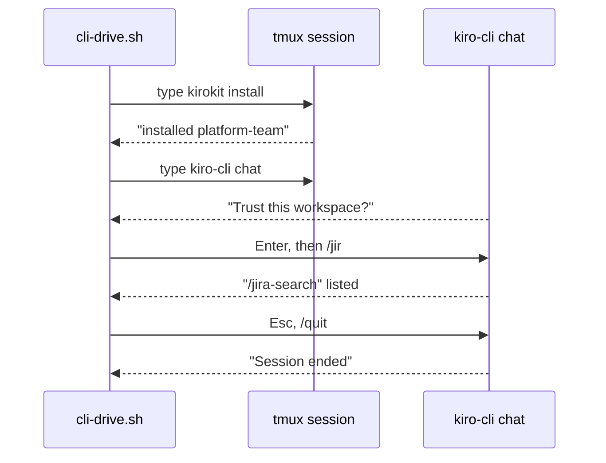

# Plan: a re-recordable 30-60 s showcase of the kirokit CLI and app

## Summary

After this change the README opens with a looping GIF of about 40-45 seconds:
- the CLI installs a team's Kiro config and Kiro starts with the team's skill;
- then the desktop app does the same with Clone and Install.

A sharp MP4 of the same cut sits next to it in `assets/`. When the UI changes, `task showcase` records both parts again from the real tools and rebuilds both files.

- **One look explains kirokit.** Visitors see the CLI and the app working before they read any text.
- **Every frame is real.** The CLI part is a real terminal session. The app part is the real app UI and backend running in a browser tab.
- **Nothing private on screen.** Recordings run in short throwaway folders, and the script refuses to finish if your home path, user name or email appear in the recorded text.
- **Small and checked.** The script fails if the GIF exceeds 8 MB, the MP4 exceeds 4 MB, or the cut falls outside 30-60 seconds.
- **Commits stay intact.** The pre-commit hooks stop rewriting GIF and MP4 files, so committed media is never corrupted.

## How we will know it works

**Oracle:** after `task showcase`, `assets/kirokit-showcase.gif` plays 30-60 s on the rendered GitHub README. Frames show `kirokit install platform-team`, Kiro's `/jir` completion listing `jira-search`, and the app's dock printing `installed platform-team into …`, and none show the person's home path or user name.

**Size:** about 3 slices and 11 tasks.

**Risky:** the recording drives outside tools (a logged-in `kiro-cli`, a GitHub clone over the network, Chrome via a new dev-only `playwright-core` dependency) and links the person's SOPS age key into a throwaway home; nothing shipped changes.

## Today and after the change

```diff
  README.md                         # intro, then Quickstart with two stills
+ README.md                         # intro, then the showcase GIF + "MP4" link, then Quickstart
  assets/kirokit-cli.png, assets/kirokit-desktop.png
+ assets/kirokit-showcase.gif       # README showcase, < 8 MB
+ assets/kirokit-showcase.mp4       # H.264 master, < 4 MB
+ scripts/showcase/record.sh        # one entry: record CLI, record app, captions, compose, checks
+ scripts/showcase/cli-drive.sh     # types the CLI story into a tmux session
+ scripts/showcase/app-drive.mjs    # clicks the app story in Chrome, records video
+ scripts/showcase/caption.mjs      # renders caption PNGs
+ scripts/showcase/package.json, package-lock.json, tmux.conf, .gitignore
  Taskfile.yml                      # build, test, desktop:*
+ Taskfile.yml                      # + showcase
  lefthook.yml                      # whitespace fixers skip only *.png
+ lefthook.yml                      # … and *.gif, *.mp4
  CONTRIBUTING.md                   # checks
+ CONTRIBUTING.md                   # + "Showcase video" (tools, task showcase)
```

## Engineering decisions

### The CLI part is a real terminal session typed by a script and recorded with asciinema

`cli-drive.sh` types into a `tmux` session one character at a time, waiting on the screen text before each step. The steps are: `kirokit install platform-team`, `kiro-cli chat --agent devops --v3`, trust the workspace, `/jir`, Esc, `/quit`. `asciinema` records the session and `agg` renders it.

We are not adding `vhs` or using `expect`: both of those drivers failed or were untested against Kiro's full-screen chat, and the tmux route ran cleanly.


<!-- ql:decide d1 -->
<!-- /ql:decide -->

### The app part is the real app in Wails dev mode, recorded in headless Chrome with a throwaway home

`record.sh` starts `go tool wails dev` with `HOME` set to a throwaway folder, so the app's settings, clone and Kiro home all live there. It also links (never copies) the person's age key into that home, so the app's three checks pass.

`app-drive.mjs` uses `playwright-core` with the installed Chrome to:
1. type `https://github.com/mavogel/kirokit.git` and press **Clone**;
2. press **Install** on `platform-team`, then **Install** in the setup dialog;
3. record the window at 1180×760, which the composer places in a plain rounded frame.

The native window capture is not used (your answer). The dev window that Wails also opens is left alone and closed when the server stops.
<!-- ql:decide d2 -->
<!-- /ql:decide -->

### Captions sit in their own band below each clip and are rendered by Chrome

This ffmpeg build has no text filter. `caption.mjs` renders each caption as a transparent PNG, and ffmpeg places it in a dark band under the clip instead of over it, because an overlay covered the app's terminal dock in the spike.

The cut is: a short title card, the CLI clip, a 0.5 s crossfade, the app clip, and an end card naming `brew install --cask mavogel/tap/kirokit` and `…/kirokit-desktop`. Each caption stays at least 2.5 s.

Caption wording:
1. "1 · Install your team's Kiro config"
2. "2 · Kiro starts with the team's agent and skills"
3. "3 · Or click: clone the config repo"
4. "4 · Install the team, see every command"
<!-- ql:decide d3 -->
<!-- /ql:decide -->

### The script refuses to publish private details, oversize files or a wrong length

**Look here:** risky · this is what keeps your name and paths out of a public file.

All recordings use the fixed neutral folders `/tmp/kirokit-demo/{home,kiro,work}`.

Before writing to `assets/`, `record.sh` fails if any of these appear:
- the person's `$HOME`, `$USER` or git email in the asciicast text, the app clip's dock text (read from the page), or the caption text;
- a GIF over 8 MB or an MP4 over 4 MB;
- a cut outside 30-60 s.

The previous `assets/` files are replaced only after every check passes.
<!-- ql:decide d4 -->
<!-- /ql:decide -->

### Committed media is protected from the whitespace hooks, and the README names the skill correctly

**Look here:** risky · without this, committing the GIF silently corrupts it.

`lefthook.yml` adds `**/*.gif` and `**/*.mp4` to the excludes of `trailing-whitespace` and `end-of-file-fixer`, next to `**/*.png`.

The README gains the GIF right under the intro, plus a one-line link to the MP4. The README sentence and alt text that call `jira-triage` "the example skill" are corrected: the skill is `jira-search`, and `jira-triage` is a prompt. The two screenshots stay.
<!-- ql:decide d5 -->
<!-- /ql:decide -->

## Not doing

- Recording the native macOS window or adding Screen Recording/Accessibility permissions.
- Voice-over, music, or posting the video anywhere; uploading the MP4 as a GitHub attachment stays your choice (`gh … --attach` can do it later).
- A CI job that re-records; recording needs a logged-in `kiro-cli` and a SOPS key, so it runs on a maintainer's Mac.
- Any change to how the `kirokit` CLI or the desktop app behaves.
- Git LFS for the media.

## Decisions made for you

- `task showcase` is the one command, and `scripts/showcase/` holds everything it runs — it sits beside the existing `scripts/desktop-build.sh` and `task desktop:*` pattern.
- File names `assets/kirokit-showcase.gif` and `assets/kirokit-showcase.mp4` — next to the existing `kirokit-cli.png` and `kirokit-desktop.png`.
- `playwright-core` 1.63.0 pinned in `scripts/showcase/package.json` with a lockfile, `channel: 'chrome'` — uses the installed Chrome, so no browser download; 1.63.0 is older than two weeks, and Renovate keeps it current.
- Terminal look: 110×32, `agg` theme `github-dark`, font size 16, typing at 70 ms per character, a neutral `$ ` prompt — readable at GIF size and free of the person's prompt.
- Canvas 1280×800 plus a caption band for the MP4 (H.264, `crf` about 24, `+faststart`), and a GIF at 12 fps, about 1000 px wide, 128 colours — the spike's 37 s cut was 0.7 MB / 1.7 MB, so there is room for a sharper GIF.
- The clone in the app uses the public `https://github.com/mavogel/kirokit.git`, the address the README tells users to use.
- The GIF is shown with `width="800"` and links to the MP4, matching the README's centred `<p align="center">` style.

## Before the build

| # | Prerequisite | Met by | Status |
|---|---|---|---|
| P1 | Permission to run the agreed build | the user, at approval | granted · approved in the App, 2026-10-25 10:04 UTC |
| P2 | `kiro-cli` installed and signed in, so the chat starts | this machine, probed by the CLI spike | met · [records/spike-cli.txt](records/spike-cli.txt) |
| P3 | A SOPS age key at the default location, so the app's check passes and the `atlassian` server starts | this machine, probed by the app spike | met · [records/spike-app.txt](records/spike-app.txt) |
| P4 | `tmux`, `asciinema`, `agg`, `ffmpeg`, Node and Google Chrome installed | this machine, used by all three spikes | met · [records/spike-compose.txt](records/spike-compose.txt) |
| P5 | Network access to `github.com` for the app's clone | this machine, probed by the app spike | met · [records/spike-app.txt](records/spike-app.txt) |

## Risks

- **Kiro's chat changes its screen text or timing.** The driver waits for exact text with a timeout and fails with the step name, so a changed Kiro breaks the run loudly instead of recording a wrong video. Test: run `task showcase`; the run log names each step reached.
- **Keystrokes reach Kiro before it is ready and go to the model, spending credits.** The driver types only after "ask a question" is on screen and never presses Enter on a chat message. Test: the recorded `.cast` contains no model reply text.
- **The clone or a slow network stretches the app clip.** Playwright waits up to 120 s, and the composer trims idle time. Test: the length check (30-60 s) fails the run if the cut grows.
- **Private detail slips into a frame.** The privacy check in decision d4 scans every recorded text source. Test: run it once with a deliberately echoed `$HOME` in a scratch copy and see it fail.
- **The age key link outlives the run.** `record.sh` removes `/tmp/kirokit-demo` in an `EXIT` trap, guarded with `${dir:?}`. Test: after a run, and after an interrupted run, `/tmp/kirokit-demo` is gone and the real key file is untouched (same inode and modification time).
- **Repository growth.** Every re-record adds the GIF and MP4 to history; the 8 MB / 4 MB caps bound it. Test: the size check.

## Decided by you

<!-- ql:decided-by-you -->
- Discuss · Which file format should the README show? — Both: GIF in the README, MP4 kept as the sharp master
- Discuss · How should the video be produced? — Scripted real recordings, re-recordable with one command
- Discuss · Which story should the 30-60 seconds tell? — User path: CLI install of a team, agent starts in Kiro, then the same in the app
- Discuss · Where in the README should it go? — At the top, under the intro; keep the two screenshots
- Discuss · Text on screen? — Short captions per step (e.g. "1 · install a team")
- Research · How should the desktop app part be recorded? — Real app UI in a browser tab, driven by script
- Research · Where should the MP4 master live? — Committed in assets/ next to the GIF
<!-- /ql:decided-by-you -->

## What the Plan rests on

- `kirokit install platform-team` renders with the real `$KIRO_HOME` baked in and prints one line with that path
- `kiro-cli chat --agent devops --v3` starts without SOPS or a key; the secret is only needed when the `atlassian` MCP server launches
- First start asks to trust the working directory, and the startup screen does not list skills
- A throwaway `HOME` isolates settings and the clone; there is no dedicated data-folder flag or env var
- Install: replace dialog if another team is installed, then a setup check dialog, then `kirokit install <team>` in the dock
- Terminal: asciinema + agg are installed and scriptable; vhs is not installed
- GitHub renders in-repo GIFs inline; MP4 plays inline only via user-attachments or a linked page
- Captions and joining are done in ffmpeg; this ffmpeg has no drawtext
- Repo gates: nothing blocks a GIF/MP4, but hooks and Prettier-like fixers have exclusions only for PNG

## Reviewed by

<!-- ql:reviews -->
<!-- /ql:reviews -->

## System design contracts

**Trust boundary:** the person's SOPS age key — `record.sh` creates a symlink to `$HOME/Library/Application Support/sops/age/keys.txt` (or `$SOPS_AGE_KEY_FILE` when set) inside `/tmp/kirokit-demo/home`. It never reads, copies or prints the key. The link is removed in the `EXIT` trap. Separately, the app clones `https://github.com/mavogel/kirokit.git` over the network.

### `task showcase` runs one script that leaves only the two asset files behind

- Signature: `scripts/showcase/record.sh [--keep]`. `--keep` leaves `/tmp/kirokit-demo` and the intermediate clips for inspection.
- Order:
  1. Preflight: required tools are present, the age key exists, and ports 34115 and 5173 are free (else fail with "close the running wails dev first").
  2. `go build` the CLI into `/tmp/kirokit-demo/bin`, and into `desktop/build/dev-bin/kirokit` as `task desktop:dev` does.
  3. Record the CLI → `cli.cast` → `cli.gif`.
  4. In `desktop/`, start `go tool wails dev` in the background with `HOME=/tmp/kirokit-demo/home`, while `GOCACHE`, `GOMODCACHE`, `GOPATH` and `npm_config_cache` keep the person's real values (read from `go env` and `npm config get cache` before the switch) so nothing is rebuilt or downloaded again. Note its PID, wait up to 180 s for `Using DevServer URL: http://localhost:34115`, run `app-drive.mjs` → `app.webm`, `app-dock.txt`, `app-marks.json`, then stop that PID. The native dev window Wails opens closes with it.
  5. Render the captions.
  6. Compose `showcase.mp4`, then `showcase.gif`.
  7. Privacy, size and length checks.
  8. Move both files into `assets/`.
- Failure: any step exits non-zero with `showcase: <step>: <reason>` on stderr. `assets/` stays untouched. The trap stops only processes this script started, by their recorded PIDs, and removes `/tmp/kirokit-demo`.
- Rejected: a Go program or a Makefile target. Shell plus Taskfile matches `scripts/desktop-build.sh`.

### `cli-drive.sh` contract

- Input: the tmux socket name and session name.
- Behaviour: it types with `tmux -u … send-keys -l` one character at a time, then calls `waitfor "<text>"` (polls `capture-pane` every 0.25 s, 30 s limit). The waits, in order:
  1. `installed platform-team`
  2. `Trust this workspace`, then Enter
  3. `ask a question`
  4. `/jir`, then `jira-search`
  5. Esc, `/quit`, then `Session ended`
  6. `exit`
- Exit status: 0, or 1 with `timeout waiting for <text>`.
- The session runs `bash --norc --noprofile` with `PS1='$ '`, `LANG=en_US.UTF-8`, `KIRO_HOME=/tmp/kirokit-demo/kiro`, `KIROKIT_REPO=<repo>`, and `PATH` starting with the fresh build, in `/tmp/kirokit-demo/work`. tmux's trailing `[exited]` is cut by ending the recording at `Session ended`.

### `app-drive.mjs` contract

- Usage: `node app-drive.mjs <outdir>`.
- Video: Chrome headless, viewport 1180×760, `deviceScaleFactor: 2`, `recordVideo` 1180×760.
- Steps:
  1. Wait for `#clone-address`, then type the address at 45 ms per character.
  2. Click `#clone-form button[type=submit]`.
  3. Wait up to 120 s for `button[data-action="install"][data-team="platform-team"]`, then click it.
  4. Wait for `#setup-install:not([disabled])`, then click it.
  5. Wait for the card badge `installed`, then hold 2 s.
- Text output: it writes the dock's visible text to `app-dock.txt` for the privacy check (`document.body.innerText`, plus xterm's row elements).
- Timestamps: it writes `app-marks.json`, the time in seconds of each step, for caption timing.
- Exit status: non-zero, naming the step, on any timeout.

### Composition contract

- Inputs: `cli.gif`, `app.webm`, caption PNGs at 1280×96, and the cue times from `cli.cast` (the times of `installed platform-team` and `ask a question`) and `app-marks.json`.
- Frame: the app clip is scaled to 1180×760 and given rounded corners (radius about 12 px) and a 1-pixel `#3a3450` border. The mask and border are a 1180×760 PNG rendered by `caption.mjs` and applied with `alphamerge` and `overlay` on the `#13111f` background. The CLI clip gets the same frame. This is the "plain rounded frame" of Done means 3; no fake macOS title bar is drawn.
- MP4: 1280×896 (an 800-pixel video area plus a 96-pixel caption band), 30 fps, H.264 `yuv420p`, `+faststart`.
- GIF: from the MP4, 12 fps, about 1000 px wide, `palettegen=max_colors=128:stats_mode=diff` and `paletteuse=dither=bayer:bayer_scale=4:diff_mode=rectangle`.
- Rejected: drawing text with ffmpeg (not built in here) and captions over the video (they covered the dock).

## Patterns to follow

- **Script shape:** follow `scripts/desktop-build.sh:7` (`set -euo pipefail`) and `:20-21` (`work=$(mktemp -d)`, `trap 'rm -rf "${work:?}"' EXIT`). Use a fixed `/tmp/kirokit-demo`, guarded the same way.
- **Taskfile entry:** follow `Taskfile.yml:45-48` (`desktop:build` → `scripts/desktop-build.sh`). Add `showcase:` with `desc: Record the README showcase (assets/kirokit-showcase.gif and .mp4) from the real CLI and app`.
- **Hook excludes:** in `lefthook.yml:17-33`, add `"**/*.gif"` and `"**/*.mp4"` beside `"**/*.png"` in both fixer jobs.
- **README images:** follow `README.md:43` and `README.md:59`: `<p align="center"></p>`.
- **Contributor docs:** add a short "Showcase video" subsection after `CONTRIBUTING.md:80-96` *Checks*: the tools (`tmux`, `asciinema`, `agg`, `ffmpeg`, Node, Google Chrome, a signed-in `kiro-cli`, the SOPS age key) and `task showcase`.
- **Node package:** `scripts/showcase/package.json` is `"private": true` and `"type": "module"`, with a `devDependencies` entry `playwright-core: 1.63.0` and a committed `package-lock.json`. `scripts/showcase/.gitignore` ignores `node_modules/`. `record.sh` runs `npm ci --prefix scripts/showcase`.
- **How the change is tested:** run `task showcase` end to end, then:
  - inspect extracted frames (`ffmpeg -ss <t> -i assets/kirokit-showcase.gif -frames:v 1`) at each caption;
  - confirm `ffprobe` length and the file sizes;
  - confirm `lefthook run pre-commit` with the staged GIF/MP4 leaves their SHA-1 unchanged;
  - prove the privacy check by making it fail on a deliberate `$HOME` echo in a scratch run.

  No Go or desktop code changes, so the existing suites only need to stay green.
- **How to start the program:** `task build` for the CLI; the app comes up through `go tool wails dev` in `desktop/` (as in `task desktop:dev`), which `record.sh` starts itself.

**Project checks:** `go test ./...` · `golangci-lint run` · `go vet ./...` · `task build` · `node scripts/sync-agent-assets.mjs --check` · `lefthook run pre-commit` · `task showcase`

## Proven before the gate

| Depends on | Proven how | Result |
|---|---|---|
| tmux + asciinema + agg driving `kiro-cli chat` (install, trust, `/jir`, Esc, `/quit`) | Spike 1, full run in a throwaway Kiro home | Works; `expect` failed twice, tmux needed `-u` and UTF-8 for glyphs · [records/spike-cli.txt](records/spike-cli.txt), [frame](records/spike-cli-jir-frame.png) |
| Wails dev serving the real app to a plain browser with live Go bindings, under a throwaway `HOME` | Spike 2, `go tool wails dev` with `HOME` redirected and caches kept | Works; DevServer at `http://localhost:34115` · [records/spike-app.txt](records/spike-app.txt) |
| `playwright-core` 1.63.0 with installed Chrome: typing, clicking, video recording | Spike 2, Clone → Install → installed | Works in about 13 s · [steps](records/spike-app-steps.png) |
| Age key reachable from the throwaway home without copying it | Spike 2, symlink into the default SOPS path | "Decryption key: found" with the throwaway path |
| Caption PNGs from Chrome, ffmpeg overlay, crossfade, MP4 and GIF sizes | Spike 3 on the two spike clips | 37 s: MP4 0.7 MB, GIF 1.7 MB at 960 px · [records/spike-compose.txt](records/spike-compose.txt), [frames](records/spike-compose-frames.png) |
| Whitespace hooks on a GIF | Test run of both fixers on a scratch GIF | Both rewrote it (SHA-1 changed) · see Research, "Repo gates" |
