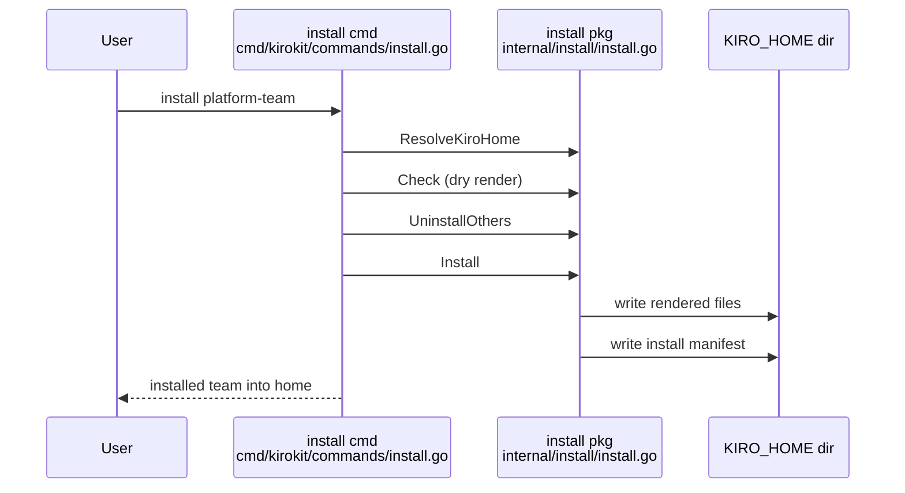

# CLI user path in a fresh temporary Kiro home: setup, install, first chat start

## Findings

### `kirokit setup` clones the repo and checks out the newest `v*` tag, printing the absolute target path twice
**Answers:** 1

- `--source` must match an https/ssh/file URL, `git@host:path`, or an absolute path (`cmd/kirokit/commands/setup.go:20`, checked at `:42`). `--target` is made absolute (`:49`) and is cloned into with `git clone -- <source> <dir>` (`:58`).
- Without `--branch`, it `chdir`s into the clone and calls `updateCheckout(true)` (`cmd/kirokit/commands/setup.go:69-72`). That fetches tags, lists `v*` tags sorted newest first and runs `git checkout --quiet <tag>` (`cmd/kirokit/commands/sync.go:125-143`). The result is a detached HEAD.
- With no `v*` tag it stays on the default branch and prints the "no release yet" notice (`cmd/kirokit/commands/setup.go:22,76-77`).
- Output I observed (ran `setup` from a build of this checkout, with the local repo path as `--source`):
  - git's own `Cloning into '<abs target>'...` and `done.`
  - `checked out v0.4.1 in <abs target>`
  - `next: export KIROKIT_REPO=<abs target>`
  - Formats are in `cmd/kirokit/commands/setup.go:66,75,77,81`.
- Private detail: the first two lines print the absolute target path. In the README flow that is `~/.kirokit-config` expanded by the shell, so it contains the user's home directory and user name. The `git clone` line also echoes the path. `--source` is not echoed by kirokit, but git may print it on errors.
- The Quickstart's `--target ~/.kirokit-config` and `KIROKIT_REPO` export are at `README.md:19-22`.

### `kirokit install platform-team` renders with the real `$KIRO_HOME` baked in and prints one line with that path
**Answers:** 1

- Kiro home is `$KIRO_HOME` if set, else `~/.kiro` (`internal/install/install.go:46-55`; called at `cmd/kirokit/commands/install.go:25`). `README.md:26-34` sets `KIRO_HOME=$(mktemp -d)` first, so the real `~/.kiro` is untouched.
- Order: a dry render into a scratch folder (`cmd/kirokit/commands/install.go:36`, `internal/install/install.go:60-67`), then removal of other installed teams (`cmd/kirokit/commands/install.go:40`; each prints `uninstalled <team> from <home>`, `:61`), then the real install (`:43`).
- Install renders with `KiroHome=kiroHome` (`internal/install/install.go:82`). It plans every file (`:89-97`), backs up changed folders (`:110`), writes files at mode 0600 (`:322-326,430-435`), then writes `<home>/.kirokit-installed/<team>.json` (`:126-131,273`).
- Only line printed on success: `installed platform-team into <KIRO_HOME>` (`cmd/kirokit/commands/install.go:46`). In a fresh home no "uninstalled" or backup line appears.
- Observed tree under the temporary home:
  - `agents/{devops,platformdev}.json`
  - `hooks/lint-on-save.json`
  - `prompts/{confluence-search,create-steering,jira-triage}.md`
  - `skills/{confluence-lookup,jira-search}/SKILL.md`
  - `steering/team-conventions.md`
  - `kirokit-steerings/platform-team/security-baseline.md`
  - `kirokit-secrets/platform-team/{devops,platformdev}/secrets.enc.yaml`
  - `.kirokit-installed/platform-team.json`
- Secrets files are copied from `teams/platform-team/agents/<agent>/env/secrets.enc.yaml` to `<home>/kirokit-secrets/<team>/<agent>/secrets.enc.yaml` (`internal/install/install.go:350-361`). They stay SOPS-encrypted.
- Private detail: the installed `agents/devops.json` contains the absolute home path in three places:
  - the skill resource URI
  - the steering resource URI
  - the `sops exec-env` secrets path
  - Template source: `teams/platform-team/agents/devops/agent.json.tmpl:19,24`.
  - These are visible if the video shows `cat agents/devops.json`. Goldens use the sentinel `/kiro-home` instead (`AGENTS.md`, "Repository rules").
- The age recipient in `secrets.enc.yaml` is a public key (`age1…`). It is visible in the `sops` error below and is not secret.

### The `devops` agent has one skill resource, `jira-search`; there is no `jira-triage` skill (it is a prompt)
**Answers:** 1

- `agents/devops.json` loads `skill://<home>/skills/jira-search/SKILL.md` (`teams/platform-team/agents/devops/agent.json.tmpl:19`). Its prompt is `file://../prompts/jira-triage.md` (`:4`). Template files: `teams/platform-team/skills/jira-search/SKILL.md.tmpl`, `teams/platform-team/prompts/jira-triage.md.tmpl`.
- `README.md:36` and the alt text at `README.md:38` call `jira-triage` "the example skill". The installed skill is named `jira-search`. `jira-triage` exists only as the agent prompt and a steering ("Jira Triage steering you have loaded", agent reply in my run).
- The agent JSON also adds the workspace globs `skill://.kiro/skills/**/SKILL.md` and `file://.kiro/steering/**/*.md`, which the global steering rendering appends (observed in the rendered JSON). The source for those two lines was not traced.

### `kiro-cli chat --agent devops --v3` starts without SOPS or a key; the secret is only needed when the `atlassian` MCP server launches
**Answers:** 1

- Observed with a pseudo-terminal, `KIRO_HOME` set to the temporary home and Kiro CLI's v3 mode:
  - The chat reached its input prompt (`devops · auto`, `ask a question or describe a task`) with no error. The banner area shows "Welcome to Kiro CLI V3!", a tip, and a Kiro 3.0 notice.
  - On this machine the Atlassian server connected, because this user has a SOPS age key. When the agent was asked "mcp", it listed `atlassian` and `context7` as connected servers.
- Without a key, `sops exec-env` on the shipped secrets file fails (observed: "Failed to get the data key required to decrypt the SOPS file ... failed to load age identities"). The `devops` MCP command is `sops exec-env <secrets> '<npx mcp-remote ...>'` (`teams/platform-team/agents/devops/agent.json.tmpl:23-24`). So the key is a runtime need of the `atlassian` server only.
- `context7` runs plain `npx` and needs no secret (`teams/platform-team/agents/devops/agent.json.tmpl:27-30`).
- What happens in the chat UI when `atlassian` fails to start was NOT observed (see Open questions). `README.md:12` states `sops` and a decrypting key are required "before starting the agent".

### First start asks to trust the working directory, and the startup screen does not list skills
**Answers:** 1

- On first launch in a directory with a fresh `KIRO_HOME`, the screen is a blocking menu: "Trust this workspace?" with `Trust, continue` / `Don't trust, exit`. It prints the working directory and the path `<KIRO_HOME>/workspace-roots/<hash>/permissions.yaml`. Enter selects `Trust, continue`.
- The trust record is written inside the temporary `KIRO_HOME`, so it is thrown away with it. The README flow does not mention this prompt.
- After trust, the startup screen shows: logo, "Welcome to Kiro CLI V3!", a rotating tip, a Kiro 3.0 notice, a status line `devops · auto · ◔ 1%`, the working directory, and a prompt `›  ask a question or describe a task ↵`.
- A search of the captured startup text found no occurrence of "skill", "jira", "sops", "atlassian" or "mcp". So no `jira-triage`/`jira-search` text is on the startup screen itself.
- The skill becomes visible through slash completion: `assets/kirokit-cli.png` (opened 2026-10-25) shows the prompt `› /jir` with a completion list `/jira-search  Search and summarize Jira tickets for platform-team, using the atlassian server.` and `/jira-triage  (file prompt) (prompt)`, plus `esc to cancel · ↑↓ to navigate · ↵ to select`. The same still shows the working directory `~/Developer/projects/kirokit` and git branch in the status line and terminal title. Slash commands such as `/skills` and `/mcp` are not verified: my keystrokes were sent while the UI was still initializing and were submitted as chat text (`mcp` reached the model), which also spent about 0.08 credits.

### Exit is clean with `/quit` (exit status 0)
**Answers:** 1

- `/quit` followed by Enter ended the session with exit status 0 and printed `Session ended.` and `Resume with: kiro-cli --resume-id sess_<uuid>`. The session id is a random identifier, not private.
- Ctrl+C or Ctrl+D handling was not tested.
- Cleanup per README: `rm -rf $KIRO_HOME` and restoring `KIRO_HOME_BACKUP` (`README.md:42-49`). If `KIRO_HOME` was unset before, `export KIRO_HOME=$KIRO_HOME_BACKUP` sets it to an empty string, which `ResolveKiroHome` treats as unset (`internal/install/install.go:47`).

### Private details printed or visible in this path
**Answers:** 1

| Where | What is printed |
|---|---|
| `setup` output (3 lines) | absolute target path (home dir and user name if under `~`) |
| `install` output | absolute `KIRO_HOME` (a `mktemp -d` path like `/var/folders/<xx>/<hash>/T/tmp.<rand>` on macOS, includes a per-user hash, not the user name) |
| `echo $KIRO_HOME` (README step) | same temporary path |
| Trust screen | current working directory plus `<KIRO_HOME>/workspace-roots/<hash>/permissions.yaml` |
| Chat footer | current working directory on every frame (wraps across two lines in 110 columns) |
| Session end | resume id (random) |
| `cat agents/devops.json` | `KIRO_HOME` path in three places |
| Terminal prompt / shell | whatever the user's shell prompt shows (user name, host) |

- No email address was seen in the output of any step. `kiro-cli` was logged in on this machine, but no account name appeared on the startup screen.
- Running from a neutral directory (for example a short `mktemp -d` folder) would keep the user's name out of the working-directory lines. In my run it was a long scratch path.

## How it is tested today

- The install package has unit tests in `internal/install/install_test.go` (install, uninstall, knowledge-base, secrets path, global steering), `installed_test.go` and `sync_test.go`. They use temporary directories, with no `kiro-cli` needed.
- One package: `go test ./internal/install/...` from the repo root. One test: `go test ./internal/install -run TestInstall_WritesSecretsFileAtExpectedPathAndBakesItIntoAgentArgs`.
- Whole suite, including golden comparison for every team: `go test ./...` (`AGENTS.md`), or `task ci` (`Taskfile.yml`, test target at lines 19-22).
- `go test ./internal/golden` also runs `kiro-cli agent validate`, skipping without a logged-in `kiro-cli` unless `KIROKIT_REQUIRE_KIRO_CLI=1` (`AGENTS.md`).
- I did not find a test for `setup`; a file search under `cmd/kirokit/commands` for `setup_test.go` was not run, so treat this as a gap, not a fact.
- Change frequency, last 90 days: `internal/install` has 9 commits and `cmd/kirokit/commands/setup.go` has 1.

## Open questions

- Question 1: What the chat UI shows when the `atlassian` MCP server fails to start because no SOPS key is present. On this machine a key exists, so the failure path was only reproduced with `sops` alone.
- Question 1: How long after launch the chat input accepts keystrokes; keystrokes sent too early reached the model as chat text.

## Code references

- `cmd/kirokit/commands/setup.go:20,42,49,58,66,69-72,75,77,81`
- `cmd/kirokit/commands/sync.go:125-143` (`updateCheckout`)
- `cmd/kirokit/commands/install.go:25,36,40,43,46,61`
- `internal/install/install.go:46-55,60-67,82,89-97,110,126-131,273,322-326,350-361,430-435`
- `teams/platform-team/agents/devops/agent.json.tmpl:4,19,23-24,27-30`
- `teams/platform-team/skills/jira-search/SKILL.md.tmpl`, `teams/platform-team/prompts/jira-triage.md.tmpl`, `teams/platform-team/manifest.yaml`
- `README.md:10-53`
- Not exhaustive: the desktop app, `uninstall`, `sync` and the render package were not traced. The Quickstart run used a local-path `--source` and a pseudo-terminal under Python, not the README's https source.
