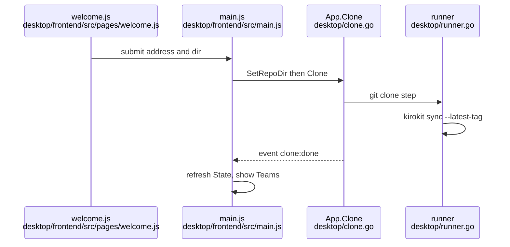

# Desktop app: first launch, Clone, data location and Install flow

## Findings

### First launch versus Teams page is decided by `.git` in the repo folder, plus a busy flag
**Answers:** 2

- Backend: `State()` stats `<repoDir>/.git` and returns `Cloned: err == nil` (`desktop/app.go:112-123`, backend).
- Frontend: `showWelcome` is true when the clone is not from Settings and (`!view.cloned` or `welcome.busy`) (`desktop/frontend/src/pages/welcome.js:10-11`, client). `setup = () => view.loaded && showWelcome(view)` (`desktop/frontend/src/main.js:36`), so nothing is decided until the first `State()` arrives (`main.js:151-153`).
- When welcoming, `render` shows `#page-welcome`, hides every sidebar page and adds class `setup` (`main.js:38-47`). CSS makes `.app.setup` one column and hides the sidebar (`desktop/frontend/src/style.css:118-119`).
- The page stays up while the clone runs, because git creates the folder before the first sync ends (`welcome.js:6-7`). After `clone:done` the view sets `busy:false` and refreshes (`main.js:196-201`), `cloned` turns true, and the Teams page appears.
- A clone started from Settings sets `fromSettings`, which keeps the pages visible and the old clone in use (`welcome.js:8-11`, `main.js:110-125`).
- Welcome page shows: heading "Set up kirokit", a "Repository address" field (placeholder `https://github.com/your-org/kiro-configs.git`), a "Repository folder" field (placeholder is `defaultRepoDir`), and a "Clone" button that reads "Cloning…" and is disabled while busy (`welcome.js:13-22`).

### Clone validates, reserves the kirokit tab, runs `git clone` then `kirokit sync --latest-tag`
**Answers:** 2

- `startClone` first calls `api.setRepoDir(dir)` (a refusal shows as the folder error with the `RepoDir: ` prefix stripped), then `api.clone(address)` (`main.js:92-109`).
- `Clone` trims the address, rejects it unless it matches `repoURLPattern` (https/ssh/file URL, `git@host:path`, or absolute path), finds the bundled CLI, then `reserve()`s the tab (`desktop/clone.go:25-36`, `desktop/settings.go:24`). It then runs in a goroutine and emits `clone:done` (`clone.go:38-51`).
- `cloneAndSync` moves any existing repo folder to `<repo>.old-<unix>` (`clone.go:57-69`), runs `git clone -- <address> <repo>` with git taken from the login PATH (`clone.go:78-82`), then `kirokit sync --latest-tag` (`clone.go:90`). Both steps run in the "kirokit" terminal tab, so the viewer sees the output.
- Outcomes: exit 0 gives OK. Output containing "no v* tag found" gives OK plus the notice "This repository has no release yet (no v* tag). Ask your team lead to tag one." (`clone.go:19, 94-97`). Any failure restores the old copy (`clone.go:70-76`).
- The address is written to `settings.json` only after a successful clone (`clone.go:41-48`).
- Git sign-in prompts are answered in the kirokit tab, which takes keystrokes only while a command runs (`desktop/frontend/src/terminal.js:57-62`).

### Settings and the repository folder live under `~/Library/Application Support/kirokit-desktop`, derived from `$HOME`
**Answers:** 2

- `NewApp()` uses `filepath.Join(homeDir(), "Library", "Application Support", "kirokit-desktop")` (`desktop/app.go:54-56`). `homeDir()` is `os.UserHomeDir()`, falling back to `/` (`app.go:137-143`). On macOS that reads `$HOME` (Go standard library behaviour, inferred, not run here).
- `settings.json` is `<dataDir>/settings.json` (`desktop/settings.go:26`), with fields `repoUrl`, `kiroHome`, `repoDir` (`settings.go:15-19`). Writes are atomic, mode 0600 (`settings.go:90-115`). A missing or unparsable file reads as empty settings, which means first launch (`settings.go:28-38`).
- Default repository folder is `<dataDir>/repo` (`app.go:126`). A saved `repoDir` wins (`app.go:130-135`). `checkRepoDir` refuses relative paths, `/`, the home folder, and a non-empty folder without `.git` (`settings.go:153-166`).
- The same data folder also holds the `zdotdir` wrapper for the zsh tab (`desktop/shell.go:198`).
- Observed on this machine: `~/Library/Application Support/kirokit-desktop` already holds `settings.json` and `zdotdir`. Contents were not read. A recording against the real home would meet the person's real settings and clone.

### A throwaway `HOME` isolates settings and the clone; there is no dedicated data-folder flag or env var
**Answers:** 2

- `main.go` calls `NewApp()` with no argument, and no environment variable overrides `dataDir` (`desktop/main.go:16`). `NewAppAt(dir)` exists but only tests and code can call it (`app.go:58-64`).
- Starting the app with `HOME=<empty temp dir>` moves the data folder, `settings.json` and the default clone under that HOME, because `dataDir` comes from `os.UserHomeDir()`. The clone then runs the same `README`-style first-launch path. This follows from the source above and was not run.
- Login environment: the app runs `$SHELL -ilc 'printf marker; exec env -0'` with a 5 s timeout and uses its environment for every command (`desktop/envcapture.go:19, 100`). The child inherits the app's `HOME`, so zsh reads the throwaway HOME's startup files (none) instead of the person's. The PATH is then topped up with `/opt/homebrew/bin`, `/opt/homebrew/sbin`, `/usr/local/bin`, `$HOME/.local/bin` (`envcapture.go:47-68, 89`). SOPS and Kiro CLI under Homebrew are still found. Note that a PATH from the person's rc files (for example a `~/.local/bin` or mise shim) is lost.
- The decryption key check uses `SOPS_AGE_KEY_FILE`, else `$XDG_CONFIG_HOME/sops/age/keys.txt`, else `$HOME/Library/Application Support/sops/age/keys.txt` (`desktop/prereq.go:44-56`), where `HOME` is the captured one. With a throwaway HOME and no `SOPS_AGE_KEY_FILE` exported to the app, the "Decryption key" row will show missing. Exporting `SOPS_AGE_KEY_FILE` to the app avoids this (inherited by the login shell).
- Kiro home: the saved `kiroHome` setting wins, else the captured `KIRO_HOME`, else `$HOME/.kiro` (`desktop/settings.go:117-137`). Every terminal gets `KIROKIT_REPO` and `KIRO_HOME` set from these (`desktop/shell.go:119-120`). So a throwaway HOME also redirects installs to `<throwaway>/.kiro`, unless `KIRO_HOME` is set in the app's environment.
- Unverified: whether `kiro-cli` still reports a logged-in session under a different HOME (its credential location was not inspected), and whether the Wails webview writes its own state under the real `~/Library`.
- Bundled CLI lookup: `$KIROKIT_DESKTOP_CLI`, else `<exe>/../../Resources/bin/kirokit`, else `desktop/build/dev-bin/kirokit` (`desktop/shell.go:32-69`). `desktop/build/bin/kirokit.app/Contents/Resources/bin/kirokit` exists locally.

### Install: replace dialog if another team is installed, then a setup check dialog, then `kirokit install <team>` in the dock
**Answers:** 3

Step by step (`desktop/frontend/src/main.js:80-90`):
1. Teams page card has an "Install" button, disabled while a command runs (`desktop/frontend/src/pages/teams.js:22, 28-33`).
2. `installPlan` (`desktop/frontend/src/dialogs.js:28-32`): the team already installed gives a "skip" error line "<team> is already installed." beside the button (`main.js:82-86`). Another team installed gives the replace dialog. None installed goes straight to setup.
3. Replace dialog ("Replace the installed team?"), text "X is installed. A Kiro home holds one team, so installing Y uninstalls X first.", buttons Cancel and Replace (`dialogs.js:34-36`, `desktop/frontend/index.html:102-108`).
4. Setup dialog titled "Install <team>" with the note "kirokit needs these on this computer before it can install a team." (`dialogs.js:60`, `index.html:110-118`). On open it calls `Prerequisites(team)` (`dialogs.js:72-84`, `api.js:24`). Rows are a badge `found` (ok) or `missing` (warn), the bold name and a detail line (`dialogs.js:20-24`).
5. Checks, fixed order (`desktop/prereq.go:20-33`): "SOPS" (detail is the found path, else "Install it with: brew install sops"), "Decryption key" (path, else "Ask your team lead for the age key and save it as <path>"), "Kiro CLI" (looks up `kiro-cli`; else "Install Kiro CLI from kiro.dev, then sign in"). Only presence is checked: `kiro-cli` login state is not tested, and the key file is only stat-ed. Each call re-reads the login shell, so "Check again" sees new installs (`prereq.go:16-22`).
6. Status line: "Checking...", then "Everything is ready. You can install." or "N of 3 checks needs/need attention. Fix them, then press Check again." (`dialogs.js:7-18`). The Install button is disabled unless all checks are found (`dialogs.js:70, 10`).
7. On Install, `runCommand(['install', team])` calls `App.Run` (`main.js:89, 68-78`). Run starts the bundled kirokit under a pseudo-terminal (`desktop/runner.go:45-51, 107-114`; `desktop/terminal/terminal.go:32-38`), prints the header `▸ kirokit install <team>` and streams bytes as base64 `term:kirokit` events (`runner.go:122-123, 136-142`). The frontend selects the kirokit tab and opens the dock when output arrives (`terminal.js:139-145`). A non-zero exit appends "exited with code N" (`terminal.js:147-151`).
8. Working directory is the repo folder (home if missing) (`runner.go:110-113`). Env includes the login environment, `KIROKIT_REPO` and `KIRO_HOME` (`shell.go:109-133`).
9. The CLI then does `Check`, uninstalls other teams ("uninstalled X from <home>"), `Install`, and prints `installed <team> into <kiroHome>` (`cmd/kirokit/commands/install.go:25-46, 58-61`). The home is `$KIRO_HOME`, else `$HOME/.kiro` (`internal/install/install.go:46-55`), which in the app is the Settings value, else the captured `KIRO_HOME`, else `~/.kiro` (`settings.go:129-137`).
10. At exit the runner re-reads install records (`runner.go:155-162`), the frontend refreshes (`main.js:191-195`), and the card's badge changes from "not installed" to "installed" and the Install page lists a row with Sync and Uninstall (`teams.js:14-17`, `pages/install.js:13-21`).

### When a prerequisite is missing, the dialog stays open with a red `missing` row and a disabled Install button
**Answers:** 3

- The row shows the badge `missing` (class `warn`), the name and the hint text (`dialogs.js:22`; hints in `prereq.go:25, 29, 31`). Status reads "1 of 3 checks needs attention. Fix them, then press Check again." (`dialogs.js:15`). The Install button stays disabled (`dialogs.js:70`) while Cancel and "Check again" remain usable. No terminal output is produced and the install does not start.
- If `Prerequisites` itself throws, rows are cleared and the error text is shown in the status line (`dialogs.js:78-81`).
- Other refusals show as an error line beside the Install button: another command is running gives "kirokit is still running a command" (`desktop/runner.go:14`, `main.js:73-76`); the bundled CLI is missing gives the "command-line tool was not found" message (`shell.go:68`).

### The terminal dock has two tabs: "kirokit" for button commands and "zsh" for the person's shell
**Answers:** 3

- `initDock` builds two xterm.js terminals (`terminal.js:50-53`). The kirokit tab prints a dim intro line, "Buttons run their kirokit command here. Type your own commands in the zsh tab." (`terminal.js:60`). The dock opens and toggles with Ctrl+` and a button (`terminal.js:94-110`).
- The kirokit tab uses a fixed 120x30 pty and the front end wraps to its width (`runner.go:16-21`). Only one command runs at a time (`runner.go:60-62`).
- The zsh tab starts a login shell through a generated ZDOTDIR wrapper that sources the person's own startup files and then puts the app's `KIRO_HOME`, `KIROKIT_REPO` and the bundled CLI first on PATH (`shell.go:140-163, 190-216`). It starts when the tab is first sized (`shell.go:233-248`).

## How it is tested today

- Go (desktop module, its own `go.mod`): tests sit beside sources, `desktop/app_test.go`, `settings_test.go`, `clone_test.go`, `prereq_test.go`, `runner_test.go`, `shell_test.go`, `envcapture_test.go`, `terminal/terminal_test.go`. App tests build the app with `NewAppAt(tempdir)` and replace `captureFn` (`app.go:17-18, 58-64`).
- Frontend: `node --test` on `desktop/frontend/src/**/*.test.js`, including `pages/pages.test.js`, `dialogs.test.js`, `api.test.js`, `tabs.test.js`, `sidebar.test.js`. They cover state builders as plain functions (`dialogs.js:3-4`).
- One frontend test file: `cd desktop/frontend && node --test src/dialogs.test.js`.
- One Go test file or package: `cd desktop && go test -run <Name> .` (all in package main), or `cd desktop && go test ./terminal`.
- Whole desktop suite from the repository root: `task desktop:test` (`Taskfile.yml:32-37`: `npm ci && npm run build`, `node --test`, `go vet`, `go test`). Nothing was run for this research.
- There is no automated test that drives the real Wails window.

## Open questions

None. Two points stay unverified by execution and are marked above: `kiro-cli` login under a different `HOME`, and any webview state Wails writes outside `dataDir`.

## Code references

Exhaustive for the files named in the questions; `desktop/catalog.go` and `desktop/installs.go` (catalog and install record polling) were not read in full. Each of the desktop files changed once in the last 90 days (`git log --oneline --since=90.days`), so they are young and have little history.

- Data folder and State: `desktop/app.go:52-64, 110-143`
- Settings: `desktop/settings.go:15-38, 43-84, 117-166`
- Clone: `desktop/clone.go:19-101`
- Login environment: `desktop/envcapture.go:19, 47-126`
- Prerequisites: `desktop/prereq.go:20-62`
- Runner and one-command lock: `desktop/runner.go:45-165`
- Shell, bundled CLI, terminal env: `desktop/shell.go:32-133, 190-216`
- Pseudo-terminal: `desktop/terminal/terminal.go:32-87`
- Window: `desktop/main.go:15-34` (1180x760, min 720x480)
- Welcome page: `desktop/frontend/src/pages/welcome.js:10-41`
- App shell and flows: `desktop/frontend/src/main.js:36-47, 80-125, 196-201`
- Dialogs: `desktop/frontend/src/dialogs.js:7-89`; markup `desktop/frontend/index.html:102-118`
- Dock: `desktop/frontend/src/terminal.js:45-152`
- CLI install: `cmd/kirokit/commands/install.go:25-61`, `internal/install/install.go:46-55`
