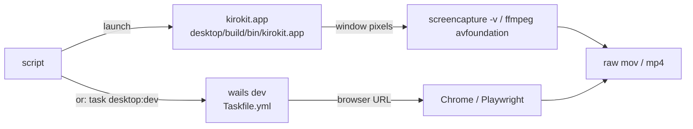

# Recording kirokit for a 30-60 s showcase: capture, terminal, GitHub, assembly, repo gates

## Findings

### The native Wails window can be recorded by screencapture or ffmpeg, but both need Screen Recording permission that this session lacks
**Answers:** 4

- The window is a plain Wails v2 window: title "kirokit", 1180x760, minimum 720x480, background colour RGB 23,19,31 (`desktop/main.go:19-27`). The window title is the only handle for AppleScript/System Events lookups.
- `screencapture` on this machine (macOS 27.0.1) offers `-v` video, `-V<seconds>` limit, `-k` show clicks, `-C` cursor (documented as non-interactive modes only), `-R<x,y,w,h>` rectangle, `-l<windowid>` window, `-o` no shadow, `-g/-G/-A` audio (from `screencapture` usage output). A window capture needs a CGWindowID, which `screencapture` does not look up; `-l` is documented for stills, and `-v` with `-l` was not tested (gap).
- Observed: `screencapture -x -R0,0,200,200 out.png` failed with "could not create image from rect" (exit 1) from this agent shell, i.e. no Screen Recording grant for the process tree. An `ffmpeg -f avfoundation ... -i "3:none"` probe hung until stopped. Device listing works: `[3] Capture screen 0`, `[4] Capture screen 1`, cameras and microphones (ffmpeg 9.0.2 `-list_devices`). The terminal app that runs the script needs System Settings > Privacy & Security > Screen Recording (inference from the failure; not toggled here).
- Retina: a still of the desktop app already committed is 2358x1576 (`assets/kirokit-desktop.png`, via `file`), i.e. about 2x the 1180x760 window. `screencapture -R`/`-v` and avfoundation record in pixels of the display, so a 1180x760 point window is about 2360x1520 px and must be scaled down for a GIF/MP4 (inference).
- Cursor: `screencapture -C` and `-k` (clicks) exist; ffmpeg avfoundation has `-capture_cursor 1` and `-capture_mouse_clicks 1` (ffmpeg option names, not run successfully here).
- Option "run `task desktop:dev` and record its browser dev server": `desktop:dev` builds the CLI to `desktop/build/dev-bin/kirokit` then runs `go tool wails dev` (`Taskfile.yml:39-43`); `wails.json` sets `frontend:dev:watcher` to `npm run dev` and `frontend:dev:serverUrl` to `auto` (`desktop/wails.json:7-8`). The frontend's only Go access is `window.go.main.App`, and it throws "kirokit is not running inside its window" when absent (`desktop/frontend/src/api.js:5-9`); events use `window.runtime.EventsOn` and degrade to a no-op (`desktop/frontend/src/api.js:58-61`). The `wailsjs` bindings folder is gitignored and generated (`desktop/.gitignore:8`, `git check-ignore`). Plain `vite` or `npm run dev` in a browser therefore has no bindings and every `api.*` call fails. Wails v2 dev mode additionally serves the app on a browser-reachable dev server (default http://localhost:34115) that injects the bindings and runtime over websocket; this is from Wails documentation knowledge and was not run here (unverified). Under that server the page renders in a normal browser tab, which Playwright/Chrome DevTools can drive and record (Playwright video, or DevTools screenshots), but it is a browser frame, not the native window chrome.
- Driving clicks: `osascript` exists (`/usr/bin/osascript`); `cliclick` is not installed; `npx` and `node` exist, so Playwright can be fetched on demand (not installed globally). AppleScript/System Events clicking needs Accessibility permission for the controlling app in addition to Screen Recording (macOS rule; not exercised). The built app exists locally at `desktop/build/bin/kirokit.app` (`ls`), produced by `scripts/desktop-build.sh:34-40` (universal, ad-hoc codesigned), so a scripted `open` of that bundle is possible without the dev server.

### Terminal: asciinema + agg are installed and scriptable; vhs is not installed
**Answers:** 5

- Installed: `asciinema` 3.2.1, `agg`, `ffmpeg`; not found: `vhs`, `gifski`, `gifsicle`, `ttyd` (`which`). vhs needs `ttyd` and ffmpeg and is installed via Homebrew (`brew install vhs`); its tape language can `Type`, `Enter`, `Sleep`, `Hide`/`Show`, `Set FontFamily/FontSize/Theme/Width/Height/TypingSpeed` and `Output` .gif/.mp4/.webm/frames, and a TUI can be driven with `Type`/`Ctrl+C`/`Ctrl+D` keys (vhs documentation knowledge; not run here since not installed).
- asciinema 3.2.1 `rec` options: `--command`, `--window-size COLSxROWS`, `--idle-time-limit`, `--headless`, `--capture-input`, `--capture-env VARS`, `--title`, `--output-format` asciicast-v3/v2/raw/txt, `--overwrite`/`--append` (`asciinema rec --help`). It records whatever the command does; keystrokes are not synthesized, so typing must come from a driver (for example a wrapper script, `expect`, or tmux `send-keys`) or a hand-edited .cast (inference).
- `agg` renders .cast to GIF only: `--font-family`/`--text-font-family` (default list JetBrains Mono, Fira Code, SF Mono, Menlo, ...), `--font-size` (16), `--font-dir`, `--line-height` (1.4), `--theme` (asciinema, dracula, github-dark, github-light, kanagawa*, monokai, nord, solarized-*, gruvbox-dark, custom), `--speed`, `--idle-time-limit` (5), `--fps-cap` (30), `--cols`/`--rows`, `--no-loop`, `--last-frame-duration` (3), `--select` ranges/markers, `--renderer swash|resvg` (`agg --help`). MP4 comes from converting the GIF or from frames via ffmpeg (inference). Menlo, Monaco and SF Mono exist under `/System/Library/Fonts/` (`ls`).
- Hiding setup: asciinema has no hide primitive; do setup before `rec` (environment exported in the parent, recording starts at the interesting command) or trim with `agg --select`. vhs has `Hide`/`Show`.
- Env: asciinema passes the parent environment to `--command`; `--capture-env` only records named variables into metadata (default SHELL), so `KIRO_HOME=/scratch asciinema rec -c "kiro-cli chat"` works; the value would only be visible in the cast if captured or echoed. vhs runs a shell in ttyd, so variables are set with `Env KIRO_HOME ...` or `Hide`-d `export` lines (vhs documentation knowledge). `demo-runbook-v1.md` is the prior scratch-`KIRO_HOME` demo script; it is gitignored (`.gitignore`, pattern `demo-runbook-*`).

### GitHub renders in-repo GIFs inline; MP4 plays inline only via user-attachments or a linked page
**Answers:** 6

Verified against GitHub Docs ("Attaching files", fetched 2026-10-25): uploads are capped at 10 MB for images and GIFs, 10 MB for videos on free plans and 100 MB on paid plans; `.mp4`, `.mov`, `.webm` are supported and H.264 is recommended. GitHub CLI can upload a video without the web editor: `gh issue comment|pr comment|issue create|pr create … --attach <video>` with a body holding `` rewrites the reference to the uploaded URL, which renders as a player; it needs push access (GitHub Docs, "Attaching files with GitHub CLI"). The remaining items below come from documentation knowledge and were not fetched.
- In-repo GIF by relative path in `` or `` renders inline, like the existing `` (`README.md:43`, `README.md:59`). Repository file limit: warning at 50 MB, block at 100 MB per file; practical README budget is the stated 10 MB target. No autoplay controls; GIF loops.
- In-repo MP4: a relative `<video>` tag is stripped or not rendered in README sanitisation, and a raw/blob link is a link or download, not an inline player.
- `github.com/user-attachments/assets/<id>` videos (drag a .mp4/.mov into a README edit box or comment): rendered as an inline player; limit about 10 MB on free plans, 100 MB on paid, per GitHub docs.
- `<picture>` with `<source media="(prefers-color-scheme: dark)">` works for images including GIFs; commonly used with `#gh-dark-mode-only` fallback. Not applicable to video.
- To stay under about 10 MB: 10-15 fps, 720-800 px width (README uses width 720), ffmpeg two-pass `fps=12,scale=800:-1:flags=lanczos,split[a][b];[a]palettegen=max_colors=128:stats_mode=diff[p];[b][p]paletteuse=dither=bayer:bayer_scale=4`. `palettegen`/`paletteuse` and `xfade` filters are present in the installed ffmpeg (filter list). `gifski` and `gifsicle` are not installed; `agg` output can be shrunk with the ffmpeg palette pass (inference).

### Captions and joining are done in ffmpeg; this ffmpeg has no drawtext
**Answers:** 7

- Captions: vhs comments cannot appear on screen (use `Type "echo ..."` or `Hide`); with asciinema the caption is a typed `echo`/`printf` before the command. ffmpeg `drawtext` with `fontfile=/System/Library/Fonts/Menlo.ttc` (path exists) is the usual approach, but the build's `drawtext` filter was NOT found in the filter list grep (only `palettegen` and `xfade` matched; the build configuration shows no `--enable-libfreetype`/`libharfbuzz`), and `ffmpeg -hide_banner -filters | grep -E ' (drawtext|overlay|xfade|palettegen) '` lists `overlay`, `palettegen` and `xfade` but no `drawtext`; `ffmpeg -buildconf` shows no freetype, harfbuzz, libass or fontconfig (run 2026-10-25), so `drawtext` is unavailable in this build. Alternative: render title cards as PNGs from HTML (Chrome DevTools/Playwright screenshot) and overlay with the `overlay` filter or use them as `-loop 1` clips.
- Joining clips of different sizes: `scale=W:H:force_original_aspect_ratio=decrease,pad=W:H:(ow-iw)/2:(oh-ih)/2:color=...,setsar=1,fps=30` on each clip, then `xfade=transition=fade:duration=0.5:offset=<len1-0.5>` or `concat`; the output is MP4 (libx264 is built in) and then GIF through the palette pass.
- One reproducible script: Taskfile already wraps shell scripts (`desktop:build` calls `scripts/desktop-build.sh`, `Taskfile.yml:45-48`); that script uses `set -euo pipefail`, `mktemp -d` and `trap 'rm -rf "${work:?}"' EXIT` (`scripts/desktop-build.sh:7,20-21`), a pattern a recording script could follow.

### Repo gates: nothing blocks a GIF/MP4, but hooks and Prettier-like fixers have exclusions only for PNG
**Answers:** 8

- CI: `ci.yaml` runs build, vet, golangci-lint, `go test ./... -v` and `node scripts/sync-agent-assets.mjs --check` on every PR and push to main (`.github/workflows/ci.yaml:11-38`). `desktop.yaml` runs on macOS for PRs touching `desktop/**`, `cmd/**`, `internal/**`, `go.*`, `Taskfile.yml`, `scripts/**` and its own file (`.github/workflows/desktop.yaml:4-16`), running `task desktop:test` and `task desktop:build` (`.github/workflows/desktop.yaml:46-50`); `assets/` changes alone do not trigger it, `scripts/**` and `Taskfile.yml` changes do.
- No workflow checks file size or binary type (no match in `.github/workflows/*.yaml`; `.gitattributes` does not exist; no LFS).
- lefthook pre-commit: `trailing-whitespace` and `end-of-file-fixer` run on `{staged_files}` with `stage_fixed: true` and exclude only `**/*.png`, `testdata/golden/**`, `**/*.enc.yaml`, `teams/*/external/**` (`lefthook.yml:15-34`). A staged `.gif` or `.mp4` is therefore passed to those fixers, which lefthook runs directly, without pre-commit's text-file filter (`lefthook.yml:17-33`). Ran 2026-10-25 on a 2 s ffmpeg test GIF in a scratch folder: `uvx --from pre-commit-hooks==6.0.0 trailing-whitespace-fixer t.gif` printed "Fixing t.gif" and exited 1, `end-of-file-fixer` did the same, and the SHA-1 changed from `488014b4…` to `0cc551a3…`: both fixers rewrite GIF bytes, so with `stage_fixed: true` a committed GIF would be corrupted. Also `check-yaml` (`*.yaml,*.yml`), `check-json`, `gitleaks git --staged` (`lefthook.yml:36-52`); commit-msg runs `cz check` (`lefthook.yml:54-57`). Adding `**/*.gif` and `**/*.mp4` to those excludes follows the existing PNG pattern.
- `.gitignore` ignores `/dist/`, `/kirokit`, `/tmp/`, `.claude/*` (except rules/skills) and `demo-runbook-*`; no rule matches `assets/*.gif`, `assets/*.mp4` or `scripts/*.tape` (`git check-ignore` returned nothing for them). Existing tracked media: `assets/kirokit-cli.png` 138 KB, `assets/kirokit-desktop.png` 216 KB, `assets/logo.png`, `assets/logo.svg`, plus many PNGs under `docs/plans/**/evidence/` (`git ls-files`).
- Docs for contributor commands: `CONTRIBUTING.md` lists tools (lines 50-58), `task build/vet/lint/test/ci/desktop:test` (lines 85-90) and says to run `task desktop:test` when touching `desktop/` (line 93). AGENTS.md requires README updates when a command, flag, manifest field or template function changes (`AGENTS.md`, Repository rules); a new Taskfile task for recording would belong in `CONTRIBUTING.md:85-90`. README embeds the stills at `README.md:43` and `README.md:59`, and mentions `task desktop:build`/`task desktop:dev` at `README.md:280`.
- Churn (90 days) on these paths is low: `git log --since=90.days -- Taskfile.yml lefthook.yml .github scripts .gitignore` lists about 10 commits, the latest `8633d86 docs: add contributing guide...`.

## How it is tested today

- Go suite from the repository root: `go test ./...` (all) or `task test`; one package `go test ./internal/golden`. CI mirrors with `task ci` (`Taskfile.yml:24-30`). Fixtures: `testdata/golden/<team>/` compared byte for byte (`AGENTS.md`).
- Desktop: `task desktop:test` builds the frontend, runs `node --test "src/**/*.test.js"` in `desktop/frontend`, then `go vet ./... && go test ./...` in `desktop` (`Taskfile.yml:32-37`). One frontend file: `cd desktop/frontend && node --test src/api.test.js`. Frontend tests live beside sources (`desktop/frontend/src/*.test.js`).
- Agent asset parity: `node scripts/sync-agent-assets.mjs --check`.
- There is no test for recording or media assets; a recording script would have none unless added.

## Open questions

- Question 4: Whether `screencapture -v` with a specific window works after Screen Recording is granted, and the exact Wails dev browser URL and binding injection were not run (permission missing; `wails dev` not started).
- Question 5: vhs behaviour with `kiro-cli chat` is from documentation, not run (vhs not installed).
- Question 6: How GitHub sanitises a relative `<video>` tag in a README is from documentation knowledge, not fetched; the upload size limits were fetched.

## Code references

- `desktop/main.go:12-35` window size, title, bindings, embedded assets
- `desktop/wails.json:7-8` dev watcher and server URL
- `desktop/frontend/src/api.js:5-9,58-61` binding requirement and event fallback
- `desktop/.gitignore:5,8` dist and wailsjs ignored
- `Taskfile.yml:24-48` ci, desktop:test, desktop:dev, desktop:build
- `scripts/desktop-build.sh:7-41` app build, bundle path, codesign
- `.github/workflows/ci.yaml:11-38`, `.github/workflows/desktop.yaml:4-50`
- `lefthook.yml:15-57`, `.gitignore`, `CONTRIBUTING.md:50-93`, `README.md:43,59,280`
- Exhaustiveness: the listed files were read; other repository files were not searched. Tool facts come from `--help` output and `which` on this machine.
