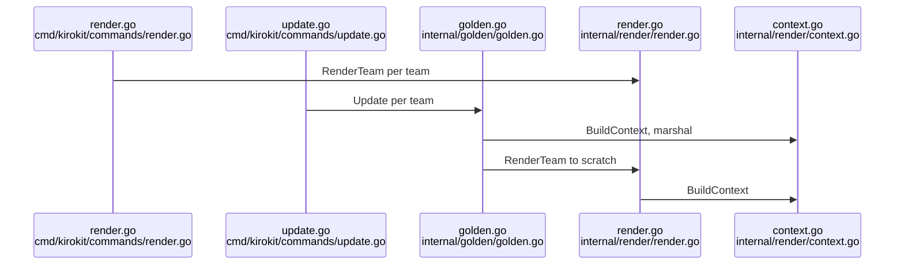
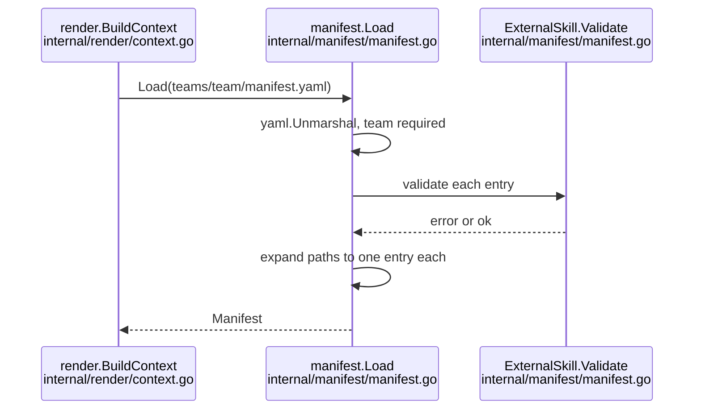
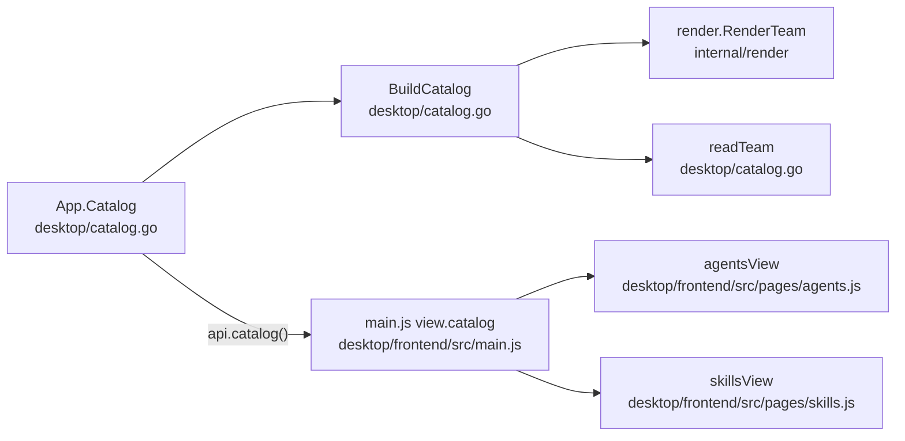

# Research: Cross-role agent harness with feedback loop

## Summary

Kiro CLI v3 already has what cooperating role agents need: an agent that lists the `subagent` tool can call other custom agents, limited to the ones its config names, and `kiro-cli agent validate` accepts such a config without checking those names. Steerings are only text an agent reads; they cannot start another agent or fire on a spec phase, so a review gate is an instruction to the agent, not an enforced step. Kiro's docs say specs (requirements, design, tasks) exist in the CLI, but nobody has run one here.

kirokit renders a team folder through one pipeline: the manifest, central MCP versions and opted-in global steerings form the template context, and that whole context is written into each team's golden `context.json`. The manifest has only three fields today and its YAML reader ignores unknown keys, so any new field (owners, a feedback repository) must be added to the Go type before kirokit sees it, and will show up in every golden context unless it is omitted when empty.

The desktop app builds its Agents and Skills pages from that rendered output; an agent or skill carries a name, description, tools and source, and nothing about who owns it. The app never opens a browser link today, though the framework it uses offers one. Kiro keeps each chat as readable JSON files under `~/.kiro/sessions/`, including which tools were called and how they went, so a skill with file access can read a past session. Several tests and the README name the two existing example teams explicitly, so a third team has to be added to them deliberately.

## What the goal puts at risk

- **Reuse:** `internal/manifest/manifest.go` for new fields and validation; `render.Context` (`.Team`) to carry them into templates; `desktop/catalog.go` `BuildCatalog` and the `Agent`/`Skill` types to carry them to the pages; the existing `addResources` path in `internal/render/render.go:54-114` for any resource every agent of a team gets.
- **Change rate (last 90 days):** `teams/` 11 commits, `internal/render` 9, `internal/manifest` 3, `desktop/catalog.go` 2, `desktop/frontend/src/pages` 1, `README.md` 26.
- **Look here:** risky · a new manifest field without `omitempty` changes `context.json` for every team, and the goldens are compared byte for byte (`internal/golden/golden.go:95`, `internal/manifest/manifest.go:16-20`).
- **Look here:** risky · `go test ./...` compares only `platform-team` against its goldens (`cmd/kirokit/commands/root_test.go:110-122`); a new team's goldens are checked only by `./kirokit test` and by `kiro-cli agent validate` when Kiro is logged in (`internal/golden/kirocli_test.go`).
- **Look here:** unsure · the review gates rest on Kiro CLI v3 running the spec workflow in a chat, which the docs claim and nothing here has run; whether a `fileMatch`/`auto` steering loaded through an agent's `file://` resources honours its front matter is also untested.
- Tests pin the example teams by name (`desktop/catalog_test.go:57-58` requires exactly two teams), and `desktop/frontend/src/pages/pages.test.js:242-247` forbids team names in page source.
- The session-analysis skill depends on Kiro's session folder layout (`~/.kiro/sessions/<workspace hash>/sess_<uuid>/messages.jsonl`), which is observed on kiro-cli 2.34.0 but contradicts the docs' "SQLite" wording, so it may change between Kiro versions.
- **Deployed state not checked:** whether the desktop app's `window.runtime.BrowserOpenURL` works on Linux (WebKitGTK) and Windows (WebView2) builds; only the API's presence was checked.

## Open questions

Question 1: What the `subagent` permission rule's `match` compares against (agent name or pattern) is not documented.
Question 2: Whether Kiro CLI v3 runs the spec workflow in a chat, and in which folder it writes spec files, was not run.
Question 2: Whether `inclusion` front matter is honoured for steerings loaded through an agent's `file://` resources was not tested.
Question 5: Whether `BrowserOpenURL` works when the frontend is served in a plain browser (the showcase mode) was not tested.
Question 7: Whether Kiro's session files list the resources (skills, steerings) an agent loaded was not established; whether a running agent can learn its own session id without the person was not tested.

## Findings

Read at 3dcf20f.

<!-- ql:folded -->
### 1. Subagents use the `subagent` tool, restricted by `toolsSettings.subagent` and the `subagent` permission capability
**Answers:** 1

- Fact (Kiro docs, https://kiro.dev/docs/cli/chat/subagents/): the tool is `subagent`. An orchestrator needs `subagent` in its `tools` array; the troubleshooting table says "Main agent can't spawn sub-agents: Add `subagent` to the orchestrator agent's `tools` array". `subagent` is also a category tag in `tools` (https://kiro.dev/docs/cli/custom-agents/configuration-reference/).
- Fact: `toolsSettings.subagent` has two fields. `availableAgents` is glob patterns of agents it may spawn (omit to allow all). `trustedAgents` is agents that run without permission prompts. Example in docs: `"availableAgents": ["reviewer","tester","docs-*"], "trustedAgents": ["reviewer","tester"]`.
- Fact: the configuration reference says `toolsSettings` is deprecated for shell/fs rules but still supported for settings `permissions` cannot express. Its example for `subagent` includes `"permissions": {"rules": []}` because a profile with `toolsSettings` and no `permissions` block is classified as an unconverted CLI 2.x profile.
- Fact: `permissions.rules[].capability` accepts `subagent` (also `fs_read, fs_write, shell, web_fetch, web_search, mcp, skill, power, context, diagnostics, sandbox_network`). Effects are allow/ask/deny, deny wins across scopes (https://kiro.dev/docs/permissions/). The docs give no `match` syntax example for `subagent`; what `match` is compared against is a gap.
- Naming: the spawned agent is any custom agent, chosen by the main agent from its `description` or requested by name ("Use the code-reviewer agent..."). Agent name is the `name` field, or the file name when absent. `kiro-cli agent list` shows names; an unknown name fails instead of falling back to the default agent. The sub-agent uses the target agent's own `tools` and `permissions`. Two built-in sub-agents (context gathering, general purpose) need no config.
- Repo today: no agent uses `subagent`. A search of `teams/`, `global/`, `README.md`, `internal/`, `cmd/` finds no subagent/toolsSettings in any agent template. All four agents have `tools` of read/write/glob/knowledge/shell/@mcp and `permissions.rules` (`teams/platform-team/agents/devops/agent.json.tmpl:5-17`, `teams/platform-team/agents/platformdev/agent.json.tmpl:5-16`, `teams/data-team/agents/godev/agent.json.tmpl:5-6`, `teams/data-team/agents/javadev/agent.json.tmpl:5-6`).

**Validation (ran, kiro-cli 2.34.0 at /opt/homebrew/bin/kiro-cli, scratch files outside the repo):**
- `kiro-cli agent validate --path orch.json` with `tools:["read","subagent"]`, a `subagent` permission rule and `toolsSettings.subagent.{availableAgents,trustedAgents}` printed nothing (= accepted; validate is silent on success).
- Same with `availableAgents` set to a string instead of an array, and with an unknown field `bogus` and a nonexistent agent name: also printed nothing. So validate does not check the `toolsSettings.subagent` shape or that named agents exist.
- A config with `resources:[5]` was rejected: "resource must be a string (file:// or skill://) or an object". This matches the repo's note that validate exits 0 and reports on stderr (`internal/golden/kirocli_test.go:34-44`).
- kirokit's own `ValidateAgentJSON` only decodes `mcpServers` (each needs `command` or `url`) and checks `resources` is an array (`internal/kiroconfig/validate.go:33-63`); other keys, including `tools`, `permissions`, `toolsSettings`, pass through unchecked.

### 2. Prompts, steerings and skills: where Kiro reads them, what `inclusion` does, and what kirokit writes
**Answers:** 2

- Prompts (docs https://kiro.dev/docs/cli/chat/manage-prompts/): workspace `.kiro/prompts/` (highest priority), global `~/.kiro/prompts/`, then MCP prompts. In V3 they show as `/name` slash commands; `$ARGUMENTS`, `${1}`..`${10}`, `${@}` are interpolated. The README says the same for `$KIRO_HOME/prompts/` (`README.md:120`); kirokit installs the home as `$KIRO_HOME` or `~/.kiro` (`internal/install/install.go:47-57`). A prompt is also usable as an agent's `prompt` via `file://` relative to the agent file (`teams/platform-team/agents/devops/agent.json.tmpl:4`, `"file://../prompts/jira-triage.md"`).
- Steerings (docs https://kiro.dev/docs/cli/steering/): workspace `.kiro/steering/`, global `~/.kiro/steering/`; workspace wins on conflict. Custom agents do not load steering automatically; it must be in `resources` (e.g. `file://.kiro/steering/**/*.md`). `AGENTS.md` is always included, no inclusion modes.
- `inclusion` front matter (YAML at the very first bytes of the file): `always` (default), `fileMatch` + `fileMatchPattern` (string or list), `manual` (pulled in with `#name` in chat; also a slash command), `auto` (needs `name` + `description`; loaded when the request matches; also a slash command). `#[[file:path[:line|:a-b]]]` and `#[[folder:path]]` embed live files. A steering is context text only; none of these modes executes anything or starts another agent. Slash-command exposure applies to `manual` and `auto` steerings only.
- Skills (docs https://kiro.dev/docs/skills/): `.kiro/skills/` and `~/.kiro/skills/`, each a folder with `SKILL.md` (front matter `name` = folder name, `description`). Only name+description load at startup; the body loads on activation (by description match, or `/skill-name [text]`; `$ARGUMENTS`/`${N}` substitution is CLI-only). A custom agent lists them via `skill://` in `resources`.
- kirokit mapping (`internal/render/render.go:241-280`): `prompts/*` and `hooks/*` and `skills/*` keep their path minus `.tmpl`; `steerings/x.md.tmpl` becomes `steering/x.md`; `agents/<a>/agent.json.tmpl` becomes `agents/<a>.json`; `agents/<a>/env/**` and `external/**` are skipped; any other top-level folder is an error (`render.go:277-278`).
- Global steerings are not placed in `steering/`: they go to `$KIRO_HOME/kirokit-steerings/<team>/<slug>.md` and are appended to every agent's `resources` as `file://` URIs (`internal/render/globalsteerings.go:19,33-35,45-51`). Every agent also gets `file://.kiro/steering/**/*.md` and `skill://.kiro/skills/**/SKILL.md` (`globalsteerings.go:27-30`; added in `render.go:54-55,109-114`). Team skills are NOT auto-listed: each agent template names its skill (`teams/platform-team/agents/devops/agent.json.tmpl:18-20`); vendored external skills are added automatically as `skill://` (`render.go:54`).
- `global/steerings/security-baseline.md:1-3` has front matter `inclusion: always`; its body is three bullets on secrets, least-privilege MCP and reviewed code (`:9-11`). The README tells authors to start such a file with front matter (`README.md:148`).
- Team steerings in the repo: `teams/platform-team/steerings/team-conventions.md.tmpl:1-4` uses `inclusion: fileMatch` with a pattern list. The prompt `teams/platform-team/prompts/create-steering.md.tmpl` documents all four modes to the model.
- Spec workflow: Kiro's docs mark Feature Specs, Bugfix Specs, Quick Spec and parallel task execution as available on IDE and CLI, with `requirements.md` (or `bugfix.md`), `design.md`, `tasks.md` as the three files (https://kiro.dev/docs/specs/, https://kiro.dev/docs/specs/feature-specs/). So the docs say specs exist in the CLI, not only the IDE; "Correctness" (property-based testing) is IDE only. Gap: the fetched pages do not state the directory `.kiro/specs/` nor whether CLI V3 (vs CLI 2.x) is the engine; I did not run a spec in kiro-cli. Repo: no mention of specs in `README.md`, `teams/`, `global/`, and no template writes spec files.
- Whether any steering can "trigger" something: only as context selection (`always`/`fileMatch`/`auto` load it; `manual` needs `#name`/slash). Steerings do not invoke skills, prompts or agents by themselves (inference from the doc text, not tested at runtime).

### 3. `render` and `update` share one pipeline; the context is manifest + versions + opted-in global steerings
**Answers:** 3

- Entry: `render [team] --out` requires `--out`; with no team it renders every directory under `teams/` into `<out>/<team>` (`cmd/kirokit/commands/render.go:18-35`; `teamNames` lists directories only, `root.go:74-89`). `update [team]` builds `golden.Inputs` from `teams`, `global/steerings`, `env/mcp-versions.yaml`, `testdata/golden` (roots at `root.go:15-20`, all resolved against `KIROKIT_REPO` or cwd, `root.go:26-31`) and calls `golden.Update` (`update.go:25-34`).
- `golden.Update`/`Compare` call `renderForGolden`, which marshals `BuildContext(..., "")` (so `KiroHome` is the sentinel `/kiro-home`, `internal/render/context.go:16,52-54`) to indented JSON, then `render.RenderTeam` into a temp dir (`internal/golden/golden.go:90-113`). `Update` replaces `testdata/golden/<team>/rendered/` and writes `context.json` (`golden.go:67-83`); `Compare` diffs the tree byte-for-byte (extra/missing/differing files) and compares `context.json` after `TrimSpace` (`golden.go:29-57,117-158`). A missing golden dir/`context.json` shows as diffs (`golden.go:124-126,47-49`).
- Template context (`render.Context`, `context.go:19-27`): `.Team` (manifest: `Team`, `GlobalSteerings`, `ExternalSkills`), `.Env` (map from `env/mcp-versions.yaml`), `.Global` (slug to file content of each opted-in `global/steerings/<slug>.md`; unreadable file is an error, `context.go:42-50`), `.KiroHome`; `LaunchShell` is excluded from JSON (`json:"-"`). The manifest requires a non-empty `team` (`internal/manifest/manifest.go:68-70`). The committed snapshot shows the shape (`testdata/golden/data-team/context.json`): the entire `Env` map is part of every team's golden, so editing `env/mcp-versions.yaml` changes every team's `context.json`.
- Funcs (`internal/render/funcs.go:14-20`): `mcpVersion` (errors when key absent, `:23-31`), `globalSteering` (errors unless opted in, `:33-41`), `jsonString`, `sopsCommand`, `sopsArgsJSON`.
- `RenderTeamWith` (`render.go:41-140`): builds context, resolves external skills (`externalskills.Resolve`), walks the team dir; skips `manifest.yaml` and `.gitkeep`; maps path; renders `*.tmpl` with `text/template` (others copied verbatim); for `agents/*` adds resources (`addResources`, text-splice that preserves template formatting); validates agents/hooks (`render.go:226-235`); writes into a temp dir; then writes global steerings and external skills, and `publish` swaps it into `outDir` (existing differing output is moved to a timestamped backup, `render.go:149-190`).
- `kiroconfig` validation: agents via `ValidateAgentJSON` (see finding 1); hooks need `version`, and each hook a `name`, a trigger from the 11-name list, and `action.type` of `command` or `agent` (`internal/kiroconfig/validate.go:15-27,68-99`).
- Goldens are discovered by team name only: `testdata/golden/<team>/{rendered/,context.json}`. There is no registry; `kirokit test`/`update` with no argument iterate `teams/*` directories (`cmd/kirokit/commands/test.go:20-47`). Current teams: `platform-team`, `data-team` (each has `rendered/` and `context.json`; `platform-team` also has `installed-with-kb/agents/devops.json`).
- What a new team needs for `go test ./...` (evidence from the tests that exist; I ran `go test ./...`: 287 passed, 14 packages, before any change):
  - Minimum to render: `teams/<team>/manifest.yaml` with `team:`; only recognised top-level folders (`agents, hooks, skills, prompts, steerings, external`); agent templates that render to valid JSON; every `mcpVersion` key present in `env/mcp-versions.yaml`; every `globalSteerings` slug existing in `global/steerings/`. `TestKirokitRepo_RenderAllTeamsFromAnUnrelatedFolder` renders every team under `teams/` (`cmd/kirokit/commands/root_test.go:20-43`), so any new team that fails to render fails `go test ./...`.
  - Goldens: the Go suite's real-repo golden comparison covers only `platform-team` (`root_test.go:110-122`, `runRoot(t,"test","platform-team")`). `internal/golden/golden_test.go` uses a temp `fixture-team`, not repo teams. So a new team without `testdata/golden/<team>/` is not failed by `go test ./...` (inference from reading all tests; I did not add a team to confirm). It would fail `./kirokit test` (no-argument form lists missing files as diffs). CI runs `go test ./... -v` and the asset-parity check (`.github/workflows/ci.yaml:73,77`), not `kirokit test`.
  - `TestCommittedGoldenAgentsValidateWithKiroCLI` globs `testdata/golden/*/rendered/agents/*.json` and runs `kiro-cli agent validate` on each, so a new team's committed golden agents are validated when `kiro-cli` is installed and logged in; it skips otherwise unless `KIROKIT_REQUIRE_KIRO_CLI` is set (`internal/golden/kirocli_test.go:13-23,60-78`).
  - Install tests install `platform-team` and `data-team` by name (`cmd/kirokit/commands/install_test.go:71-88`), not by enumeration.
  - `kirokit onboard <team>` copies the embedded starter (manifest, `agents/example-agent/agent.json.tmpl` using `mcpVersion "example-mcp"`, empty category dirs with `.gitkeep`) and refuses an existing team (`internal/scaffold/scaffold.go:28-42`; `internal/scaffold/starter/agents/example-agent/agent.json.tmpl`). `env/mcp-versions.yaml` has `example-mcp` for it. A test renders a freshly scaffolded team (`internal/render/render_test.go:421`).

### The manifest has three top-level fields and is loaded by a single function
**Answers:** 4

- `Manifest` holds `team`, `globalSteerings` (`[]string`) and `externalSkills` (`[]ExternalSkill`) (`internal/manifest/manifest.go:16-20`). Nothing is per-agent: no field names an agent, and the per-skill data lives only on external skills (`internal/manifest/manifest.go:33-43`).
- `ExternalSkill` fields: `name`, `source`, `ref`, `paths`, `all`, `exclude`, plus `Path` tagged `yaml:"-"` and set only by expansion (`internal/manifest/manifest.go:33-43`).
- `Load` reads the file, calls `yaml.Unmarshal` (yaml.v3) into the struct, and requires `team` non-empty (`internal/manifest/manifest.go:58-77`). Specifically: `yaml.Unmarshal(data, &m)` at line 65, `m.Team == ""` check at line 68.
- The decoder is not strict. There is no `KnownFields` call anywhere in the package (grep of `internal/manifest/*.go` for `KnownFields|unknown` found nothing), so a key that is not a struct field is silently ignored. This is inference from the absence of the call plus yaml.v3's default; I did not run a probe.
- `globalSteerings` has no validation in `Load`; slugs are checked later, when the file `global/steerings/<slug>.md` is read (`internal/render/context.go:42-50`).

### External-skill validation and expansion happen inside Load
**Answers:** 4

- `Load` calls `expandExternalSkills`, which for each entry labelled `externalSkills[i]` calls `Validate`, then `Expand`, and rejects duplicate effective names among single (non-collection) entries (`internal/manifest/manifest.go:71-75`, `94-117`). Duplicate line: `return nil, fmt.Errorf("%s: duplicate skill name %q", label, name)` (`internal/manifest/manifest.go:111`).
- Collections (`all: true`) skip the duplicate check because their skill names are known only after a fetch (`internal/manifest/manifest.go:104-108`).
- `Expand` turns an entry with `paths` into one entry per path (copying `Name`, `Source`, `Ref`, `All`, `Exclude`, dropping `Paths`), so code after `Load` sees only `Path` (`internal/manifest/manifest.go:81-90`, doc at `26-28`).
- `Validate` rules (`internal/manifest/manifest.go:123-171`):
  - with several `paths`, `name` and `exclude` are refused (`:125-130`);
  - `source`, `ref` and the path must be non-blank (`:138-142`; the error names the field `"paths"`);
  - `validateSkillPath` rejects absolute, backslash and `..` paths (`:173-182`);
  - `all: true` forbids `name` and validates `exclude` items as single directory names (`:147-155`); without `all`, `exclude` is refused and the name must be one path element (`:156-162`);
  - `validateSource` refuses a leading dash, git transport helpers (`ext::`), non-allowed schemes, and embedded credentials (`:194-218`); `validateRef` refuses a leading dash and whitespace/control characters (`:222-232`).
- `Validate` is public and is documented as re-called by code that acts on an entry, such as the fetch (`internal/manifest/manifest.go:119-122`). `externalskills.Fetch(teamDir, entries []manifest.ExternalSkill)` takes the expanded entries (`internal/externalskills/fetch.go:23`).
- `EffectiveName` is `Name`, else `path.Base(Path)` (`internal/manifest/manifest.go:50-55`).

### The whole Manifest is the template context's `.Team`, and is serialised into context.json
**Answers:** 4

- `render.Context` has `Team manifest.Manifest`, `Env`, `Global` (slug to content), `KiroHome`, and `LaunchShell` (`json:"-"`) (`internal/render/context.go:19-27`). `BuildContext` calls `manifest.Load` and stores `Team: *m` (`internal/render/context.go:32`, `57`).
- Templates therefore see `.Team.Team`, `.Team.GlobalSteerings`, `.Team.ExternalSkills`. The `Execute(&buf, ctx)` call is at `internal/render/render.go:207`.
- The golden harness writes `json.MarshalIndent(ctx, "", "  ")` (`internal/golden/golden.go:95`) and compares it, trimmed, byte for byte with `testdata/golden/<team>/context.json` (`internal/golden/golden.go:38`, `53`).
- Because `Manifest` fields `Team` and `GlobalSteerings` have no `json` tag, they appear under their Go names. `testdata/golden/platform-team/context.json:2-7` shows `"Team": {"Team": "platform-team", "GlobalSteerings": ["security-baseline"]}`; `testdata/golden/data-team/context.json:2-5` shows `"GlobalSteerings": []`.
- `ExternalSkills` and the `ExternalSkill` fields `Paths`, `All`, `Exclude` carry `json:",omitempty"` (`internal/manifest/manifest.go:19`, `37-39`). Neither committed golden context.json has an `ExternalSkills` key, because neither team currently declares any (`teams/platform-team/manifest.yaml` has them only as comments; `teams/data-team/manifest.yaml` has two lines). `Name`, `Source`, `Ref` and `Path` carry no omitempty, so any declared external skill emits all four of those keys (inference from the tags; no committed golden shows it). A new field without `omitempty` would add a key to every team's context.json, and one with it would not for teams that leave it unset (inference from the same tags).
- Golden-file history: `internal/render/context.go` and `internal/golden/golden.go` changed in 3 commits in the last 90 days, listed by `git log --oneline --since=90.days` as `50adcc7`, `bcd9d8c`, `d508c7f`. `internal/manifest` changed in 3 commits (`9a919bf`, `e677d33`, `d508c7f`), the most recent adding the `paths` list as a breaking change.

### Other readers of the manifest
**Answers:** 4

- `kirokit skills fetch` calls `manifest.Load` and passes `m.ExternalSkills` to `externalskills.Fetch` (`cmd/kirokit/commands/skills.go:47`, `58`).
- The render path passes `ctx.Team.ExternalSkills` to `externalskills.Resolve` (checks the lock against the entries) (`internal/render/render.go:50`; `internal/externalskills/verify.go:28`), and the resulting names become `skill://` resources on every agent (`internal/render/render.go:54`).
- The desktop catalogue calls `manifest.Load` and ignores the error, reading only `GlobalSteerings` to list steerings (`desktop/catalog.go:174-179`). It does not read `ExternalSkills`.
- `kirokit onboard` scaffolding renders its own `manifest.yaml` from an embedded template with only `Team` (`internal/scaffold/scaffold.go:88`) and does not use the `manifest` package.
- Resources added to agents (global steerings, external skills) are applied to all agents of a team uniformly; `agentResources` is built once per team (`internal/render/render.go:54`). There is no per-agent selection in that code. That agents are otherwise defined by files under `teams/<team>/agents/<agent>/` is shown by the path handling at `internal/render/render.go:248-262`.

### Where a per-agent or per-skill field would meet the existing code (descriptive)
**Answers:** 4

- A new key on `Manifest` or `ExternalSkill` needs a struct field with a `yaml` tag (`internal/manifest/manifest.go:16-20`, `33-43`); unknown keys currently do not error, so only a struct field makes it available.
- Per-entry rules would live in `ExternalSkill.Validate` (`:123-171`) and, for cross-entry rules, `expandExternalSkills` (`:94-117`). `Expand` copies fields by name explicitly (`:87`), so a new `ExternalSkill` field must be added there or it is lost after `Load`.
- Any field is visible to templates as `.Team.<Field>` and is serialised into `context.json` (golden, `internal/golden/golden.go:95`), changing the committed goldens for teams that set it (and for all teams unless `omitempty`).
- Existing per-skill data (name, collection exclusions) is keyed by directory name derived from `Path`; collection members' names are not known at `Load` time (`:104-108`).
- Existing manifest documentation: `README.md:122-146` (reference block) and `README.md:148-169`; AGENTS.md says to update README with manifest field changes.

### The Agents and Skills pages are plain string renderers over one cached Go catalog
**Answers:** 5

`App.Catalog()` builds the catalog once and caches it until a clone or sync ends (`desktop/catalog.go:246-253`; `refreshCatalog` at `desktop/catalog.go:257-261`). With no `teams/` folder it returns an empty catalog (`desktop/catalog.go:265-267`). `BuildCatalog` renders every `teams/<x>/` that has a `manifest.yaml` into a temp dir via `render.RenderTeam` (`desktop/catalog.go:91-95`), then `readTeam` reads the rendered output. A team that fails to render fails the whole catalog (`desktop/catalog.go:95-97`).

Data shapes (JSON tags):
- `Catalog{teams, pins, tag}` (`desktop/catalog.go:25-29`). `Team{name, agents, skills, prompts, steerings}` (`desktop/catalog.go:32-38`).
- `Agent{name, description, tools, servers, pins, needsKey}` (`desktop/catalog.go:42-51`). Name, description, tools and `mcpServers` keys come from the rendered `agents/*.json` (`desktop/catalog.go:118-135`). `pins` are the `mcpVersion "<key>"` calls found by regex in `agent.json.tmpl` (`desktop/catalog.go:185-201`). `needsKey` is true when `agents/<file>/env/secrets.enc.yaml` exists in the source tree (`desktop/catalog.go:137-138`).
- `Skill{name, source}` (`desktop/catalog.go:54-57`). Every directory in the rendered `skills/` is a skill. Source is `"<source> @ <ref>"` when the name is in the team's external-skills lock (`desktop/catalog.go:146-149`), else the constant `teamSkillSource = "Written by the team"` (`desktop/catalog.go:59`, `155-158`). So a skill carries only a name and a source string; no per-skill URL or path field exists.
- `Catalog.Tag` is the exact-match `git describe --tags` of HEAD, via a `git` subprocess with `GIT_*` env dropped (`desktop/catalog.go:213-221`).

Frontend: `agentsView` returns `{blocked, html}`, one `<tr>` per agent (name, team, description, tool chips plus `@server` chips, "needs key" badge) with every value passed through `esc` (`desktop/frontend/src/pages/agents.js:4-21`). `skillsView` builds two tables: skills (name, team, source) and MCP pins joined to the teams whose agents use them (`desktop/frontend/src/pages/skills.js:5-32`). `initAgents`/`initSkills` write `innerHTML` into the existing `<tbody>`s (`agents.js:23-34`, `skills.js:34-49`). The source column is escaped text only; no anchors are generated (`skills.js:13`). `main.js` imports both inits (`desktop/frontend/src/main.js:7,9`), calls them at `131,134`, and fills `view.catalog = await api.catalog()` (`main.js:159`). A render error or missing clone short-circuits both pages through `problem(view)` (`agents.js:5-6`, `skills.js:6-7`).

### No external-URL opening exists in the app source; Wails' `BrowserOpenURL` is only in the generated runtime
**Answers:** 5

- `desktop/frontend/src/api.js` is documented as the only module that reaches Go (`api.js:1`); its only runtime use is `window.runtime.EventsOn` (`api.js:58-62`). Go side imports Wails `runtime` only for `EventsEmit` and `Quit` (`desktop/app.go:75`, `desktop/main.go:36`).
- A repo-wide search (excluding `node_modules`) for `BrowserOpenURL|OpenURL|window.open|openExternal|xdg-open` finds `BrowserOpenURL` only in the generated `desktop/frontend/wailsjs/runtime/runtime.d.ts:209-211` and `runtime.js:180`, which are not tracked by git (`git ls-files desktop/frontend/wailsjs` is empty). The only `window.open` is inside the bundled xterm link handler in `desktop/frontend/dist/assets/index-C9O1r92G.js` (a build artefact). No `<a href>` or `target=` exists in `desktop/frontend/index.html` or `src`.
- Fact (not run): `window.runtime.BrowserOpenURL` is exposed by Wails but nothing in `api.js` wraps it. Wails v2 is the framework (`desktop/app.go:11` imports `github.com/wailsapp/wails/v2/pkg/runtime`).
- The showcase drives the app in a Chrome tab at `http://localhost:34115` (`scripts/showcase/app-drive.mjs:22`), i.e. the same frontend served in a plain browser.

### Pages are tested as pure functions with `node --test`; Go side tests the catalog against the real repo
**Answers:** 5

`pages.test.js` imports the view functions and asserts on returned HTML with regexes, using a hand-made `catalog` fixture (`desktop/frontend/src/pages/pages.test.js:11-29`). Relevant cases: Agents escapes text and shows "needs key" (`:55-60`), Skills shows each source and pin users (`:62-68`), a render error blocks all pages (`:70-77`), no clone points to Settings (`:79-83`). Settings pages are tested on a fake `document`/`window` (`:181-204`). A guard test fails if any non-test page source names `platform-team` or `data-team` (`:242-247`; regex `/platform-team|data-team(?!=)/`). Go: `desktop/catalog_test.go` has `TestCatalog_ReadsRealTeams` (calls `BuildCatalog("..")`, requires teams exactly `["data-team","platform-team"]`, `:46-58`), `TestCatalog_AgentPinsFollowMcpVersionCalls` (`:78-96`) and `TestCatalog_NeedsKeyExactlyForShippedSecrets` (`:99-110`), each listing the four agents by name, plus temp-dir fixtures (`:117-143`).

### The config repository's address is stored in one place (desktop `settings.json`), written only after a successful clone
**Answers:** 6

- `Settings{RepoURL json:"repoUrl", KiroHome, RepoDir}` lives in `<app data dir>/settings.json` (`desktop/settings.go:17-21,40`). Empty means no repository yet (`:14-16`).
- Validation: regexp accepting https/ssh/file URLs, `git@host:path`, absolute and Windows drive paths (`desktop/settings.go:27`); an address that fails is refused with `repoURLMessage` (`:68-70`, `:101`).
- `Clone(address)` re-validates (`desktop/clone.go:27-29`), runs `git clone -- <address> <repo>` then `kirokit sync --latest-tag` (`:82,90`), and only on success writes `RepoURL = address` (`:41-47`). A failed clone leaves the old address (and test `pages.test.js:219`).
- The frontend reads it from `state.settings.repoUrl` to prefill the welcome page (`desktop/frontend/src/main.js:156`) and Settings (`desktop/frontend/dist` bundle `s.value ||= e.settings.repoUrl`).
- CLI: `kirokit setup --source` uses a duplicate of the same regexp (`cmd/kirokit/commands/setup.go:21,43`), runs `git clone` and stores nothing (`:59-83`); it only prints the target dir. `kirokit sync` takes `--repo`/`KIROKIT_REPO`/cwd (`cmd/kirokit/commands/sync.go:63-72`), then `git fetch --tags --prune` plus `pull --ff-only` or checkout of the newest `v*` tag (`:125-143`). It never names the remote; `gitOutput` just execs git in the checkout (`:145-154`).
- Nothing in Go, JS or scripts runs `git remote get-url origin`. The only occurrence is a transcript line in a past plan's evidence file (`docs/plans/2026-10-17-desktop-app-from-design/evidence/it1-probe-new-address.txt:14`). So for a clone made by the app the address is in `settings.json`; for a CLI-made or hand-made checkout it exists only in that checkout's git config (inference; `setup` records nothing). `scripts/kirokit-sync-setup.sh --repo-url` takes an address as an argument (`README.md:297`).
- Repo dir: `settings.RepoDir`, else the default `<app folder>/repo` (`desktop/app.go:138-143`).

### Kiro CLI 2.34.0 v3 keeps sessions as per-workspace folders of JSON/JSONL under `~/.kiro/sessions`, not in SQLite
**Answers:** 7

Evidence is from this machine's `kiro-cli 2.34.0` (read only; message text was not read, only key names and counts) and the docs page https://kiro.dev/docs/cli/chat/session-management/ (fetched).
- Docs: sessions are auto-saved every turn, per directory, UUID ids; the docs state "SQLite database in `~/.kiro/`" and "Auto-save to database only (not files)" (technical details section). Commands: `kiro-cli chat --resume | --resume-id <ID> | --resume-picker | --list-sessions [-f json] [--all-cwds] | --delete-session`, in chat `/session-id`, `/chat save <file.zip>` (V3 zip archive; 2.x was JSON), `/chat load`, `/chat save-via-script <script>` (session JSON on stdin) and `/chat load-via-script`.
- Observed here, which differs from the docs' wording: the legacy SQLite `~/Library/Application Support/kiro-cli/data.sqlite3` has tables `conversations`, `conversations_v2`, `history`... but `conversations` and `conversations_v2` hold 0 rows. Sessions are in files:
  - V3: `~/.kiro/sessions/<16-hex workspace hash>/sess_<uuid>/` containing `session.json`, `messages.jsonl`, `publish.cursor`, `snapshots/`; plus `<hash>/.index/index.json` and `~/.kiro/session-index/<hash>.jsonl` (append ops `{"op":"add","sessionPath",...}`). Owner-only permissions (dirs 700, files 600).
  - Older v1/v2: `~/.kiro/sessions/cli/<uuid>.json` (+ empty `.jsonl`) and `sess_<uuid>.history`.
- `session.json` keys: `id, title, agentMode, workspacePaths, rootPaths, createdAt, lastModifiedAt, modelId, autopilot, status, memoryConfig, specWorkflow...`. `messages.jsonl` lines are `{id, timestamp, payload}`, payload `type` values seen in one 95 KB session: `session_start` (`agentType`, `composition`), `user` (`content`, `documents`, `images`), `assistant`, `tool_call` (`toolCallId, toolName, args, status, kind, title`), `tool_result` (`toolCallId, content, success, durationMs`), `turn_start/turn_end`, `pending_interaction/interaction_resolved` (consent questions), `usage_summary`, `session_metadata` (context usage), `agent_note`, `session_event`.
- Which agent: `session_start.agentType` and the old format's `session_state.agent_name` (key names only; value semantics for custom agents not checked). Loaded resources: no dedicated list was identified in the keys seen (gap).
- A skill's agent that has `read` and `shell` (the example agents list `"read","write","glob","knowledge","shell"`, e.g. `teams/platform-team/agents/devops/agent.json.tmpl:5`) could open files under `~/.kiro/sessions` by path, as plain files, subject to the agent's permission rules and workspace trust (inference; not executed). The agent's own session id is printable by `/session-id` (docs); whether a running agent can learn it without the user is not established. `kirokit` itself sets `KIRO_HOME` handling (`desktop/settings.go:131-151`, default `~/.kiro`).

### `platform-team` and `data-team` are named in many places, and several tests hard-code exactly those two
**Answers:** 8

Directories: `teams/platform-team`, `teams/data-team`; goldens `testdata/golden/platform-team`, `testdata/golden/data-team`.
Hard-coded or enumerating (would need a third team to be counted):
- `desktop/catalog_test.go:57-58` (exact team list), `:85-88` and `:104` (per-agent pins and needsKey for four named agents).
- `cmd/kirokit/commands/root_test.go:29` (render-all asserts both folders), `:36-40,50,62,115-119` (platform-team only).
- `internal/golden/kirocli_test.go:~58` globs `testdata/golden/*/rendered/agents/*.json` (so a new team's goldens are picked up automatically); `internal/golden/knowledgebase_test.go:19-66` is platform-team/devops only.
- `.sops.yaml:8,10` has one `path_regex` per team (`teams/platform-team/.*/env/secrets\.enc\.yaml$`, `teams/data-team/...`), so an encrypted secrets file in a third team needs its own rule (inference from structure).
- `README.md:10` (showcase alt text), `:27`, `:50-52`, `:119` (the "Example teams" bullet names both teams and their agents and says "Copy one or use `kirokit onboard`"), `:120`, `:127` (data-team as the opt-out example), `:204`, `:216`, `:297-299`.
- Showcase (installs platform-team only): `scripts/showcase/cli-drive.sh:4,42,44`, `caption.mjs:81,83`, `app-drive.mjs:3,24,79,107`, `showcase.test.mjs:60,93,189,252,374`.
- Other: `cmd/kirokit/commands/install_test.go:71-130` (platform-team then data-team to test single-team install), `sync_test.go:130,151,191`, `internal/manifest/manifest_test.go:21-36`, `desktop/runner_test.go:101-115`, `desktop/prereq_test.go:48,55`, `.github/ISSUE_TEMPLATE/bug_report.md:25`.
- Generic, not name-bound: `desktop/frontend/src/pages/pages.test.js:11-29` uses `alpha`/`beta`; `internal/golden/golden_test.go` uses `fixture-team`; `internal/scaffold` tests use `newteam`. `pages.test.js:242-247` forbids those names in page source.
- `CONTRIBUTING.md` has no team names (only `teams/<team>/`, lines 75, 134). Untracked/ignored files also mention the names (`demo-runbook-v1.md`, `tmp/*`; `.gitignore:7` ignores `demo-runbook-*`) and past plans under `docs/plans/` do too (historical).
- `kirokit render` without a name renders all folders under `teams/` (`root_test.go:20-33`), and the desktop catalog lists every `teams/*` with a manifest, so counts there follow the directory listing, not a name list (`desktop/catalog.go:87-93`).
- Showcase/README tell a story with `platform-team`'s `devops` agent and `jira-search` skill (`README.md:10`).

### Change rate and where it is hard to change
**Answers:** 5, 6

`git log --since=90.days` over the catalog, pages, settings, clone, setup and sync files lists 5 commits (`50adcc7` Linux/Windows, `974035a` setup command, `6c19579` desktop app, `bcd9d8c` rename, `5032831` sync). Rendered tables are exercised by hard-coded team names in `catalog_test.go`; the repository address regexp is duplicated in `desktop/settings.go:27` and `cmd/kirokit/commands/setup.go:21`.
<!-- /ql:folded -->

## Decided with you

<!-- ql:decided -->
No choices were open.
<!-- /ql:decided -->

## The questions

1. **How does a Kiro CLI v3 agent config let one agent call another agent as a subagent?** Find the tool name (e.g. `subagent` / `use_subagent` / `delegate`), the `toolsSettings` fields that restrict which agents it may spawn or trust, and how the spawned agent is named. Look at Kiro's agent-configuration and built-in-tools docs (kiro.dev/docs/cli) and at any agent in this repo; check whether `kiro-cli agent validate` accepts such a config.
2. **How does Kiro CLI v3 load prompts, steerings and skills, and which can a steering trigger?** Where `$KIRO_HOME/prompts/`, `steering/` and `skill://` resources are read, how `inclusion` front matter works, and whether Kiro's spec workflow (requirements, design, tasks files under `.kiro/specs/`) exists in the CLI v3 or only in the IDE. Look at the README sections on prompts and global steerings, `global/steerings/security-baseline.md`, and Kiro's docs.
3. **How does the render pipeline turn a team folder into the rendered tree, and what does a new team need to pass `go test ./...`?** Trace `kirokit render`/`update` from `cmd/kirokit/commands/render.go` and `update.go` through `internal/render` and `internal/golden`, including the template context (`internal/render/context.go`), template funcs, `kiroconfig` validation and how goldens are discovered per team.
4. **How is `manifest.yaml` parsed and validated, and where would a per-agent or per-skill field fit?** Read `internal/manifest/manifest.go` (fields, `Validate`, external-skill expansion), its tests, and where the manifest reaches the template context and `context.json` goldens.
5. **How does the desktop app build its Agents and Skills pages, and how can it open an external URL?** Trace `desktop/catalog.go` (`BuildCatalog`, `Agent`, `Skill`, `teamSkillSource`) to `desktop/frontend/src/pages/agents.js` and `skills.js`, how pages are tested (`pages.test.js`), and whether Wails' `BrowserOpenURL` or similar is already used anywhere.
6. **Where does kirokit know the config repository's remote address?** Look at `desktop/settings.go` (`repoUrl`), `desktop/clone.go`, `cmd/kirokit/commands/setup.go` and `sync.go`, and whether anything reads `git remote get-url origin` today.
7. **Where and in what format does Kiro CLI v3 keep chat sessions, and how can a skill read one?** Find how sessions are stored (files under `$KIRO_HOME` or `~/.kiro`, a SQLite database, `/chat save` / `/chat load` exports, conversation ids), what a saved session contains (messages, tool calls, which agent, loaded resources), and whether a skill's agent can read it with the `read`/`shell` tools. Look at Kiro's CLI docs and, if a logged-in `kiro-cli` exists here, its data folders (read only).
8. **How are example teams presented in the README and showcase, and what lists them?** Find every place that names `platform-team` and `data-team` (README, CONTRIBUTING, tests such as `desktop/catalog_test.go`, `internal/golden`, scripts/showcase) so a third team is counted correctly.

**Key context pointers:**
- `README.md` (Directory Layout, manifest.yaml Reference, Desktop app)
- `teams/platform-team/`, `teams/data-team/`, `global/steerings/security-baseline.md`
- `internal/manifest/manifest.go`, `internal/render/`, `internal/golden/`, `internal/kiroconfig/validate.go`, `internal/scaffold/`
- `cmd/kirokit/commands/`
- `desktop/catalog.go`, `desktop/settings.go`, `desktop/clone.go`, `desktop/frontend/src/pages/`, `desktop/frontend/src/api.js`
- Kiro CLI docs: https://kiro.dev/docs/cli/ (agent configuration, built-in tools, steering, hooks, prompts)

## How it is tested today

- **All CLI and internal packages:** `go test ./...` from the repository root (287 tests in 14 packages passed at 3dcf20f); `task ci` adds build, vet and lint.
- **One package or test:** `go test ./internal/manifest`, `go test ./internal/render -run TestRenderTeam_ProducesFlatOutputTree`, `go test ./internal/golden`, `go test ./cmd/kirokit/commands -run TestKirokitRepo_TestAndUpdateUseTheRepositoryGoldens`.
- **Goldens:** `./kirokit test [team]` diffs `testdata/golden/<team>/` byte for byte; `./kirokit update [team]` rewrites them (build first with `task build`).
- **Kiro validation:** `internal/golden/kirocli_test.go` runs `kiro-cli agent validate` on every committed golden agent; it skips without a logged-in `kiro-cli` unless `KIROKIT_REQUIRE_KIRO_CLI=1` (kiro-cli 2.34.0 is installed here).
- **Desktop Go:** `cd desktop && go test ./...` (catalog tests use the real repository via `BuildCatalog("..")` plus `t.TempDir()` fixtures).
- **Desktop frontend:** `cd desktop/frontend && npm test` (`node --test`), one file with `node --test src/pages/pages.test.js`; `task desktop:test` runs both.
- **Fixtures:** `t.TempDir()` manifests and teams (`internal/manifest/manifest_test.go:11-18`, `internal/golden/golden_test.go` `fixture-team`), `testdata/golden/`, `testdata/knowledgebase/`, `testdata/sops/`.

## Code references

<!-- ql:folded references -->
Exhaustive for the render/golden/validation path; selective for Kiro docs (pages fetched 2026-10-26: custom-agents/configuration-reference, reference/built-in-tools, chat/subagents, steering, chat/manage-prompts, skills, specs, specs/feature-specs, permissions).
- Commands: `cmd/kirokit/commands/render.go:11-44`, `update.go:10-42`, `test.go:10-55`, `root.go:12-31,72-89`, `root_test.go:20-43,110-122`
- Render: `internal/render/render.go:36-140,226-280`, `context.go:19-62`, `funcs.go:13-76`, `globalsteerings.go:19-69,76-111`
- Golden: `internal/golden/golden.go:29-113,117-158`, `golden_test.go:19-52`, `kirocli_test.go:34-78`, `knowledgebase_test.go:51-93`
- Validation/manifest/scaffold: `internal/kiroconfig/validate.go:15-99`, `internal/manifest/manifest.go:16-77`, `internal/scaffold/scaffold.go:28-92`
- Content: `global/steerings/security-baseline.md`, `teams/platform-team/agents/devops/agent.json.tmpl`, `teams/platform-team/agents/platformdev/agent.json.tmpl`, `teams/data-team/agents/{godev,javadev}/agent.json.tmpl`, `teams/platform-team/manifest.yaml`, `teams/platform-team/steerings/team-conventions.md.tmpl`, `teams/platform-team/prompts/create-steering.md.tmpl`, `README.md:94-150,222-238`
- Change frequency (commits in last 90 days): `internal/render` 9, `internal/golden` 4, `internal/kiroconfig` 1, `internal/manifest` 3, `teams` 11, `global` 2, `testdata/golden` 11, `cmd/kirokit/commands` plus `internal/install` 13.

- `internal/manifest/manifest.go:16-20` Manifest; `:33-43` ExternalSkill; `:58-77` Load; `:81-90` Expand; `:94-117` expandExternalSkills; `:123-171` Validate; `:194-232` source and ref checks.
- `internal/manifest/manifest_test.go:11-18`, `:20-299`.
- `internal/render/context.go:19-62`; `internal/render/render.go:42-54`, `207`.
- `internal/golden/golden.go:38-53`, `95`.
- `testdata/golden/platform-team/context.json`, `testdata/golden/data-team/context.json`.
- `cmd/kirokit/commands/skills.go:47-58`; `desktop/catalog.go:174-179`; `internal/externalskills/verify.go:28`, `fetch.go:23`.
- `README.md:122-169`; `teams/platform-team/manifest.yaml`, `teams/data-team/manifest.yaml`.
- Exhaustiveness: callers were found by grep of `*.go` for `manifest.Load|manifest.Manifest|GlobalSteerings|ExternalSkills` across `internal`, `cmd`, `desktop`; the desktop frontend JS was not searched for manifest use.
- Catalog: `desktop/catalog.go:23-59,65-105,107-183,185-221,246-270`
- Pages: `desktop/frontend/src/pages/agents.js:1-34`, `skills.js:1-49`, `pages.test.js:11-247`, `desktop/frontend/src/api.js:1,58-62`, `desktop/frontend/src/main.js:7,9,131,134,156,159`
- Address: `desktop/settings.go:17-27,57-82,101`, `desktop/clone.go:25-101`, `desktop/app.go:138-143`, `cmd/kirokit/commands/setup.go:21-92`, `cmd/kirokit/commands/sync.go:61-76,125-154`
- Sessions: `~/.kiro/sessions/`, `~/.kiro/session-index/`, `~/Library/Application Support/kiro-cli/data.sqlite3`; docs URL above
- Team names: grep over the repository excluding `node_modules`, `.git`, `testdata`, `teams`, `docs`, `dist`; the list under question 8 is exhaustive for tracked non-doc files except `docs/plans/**` and `docs/prd/**`.

**How it is tested today**
- Go test suite, from the repository root: all, `go test ./...` (or `task test`, which runs `go test ./... -v`; `task ci` adds build, vet, lint). One file/package: `go test ./internal/render -run TestRenderTeam_ProducesFlatOutputTree`, `go test ./internal/golden`, `go test ./cmd/kirokit/commands -run TestKirokitRepo_TestAndUpdateUseTheRepositoryGoldens`. Ran `go test ./...` here: 287 passed in 14 packages; ran `go test ./internal/golden -run 'Compare|Update|Validate' -v`: 9 passed.
- Isolation: `internal/render/render_test.go` and `internal/golden/golden_test.go` build fixture trees in `t.TempDir()`; `root_test.go` uses the real repo via `KIROKIT_REPO` and `chdir` to a temp dir (`thisRepo` = three dirs up from the package).
- Fixtures: committed goldens in `testdata/golden/<team>/`, `testdata/knowledgebase/`, `testdata/sops/`; golden regeneration for the install-with-KB case is `go test ./internal/golden -run KnowledgeBaseRenderedIntoAgentJSON -update-kb-golden` (`internal/golden/knowledgebase_test.go:16-17,50`).
- `kiro-cli`-dependent tests skip without a logged-in `kiro-cli` unless `KIROKIT_REQUIRE_KIRO_CLI=1`. `kiro-cli` was present locally (2.34.0) and these tests ran.
- Desktop module separately: `task desktop:test` (`Taskfile.yml`, `desktop/frontend` uses `node --test`).
- Unit tests: `internal/manifest/manifest_test.go` (299 lines, 14 `Test...` functions, e.g. `TestLoad_ValidManifest` at `:20`, `TestLoad_MissingTeamErrors` at `:47`, `TestLoad_ExternalSkillsRejectsInvalidEntries` at `:92`, `...RejectsGitOptionAndTransportInjection` at `:132`, collection and paths cases at `:167-299`).
- Isolation: a `writeFixture(t, content)` helper writes `manifest.yaml` into `t.TempDir()` (`internal/manifest/manifest_test.go:11-18`); tests call `Load` on it and assert fields or error text. No network or mocks.
- Other manifest-driven tests write inline manifests (`cmd/kirokit/commands/skills_test.go:64-68`, `internal/externalskills/fetch_test.go` builds `manifest.ExternalSkill` literals); the golden comparison for every team (including `context.json`) runs under `go test ./...`.
- Commands from the repository root: one package/file `go test ./internal/manifest` (I ran it: "44 passed in 1 packages"); one test `go test ./internal/manifest -run TestLoad_ExternalSkills`; golden contexts `go test ./internal/golden`; full suite `go test ./...` or `task ci`.
- Frontend (from repo root): `cd desktop/frontend && node --test src/pages/pages.test.js` for one file; `cd desktop/frontend && npm test` (`node --test "src/**/*.test.js"`, `desktop/frontend/package.json`) for all. `task desktop:test` runs the desktop suite (AGENTS.md).
- Desktop Go (separate module `desktop/go.mod`): `cd desktop && go test -run TestCatalog ./...` for catalog tests; `cd desktop && go test ./...` for all. Catalog tests use the real repo (`BuildCatalog("..")`) plus `t.TempDir()` fixtures.
- CLI/internal: `go test ./cmd/kirokit/commands -run <Name>`; `go test ./...` for all (includes golden compare; `kiro-cli agent validate` skips without login unless `KIROKIT_REQUIRE_KIRO_CLI=1`, `internal/golden/kirocli_test.go`). `task ci` is the full gate.
- Showcase scripts: `node --test scripts/showcase/showcase.test.mjs` (inferred from file naming; not run).
- Nothing was executed for this report.
<!-- /ql:folded -->
