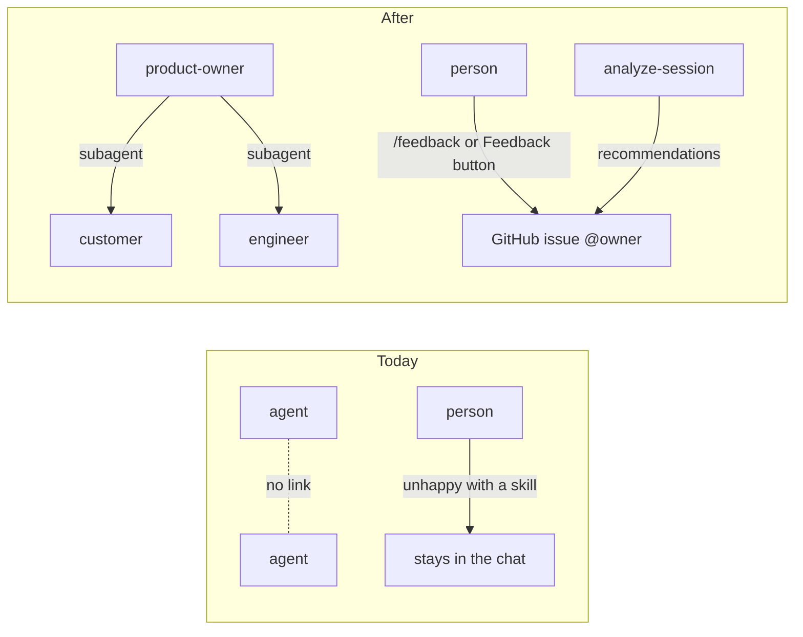
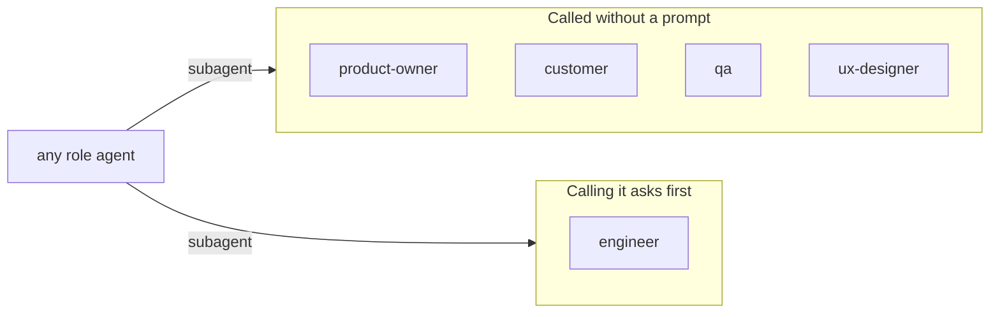
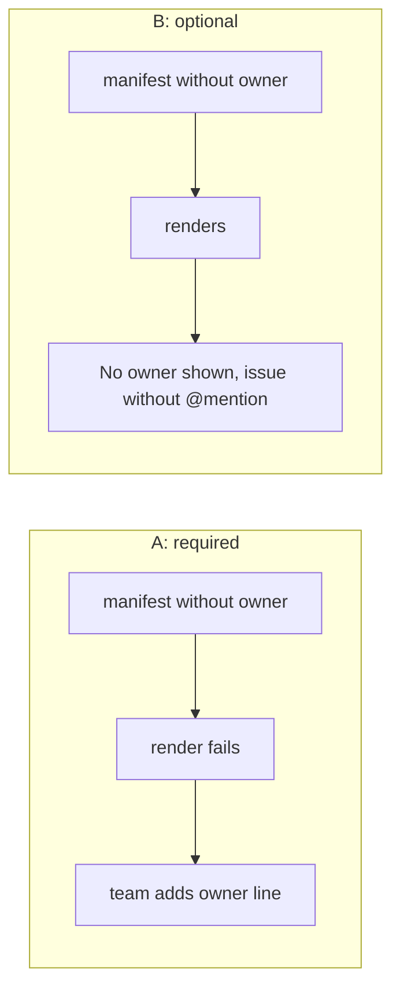
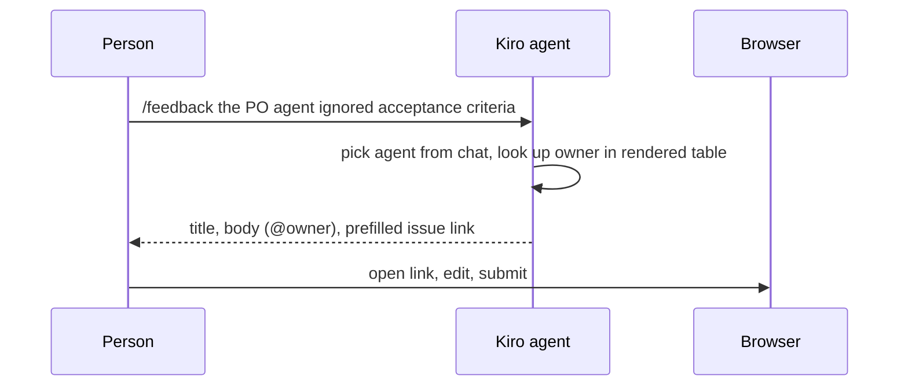

# Cross-role agent harness with feedback loop

## Summary

After this change a team can install `product-team`, an example of five role agents (product owner, engineer, customer, QA, UX/UI designer) that consult each other as Kiro subagents, with a steering that has the product owner review a spec's requirements and the engineer its design. Every team can name owners for its agents and skills in `manifest.yaml`, and anyone, engineer or not, can send feedback on an agent or skill from Kiro (`/feedback`) or from the desktop app (**Feedback**) as a prefilled GitHub issue that @-mentions the owner. An `analyze-session` skill reads a past Kiro chat and suggests harness improvements, grouped by owner, ready to send the same way.

- **Role agents that talk to each other.** `kirokit install product-team` gives five agents, each allowed to call the other four through Kiro's `subagent` tool.
- **Review gates in the spec workflow.** A steering tells the agent writing a spec to ask the product owner agent to review requirements and the engineer agent to review the design.
- **Every agent and skill has an owner.** `owner` names the team owner, `owners` overrides it per agent or skill, and the desktop app shows who owns what.
- **Feedback reaches the owner.** `/feedback` in Kiro and **Feedback** in the app open a prefilled issue in the repository `feedback.github` names; nothing is sent without the person.
- **Sessions become improvements.** `analyze-session` turns a Kiro chat into recommendations per agent, skill or steering and offers an issue per owner.

## How we will know it works

**Oracle:** With `product-team` installed into a temporary Kiro home, `kiro-cli chat --agent product-owner --v3` consults the customer agent as a subagent, and both `/feedback` and the desktop app's **Feedback** button produce a `https://github.com/mavogel/kirokit/issues/new?…` address whose body names the agent and @-mentions its owner.

**Size:** about 5 slices and 16 tasks.

**Risky:** the desktop app gains its first path that opens the system browser, with an address built from repository content; and the review gates rest on Kiro CLI v3 running specs in a chat, which nobody here has run.

## Interface

The Agents and Skills tables gain an **Owner** column (an inherited owner says *team owner*) and a **Feedback** button per row; a team that names no feedback repository shows its buttons off with the reason under the table. The last part shows the issue the button opens.

<!-- ql:artifact artifacts/agents-skills-feedback.html#agents-page -->
**Artifact: Agents and Skills with owners.** Owner column and Feedback button on the desktop app's Agents and Skills pages. Shown in QualityLayer, on the author's Mac only.
<!-- /ql:artifact -->

<!-- ql:artifact artifacts/agents-skills-feedback.html#skills-page -->
**Artifact: Agents and Skills with owners.** Owner column and Feedback button on the desktop app's Agents and Skills pages. Shown in QualityLayer, on the author's Mac only.
<!-- /ql:artifact -->

<!-- ql:artifact artifacts/agents-skills-feedback.html#opened-issue -->
**Artifact: Agents and Skills with owners.** Owner column and Feedback button on the desktop app's Agents and Skills pages. Shown in QualityLayer, on the author's Mac only.
<!-- /ql:artifact -->

## Today and after the change

```diff
 teams/platform-team/manifest.yaml
 team: platform-team
+owner: "@mavogel"
 globalSteerings:
   - security-baseline

+teams/product-team/manifest.yaml
+team: product-team
+owner: "@mavogel"
+owners:
+  agents:
+    product-owner: "@mavogel"
+feedback:
+  github: mavogel/kirokit
+globalSteerings: []
```



## Engineering decisions

### The role agents ship as a new example team, `product-team`, with no MCP servers

`teams/product-team/` holds five agents (`product-owner`, `engineer`, `customer`, `qa`, `ux-designer`), the `spec-review-gates` steering, the `/feedback` prompt and the `analyze-session` skill, rendered and golden-tested like the other two teams. It has no MCP servers and no secrets, so it installs with no SOPS key; teams add Jira or Confluence servers the way `platform-team` shows. Each agent's prompt is a role persona written as an example to replace: the customer persona is marked as invented until the team fills it from its own interviews.

<!-- ql:decide d1 -->
<!-- /ql:decide -->

### Each role agent may call the other four, and kirokit rejects a name that is not an agent of the team

Every role agent lists `subagent` in `tools` and `toolsSettings.subagent.availableAgents` with the other four role agents; `trustedAgents` lists the four that cannot write files (`product-owner`, `customer`, `qa`, `ux-designer`), so consulting them needs no permission prompt while calling the engineer asks first. `kiro-cli agent validate` accepts unknown agent names, so render fails when `availableAgents` or `trustedAgents` names something that is neither a glob nor an agent of the same team. kirokit does not add a `subagent` permission rule, because what its `match` compares against is undocumented.



<!-- ql:decide d2 -->
<!-- /ql:decide -->

### The review gates are a steering every role agent loads, because Kiro has no spec-phase hook

**Look here:** unsure · Kiro's docs say specs run in the CLI, but nobody here has run one; Done means 2 is proved by running one in slice 2.

`teams/product-team/steerings/spec-review-gates.md.tmpl` (`inclusion: always`) tells the agent writing a spec: after `requirements.md`, ask the `product-owner` agent through `subagent` to review vision fit, completeness, acceptance criteria and prioritisation, and fold its answer in before design; after `design.md`, ask the `engineer` agent to review it for deep modules, information hiding and red flags. It renders to the Kiro home's `steering/` folder, which Kiro's default agent loads, and each role agent also lists it in `resources`, since custom agents load no steering on their own. A steering instructs; it cannot force the review.

<!-- ql:decide d3 -->
<!-- /ql:decide -->

### Owners and the feedback repository live in `manifest.yaml`, and an owner falls back to the team owner

`owner` (the team owner), `owners.agents.<name>` and `owners.skills.<name>` take a GitHub handle (`@user` or `@org/team`); `feedback.github` takes `owner/repo`. An agent or skill without its own entry, including vendored skills, gets the team owner; a key naming an agent or skill the team does not have fails render. All three fields are omitted from `context.json` when unset, so only teams that set them see golden changes.

<!-- ql:decide d4 -->
<!-- /ql:decide -->

### Your call: must every team name an owner?

late: true

Today's config repositories have no `owner`, so making it required stops them rendering after a kirokit upgrade until they add one line; making it optional keeps them working but lets agents stay ownerless.

**A:** Required. Render fails with `manifest: <path>: missing required field "owner"`; the README notes the one-line migration.

**B:** Optional. A team without it renders as today; the app shows *No owner*, and feedback still opens an issue, without an @-mention.

**Recommended:** B



<!-- ql:decide d5 -->
**Your call:** agreed · 26 Oct, 13:01: B
<!-- /ql:decide -->

### `/feedback` is a prompt the agent fills from the chat, with the owner table rendered into it

`teams/product-team/prompts/feedback.md.tmpl` becomes the `/feedback [what went wrong]` slash command. kirokit renders the team's agents and skills with their owners and the issue address base into it (new template functions `owners` and `feedbackRepo`); the agent picks the agent or skill from the chat or asks, writes a short title and body (what happened, what was expected, a quote from the chat), and prints a percent-encoded `issues/new?title=…&body=…&labels=feedback,team:<team>,<kind>:<name>` link plus the same text to copy. It never calls GitHub itself.



<!-- ql:decide d6 -->
<!-- /ql:decide -->

### The desktop app builds the issue address in a tested page helper and opens it through Wails

**Look here:** risky · first time the app opens an outside address; it must only ever open `https://github.com/<owner>/<repo>/issues/new`.

The catalog gains `owner` and `ownerFromTeam` on each agent and skill and `feedback` (`owner/repo`) on each team, from the same Go owner lookup kirokit renders with. A new pure helper `feedbackURL(team, kind, name, owner)` builds the address with `encodeURIComponent`; `api.openURL` passes it to Wails' `BrowserOpenURL` only when it matches `^https://github\.com/[A-Za-z0-9-]+/[A-Za-z0-9._-]+/issues/new\?`. A team without `feedback` renders its buttons disabled with the reason under the table.

<!-- ql:decide d7 -->
<!-- /ql:decide -->

### `analyze-session` reads Kiro's session files and reports by owner, sending nothing itself

`teams/product-team/skills/analyze-session/SKILL.md.tmpl` tells the agent to take a session id from the person (`/session-id`) or list `<Kiro home>/sessions/*/sess_*/session.json` and ask which one, then read its `messages.jsonl` for failed or denied tool calls, permission prompts, repeated lookups, skills that never activated and high context use. It maps each finding to an agent, skill, steering or hook with its owner from the rendered table, lists the recommendations (add a hook, harden a steering, add a permission, sharpen a prompt) grouped by owner, and offers one prefilled issue link per owner in the `/feedback` format. All five role agents list the skill.

<!-- ql:decide d8 -->
<!-- /ql:decide -->

## Not doing

- **No QA or UX review gate in the spec steering;** the QA and UX agents are consulted on request.
- **No Kiro hook for spec phases;** Kiro offers none.
- **No CLI `kirokit feedback` command and no GitHub token;** the person submits the issue.
- **No feedback prompt for `platform-team` and `data-team`;** they get an `owner` line only, and the README shows how to copy the prompt.
- **No usage or credit metrics** from sessions.

## Decisions made for you

- **The example team is named `product-team`** — it names the cross-functional product group, beside `platform-team` and `data-team`.
- **Example owners are `@mavogel` only** — any other handle in a public example would notify a real GitHub user.
- **The example feedback repository is `mavogel/kirokit`** — the repository the README already uses as the example config source; teams change one line.
- **Issues carry three labels: `feedback`, `team:<team>` and `agent:<name>` or `skill:<name>`** — Done means 5 asks for team and item labels; GitHub applies URL labels only for people who may triage, so the title and body name the team and item too.
- **`trustedAgents` excludes the engineer** — it can write files and run shell commands, so calling it should still ask.
- **`go test ./...` checks every team's goldens** — today it checks only `platform-team`, so a new team's drift would slip through.
- **The README gains a "Role agents and feedback" section** — it covers `product-team`, the `owner`/`owners`/`feedback` fields in the manifest reference, `/feedback`, the app's Owner column and Feedback button, and `analyze-session`, and the "Example teams" bullet lists three teams (Done means 7; AGENTS.md requires README updates with manifest and template-function changes).
- **`analyze-session` reads files, no shell** — the role agents' existing read permissions cover `<Kiro home>/sessions`, and listing sessions needs no `kiro-cli` call.

## Assumptions

- Kiro CLI v3 runs the spec workflow in a chat and writes `requirements.md` and `design.md` (unconfirmed); the work for Done means 2 answers it.
- Kiro writes sessions under the Kiro home in use (`$KIRO_HOME/sessions`), as observed at `~/.kiro/sessions` (unconfirmed); the work for Done means 6 answers it.
- GitHub's `issues/new` form keeps a prefilled body of a few thousand characters (unconfirmed); the work for Done means 5 caps the body at 1500 characters.

## Before the build

| # | Prerequisite | Met by | Status |
|---|---|---|---|
| P1 | Permission to run the agreed build | the user, at approval | granted · approved in the App, 2026-10-26 12:03 UTC |
| P2 | `kiro-cli` installed and logged in, so golden agents are validated and the oracle chat can run | probe `kiro-cli --version` and the r1 validate run | met · [records/research-r1-5jh21eace1190.md](records/research-r1-5jh21eace1190.md) |

## Risks

- **The app could open an address an attacker put in a config repository.** Mitigation: `feedback.github` is validated at manifest load and `api.openURL` refuses anything but the GitHub issues address; a page test feeds `javascript:` and `https://evil.example` and expects no call.
- **Owner fields churn every golden.** Mitigation: `omitempty` on the new fields; `./kirokit test` shows only the teams whose manifests changed.
- **The spec workflow may not run in Kiro CLI v3.** Mitigation: slice 2 runs a quick spec with `product-team` installed; if specs do not run, the steering still governs agents asked to "write requirements", and the finding is raised with the person before Review.
- **`BrowserOpenURL` is untested on Linux and Windows builds** (Deployed state not checked in Research). Mitigation: the desktop slice drives the button in `task desktop:dev` on macOS, and the Linux build is checked with `scripts/linux-docker.sh`; Windows is recorded as unchecked if no runner is available.
- **Kiro's session format may change.** Mitigation: the skill names the fields it reads and tells the person when a session has none of them, instead of reporting nothing.

## Decided by you

<!-- ql:decided-by-you -->
- Discuss · Which parts of the talk's setup ship first? — Role agents consulting each other + Spec review gates steering + Named owner per agent/skill + Non-engineer feedback to owners + Session-analysis skill
- Discuss · Where do the role agents live? — New example team
- Discuss · Where does a non-engineer give feedback? — Both prompt and button
- Discuss · Where should the feedback arrive? — GitHub issue for the owner
- Discuss · Which role agents does the example team ship? — Product owner + Engineer + Customer + QA + UX/UI designer
- Discuss · How is an owner written down? — GitHub handle
- Discuss · Must every agent and skill name an owner? — Team default, per-item overrides
- Discuss · What does session analysis do with its recommendations? — Report, then offer owner issues
- Discuss · How does kirokit know which repository receives feedback issues? — manifest.yaml feedback field
- Plan · Your call: must every team name an owner? — B · Optional. A team without it renders as today; the app shows *No owner*, and feedback still opens an issue, without an @-mention.
<!-- /ql:decided-by-you -->

## What the Plan rests on

- *1. Subagents use the `subagent` tool, restricted by `toolsSettings.subagent` and the `subagent` permission capability*
- *2. Prompts, steerings and skills: where Kiro reads them, what `inclusion` does, and what kirokit writes*
- *3. `render` and `update` share one pipeline; the context is manifest + versions + opted-in global steerings*
- *The whole Manifest is the template context's `.Team`, and is serialised into context.json*
- *Where a per-agent or per-skill field would meet the existing code (descriptive)*
- *The Agents and Skills pages are plain string renderers over one cached Go catalog*
- *No external-URL opening exists in the app source; Wails' `BrowserOpenURL` is only in the generated runtime*
- *Kiro CLI 2.34.0 v3 keeps sessions as per-workspace folders of JSON/JSONL under `~/.kiro/sessions`, not in SQLite*
- *`platform-team` and `data-team` are named in many places, and several tests hard-code exactly those two*

## Reviewed by

<!-- ql:reviews -->
**Design reviewed** · 3 findings fixed.
<!-- /ql:reviews -->

## System design contracts

**Trust boundary:** the desktop app opens the system browser at an address built from `manifest.yaml` content of a cloned repository; the `analyze-session` skill reads the person's local Kiro session files (their own data, inside their own agent's existing read permission).

### `manifest.Manifest` gains `Owner`, `Owners` and `Feedback`, validated at load

```go
type Manifest struct {
	Team            string          `yaml:"team"`
	Owner           string          `yaml:"owner" json:",omitempty"`
	Owners          Owners          `yaml:"owners" json:",omitzero"`
	Feedback        Feedback        `yaml:"feedback" json:",omitzero"`
	GlobalSteerings []string        `yaml:"globalSteerings"`
	ExternalSkills  []ExternalSkill `yaml:"externalSkills" json:",omitempty"`
}
type Owners struct {
	Agents map[string]string `yaml:"agents" json:",omitempty"`
	Skills map[string]string `yaml:"skills" json:",omitempty"`
}
type Feedback struct {
	GitHub string `yaml:"github" json:",omitempty"`
}
// OwnerOf returns the owner of an agent or skill and whether it is the team owner.
func (m Manifest) OwnerOf(kind, name string) (owner string, fromTeam bool)
```

- Handles match `^@[A-Za-z0-9](?:[A-Za-z0-9-]{0,38})(?:/[A-Za-z0-9._-]+)?$`; `feedback.github` matches `^[A-Za-z0-9-]+/[A-Za-z0-9._-]+$`. A failure names the field: `manifest: <path>: owners.agents.qa: "jane" is not a GitHub handle (write @jane)`.
- `OwnerOf` returns the override, else `Owner` with `fromTeam=true`, else `""`.
- Whether `owner` is required follows the Your call (d5).
- Rejected: owners in each agent's `agent.json.tmpl` — Kiro would reject the unknown key, and skills have no config file to hold it.

### Render checks owner keys and subagent names against the team, and offers two template functions

- `RenderTeamWith` (`internal/render/render.go:41`) collects the team's agent names (`agents/<name>/`) and skill names (`skills/<name>/` plus external names) before the walk, keeps them on `Context` as `json:"-"` fields, and fails with `render: manifest.yaml: owners.agents.<name>: <team> has no agent <name>` for an unknown key.
- After rendering `agents/<a>.json`, render reads `toolsSettings.subagent.availableAgents` and `trustedAgents`; every entry without `*`, `?` or `[` must be a team agent, else `render: agents/<a>/agent.json.tmpl: toolsSettings.subagent.availableAgents names "<x>", which is not an agent of <team>`.
- `owners` returns `[]OwnerRow{Kind, Name, Owner, FromTeam}` sorted by kind then name; `feedbackRepo` returns `Feedback.GitHub` or fails like `mcpVersion` does: `feedbackRepo: <team>'s manifest.yaml sets no feedback.github`.

### The desktop catalog carries owners and the feedback repository

```go
type Team struct { /* existing */ Feedback string `json:"feedback"` }
type Agent struct { /* existing */ Owner string `json:"owner"`; OwnerFromTeam bool `json:"ownerFromTeam"` }
type Skill struct { /* existing */ Owner string `json:"owner"`; OwnerFromTeam bool `json:"ownerFromTeam"` }
```

`readTeam` (`desktop/catalog.go:107`) loads the manifest once and fills these with `manifest.OwnerOf`; a manifest that fails to load already fails the render before this point.

### The frontend opens only GitHub issue addresses

- `desktop/frontend/src/pages/feedback.js`: `feedbackURL(repo, team, kind, name, owner) -> string` builds `https://github.com/${repo}/issues/new?title=…&body=…&labels=feedback,team:${team},${kind}:${name}` with `encodeURIComponent`; the body is the artifact's template, `**Owner:** @x` only when an owner exists.
- `api.openURL(url)` calls `window.runtime.BrowserOpenURL(url)` when the URL matches `^https://github\.com/[A-Za-z0-9-]+/[A-Za-z0-9._-]+/issues/new\?`; otherwise it rejects with `refusing to open <url>`, shown beside the button through the existing `actionError` path.
- `agentsView`/`skillsView` add the two cells; `initAgents(section, onFeedback)` and `initSkills(section, onFeedback)` delegate clicks on `button[data-feedback]`.
- Rejected: a Go-bound `OpenFeedback` method — the frontend already holds every input, and a pure JS helper is testable with `node --test` without a Wails window.

### Product-team agent config shape

```json
{
  "name": "product-owner",
  "tools": ["read", "glob", "knowledge", "subagent"],
  "toolsSettings": { "subagent": {
    "availableAgents": ["customer", "engineer", "qa", "ux-designer"],
    "trustedAgents": ["customer", "qa", "ux-designer"] } },
  "permissions": { "rules": [ { "capability": "fs_read", "match": ["**"], "effect": "allow" } ] },
  "resources": [
    "file://{{ .KiroHome }}/steering/spec-review-gates.md",
    "skill://{{ .KiroHome }}/skills/analyze-session/SKILL.md"
  ]
}
```

The engineer additionally has `write` and `shell` with the deny rules `platform-team` uses (`rm *`, force push, push to main, branch delete).

## Patterns to follow

- **Strict template function:** `mcpVersionFunc` (`internal/render/funcs.go:23-31`) — fail naming the missing key; `feedbackRepo` copies it. Register in `FuncMap` (`internal/render/funcs.go:13-20`).
- **Manifest validation with field-named errors:** `ExternalSkill.Validate` (`internal/manifest/manifest.go:123-171`); tests write fixtures with `writeFixture` (`internal/manifest/manifest_test.go:11-18`).
- **Agent template with permissions and resources:** `teams/platform-team/agents/devops/agent.json.tmpl:1-20`.
- **Steering front matter:** `global/steerings/security-baseline.md:1-3`; skill front matter: `teams/platform-team/skills/jira-search/SKILL.md.tmpl:1-4`; prompt as slash command: `teams/platform-team/prompts/create-steering.md.tmpl`.
- **Output validation hook:** `validateOutput` (`internal/render/render.go:226`) is where the subagent-name check joins the agent checks.
- **Catalog reading:** `readTeam` (`desktop/catalog.go:107-183`); tests `desktop/catalog_test.go:46-58` list the real teams.
- **Page views as pure HTML strings:** `agentsView` (`desktop/frontend/src/pages/agents.js:4-21`), helpers `esc`, `actionError` (`desktop/frontend/src/pages/html.js:4,43`); tests assert on returned HTML (`desktop/frontend/src/pages/pages.test.js:55-68`), and page source must not name a team (`desktop/frontend/src/pages/pages.test.js:242-247`).
- **Bound calls in one module:** `desktop/frontend/src/api.js:1-32`, tested with fakes (`desktop/frontend/src/api.test.js:6-18`).
- **Goldens:** after a template change run `task build` then `./kirokit update <team>` and review the diff; never hand-edit `testdata/golden/**`.
- **Start the app:** `task desktop:dev`; the CLI: `task build`, then `KIRO_HOME=$(mktemp -d) ./kirokit install product-team` and `kiro-cli chat --agent product-owner --v3`.
- **Commits:** Conventional Commits (`cz check` in lefthook).

**Project checks:** `go test ./...` · `task lint` · `go vet ./...` · `task build` · `task desktop:test` · `node scripts/sync-agent-assets.mjs --check`

## Proven before the gate

| Depends on | Proven how | Result |
|---|---|---|
| Kiro `subagent` tool and `toolsSettings.subagent` | `kiro-cli agent validate` on a config with `subagent`, `availableAgents`, `trustedAgents` (Research r1) | accepted; unknown names also accepted, hence kirokit's own check |
| Kiro session files | read-only listing of `~/.kiro/sessions` key names on kiro-cli 2.34.0 (Research r3) | `session.json`, `messages.jsonl` with `tool_call`, `tool_result`, `pending_interaction` |
| Wails `BrowserOpenURL` | present in the generated runtime (`desktop/frontend/wailsjs/runtime/runtime.js:180`); not run | proved in the desktop slice by driving the button in `task desktop:dev` |
| Kiro spec workflow in CLI v3 | docs only (Research r1); not run | proved in slice 2 by running a quick spec with `product-team` installed |
