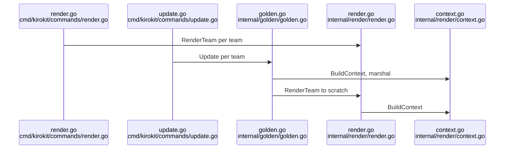

# Kiro CLI v3 subagents, prompts/steerings/skills, and the kirokit render pipeline

## Findings

### 1. Subagents use the `subagent` tool, restricted by `toolsSettings.subagent` and the `subagent` permission capability
**Answers:** 1

- Fact (Kiro docs, https://kiro.dev/docs/cli/chat/subagents/): the tool is `subagent`. An orchestrator needs `subagent` in its `tools` array; the troubleshooting table says "Main agent can't spawn sub-agents: Add `subagent` to the orchestrator agent's `tools` array". `subagent` is also a category tag in `tools` (https://kiro.dev/docs/cli/custom-agents/configuration-reference/).
- Fact: `toolsSettings.subagent` has two fields. `availableAgents` is glob patterns of agents it may spawn (omit to allow all). `trustedAgents` is agents that run without permission prompts. Example in docs: `"availableAgents": ["reviewer","tester","docs-*"], "trustedAgents": ["reviewer","tester"]`.
- Fact: the configuration reference says `toolsSettings` is deprecated for shell/fs rules but still supported for settings `permissions` cannot express. Its example for `subagent` includes `"permissions": {"rules": []}` because a profile with `toolsSettings` and no `permissions` block is classified as an unconverted CLI 2.x profile.
- Fact: `permissions.rules[].capability` accepts `subagent` (also `fs_read, fs_write, shell, web_fetch, web_search, mcp, skill, power, context, diagnostics, sandbox_network`). Effects are allow/ask/deny, deny wins across scopes (https://kiro.dev/docs/permissions/). The docs give no `match` syntax example for `subagent`; what `match` is compared against is a gap.
- Naming: the spawned agent is any custom agent, chosen by the main agent from its `description` or requested by name ("Use the code-reviewer agent..."). Agent name is the `name` field, or the file name when absent. `kiro-cli agent list` shows names; an unknown name fails instead of falling back to the default agent. The sub-agent uses the target agent's own `tools` and `permissions`. Two built-in sub-agents (context gathering, general purpose) need no config.
- Repo today: no agent uses `subagent`. A search of `teams/`, `global/`, `README.md`, `internal/`, `cmd/` finds no subagent/toolsSettings in any agent template. All four agents have `tools` of read/write/glob/knowledge/shell/@mcp and `permissions.rules` (`teams/platform-team/agents/devops/agent.json.tmpl:5-17`, `teams/platform-team/agents/platformdev/agent.json.tmpl:5-16`, `teams/data-team/agents/godev/agent.json.tmpl:5-6`, `teams/data-team/agents/javadev/agent.json.tmpl:5-6`).

**Validation (ran, kiro-cli 2.34.0 at /opt/homebrew/bin/kiro-cli, scratch files outside the repo):**
- `kiro-cli agent validate --path orch.json` with `tools:["read","subagent"]`, a `subagent` permission rule and `toolsSettings.subagent.{availableAgents,trustedAgents}` printed nothing (= accepted; validate is silent on success).
- Same with `availableAgents` set to a string instead of an array, and with an unknown field `bogus` and a nonexistent agent name: also printed nothing. So validate does not check the `toolsSettings.subagent` shape or that named agents exist.
- A config with `resources:[5]` was rejected: "resource must be a string (file:// or skill://) or an object". This matches the repo's note that validate exits 0 and reports on stderr (`internal/golden/kirocli_test.go:34-44`).
- kirokit's own `ValidateAgentJSON` only decodes `mcpServers` (each needs `command` or `url`) and checks `resources` is an array (`internal/kiroconfig/validate.go:33-63`); other keys, including `tools`, `permissions`, `toolsSettings`, pass through unchecked.

### 2. Prompts, steerings and skills: where Kiro reads them, what `inclusion` does, and what kirokit writes
**Answers:** 2

- Prompts (docs https://kiro.dev/docs/cli/chat/manage-prompts/): workspace `.kiro/prompts/` (highest priority), global `~/.kiro/prompts/`, then MCP prompts. In V3 they show as `/name` slash commands; `$ARGUMENTS`, `${1}`..`${10}`, `${@}` are interpolated. The README says the same for `$KIRO_HOME/prompts/` (`README.md:120`); kirokit installs the home as `$KIRO_HOME` or `~/.kiro` (`internal/install/install.go:47-57`). A prompt is also usable as an agent's `prompt` via `file://` relative to the agent file (`teams/platform-team/agents/devops/agent.json.tmpl:4`, `"file://../prompts/jira-triage.md"`).
- Steerings (docs https://kiro.dev/docs/cli/steering/): workspace `.kiro/steering/`, global `~/.kiro/steering/`; workspace wins on conflict. Custom agents do not load steering automatically; it must be in `resources` (e.g. `file://.kiro/steering/**/*.md`). `AGENTS.md` is always included, no inclusion modes.
- `inclusion` front matter (YAML at the very first bytes of the file): `always` (default), `fileMatch` + `fileMatchPattern` (string or list), `manual` (pulled in with `#name` in chat; also a slash command), `auto` (needs `name` + `description`; loaded when the request matches; also a slash command). `#[[file:path[:line|:a-b]]]` and `#[[folder:path]]` embed live files. A steering is context text only; none of these modes executes anything or starts another agent. Slash-command exposure applies to `manual` and `auto` steerings only.
- Skills (docs https://kiro.dev/docs/skills/): `.kiro/skills/` and `~/.kiro/skills/`, each a folder with `SKILL.md` (front matter `name` = folder name, `description`). Only name+description load at startup; the body loads on activation (by description match, or `/skill-name [text]`; `$ARGUMENTS`/`${N}` substitution is CLI-only). A custom agent lists them via `skill://` in `resources`.
- kirokit mapping (`internal/render/render.go:241-280`): `prompts/*` and `hooks/*` and `skills/*` keep their path minus `.tmpl`; `steerings/x.md.tmpl` becomes `steering/x.md`; `agents/<a>/agent.json.tmpl` becomes `agents/<a>.json`; `agents/<a>/env/**` and `external/**` are skipped; any other top-level folder is an error (`render.go:277-278`).
- Global steerings are not placed in `steering/`: they go to `$KIRO_HOME/kirokit-steerings/<team>/<slug>.md` and are appended to every agent's `resources` as `file://` URIs (`internal/render/globalsteerings.go:19,33-35,45-51`). Every agent also gets `file://.kiro/steering/**/*.md` and `skill://.kiro/skills/**/SKILL.md` (`globalsteerings.go:27-30`; added in `render.go:54-55,109-114`). Team skills are NOT auto-listed: each agent template names its skill (`teams/platform-team/agents/devops/agent.json.tmpl:18-20`); vendored external skills are added automatically as `skill://` (`render.go:54`).
- `global/steerings/security-baseline.md:1-3` has front matter `inclusion: always`; its body is three bullets on secrets, least-privilege MCP and reviewed code (`:9-11`). The README tells authors to start such a file with front matter (`README.md:148`).
- Team steerings in the repo: `teams/platform-team/steerings/team-conventions.md.tmpl:1-4` uses `inclusion: fileMatch` with a pattern list. The prompt `teams/platform-team/prompts/create-steering.md.tmpl` documents all four modes to the model.
- Spec workflow: Kiro's docs mark Feature Specs, Bugfix Specs, Quick Spec and parallel task execution as available on IDE and CLI, with `requirements.md` (or `bugfix.md`), `design.md`, `tasks.md` as the three files (https://kiro.dev/docs/specs/, https://kiro.dev/docs/specs/feature-specs/). So the docs say specs exist in the CLI, not only the IDE; "Correctness" (property-based testing) is IDE only. Gap: the fetched pages do not state the directory `.kiro/specs/` nor whether CLI V3 (vs CLI 2.x) is the engine; I did not run a spec in kiro-cli. Repo: no mention of specs in `README.md`, `teams/`, `global/`, and no template writes spec files.
- Whether any steering can "trigger" something: only as context selection (`always`/`fileMatch`/`auto` load it; `manual` needs `#name`/slash). Steerings do not invoke skills, prompts or agents by themselves (inference from the doc text, not tested at runtime).

### 3. `render` and `update` share one pipeline; the context is manifest + versions + opted-in global steerings
**Answers:** 3

- Entry: `render [team] --out` requires `--out`; with no team it renders every directory under `teams/` into `<out>/<team>` (`cmd/kirokit/commands/render.go:18-35`; `teamNames` lists directories only, `root.go:74-89`). `update [team]` builds `golden.Inputs` from `teams`, `global/steerings`, `env/mcp-versions.yaml`, `testdata/golden` (roots at `root.go:15-20`, all resolved against `KIROKIT_REPO` or cwd, `root.go:26-31`) and calls `golden.Update` (`update.go:25-34`).
- `golden.Update`/`Compare` call `renderForGolden`, which marshals `BuildContext(..., "")` (so `KiroHome` is the sentinel `/kiro-home`, `internal/render/context.go:16,52-54`) to indented JSON, then `render.RenderTeam` into a temp dir (`internal/golden/golden.go:90-113`). `Update` replaces `testdata/golden/<team>/rendered/` and writes `context.json` (`golden.go:67-83`); `Compare` diffs the tree byte-for-byte (extra/missing/differing files) and compares `context.json` after `TrimSpace` (`golden.go:29-57,117-158`). A missing golden dir/`context.json` shows as diffs (`golden.go:124-126,47-49`).
- Template context (`render.Context`, `context.go:19-27`): `.Team` (manifest: `Team`, `GlobalSteerings`, `ExternalSkills`), `.Env` (map from `env/mcp-versions.yaml`), `.Global` (slug to file content of each opted-in `global/steerings/<slug>.md`; unreadable file is an error, `context.go:42-50`), `.KiroHome`; `LaunchShell` is excluded from JSON (`json:"-"`). The manifest requires a non-empty `team` (`internal/manifest/manifest.go:68-70`). The committed snapshot shows the shape (`testdata/golden/data-team/context.json`): the entire `Env` map is part of every team's golden, so editing `env/mcp-versions.yaml` changes every team's `context.json`.
- Funcs (`internal/render/funcs.go:14-20`): `mcpVersion` (errors when key absent, `:23-31`), `globalSteering` (errors unless opted in, `:33-41`), `jsonString`, `sopsCommand`, `sopsArgsJSON`.
- `RenderTeamWith` (`render.go:41-140`): builds context, resolves external skills (`externalskills.Resolve`), walks the team dir; skips `manifest.yaml` and `.gitkeep`; maps path; renders `*.tmpl` with `text/template` (others copied verbatim); for `agents/*` adds resources (`addResources`, text-splice that preserves template formatting); validates agents/hooks (`render.go:226-235`); writes into a temp dir; then writes global steerings and external skills, and `publish` swaps it into `outDir` (existing differing output is moved to a timestamped backup, `render.go:149-190`).
- `kiroconfig` validation: agents via `ValidateAgentJSON` (see finding 1); hooks need `version`, and each hook a `name`, a trigger from the 11-name list, and `action.type` of `command` or `agent` (`internal/kiroconfig/validate.go:15-27,68-99`).
- Goldens are discovered by team name only: `testdata/golden/<team>/{rendered/,context.json}`. There is no registry; `kirokit test`/`update` with no argument iterate `teams/*` directories (`cmd/kirokit/commands/test.go:20-47`). Current teams: `platform-team`, `data-team` (each has `rendered/` and `context.json`; `platform-team` also has `installed-with-kb/agents/devops.json`).
- What a new team needs for `go test ./...` (evidence from the tests that exist; I ran `go test ./...`: 287 passed, 14 packages, before any change):
  - Minimum to render: `teams/<team>/manifest.yaml` with `team:`; only recognised top-level folders (`agents, hooks, skills, prompts, steerings, external`); agent templates that render to valid JSON; every `mcpVersion` key present in `env/mcp-versions.yaml`; every `globalSteerings` slug existing in `global/steerings/`. `TestKirokitRepo_RenderAllTeamsFromAnUnrelatedFolder` renders every team under `teams/` (`cmd/kirokit/commands/root_test.go:20-43`), so any new team that fails to render fails `go test ./...`.
  - Goldens: the Go suite's real-repo golden comparison covers only `platform-team` (`root_test.go:110-122`, `runRoot(t,"test","platform-team")`). `internal/golden/golden_test.go` uses a temp `fixture-team`, not repo teams. So a new team without `testdata/golden/<team>/` is not failed by `go test ./...` (inference from reading all tests; I did not add a team to confirm). It would fail `./kirokit test` (no-argument form lists missing files as diffs). CI runs `go test ./... -v` and the asset-parity check (`.github/workflows/ci.yaml:73,77`), not `kirokit test`.
  - `TestCommittedGoldenAgentsValidateWithKiroCLI` globs `testdata/golden/*/rendered/agents/*.json` and runs `kiro-cli agent validate` on each, so a new team's committed golden agents are validated when `kiro-cli` is installed and logged in; it skips otherwise unless `KIROKIT_REQUIRE_KIRO_CLI` is set (`internal/golden/kirocli_test.go:13-23,60-78`).
  - Install tests install `platform-team` and `data-team` by name (`cmd/kirokit/commands/install_test.go:71-88`), not by enumeration.
  - `kirokit onboard <team>` copies the embedded starter (manifest, `agents/example-agent/agent.json.tmpl` using `mcpVersion "example-mcp"`, empty category dirs with `.gitkeep`) and refuses an existing team (`internal/scaffold/scaffold.go:28-42`; `internal/scaffold/starter/agents/example-agent/agent.json.tmpl`). `env/mcp-versions.yaml` has `example-mcp` for it. A test renders a freshly scaffolded team (`internal/render/render_test.go:421`).

## How it is tested today

- Go test suite, from the repository root: all, `go test ./...` (or `task test`, which runs `go test ./... -v`; `task ci` adds build, vet, lint). One file/package: `go test ./internal/render -run TestRenderTeam_ProducesFlatOutputTree`, `go test ./internal/golden`, `go test ./cmd/kirokit/commands -run TestKirokitRepo_TestAndUpdateUseTheRepositoryGoldens`. Ran `go test ./...` here: 287 passed in 14 packages; ran `go test ./internal/golden -run 'Compare|Update|Validate' -v`: 9 passed.
- Isolation: `internal/render/render_test.go` and `internal/golden/golden_test.go` build fixture trees in `t.TempDir()`; `root_test.go` uses the real repo via `KIROKIT_REPO` and `chdir` to a temp dir (`thisRepo` = three dirs up from the package).
- Fixtures: committed goldens in `testdata/golden/<team>/`, `testdata/knowledgebase/`, `testdata/sops/`; golden regeneration for the install-with-KB case is `go test ./internal/golden -run KnowledgeBaseRenderedIntoAgentJSON -update-kb-golden` (`internal/golden/knowledgebase_test.go:16-17,50`).
- `kiro-cli`-dependent tests skip without a logged-in `kiro-cli` unless `KIROKIT_REQUIRE_KIRO_CLI=1`. `kiro-cli` was present locally (2.34.0) and these tests ran.
- Desktop module separately: `task desktop:test` (`Taskfile.yml`, `desktop/frontend` uses `node --test`).

## Open questions

Question 1: What `match` values the `subagent` permission capability compares against (agent name vs pattern) is not shown on the fetched pages.
Question 2: The directory Kiro uses for specs (`.kiro/specs/`) and whether the CLI V3 engine itself, rather than only CLI 2.x or IDE, runs the spec workflow are not stated on the fetched pages; not run locally.
Question 2: Whether `fileMatch`/`auto` steerings listed in `resources` as `file://` URIs (the kirokit global-steering route) honour the `inclusion` front matter was not tested; docs only state the modes for steering files in the steering directories.

## Code references

Exhaustive for the render/golden/validation path; selective for Kiro docs (pages fetched 2026-10-26: custom-agents/configuration-reference, reference/built-in-tools, chat/subagents, steering, chat/manage-prompts, skills, specs, specs/feature-specs, permissions).
- Commands: `cmd/kirokit/commands/render.go:11-44`, `update.go:10-42`, `test.go:10-55`, `root.go:12-31,72-89`, `root_test.go:20-43,110-122`
- Render: `internal/render/render.go:36-140,226-280`, `context.go:19-62`, `funcs.go:13-76`, `globalsteerings.go:19-69,76-111`
- Golden: `internal/golden/golden.go:29-113,117-158`, `golden_test.go:19-52`, `kirocli_test.go:34-78`, `knowledgebase_test.go:51-93`
- Validation/manifest/scaffold: `internal/kiroconfig/validate.go:15-99`, `internal/manifest/manifest.go:16-77`, `internal/scaffold/scaffold.go:28-92`
- Content: `global/steerings/security-baseline.md`, `teams/platform-team/agents/devops/agent.json.tmpl`, `teams/platform-team/agents/platformdev/agent.json.tmpl`, `teams/data-team/agents/{godev,javadev}/agent.json.tmpl`, `teams/platform-team/manifest.yaml`, `teams/platform-team/steerings/team-conventions.md.tmpl`, `teams/platform-team/prompts/create-steering.md.tmpl`, `README.md:94-150,222-238`
- Change frequency (commits in last 90 days): `internal/render` 9, `internal/golden` 4, `internal/kiroconfig` 1, `internal/manifest` 3, `teams` 11, `global` 2, `testdata/golden` 11, `cmd/kirokit/commands` plus `internal/install` 13.
