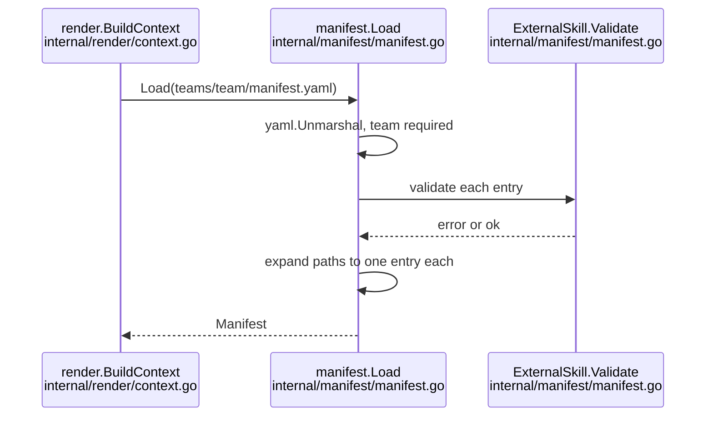

# How manifest.yaml is parsed, validated and exposed to templates

## Findings

### The manifest has three top-level fields and is loaded by a single function
**Answers:** 4

- `Manifest` holds `team`, `globalSteerings` (`[]string`) and `externalSkills` (`[]ExternalSkill`) (`internal/manifest/manifest.go:16-20`). Nothing is per-agent: no field names an agent, and the per-skill data lives only on external skills (`internal/manifest/manifest.go:33-43`).
- `ExternalSkill` fields: `name`, `source`, `ref`, `paths`, `all`, `exclude`, plus `Path` tagged `yaml:"-"` and set only by expansion (`internal/manifest/manifest.go:33-43`).
- `Load` reads the file, calls `yaml.Unmarshal` (yaml.v3) into the struct, and requires `team` non-empty (`internal/manifest/manifest.go:58-77`). Specifically: `yaml.Unmarshal(data, &m)` at line 65, `m.Team == ""` check at line 68.
- The decoder is not strict. There is no `KnownFields` call anywhere in the package (grep of `internal/manifest/*.go` for `KnownFields|unknown` found nothing), so a key that is not a struct field is silently ignored. This is inference from the absence of the call plus yaml.v3's default; I did not run a probe.
- `globalSteerings` has no validation in `Load`; slugs are checked later, when the file `global/steerings/<slug>.md` is read (`internal/render/context.go:42-50`).

### External-skill validation and expansion happen inside Load
**Answers:** 4

- `Load` calls `expandExternalSkills`, which for each entry labelled `externalSkills[i]` calls `Validate`, then `Expand`, and rejects duplicate effective names among single (non-collection) entries (`internal/manifest/manifest.go:71-75`, `94-117`). Duplicate line: `return nil, fmt.Errorf("%s: duplicate skill name %q", label, name)` (`internal/manifest/manifest.go:111`).
- Collections (`all: true`) skip the duplicate check because their skill names are known only after a fetch (`internal/manifest/manifest.go:104-108`).
- `Expand` turns an entry with `paths` into one entry per path (copying `Name`, `Source`, `Ref`, `All`, `Exclude`, dropping `Paths`), so code after `Load` sees only `Path` (`internal/manifest/manifest.go:81-90`, doc at `26-28`).
- `Validate` rules (`internal/manifest/manifest.go:123-171`):
  - with several `paths`, `name` and `exclude` are refused (`:125-130`);
  - `source`, `ref` and the path must be non-blank (`:138-142`; the error names the field `"paths"`);
  - `validateSkillPath` rejects absolute, backslash and `..` paths (`:173-182`);
  - `all: true` forbids `name` and validates `exclude` items as single directory names (`:147-155`); without `all`, `exclude` is refused and the name must be one path element (`:156-162`);
  - `validateSource` refuses a leading dash, git transport helpers (`ext::`), non-allowed schemes, and embedded credentials (`:194-218`); `validateRef` refuses a leading dash and whitespace/control characters (`:222-232`).
- `Validate` is public and is documented as re-called by code that acts on an entry, such as the fetch (`internal/manifest/manifest.go:119-122`). `externalskills.Fetch(teamDir, entries []manifest.ExternalSkill)` takes the expanded entries (`internal/externalskills/fetch.go:23`).
- `EffectiveName` is `Name`, else `path.Base(Path)` (`internal/manifest/manifest.go:50-55`).

### The whole Manifest is the template context's `.Team`, and is serialised into context.json
**Answers:** 4

- `render.Context` has `Team manifest.Manifest`, `Env`, `Global` (slug to content), `KiroHome`, and `LaunchShell` (`json:"-"`) (`internal/render/context.go:19-27`). `BuildContext` calls `manifest.Load` and stores `Team: *m` (`internal/render/context.go:32`, `57`).
- Templates therefore see `.Team.Team`, `.Team.GlobalSteerings`, `.Team.ExternalSkills`. The `Execute(&buf, ctx)` call is at `internal/render/render.go:207`.
- The golden harness writes `json.MarshalIndent(ctx, "", "  ")` (`internal/golden/golden.go:95`) and compares it, trimmed, byte for byte with `testdata/golden/<team>/context.json` (`internal/golden/golden.go:38`, `53`).
- Because `Manifest` fields `Team` and `GlobalSteerings` have no `json` tag, they appear under their Go names. `testdata/golden/platform-team/context.json:2-7` shows `"Team": {"Team": "platform-team", "GlobalSteerings": ["security-baseline"]}`; `testdata/golden/data-team/context.json:2-5` shows `"GlobalSteerings": []`.
- `ExternalSkills` and the `ExternalSkill` fields `Paths`, `All`, `Exclude` carry `json:",omitempty"` (`internal/manifest/manifest.go:19`, `37-39`). Neither committed golden context.json has an `ExternalSkills` key, because neither team currently declares any (`teams/platform-team/manifest.yaml` has them only as comments; `teams/data-team/manifest.yaml` has two lines). `Name`, `Source`, `Ref` and `Path` carry no omitempty, so any declared external skill emits all four of those keys (inference from the tags; no committed golden shows it). A new field without `omitempty` would add a key to every team's context.json, and one with it would not for teams that leave it unset (inference from the same tags).
- Golden-file history: `internal/render/context.go` and `internal/golden/golden.go` changed in 3 commits in the last 90 days, listed by `git log --oneline --since=90.days` as `50adcc7`, `bcd9d8c`, `d508c7f`. `internal/manifest` changed in 3 commits (`9a919bf`, `e677d33`, `d508c7f`), the most recent adding the `paths` list as a breaking change.

### Other readers of the manifest
**Answers:** 4

- `kirokit skills fetch` calls `manifest.Load` and passes `m.ExternalSkills` to `externalskills.Fetch` (`cmd/kirokit/commands/skills.go:47`, `58`).
- The render path passes `ctx.Team.ExternalSkills` to `externalskills.Resolve` (checks the lock against the entries) (`internal/render/render.go:50`; `internal/externalskills/verify.go:28`), and the resulting names become `skill://` resources on every agent (`internal/render/render.go:54`).
- The desktop catalogue calls `manifest.Load` and ignores the error, reading only `GlobalSteerings` to list steerings (`desktop/catalog.go:174-179`). It does not read `ExternalSkills`.
- `kirokit onboard` scaffolding renders its own `manifest.yaml` from an embedded template with only `Team` (`internal/scaffold/scaffold.go:88`) and does not use the `manifest` package.
- Resources added to agents (global steerings, external skills) are applied to all agents of a team uniformly; `agentResources` is built once per team (`internal/render/render.go:54`). There is no per-agent selection in that code. That agents are otherwise defined by files under `teams/<team>/agents/<agent>/` is shown by the path handling at `internal/render/render.go:248-262`.

### Where a per-agent or per-skill field would meet the existing code (descriptive)
**Answers:** 4

- A new key on `Manifest` or `ExternalSkill` needs a struct field with a `yaml` tag (`internal/manifest/manifest.go:16-20`, `33-43`); unknown keys currently do not error, so only a struct field makes it available.
- Per-entry rules would live in `ExternalSkill.Validate` (`:123-171`) and, for cross-entry rules, `expandExternalSkills` (`:94-117`). `Expand` copies fields by name explicitly (`:87`), so a new `ExternalSkill` field must be added there or it is lost after `Load`.
- Any field is visible to templates as `.Team.<Field>` and is serialised into `context.json` (golden, `internal/golden/golden.go:95`), changing the committed goldens for teams that set it (and for all teams unless `omitempty`).
- Existing per-skill data (name, collection exclusions) is keyed by directory name derived from `Path`; collection members' names are not known at `Load` time (`:104-108`).
- Existing manifest documentation: `README.md:122-146` (reference block) and `README.md:148-169`; AGENTS.md says to update README with manifest field changes.

## How it is tested today

- Unit tests: `internal/manifest/manifest_test.go` (299 lines, 14 `Test...` functions, e.g. `TestLoad_ValidManifest` at `:20`, `TestLoad_MissingTeamErrors` at `:47`, `TestLoad_ExternalSkillsRejectsInvalidEntries` at `:92`, `...RejectsGitOptionAndTransportInjection` at `:132`, collection and paths cases at `:167-299`).
- Isolation: a `writeFixture(t, content)` helper writes `manifest.yaml` into `t.TempDir()` (`internal/manifest/manifest_test.go:11-18`); tests call `Load` on it and assert fields or error text. No network or mocks.
- Other manifest-driven tests write inline manifests (`cmd/kirokit/commands/skills_test.go:64-68`, `internal/externalskills/fetch_test.go` builds `manifest.ExternalSkill` literals); the golden comparison for every team (including `context.json`) runs under `go test ./...`.
- Commands from the repository root: one package/file `go test ./internal/manifest` (I ran it: "44 passed in 1 packages"); one test `go test ./internal/manifest -run TestLoad_ExternalSkills`; golden contexts `go test ./internal/golden`; full suite `go test ./...` or `task ci`.

## Open questions

None.

## Code references

- `internal/manifest/manifest.go:16-20` Manifest; `:33-43` ExternalSkill; `:58-77` Load; `:81-90` Expand; `:94-117` expandExternalSkills; `:123-171` Validate; `:194-232` source and ref checks.
- `internal/manifest/manifest_test.go:11-18`, `:20-299`.
- `internal/render/context.go:19-62`; `internal/render/render.go:42-54`, `207`.
- `internal/golden/golden.go:38-53`, `95`.
- `testdata/golden/platform-team/context.json`, `testdata/golden/data-team/context.json`.
- `cmd/kirokit/commands/skills.go:47-58`; `desktop/catalog.go:174-179`; `internal/externalskills/verify.go:28`, `fetch.go:23`.
- `README.md:122-169`; `teams/platform-team/manifest.yaml`, `teams/data-team/manifest.yaml`.
- Exhaustiveness: callers were found by grep of `*.go` for `manifest.Load|manifest.Manifest|GlobalSteerings|ExternalSkills` across `internal`, `cmd`, `desktop`; the desktop frontend JS was not searched for manifest use.
