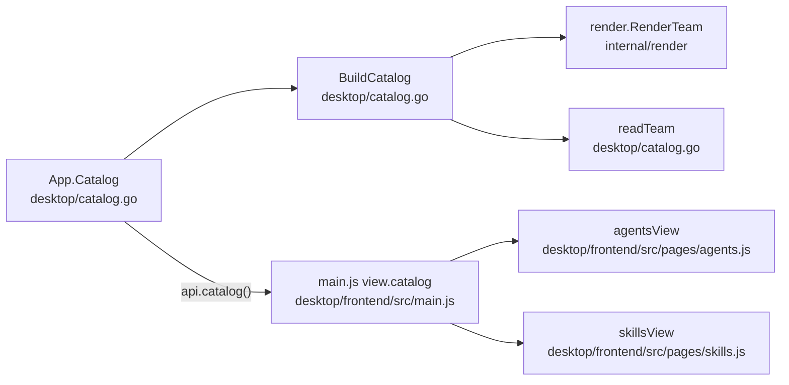

# Desktop catalog pages, repository address, Kiro v3 sessions and example-team mentions

## Findings

### The Agents and Skills pages are plain string renderers over one cached Go catalog
**Answers:** 5

`App.Catalog()` builds the catalog once and caches it until a clone or sync ends (`desktop/catalog.go:246-253`; `refreshCatalog` at `desktop/catalog.go:257-261`). With no `teams/` folder it returns an empty catalog (`desktop/catalog.go:265-267`). `BuildCatalog` renders every `teams/<x>/` that has a `manifest.yaml` into a temp dir via `render.RenderTeam` (`desktop/catalog.go:91-95`), then `readTeam` reads the rendered output. A team that fails to render fails the whole catalog (`desktop/catalog.go:95-97`).

Data shapes (JSON tags):
- `Catalog{teams, pins, tag}` (`desktop/catalog.go:25-29`). `Team{name, agents, skills, prompts, steerings}` (`desktop/catalog.go:32-38`).
- `Agent{name, description, tools, servers, pins, needsKey}` (`desktop/catalog.go:42-51`). Name, description, tools and `mcpServers` keys come from the rendered `agents/*.json` (`desktop/catalog.go:118-135`). `pins` are the `mcpVersion "<key>"` calls found by regex in `agent.json.tmpl` (`desktop/catalog.go:185-201`). `needsKey` is true when `agents/<file>/env/secrets.enc.yaml` exists in the source tree (`desktop/catalog.go:137-138`).
- `Skill{name, source}` (`desktop/catalog.go:54-57`). Every directory in the rendered `skills/` is a skill. Source is `"<source> @ <ref>"` when the name is in the team's external-skills lock (`desktop/catalog.go:146-149`), else the constant `teamSkillSource = "Written by the team"` (`desktop/catalog.go:59`, `155-158`). So a skill carries only a name and a source string; no per-skill URL or path field exists.
- `Catalog.Tag` is the exact-match `git describe --tags` of HEAD, via a `git` subprocess with `GIT_*` env dropped (`desktop/catalog.go:213-221`).

Frontend: `agentsView` returns `{blocked, html}`, one `<tr>` per agent (name, team, description, tool chips plus `@server` chips, "needs key" badge) with every value passed through `esc` (`desktop/frontend/src/pages/agents.js:4-21`). `skillsView` builds two tables: skills (name, team, source) and MCP pins joined to the teams whose agents use them (`desktop/frontend/src/pages/skills.js:5-32`). `initAgents`/`initSkills` write `innerHTML` into the existing `<tbody>`s (`agents.js:23-34`, `skills.js:34-49`). The source column is escaped text only; no anchors are generated (`skills.js:13`). `main.js` imports both inits (`desktop/frontend/src/main.js:7,9`), calls them at `131,134`, and fills `view.catalog = await api.catalog()` (`main.js:159`). A render error or missing clone short-circuits both pages through `problem(view)` (`agents.js:5-6`, `skills.js:6-7`).

### No external-URL opening exists in the app source; Wails' `BrowserOpenURL` is only in the generated runtime
**Answers:** 5

- `desktop/frontend/src/api.js` is documented as the only module that reaches Go (`api.js:1`); its only runtime use is `window.runtime.EventsOn` (`api.js:58-62`). Go side imports Wails `runtime` only for `EventsEmit` and `Quit` (`desktop/app.go:75`, `desktop/main.go:36`).
- A repo-wide search (excluding `node_modules`) for `BrowserOpenURL|OpenURL|window.open|openExternal|xdg-open` finds `BrowserOpenURL` only in the generated `desktop/frontend/wailsjs/runtime/runtime.d.ts:209-211` and `runtime.js:180`, which are not tracked by git (`git ls-files desktop/frontend/wailsjs` is empty). The only `window.open` is inside the bundled xterm link handler in `desktop/frontend/dist/assets/index-C9O1r92G.js` (a build artefact). No `<a href>` or `target=` exists in `desktop/frontend/index.html` or `src`.
- Fact (not run): `window.runtime.BrowserOpenURL` is exposed by Wails but nothing in `api.js` wraps it. Wails v2 is the framework (`desktop/app.go:11` imports `github.com/wailsapp/wails/v2/pkg/runtime`).
- The showcase drives the app in a Chrome tab at `http://localhost:34115` (`scripts/showcase/app-drive.mjs:22`), i.e. the same frontend served in a plain browser.

### Pages are tested as pure functions with `node --test`; Go side tests the catalog against the real repo
**Answers:** 5

`pages.test.js` imports the view functions and asserts on returned HTML with regexes, using a hand-made `catalog` fixture (`desktop/frontend/src/pages/pages.test.js:11-29`). Relevant cases: Agents escapes text and shows "needs key" (`:55-60`), Skills shows each source and pin users (`:62-68`), a render error blocks all pages (`:70-77`), no clone points to Settings (`:79-83`). Settings pages are tested on a fake `document`/`window` (`:181-204`). A guard test fails if any non-test page source names `platform-team` or `data-team` (`:242-247`; regex `/platform-team|data-team(?!=)/`). Go: `desktop/catalog_test.go` has `TestCatalog_ReadsRealTeams` (calls `BuildCatalog("..")`, requires teams exactly `["data-team","platform-team"]`, `:46-58`), `TestCatalog_AgentPinsFollowMcpVersionCalls` (`:78-96`) and `TestCatalog_NeedsKeyExactlyForShippedSecrets` (`:99-110`), each listing the four agents by name, plus temp-dir fixtures (`:117-143`).

### The config repository's address is stored in one place (desktop `settings.json`), written only after a successful clone
**Answers:** 6

- `Settings{RepoURL json:"repoUrl", KiroHome, RepoDir}` lives in `<app data dir>/settings.json` (`desktop/settings.go:17-21,40`). Empty means no repository yet (`:14-16`).
- Validation: regexp accepting https/ssh/file URLs, `git@host:path`, absolute and Windows drive paths (`desktop/settings.go:27`); an address that fails is refused with `repoURLMessage` (`:68-70`, `:101`).
- `Clone(address)` re-validates (`desktop/clone.go:27-29`), runs `git clone -- <address> <repo>` then `kirokit sync --latest-tag` (`:82,90`), and only on success writes `RepoURL = address` (`:41-47`). A failed clone leaves the old address (and test `pages.test.js:219`).
- The frontend reads it from `state.settings.repoUrl` to prefill the welcome page (`desktop/frontend/src/main.js:156`) and Settings (`desktop/frontend/dist` bundle `s.value ||= e.settings.repoUrl`).
- CLI: `kirokit setup --source` uses a duplicate of the same regexp (`cmd/kirokit/commands/setup.go:21,43`), runs `git clone` and stores nothing (`:59-83`); it only prints the target dir. `kirokit sync` takes `--repo`/`KIROKIT_REPO`/cwd (`cmd/kirokit/commands/sync.go:63-72`), then `git fetch --tags --prune` plus `pull --ff-only` or checkout of the newest `v*` tag (`:125-143`). It never names the remote; `gitOutput` just execs git in the checkout (`:145-154`).
- Nothing in Go, JS or scripts runs `git remote get-url origin`. The only occurrence is a transcript line in a past plan's evidence file (`docs/plans/2026-10-17-desktop-app-from-design/evidence/it1-probe-new-address.txt:14`). So for a clone made by the app the address is in `settings.json`; for a CLI-made or hand-made checkout it exists only in that checkout's git config (inference; `setup` records nothing). `scripts/kirokit-sync-setup.sh --repo-url` takes an address as an argument (`README.md:297`).
- Repo dir: `settings.RepoDir`, else the default `<app folder>/repo` (`desktop/app.go:138-143`).

### Kiro CLI 2.34.0 v3 keeps sessions as per-workspace folders of JSON/JSONL under `~/.kiro/sessions`, not in SQLite
**Answers:** 7

Evidence is from this machine's `kiro-cli 2.34.0` (read only; message text was not read, only key names and counts) and the docs page https://kiro.dev/docs/cli/chat/session-management/ (fetched).
- Docs: sessions are auto-saved every turn, per directory, UUID ids; the docs state "SQLite database in `~/.kiro/`" and "Auto-save to database only (not files)" (technical details section). Commands: `kiro-cli chat --resume | --resume-id <ID> | --resume-picker | --list-sessions [-f json] [--all-cwds] | --delete-session`, in chat `/session-id`, `/chat save <file.zip>` (V3 zip archive; 2.x was JSON), `/chat load`, `/chat save-via-script <script>` (session JSON on stdin) and `/chat load-via-script`.
- Observed here, which differs from the docs' wording: the legacy SQLite `~/Library/Application Support/kiro-cli/data.sqlite3` has tables `conversations`, `conversations_v2`, `history`... but `conversations` and `conversations_v2` hold 0 rows. Sessions are in files:
  - V3: `~/.kiro/sessions/<16-hex workspace hash>/sess_<uuid>/` containing `session.json`, `messages.jsonl`, `publish.cursor`, `snapshots/`; plus `<hash>/.index/index.json` and `~/.kiro/session-index/<hash>.jsonl` (append ops `{"op":"add","sessionPath",...}`). Owner-only permissions (dirs 700, files 600).
  - Older v1/v2: `~/.kiro/sessions/cli/<uuid>.json` (+ empty `.jsonl`) and `sess_<uuid>.history`.
- `session.json` keys: `id, title, agentMode, workspacePaths, rootPaths, createdAt, lastModifiedAt, modelId, autopilot, status, memoryConfig, specWorkflow...`. `messages.jsonl` lines are `{id, timestamp, payload}`, payload `type` values seen in one 95 KB session: `session_start` (`agentType`, `composition`), `user` (`content`, `documents`, `images`), `assistant`, `tool_call` (`toolCallId, toolName, args, status, kind, title`), `tool_result` (`toolCallId, content, success, durationMs`), `turn_start/turn_end`, `pending_interaction/interaction_resolved` (consent questions), `usage_summary`, `session_metadata` (context usage), `agent_note`, `session_event`.
- Which agent: `session_start.agentType` and the old format's `session_state.agent_name` (key names only; value semantics for custom agents not checked). Loaded resources: no dedicated list was identified in the keys seen (gap).
- A skill's agent that has `read` and `shell` (the example agents list `"read","write","glob","knowledge","shell"`, e.g. `teams/platform-team/agents/devops/agent.json.tmpl:5`) could open files under `~/.kiro/sessions` by path, as plain files, subject to the agent's permission rules and workspace trust (inference; not executed). The agent's own session id is printable by `/session-id` (docs); whether a running agent can learn it without the user is not established. `kirokit` itself sets `KIRO_HOME` handling (`desktop/settings.go:131-151`, default `~/.kiro`).

### `platform-team` and `data-team` are named in many places, and several tests hard-code exactly those two
**Answers:** 8

Directories: `teams/platform-team`, `teams/data-team`; goldens `testdata/golden/platform-team`, `testdata/golden/data-team`.
Hard-coded or enumerating (would need a third team to be counted):
- `desktop/catalog_test.go:57-58` (exact team list), `:85-88` and `:104` (per-agent pins and needsKey for four named agents).
- `cmd/kirokit/commands/root_test.go:29` (render-all asserts both folders), `:36-40,50,62,115-119` (platform-team only).
- `internal/golden/kirocli_test.go:~58` globs `testdata/golden/*/rendered/agents/*.json` (so a new team's goldens are picked up automatically); `internal/golden/knowledgebase_test.go:19-66` is platform-team/devops only.
- `.sops.yaml:8,10` has one `path_regex` per team (`teams/platform-team/.*/env/secrets\.enc\.yaml$`, `teams/data-team/...`), so an encrypted secrets file in a third team needs its own rule (inference from structure).
- `README.md:10` (showcase alt text), `:27`, `:50-52`, `:119` (the "Example teams" bullet names both teams and their agents and says "Copy one or use `kirokit onboard`"), `:120`, `:127` (data-team as the opt-out example), `:204`, `:216`, `:297-299`.
- Showcase (installs platform-team only): `scripts/showcase/cli-drive.sh:4,42,44`, `caption.mjs:81,83`, `app-drive.mjs:3,24,79,107`, `showcase.test.mjs:60,93,189,252,374`.
- Other: `cmd/kirokit/commands/install_test.go:71-130` (platform-team then data-team to test single-team install), `sync_test.go:130,151,191`, `internal/manifest/manifest_test.go:21-36`, `desktop/runner_test.go:101-115`, `desktop/prereq_test.go:48,55`, `.github/ISSUE_TEMPLATE/bug_report.md:25`.
- Generic, not name-bound: `desktop/frontend/src/pages/pages.test.js:11-29` uses `alpha`/`beta`; `internal/golden/golden_test.go` uses `fixture-team`; `internal/scaffold` tests use `newteam`. `pages.test.js:242-247` forbids those names in page source.
- `CONTRIBUTING.md` has no team names (only `teams/<team>/`, lines 75, 134). Untracked/ignored files also mention the names (`demo-runbook-v1.md`, `tmp/*`; `.gitignore:7` ignores `demo-runbook-*`) and past plans under `docs/plans/` do too (historical).
- `kirokit render` without a name renders all folders under `teams/` (`root_test.go:20-33`), and the desktop catalog lists every `teams/*` with a manifest, so counts there follow the directory listing, not a name list (`desktop/catalog.go:87-93`).
- Showcase/README tell a story with `platform-team`'s `devops` agent and `jira-search` skill (`README.md:10`).

### Change rate and where it is hard to change
**Answers:** 5, 6

`git log --since=90.days` over the catalog, pages, settings, clone, setup and sync files lists 5 commits (`50adcc7` Linux/Windows, `974035a` setup command, `6c19579` desktop app, `bcd9d8c` rename, `5032831` sync). Rendered tables are exercised by hard-coded team names in `catalog_test.go`; the repository address regexp is duplicated in `desktop/settings.go:27` and `cmd/kirokit/commands/setup.go:21`.

## How it is tested today

- Frontend (from repo root): `cd desktop/frontend && node --test src/pages/pages.test.js` for one file; `cd desktop/frontend && npm test` (`node --test "src/**/*.test.js"`, `desktop/frontend/package.json`) for all. `task desktop:test` runs the desktop suite (AGENTS.md).
- Desktop Go (separate module `desktop/go.mod`): `cd desktop && go test -run TestCatalog ./...` for catalog tests; `cd desktop && go test ./...` for all. Catalog tests use the real repo (`BuildCatalog("..")`) plus `t.TempDir()` fixtures.
- CLI/internal: `go test ./cmd/kirokit/commands -run <Name>`; `go test ./...` for all (includes golden compare; `kiro-cli agent validate` skips without login unless `KIROKIT_REQUIRE_KIRO_CLI=1`, `internal/golden/kirocli_test.go`). `task ci` is the full gate.
- Showcase scripts: `node --test scripts/showcase/showcase.test.mjs` (inferred from file naming; not run).
- Nothing was executed for this report.

## Open questions

Question 7: Whether `messages.jsonl`/`session.json` list the loaded resources (skills, steering, knowledge) was not established from key names alone.
Question 7: The docs say sessions are in SQLite, while this machine's v3 sessions are files and the SQLite tables are empty; which store other Kiro versions or platforms use was not determined.
Question 7: Whether a running agent can learn its own session id or session folder without the user (env var or tool output) was not tested.
Question 5: Whether `window.runtime.BrowserOpenURL` works when the frontend runs in a plain browser (the showcase mode) was not tested.

## Code references

- Catalog: `desktop/catalog.go:23-59,65-105,107-183,185-221,246-270`
- Pages: `desktop/frontend/src/pages/agents.js:1-34`, `skills.js:1-49`, `pages.test.js:11-247`, `desktop/frontend/src/api.js:1,58-62`, `desktop/frontend/src/main.js:7,9,131,134,156,159`
- Address: `desktop/settings.go:17-27,57-82,101`, `desktop/clone.go:25-101`, `desktop/app.go:138-143`, `cmd/kirokit/commands/setup.go:21-92`, `cmd/kirokit/commands/sync.go:61-76,125-154`
- Sessions: `~/.kiro/sessions/`, `~/.kiro/session-index/`, `~/Library/Application Support/kiro-cli/data.sqlite3`; docs URL above
- Team names: grep over the repository excluding `node_modules`, `.git`, `testdata`, `teams`, `docs`, `dist`; the list under question 8 is exhaustive for tracked non-doc files except `docs/plans/**` and `docs/prd/**`.
