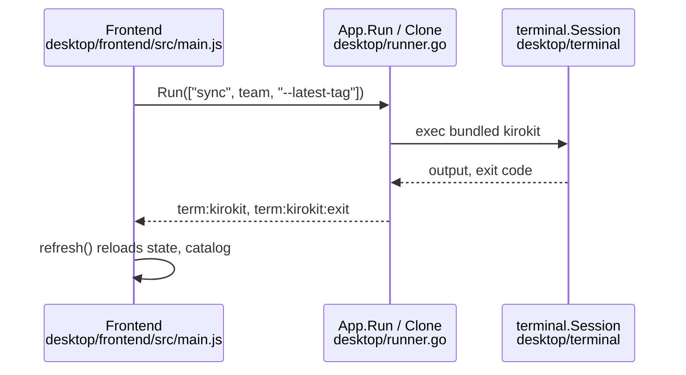

# Research: Check out a config repo branch

## Summary

Both halves already have most of the pieces. The CLI's `sync` fetches and then either fast-forwards the current branch or jumps to the newest `v*` tag; it has no way to name a branch or tag, and a plain `sync` on a tag checkout fails because git cannot fast-forward a detached HEAD. `setup --branch` already validates a branch-or-tag name and is tested against real git repositories, so its rule and its test style carry over.

The desktop app builds every git-touching command in JavaScript and always adds `--latest-tag`: the first clone, the Update button on Settings and the Sync button per installed team. It remembers nothing about a branch, reads git state in only one place (the exact tag of HEAD, for the catalog) and shows that tag nowhere. Commands that might ask for a password run in the kirokit terminal tab; the app's only other git call is a quiet local read. The first-launch page has no clone yet, so it cannot list branches or tags from disk.

## What the goal puts at risk

- **Look here:** risky · Listing branches and tags on the first-launch page needs the remote (`git ls-remote`) before any clone exists; today every network git call runs in the kirokit tab, where sign-in prompts can be answered (`desktop/clone.go:82`, `desktop/frontend/src/pages/welcome.js:18`). A quiet background call cannot answer a password or passphrase prompt.
- **Look here:** unsure · "Newest release" and "a tag pinned by hand" look the same in the checkout (both a detached HEAD on a tag), so the desktop app cannot tell them apart from git alone; the choice has to be remembered somewhere (`desktop/settings.go:17-21`, `desktop/catalog.go:231-240`).
- **Look here:** risky · `git checkout` carries over local edits it does not conflict with, so "a checkout with local changes fails" needs an explicit check; `sync` has none today (`cmd/kirokit/commands/sync.go:125-143`).
- Reuse: `updateCheckout`/`gitOutput` are shared by `sync` and `setup` (`cmd/kirokit/commands/setup.go:73-75`), and `setup` matches the error text `no v* tag found` (`setup.go:77`), as does the desktop clone (`desktop/clone.go:96`); changing that text breaks both.
- Reuse: `setup`'s branch-name rule (`cmd/kirokit/commands/setup.go:47-49`) and the `git`/`commitFile` test helpers with real local origins (`cmd/kirokit/commands/sync_test.go:12-55`).
- The catalog is re-rendered only after a `kirokit sync` run (`desktop/runner.go:126`); a switch that does not run through `sync` would leave the pages on the old templates.
- `repoTag` uses the app's own `PATH`, not the login shell's, unlike the clone (`desktop/catalog.go:232` vs `desktop/clone.go:78-81`); a new git read should pick one on purpose.
- Churn in 90 days is low: `sync.go` 3 commits, `setup.go` 2, `clone.go` 1, `settings.js` 1, `install.js` 1, `welcome.js` 1, `main.js` 3; `README.md` 27.
- Not touched by the questions: `scripts/kirokit-sync-setup.sh` always passes `--latest-tag` when asked and stays out of scope; mentions under `docs/` are dated plans and are not updated.

## Open questions

None.

## Findings

Read at da80102.

### `sync` and `setup` are tested against throwaway local git origins with small helpers
**Answers:** 2

- `git(t, dir, args...)` runs git with hooks, signing and identity pinned by `-c` flags and every `GIT_*` variable dropped (`cmd/kirokit/commands/sync_test.go:12-34`); `chdir` switches the working directory and restores it on cleanup (`:36-46`); `commitFile` writes `f` and commits it (`:48-55`).
- Fixtures are built inline per test: `git init -b main` in a `t.TempDir()` origin, commits, `git tag v…`, `git branch feature`, then `git clone` into another temp folder (`cmd/kirokit/commands/sync_test.go:57-67`, `cmd/kirokit/commands/setup_test.go:54-66`).
- `TestUpdateCheckout` covers the fast-forward and the newest-tag paths (`cmd/kirokit/commands/sync_test.go:57-85`); `TestSync_WithoutATeamUpdatesTheCheckoutOnly` asserts the exact `updated … -> …` and `checked out … at …` lines (`cmd/kirokit/commands/sync_test.go:87-114`); `TestSetup_BranchChecksOutThatBranchOrTag` covers `main`, `feature` and `v1.0.0` (`setup_test.go:54-83`) and `TestSetup_BranchRefusesBadOrUnknownRef` the refusals (`setup_test.go:85-97`). Commands run in-process through `runRoot` (`setup_test.go:71`).
- These tests use plain git and no shell, so none of them skips on Windows (no `testutil` skip in either file).

**Tested today:** `go test ./cmd/kirokit/commands -run 'TestSetup|TestSync|TestUpdateCheckout'`.

### The first-launch page only collects an address and a folder; the clone runs in the kirokit tab
**Answers:** 4

- `welcomeView` renders the address and folder fields and one Clone button; its lede promises "uses its newest release" (`desktop/frontend/src/pages/welcome.js:13-22`). Submit calls `onClone(address, dir)` (`welcome.js:29-32`), which is `startClone` in `main.js`: save the folder with `setRepoDir`, then `api.clone(address)` (`desktop/frontend/src/main.js:105-122`).
- The hint tells the person to answer git's sign-in prompt in the kirokit tab (`welcome.js:18`), because `git clone` runs there as a PTY step (`desktop/clone.go:82`).
- `showWelcome` keeps the page up until a clone exists or while one runs (`welcome.js:10-11`).

**Tested today:** `welcomeView` and `showWelcome` in `desktop/frontend/src/pages/pages.test.js`; the clone flow in `desktop/clone_test.go`.

<!-- ql:folded -->
### sync updates the checkout with fetch, then pull --ff-only or a tag checkout, and fails before any uninstall
**Answers:** 1

Order in `RunE` (`cmd/kirokit/commands/sync.go:36-114`):
1. Without a team, any `--kb-*` flag changed returns `--<flag> needs a team` (`sync.go:45-50`). With a team: parse KB flags and resolve KIRO_HOME (`sync.go:51-58`).
2. Resolve dir (`--repo`, else `repoBase`/KIROKIT_REPO, else ".") and `os.Chdir` into it (`sync.go:63-72`); `repoBase` is cleared (`sync.go:73`).
3. `git rev-parse --short HEAD` as "before" (error ignored, `sync.go:75`), then `updateCheckout(latestTag)` (`sync.go:76`).
4. `updateCheckout` (`sync.go:125-143`): always `git fetch --tags --prune --quiet` (`:126`). Without `--latest-tag`: `git pull --ff-only --quiet` (`:130`). With it: `git tag --list v* --sort=-v:refname` (`:133`), first line is the tag; empty gives `--latest-tag: no v* tag found after fetch` (`:138-139`); else `git checkout --quiet <tag>` (`:141`).
5. Prints `updated <before> -> <after>` only if short HEADs differ (`sync.go:79-82`).
6. No team: prints `checked out <ref> at <after>` and returns; ref is the exact-match tag, overridden by the branch name when `symbolic-ref --short -q HEAD` succeeds (`sync.go:84-90`). Nothing installed.
7. With a team: `install.Check` renders into a scratch dir and writes nothing to KIRO_HOME (`internal/install/install.go:63-70`), then `uninstallOthers` (prints `uninstalled X from home`, `cmd/kirokit/commands/install.go:58-64`), then `install.Sync` (prints `pruned 
` per file) and `synced <team> into <home> at <after>` (`sync.go:100-113`).

Failure boundary: a failed fetch/pull/checkout returns at `sync.go:76-78`; an unknown or broken team fails in `install.Check` at `sync.go:100-102`. Both precede `uninstallOthers` at `:103`. The Long help states this (`sync.go:21-24`).

Git invocation: `gitOutput` runs `git` with combined output, trimmed, env stripped of GIT_DIR etc. via `externalskills.WithoutRepoGitEnv` (`sync.go:145-153`, `internal/externalskills/fetch.go:324-336`). Errors read `git <args>: <err>: <output>` (`sync.go:151`).

Situations (the code has no special handling for any of them; results are git's):
- Detached HEAD, default mode: `pull --ff-only` fails. Run: git prints "You are not currently on a branch." and exits 1 (ran on a clone checked out at a tag). So plain `sync` on a detached checkout errors and stops before install. `--latest-tag` works on a detached HEAD because it checks out by tag.
- Local changes: no stash/reset/clean is issued; `pull --ff-only` and `checkout` only fail where git refuses (diverged history, or overwriting dirty files). Inference from git semantics; the only test of failure is a diverged branch (`sync_test.go:179-183`).
- Unknown ref: sync has no branch/ref flag; the only ref it names is the computed newest `v*` tag (`sync.go:117-121`, flags). No-tag case is the error above.

### The no-team path reports the checkout; HEAD short hash before/after drives the "updated" line
**Answers:** 1

See steps 5-6. Output asserted exactly in `sync_test.go:107`.

### setup --branch validates by a small rule set and passes the name to git clone --branch
**Answers:** 3

- `--source` must match `sourcePattern` (https/ssh/file URL, `git@host:path`, absolute path, Windows drive path), else `kirokit setup: --source: use an https, ssh or file address, git@host:path, or an absolute path` (`cmd/kirokit/commands/setup.go:21`, `:43-45`).
- `--branch` is trimmed (`setup.go:46`). Only if the flag was passed (`Changed`), it is refused when empty, starting with `-`, or containing space/tab/CR/LF, with `kirokit setup: --branch: must be a branch or tag name, not empty, starting with '-' or containing whitespace` (`setup.go:47-49`). No other git ref-format checks (e.g. `..`, `~`) exist.
- Clone: `git clone [--branch <b>] -- <source> <dir>` (`setup.go:55-59`); stdout goes to the command output, stderr to the command stderr (`:61`). A clone failure returns `kirokit setup: git clone: <err>` (`:62-64`). `--target` must be empty/non-existent: enforced by git clone itself (test `setup_test.go:124,127`); no code check in setup.go.
- git behaviour: `--branch` accepts a branch or tag; a tag yields a detached HEAD. Ran: tag `v1` clones with "detached HEAD" notice; unknown name gives `fatal: Remote branch nope not found in upstream origin`, surfaced through the wrapped clone error plus git's stderr.
- With `--branch` success prints `checked out <b> in <dir>` and `next: export KIROKIT_REPO=<dir>`, with no tag lookup (`setup.go:66-69`).
- No-release case (no `--branch`): after clone, chdir, `updateCheckout(true)` (`setup.go:70-73`); if the error contains `no v* tag found` it prints `cloned into <dir>` plus `noReleaseNotice` ("This repository has no release yet (no v* tag). Ask your team lead to tag one.", `setup.go:23`) and exits successfully, clone kept on the default branch (`:77-78`); other errors fail (`:79-80`). The match is string-based on the error from `sync.go:139`, so the two files are coupled.

Reuse: setup shares `updateCheckout` and `gitOutput` with sync (`setup.go:73,75`); these are the only callers outside sync.go.

### Update and Sync send `sync ... --latest-tag` through the bundled kirokit; Clone runs `git clone` then `kirokit sync --latest-tag`
**Answers:** 4

- Update: `updateArgs(installs)` returns `['sync', <first installed team>, '--latest-tag']`, or `['sync', '--latest-tag']` when no team is installed (`desktop/frontend/src/pages/settings.js:31-34`). `main.js` wires it as `runCommand(updateArgs(view.installs), 'update')` (`desktop/frontend/src/main.js:140`).
- Sync (per-row button): `syncArgs(team)` is always `['sync', team, '--latest-tag']` (`desktop/frontend/src/pages/install.js:26`), dispatched at `desktop/frontend/src/main.js:145-146`.
- `runCommand` calls `api.run(args)`; a refusal becomes `view.actionError` shown beside the button (`desktop/frontend/src/main.js:69-79`). `App.Run` resolves `BundledCLI()` and calls `runProgram("kirokit", cli, args)` (`desktop/runner.go:45-51`).
- Neither button can send a branch: no branch/ref argument exists in either args builder. The CLI side of `--latest-tag`: `updateCheckout` runs `git fetch --tags --prune --quiet`; without the flag `git pull --ff-only --quiet`; with it picks the first of `git tag --list v* --sort=-v:refname` and runs `git checkout --quiet <tag>` (detached HEAD), erroring "no v* tag found after fetch" if none (`cmd/kirokit/commands/sync.go:125-143`). `gitOutput` runs plain `git` with `externalskills.WithoutRepoGitEnv()` (`cmd/kirokit/commands/sync.go:145-148`, `internal/externalskills/fetch.go:324-336`). The CLI `sync` chdirs to `--repo`, else `KIROKIT_REPO`, else `.` (`cmd/kirokit/commands/sync.go:56-69`).
- Clone (`App.Clone`): validates the address against `repoURLPattern` (`desktop/clone.go:27-29`), resolves the bundled CLI, `reserve()`s the tab, then in a goroutine runs `cloneAndSync` and emits `clone:done` (`desktop/clone.go:25-53`). `cloneAndSync` renames an existing repo dir to `<repo>.old-<unix>` (suffix `-N` if taken) (`desktop/clone.go:58-69`), runs `git clone -- <address> <repo>` (`desktop/clone.go:82`), then `kirokit sync --latest-tag` with no team (`desktop/clone.go:90`). On failure it removes the partial clone and renames the old one back (`desktop/clone.go:70-76`). A sync output tail containing "no v* tag found" is OK with a notice (`desktop/clone.go:96-97`). The address is saved to settings only after success (`desktop/clone.go:41-48`).
- The git binary for the clone is `a.loginEnv().Lookup("git")` on the captured login PATH, falling back to bare `"git"` (`desktop/clone.go:78-81`); `Lookup` resolves on the captured `PATH`/`PATHEXT` (`desktop/envcapture.go:32-35`).

### One command at a time is enforced by `runHost` (`sess` plus `reserved`), and Clone holds `reserved` across its steps
**Answers:** 4

- `runHost` has `mu`, `sess` (nil when idle), `id`, `reserved` (`desktop/runner.go:24-29`).
- `runProgram` returns `errRunning` ("kirokit is still running a command") if `sess != nil || reserved`, else launches under the mutex (`desktop/runner.go:60-64`). `reserve()` does the same check and sets `reserved` (`desktop/runner.go:73-76`); `release()` clears it (`desktop/runner.go:80-85`).
- `runStep` (used only inside the reserved clone job) skips the `reserved` check, calls `launchLocked`, unlocks and blocks on the result channel (`desktop/runner.go:88-97`). `launchLocked` still refuses if `h.sess != nil` (`desktop/runner.go:103-105`).
- Between clone steps `sess` is nil but `reserved` is true, so a button `Run` is refused (`desktop/runner.go:60`). `Clone` itself fails if a command runs or is reserved (`desktop/clone.go:34`).
- `finishRun` streams output (keeping the last 4096 bytes as `Tail`), waits, clears `h.sess`, and sends `runResult{Code, Tail}` on `done` after emitting `term:kirokit:exit` (`desktop/runner.go:134-165`, `tailSize` at `:39`).
- `RunWrite` forwards keystrokes only for the current run id (`desktop/runner.go:169-179`).
- The lock is per `App` in memory; it does not coordinate with the shell tab (`a.shell`) or an external `kirokit`.

### The run environment is the captured login env plus KIROKIT_REPO, KIRO_HOME and the bundled CLI first on PATH
**Answers:** 4

- `launchLocked` builds `exec.Command(program, args...)`, `cmd.Env = a.terminalEnv(cli, nil)`, `cmd.Dir = a.repoDir()` falling back to the home dir if that folder is missing, and starts it on a pseudo-terminal 120x30 (`desktop/runner.go:107-114`, sizes `:18-21`).
- `terminalEnv` copies `loginEnv().Vars`, sets `TERM`, `COLORTERM`, `KIROKIT_REPO=a.repoDir()`, `KIRO_HOME=a.kiroHome()`, and prepends the CLI's directory to `PATH` (`desktop/shell.go:110-121`); extra entries override; the result is sorted (`desktop/shell.go:122-130`).
- `loginEnv()` returns the cached capture once `envReady`, otherwise captures synchronously via `refreshEnv` (`desktop/shell.go:97-105`). `startup` also captures in the background (`desktop/app.go:78`). `Capture` runs the login shell, with a fallback to the app's own env plus a note on failure/timeout; on Windows it uses the app env directly (`desktop/envcapture.go:42-53`).
- `repoDir()` is the saved `RepoDir` setting, else `<dataDir>/repo` (`desktop/app.go:134-143`); `kiroHome()` is the saved setting, else the captured default (`desktop/settings.go:143-151`). Settings are re-read from the JSON file on every call; a read or parse error yields empty settings (`desktop/settings.go:42-52`).
- Because the header is "▸ <name> <args>", the clone's git step shows as `git clone -- ...` (`desktop/runner.go:122`).

### The catalog is refreshed after any run whose name is `kirokit` and first arg `sync`, including the clone's sync step
**Answers:** 4

- `launchLocked` sets `isSync := name == "kirokit" && len(args) > 0 && args[0] == "sync"` (`desktop/runner.go:126`) and passes it to `finishRun`, which calls `a.refreshCatalog()` after clearing the lock (`desktop/runner.go:151-153`). The clone's step is launched with name `"kirokit"` and args `sync --latest-tag`, so it also refreshes (`desktop/clone.go:90`); the `git clone` step (name `"git"`) does not.
- Then `finishRun` runs `poller.Check()` to re-read install records and emits `term:kirokit:exit` (`desktop/runner.go:155-163`). The frontend answers that event with `refresh()`, i.e. `api.state()`, `api.catalog()`, `api.installs()` (`desktop/frontend/src/main.js:162-190`, `:206-210`). `clone:done` also triggers `settings.load()` and `refresh()` (`desktop/frontend/src/main.js:211-217`).
- `refreshCatalog` locks the cache and rebuilds for `repoDir()` (`desktop/catalog.go:275-279`). Test: `TestRunner_SyncEndRendersTheCatalogAgain` shows install does not rebuild, sync does (`desktop/runner_test.go:186-218`).

### The checkout state is read from git in exactly one place: `repoTag` runs `git describe --tags --exact-match HEAD` inside `BuildCatalog`, cached with the catalog
**Answers:** 5

- `repoTag(repo)` runs `git -C <repo> describe --tags --exact-match HEAD` using bare `git` from the app process's own `PATH` (not the login env), with `GIT_*` variables stripped by `withoutGitEnv` and `hideConsole(cmd)` (no-op off Windows) (`desktop/catalog.go:229-240`, `:242-250`, `desktop/procgroup_unix.go:17-18`).
- Any error returns `""`; the docs say empty means "on a branch or git cannot say", so a missing git, a non-repo, a branch and an untagged commit are indistinguishable (`desktop/catalog.go:236-238`).
- It is called only from `BuildCatalog` (`desktop/catalog.go:78`), stored in `Catalog.Tag` (`json:"tag"`, `desktop/catalog.go:28`). Only the name of an exactly-matching tag is read: no branch name, no commit, no dirty state, no remote.
- When `teams/` is missing, `build` returns an empty catalog with no tag and no git call (`desktop/catalog.go:283-286`). A render failure returns `Catalog{}` (empty tag) with the error (`desktop/catalog.go:281-288`, errors in `BuildCatalog` return `Catalog{}`).
- Timing: `Catalog()` builds on first call and caches until `refreshCatalog` (`desktop/catalog.go:264-271`, `catalogCache` `:253-258`); rebuilds happen at `startup` (`desktop/app.go:79`) and after each sync run (see above). A `git checkout` made outside the app (shell tab or a terminal) is not seen until the next sync or restart. `Catalog` does not fail on the git read.
- `State()` does not use git: `Cloned` is `os.Stat(<repoDir>/.git)` succeeding; `AppState` holds `Settings`, `Cloned`, `Env` (`desktop/app.go:49-53`, `:116-131`).

### `catalog.tag` reaches the frontend but no page displays it
**Answers:** 5

- The Wails binding returns `Catalog` including `tag`; `main.js` stores it as `view.catalog` after `api.catalog()` (`desktop/frontend/src/main.js:172`), with the initial default `tag: ''` (`desktop/frontend/src/main.js:27`).
- Outside tests and the generated `dist` bundle, the only occurrence of `tag` in `desktop/**/*.js|html|go` code consuming the catalog is that default; page modules do not read `catalog.tag` and `desktop/frontend/index.html` has no tag element (the Settings hints at `desktop/frontend/index.html:69-75` describe folders and address only). The frontend test fixtures set `tag: 'v1.0.0'` and `tag: ''` (`desktop/frontend/src/pages/pages.test.js:13`, `:245`) but I found no assertion that a page renders it (searched by `grep` for `tag`; fact for source, not a runtime check).
- Documentation: README describes `--branch` for `setup` only (`README.md:297-303`); I did not find the desktop README section claiming a tag display (`README.md:329` introduces the desktop app).

### The Settings page is one static HTML section driven by `initSettings`, with per-field error spans

**Answers:** 6

- `desktop/frontend/index.html:69-79` holds `page-settings`. Each of the three fields (`kirohome`, `repo`, `repodir`) is a `.field` with `<input>`, `` and ``, tied together with `aria-describedby` (`desktop/frontend/index.html:71-73`).
- Below the fields sit `env-note` (a `role="status"` paragraph, line 74), the Save button with `save-status` (line 75), and the "Templates" block: a static note "Update fetches the newest release of your team's repository, and re-installs the installed team from it." (line 77) plus the Update button `#update` and `#update-error` (line 78). The Update copy is hard-coded HTML, not generated in JS.
- `initSettings(onUpdate, onClone)` (`desktop/frontend/src/pages/settings.js:39`) looks the elements up by id and returns `{ load, paint, cloneDone }` (line 138).
  - `show(input, errEl, message)` sets the error text and toggles `aria-invalid` (lines 52-56).
  - `load()` calls `api.state()`. It fills KiroHome and RepoDir unless the person has typed (`edited` / `dirEdited`), fills the address only if the field is empty, remembers `saved.repoUrl`, shows `env.note`, and re-polls every 300 ms until `env.ready` (lines 69-81).
  - The Save click handler clears the errors, builds the form, calls `saveAndMaybeClone(api.saveSettings, ...)`, and sets the status to "Saved. Cloning the new repository..." or "Saved on this computer" (lines 83-102).
  - On error it runs `parseFieldErrors`, moves a clone-start refusal (no field prefix) to the address field, shows the field errors, puts any other text in the status line, and focuses the first bad field (lines 103-117).
  - `paint(view)` disables Update while `view.running` and shows `view.actionError.message` when `where === 'update'` (lines 120-124).
  - `cloneDone({ok,error})` shows a failure beside the address, or "Cloned. The new repository is in use." / the no-release message in the status line (lines 128-136).
- `parseFieldErrors` splits the error message on newlines and maps the prefixes `KiroHome: `, `RepoDir: `, `RepoURL: ` to fields; any other non-blank line goes to `other` (`desktop/frontend/src/pages/settings.js:5-14`).
- `saveAndMaybeClone` saves the OLD address together with the form, and calls `clone(form.repoUrl)` only when the address is non-empty and differs from `saved.repoUrl` (lines 22-27). `Clone` itself stores the new address after success (`desktop/clone.go:41-49`).
- Update's arguments are built in JS: `updateArgs(installs)` returns `['sync', team, '--latest-tag']`, or `['sync', '--latest-tag']` with no install (`desktop/frontend/src/pages/settings.js:31-34`). `main.js` wires it: `initSettings(() => runCommand(updateArgs(view.installs), 'update'), cloneFromSettings)` (`desktop/frontend/src/main.js:140`). `runCommand` calls `api.run(args)`; a refusal becomes `view.actionError = {where:'update', message}` (`main.js:69-79`).
- Go side: `Settings{RepoURL, KiroHome, RepoDir}` with JSON keys `repoUrl`, `kiroHome`, `repoDir` (`desktop/settings.go:17-21`). The settings file has no branch or ref field today.
- `SaveSettings` trims every field and collects per-field problems as `errors.Join` of `"KiroHome: ..."`, `"RepoURL: ..."`, `"RepoDir: ..."` lines, saving nothing on any problem (`desktop/settings.go:57-82`). The RepoURL rule is `repoURLPattern` (line 27), whose message is `repoURLMessage` (line 101). An empty RepoURL is allowed. Persistence is an atomic temp-file rename with mode 0600 (`writeSettings`, lines 104-129). `SetRepoDir` stores only the clone folder (lines 87-98).
- Layering: the three field names are a shared contract between `settings.go` error prefixes and `parseFieldErrors`; adding a field needs both.
- Churn in the last 90 days (`git log --oneline --since=90.days`): `desktop/settings.go` 2 commits, `settings.js` 1, `index.html` 2, `README.md` 27.

### Update and Sync run `kirokit sync ... --latest-tag` as a PTY command through `App.Run`; the clone does the same internally

**Answers:** 6, 7, 8

- Sync button args: `syncArgs(team)` = `['sync', team, '--latest-tag']` (`desktop/frontend/src/pages/install.js:26`); the button is rendered per installed team at `install.js:20` and dispatched via `main.js:145-146`.
- `Run(args)` starts the bundled CLI in the kirokit tab (`desktop/runner.go:45-51`). A second run is refused with `errRunning` = "kirokit is still running a command" (`runner.go:14`, `:60-62`). The command runs in `repoDir()`, falling back to home (`runner.go:109-113`). When the first arg is `sync` and the program is `kirokit`, the catalog is re-rendered after exit (`runner.go:126`, `:151-153`).
- `Clone(address)` validates against `repoURLPattern`, reserves the tab, then `cloneAndSync` runs `git clone -- <address> <repo>` and then hard-codes `kirokit sync --latest-tag` (`desktop/clone.go:82`, `:90`). It treats output containing "no v* tag found" as OK-with-message (`clone.go:96-97`). The failure path restores the old clone (`clone.go:70-76`).

### Bound methods are the exported methods on `*App`; `api.js` is the only JS module that touches them

**Answers:** 7

- `main.go` binds one value: `Bind: []any{app}` (`desktop/main.go:32`), with `OnStartup: app.startup` and `OnShutdown: app.shutdown` (lines 30-31). Wails exposes every exported method of `App` as `window.go.main.App.<Method>`. Nothing generated is committed.
- `api.js` resolves `window.go.main.App` lazily and throws 'kirokit is not running inside its window' if absent (`desktop/frontend/src/api.js:5-9`). It has one thin wrapper per method:
  - `state` -> `State()` (line 11)
  - `setRepoDir` -> `SetRepoDir(dir)` (line 15)
  - `saveSettings` -> `SaveSettings(settings)` (line 17)
  - `catalog` -> `Catalog()` (line 19)
  - `installs` -> `Installs()` (line 21)
  - `prerequisites(team)` (line 24)
  - `run(args)` -> `Run(args)` (line 27)
  - `clone(address)` (line 32)
  - `runWrite` and `shellWrite` go through ordered "lines" (lines 38-53)
  - `shellResize` (line 55)
- Pages import only `api.js` (header comment, lines 1-3). Events come back through `on(event, handler)` (`api.js:85-88`). The events are `installs:changed`, `term:kirokit`, `term:kirokit:exit` and `clone:done`, emitted from Go via `a.emit` (`desktop/app.go:96-103`) and subscribed in `main.js:195-217`.
- Errors: a Go `error` return becomes a rejected promise whose `.message` is the Go error text (Wails behaviour; the code relies on it). Multi-field errors are `errors.Join` text split on newlines by `parseFieldErrors`; plain errors such as `errRunning` are shown verbatim via `message(e)` (`main.js:64`). Structured results such as `State` and `Catalog` are Go structs with JSON tags (`desktop/app.go:34-53`). Asynchronous outcomes are not returned but emitted as events (`clone:done` payload `cloneResult{ok,error}`, `desktop/clone.go:14-17`).
- A new bound method needs: (1) an exported method on `App` in `desktop/*.go`, (2) a wrapper in `api.js`, (3) a Go test that calls it on `NewAppAt(tmp)`, and (4) a JS test where the page logic depends on it. Frontend tests fake the binding by setting `globalThis.window = { go: { main: { App: {...} } } }` (`desktop/frontend/src/pages/pages.test.js:194-199`, `desktop/frontend/src/api.test.js:21-26`). Nothing checks that `api.js` method names match the Go methods; that wiring is unverified outside a running window (the smoke start only loads the page, `desktop/main.go:35-40`). Inference, not run.
- Churn: `api.js` 2 commits, `runner.go` 1, `clone.go` 1 in 90 days.

### Documentation and callers that name `--latest-tag`, `setup --branch`, Update and Sync

**Answers:** 8

Code (non-test):
- `cmd/kirokit/commands/sync.go:16`, `:27`, `:118`, `:125-139` define the flag; its help text says "check out the newest v* tag instead of fast-forwarding the current branch (also without a team)".
- `cmd/kirokit/commands/setup.go:25`, `:32-33`, `:48`, `:57` define and validate `--branch`; `setup` has no desktop caller.
- `desktop/clone.go:90`, `desktop/frontend/src/pages/settings.js:33`, `desktop/frontend/src/pages/install.js:26`.
- `scripts/kirokit-sync-setup.sh:17` (usage), `:32` (`--latest-tag) latest_tag="--latest-tag"`) passes the flag through to the scheduled sync.
- `desktop/frontend/index.html:77-78` is the Update copy; `desktop/frontend/src/pages/html.js:42` comments on the "update" error location.

Docs:
- `README.md:297` (setup description, newest `v*` tag), `:298` (`--branch`), `:300` (no `v*` tag -> default branch, exit 0), `:307-308` (sync examples), `:311` (sync semantics with `--latest-tag`), `:322` (script example with `--latest-tag`), `:327` (dedicated-checkout warning about detached HEAD), `:341` (First launch: `git clone --` then `kirokit sync --latest-tag`; Settings address change), `:344` (Sync = `kirokit sync <team> --latest-tag`; Settings Update = `kirokit sync --latest-tag`, with or without team), `:346` (`KIROKIT_REPO` + `sync --latest-tag`).
- `CONTRIBUTING.md` has no mention of these flags or buttons (only the generic rule at `CONTRIBUTING.md:152`; `AGENTS.md:33` repeats it). The showcase scripts (`scripts/showcase/*`) contain no `--latest-tag`, `--branch`, Update or Sync button references (grep over the folder returned nothing for these terms; their "update/sync" hits are unrelated identifiers).

Tests asserting these arguments or texts:
- `desktop/frontend/src/pages/pages.test.js:110-113` (`syncArgs`, `updateArgs`) and `:102-107` (Sync/Uninstall buttons).
- `desktop/clone_test.go:126` asserts the tab shows `▸ kirokit sync --latest-tag`; `:106-135` asserts the clone ends on the newest tag (v1.2.0).
- `desktop/runner_test.go:204` runs `sync --latest-tag` through `Run` and checks the catalog is re-rendered.
- `cmd/kirokit/commands/setup_test.go:71`, `:92-93` (`--branch` accepted/refused), `cmd/kirokit/commands/sync_test.go:79-103` (`--latest-tag`).
- No test asserts the Update note text in `index.html` (static HTML, not tested) or the `README` text.
<!-- /ql:folded -->

## Decided with you

<!-- ql:decided -->
| # | Question | Your answer |
|---|---|---|
| 5 | On the first-launch page, how should the app get the list of branches and tags? | Clone first, then choose on the same page |
<!-- /ql:decided -->

## The questions

1. **How does `kirokit sync` update the config checkout today, step by step?** Trace `cmd/kirokit/commands/sync.go` (`newSyncCmd`, `updateCheckout`, `gitOutput`): which git commands run in which order, what happens on a detached HEAD, with local changes or an unknown ref, what is printed, and at which point a failure stops before anything is uninstalled or installed.
2. **How are `sync` and `setup` tested against real git repositories?** Look at `cmd/kirokit/commands/sync_test.go` and `setup_test.go`: how fixture repositories, remotes, branches and tags are built, which helpers exist, and which tests skip on Windows.
3. **How does `setup --branch` validate a branch or tag name, and how does `git clone --branch` treat it?** `cmd/kirokit/commands/setup.go`: the validation rules, the error texts, and how the no-release case is reported.
4. **How does the desktop app run git and kirokit for Clone, Update and Sync?** Trace `desktop/clone.go`, `desktop/runner.go` (`Run`, `runProgram`, `reserve`, `runStep`, `finishRun`), `desktop/frontend/src/pages/settings.js` (`updateArgs`) and `desktop/frontend/src/pages/install.js` (`syncArgs`): which arguments each button sends, how the one-command lock works, how the catalog is refreshed after a sync, and how a run's environment (`KIROKIT_REPO`, PATH, git lookup via `loginEnv`) is built.
5. **How does the desktop app learn about the checkout's state today?** `desktop/catalog.go` (`repoTag`, `withoutGitEnv`, `Catalog`, `catalogCache`), `desktop/app.go` (`State`, `AppState`): what is read from git, when, how failures are handled, and where `catalog.tag` reaches the frontend (`desktop/frontend/src/main.js`) and whether any page shows it.
6. **How is the Settings page built and tested?** `desktop/frontend/index.html` (the `page-settings` section), `desktop/frontend/src/pages/settings.js` (`initSettings`, `saveAndMaybeClone`, `parseFieldErrors`), `desktop/settings.go` (`Settings`, `SaveSettings`): how fields, hints, errors, status lines and the Update button are wired, and how `desktop/frontend/src/pages/pages.test.js` and the Go tests in `desktop/*_test.go` exercise them.
7. **How are Go methods exposed to the frontend and how are the bindings tested?** `desktop/frontend/src/api.js`, `desktop/main.go`, and the Go tests that call `App` methods: what a new bound method needs (Go side, `api.js`, tests), and how errors cross the boundary.
8. **What documentation and other callers mention `--latest-tag`, `setup --branch` or the desktop Update and Sync buttons?** `README.md`, `CONTRIBUTING.md`, `scripts/kirokit-sync-setup.sh`, `scripts/showcase/`, and any test that asserts these arguments or texts.

**Key context pointers:**

- `cmd/kirokit/commands/sync.go:14`, `:125`, `:145`
- `cmd/kirokit/commands/setup.go:25`
- `desktop/clone.go:25`, `:57`
- `desktop/runner.go:45`, `:56`, `:134`
- `desktop/catalog.go:231`, `:264`
- `desktop/app.go:116`
- `desktop/settings.go:17`, `:57`
- `desktop/frontend/src/main.js:140`, `:146`
- `desktop/frontend/src/pages/settings.js:31`
- `desktop/frontend/src/pages/install.js:26`
- `desktop/frontend/index.html:69`
- `README.md:297`, `:303`, `:329`

## Code references

<!-- ql:folded references -->
- `cmd/kirokit/commands/sync.go:14-154` (whole command, `updateCheckout` :125, `gitOutput` :145)
- `cmd/kirokit/commands/setup.go:16-92`
- `cmd/kirokit/commands/install.go:58-64` (uninstallOthers)
- `internal/install/install.go:63-70` (Check), `internal/install/sync.go:16` (Sync), `internal/install/installed.go:59` (UninstallOthers)
- `internal/externalskills/fetch.go:324-336`
- `cmd/kirokit/commands/sync_test.go`, `setup_test.go`, `skills_test.go:14,25`, `root_test.go:11`, `install_test.go:52`
- Churn, last 90 days: sync.go 3 commits, setup.go 2, the two test files 4 combined. Exhaustive for the three questions; desktop and README pointers in the brief were not read.
- `desktop/clone.go:25-106`, `desktop/runner.go:45-189`, `desktop/shell.go:97-131`
- `desktop/catalog.go:25-30, 73-78, 229-288`, `desktop/app.go:49-53, 78-79, 116-143`, `desktop/settings.go:42-52, 143-151`, `desktop/envcapture.go:32-53`
- `desktop/frontend/src/main.js:27, 69-79, 140-146, 162-217`, `desktop/frontend/src/pages/settings.js:31-34`, `desktop/frontend/src/pages/install.js:26`
- `cmd/kirokit/commands/sync.go:56-69, 125-148`, `internal/externalskills/fetch.go:324-336`
- Tests: `desktop/runner_test.go:186-218`, `desktop/clone_test.go:106-260`, `desktop/frontend/src/pages/pages.test.js:110-113`
- Change frequency (90 days, commits): clone.go 1, runner.go 1, catalog.go 3, app.go 2, shell.go 2, main.js 3, settings.js 1, install.js 1. Exhaustive for the named question files; not a full audit of the desktop module.
- Settings UI: `desktop/frontend/index.html:69-79`, `desktop/frontend/src/pages/settings.js:5-139`, `desktop/frontend/src/main.js:64-79,105-160,195-217`
- Go settings: `desktop/settings.go:17-129`, `desktop/app.go:14-53,96-143`
- Binding: `desktop/main.go:17-44`, `desktop/frontend/src/api.js:1-88`
- Run / clone: `desktop/runner.go:14-165`, `desktop/clone.go:14-101`
- Install page: `desktop/frontend/src/pages/install.js:6-46`
- Tests: `desktop/frontend/src/pages/pages.test.js`, `desktop/frontend/src/api.test.js`, `desktop/settings_test.go`, `desktop/clone_test.go`, `desktop/runner_test.go`, `desktop/app_test.go`
- Docs and scripts: `README.md:297-346`, `scripts/kirokit-sync-setup.sh:17,32`, `CONTRIBUTING.md:152`
- CLI: `cmd/kirokit/commands/sync.go`, `cmd/kirokit/commands/setup.go`

Exhaustive for the files named in the questions; the grep for the flag and button terms covered the whole repository except `node_modules`, `.git`, `dist`, `testdata`, `teams`, `docs` and `.claude`, so mentions under `docs/` were not searched.

**How it is tested today**
- One file's tests: `go test ./cmd/kirokit/commands -run 'TestSetup|TestSync|TestUpdateCheckout'` (the package has other test files; choose names with `-run`).
- Suite: `go test ./...` (or `task ci`).
- Go tests live beside the code in `desktop/*_test.go` (own module `desktop/go.mod`): `runner_test.go` (header/output/exit, second-command refusal, sync re-renders catalog, install records), `clone_test.go` (real git against a local origin via `cleanGitEnv()`, old-clone restore, no-release case), `catalog_test.go` (real teams, cache until refresh, no clone). Runner tests use a fake kirokit script per OS (`runnerApp`). Frontend: `desktop/frontend/src/pages/pages.test.js` asserts `updateArgs`/`syncArgs` (`:110-113`).
- One Go file's tests: `cd desktop && go test ./... -run 'TestRunner_'` (or `-run TestClone_`, `-run TestCatalog_`). Whole desktop suite: `cd desktop && go vet ./... && go test ./...`. Frontend: `cd desktop/frontend && node --test "src/**/*.test.js"`. All three via `task desktop:test` from the repository root (`Taskfile.yaml` lines 32-37). CLI side: `go test ./...` from the root. I did not run any of these.
- Frontend (node test runner, no DOM library): `cd desktop/frontend && node --test "src/**/*.test.js"` (`package.json` script `test`); one file: `cd desktop/frontend && node --test src/pages/pages.test.js`. Page logic is split into pure view functions (`teamsView`, `installView`, `welcomeView`, `updateArgs`, `saveAndMaybeClone`) tested by string match on HTML or deepEqual. `initSettings` is tested with a hand-rolled fake `document`/`window.go.main.App` (`desktop/frontend/src/pages/pages.test.js:183-205`), covering the failed-clone and finished-clone status behaviour (`:207-241`). `parseFieldErrors` is exported but has no direct test in this file (inferred from the imports at `:7`). `index.html` is untested.
- Go desktop module: `cd desktop && go test ./...` (module in `desktop/go.mod`); one test: `cd desktop && go test -run TestSaveSettings_RepoURL ./`. Whole desktop gate from root: `task desktop:test` (`Taskfile` lines 32-37: builds frontend, node tests, `go vet`, `go test`). Root suite: `go test ./...` or `task ci`.
- Go fixtures: `newTestApp` (`desktop/settings_test.go:10-17`) uses temp HOME and `NewAppAt(tmp)` and calls `SaveSettings`/`State` directly, including the "survives a new App" and per-field error prefix checks (`:20-51`, `:106`). Runner and clone tests use `runnerApp` (`desktop/runner_test.go:84-96`), which installs a fake bundled `kirokit` script via `KIROKIT_DESKTOP_CLI` and an `eventLog` as `a.emitter` to capture events. Clone tests build the real CLI once (`realKirokit`, `desktop/clone_test.go:70-87`) and use real git origins from `newOrigin` (`:29-40`) plus `waitClone`. No test goes through Wails itself.
- CLI tests: `go test ./cmd/kirokit/commands -run TestSetup` style, using real git repos (`setup_test.go`, `sync_test.go`).
<!-- /ql:folded -->
