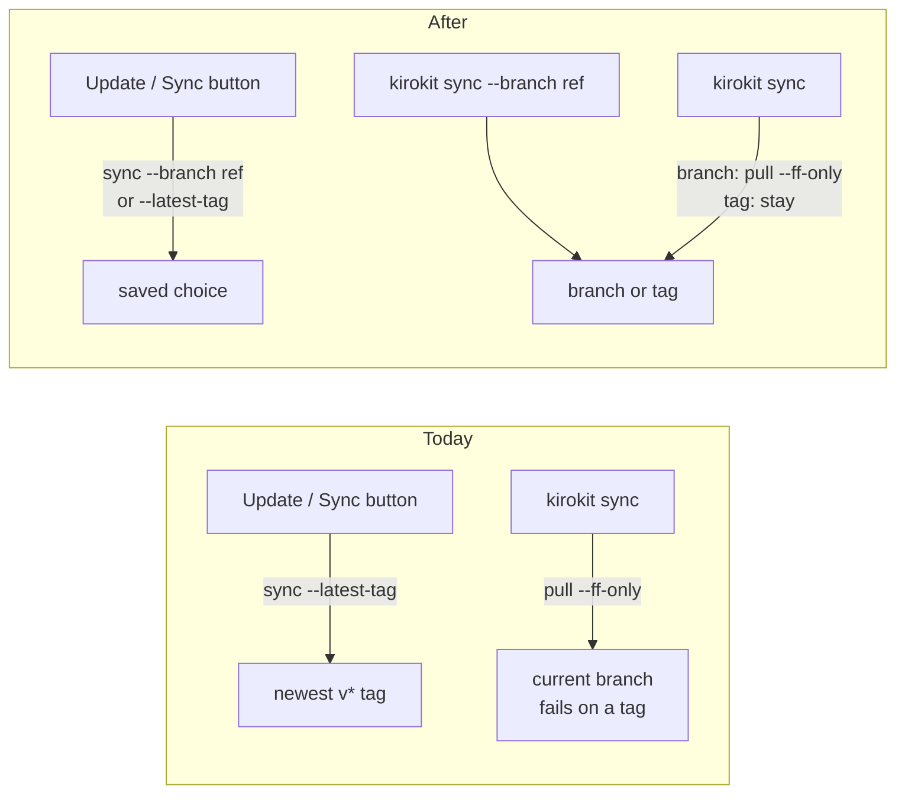
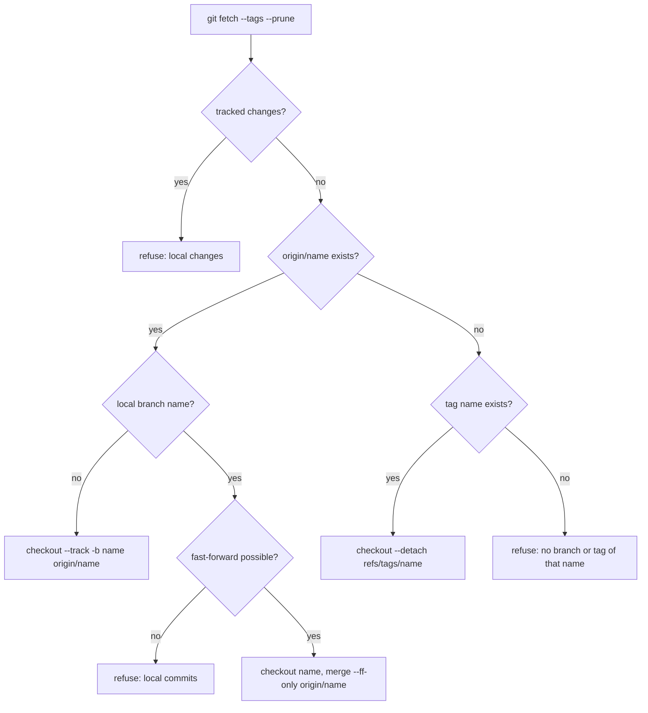
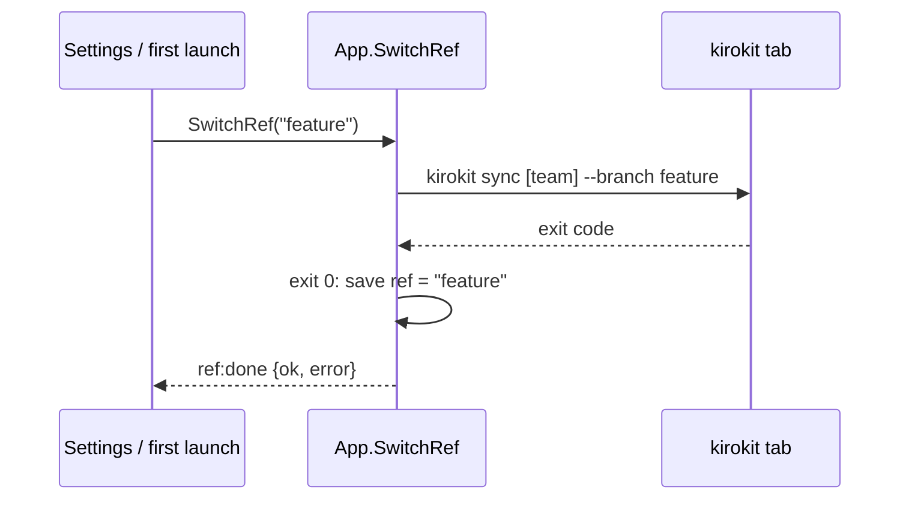

# Plan: check out a branch or tag of the config repo

## Summary

After this change, `kirokit sync [team] --branch <name>` switches the config checkout to a branch or tag and installs from it, and later syncs keep that choice until `--latest-tag` goes back to releases. The desktop app gets a version list (Newest release, the branches, the tags) on Settings and on the first-launch page after the clone, its Update and Sync buttons keep the chosen version, and it shows where the installed templates come from.

- **One flag switches the CLI.** `sync --branch main` or `sync --branch v1.2.0` fetches, switches and installs in one run, and says what it is on.
- **The choice sticks.** A plain `sync` follows new commits of a branch and stays on a tag; only `--latest-tag` goes back to releases.
- **The app picks from a list.** Settings and the first-launch page offer Newest release, every branch and every tag of the repository.
- **The app's buttons respect it.** Update and Sync never jump back to the newest release unless that is the choice.
- **Nothing is lost on a bad switch.** An unknown name, local edits or local commits stop the switch before git changes the checkout or kirokit touches the installed team.

## How we will know it works

**Oracle:** In a clone of a test repository with a `feature` branch, `v1.0.0` and `v1.1.0`, `kirokit sync <team> --branch feature` leaves HEAD on branch `feature` at `origin/feature` with the team installed from it; a later plain `kirokit sync <team>` after a new commit on `origin/feature` moves HEAD to that commit; and in the desktop app, after `feature` is chosen in Settings, the Install page's Sync button runs `kirokit sync <team> --branch feature`, not `--latest-tag`.

**Size:** about 3 slices and 10 tasks.

**Risky:** **Look here:** risky · it runs `git checkout` in the person's config checkout, where local edits or local commits could be lost; the switch refuses both before it moves anything.

## Interface

Three surfaces change in the desktop app. The CLI change is one new flag and one new output line (see *System design contracts*).

<!-- ql:artifact branch-picker#settings-version -->
**Artifact: Branch picker.** Choose the branch, tag or newest release the desktop app uses: Settings, first launch, and where it shows. Shown in QualityLayer, on the author's Mac only.
<!-- /ql:artifact -->

- **Settings shows what is in use and offers a version list.** The Templates section gains an "In use" line and a **Version** select (Newest release, then Branches, then Tags). Update applies the selected entry; when it differs from the one in use the button reads "Switch to <name> and update". A failed switch shows its reason under the select and changes nothing.

<!-- ql:artifact branch-picker#welcome-version -->
**Artifact: Branch picker.** Choose the branch, tag or newest release the desktop app uses: Settings, first launch, and where it shows. Shown in QualityLayer, on the author's Mac only.
<!-- /ql:artifact -->

- **First launch asks after the clone.** The clone runs as today in the kirokit tab. Then the same page shows the Version select with Newest release preselected; Continue keeps it, another entry switches first. A repository with no release yet says so and preselects its default branch.

<!-- ql:artifact branch-picker#install-source -->
**Artifact: Branch picker.** Choose the branch, tag or newest release the desktop app uses: Settings, first launch, and where it shows. Shown in QualityLayer, on the author's Mac only.
<!-- /ql:artifact -->

- **Install and sync names the source.** A line above the table reads "Templates from branch main at b81d0a7" (or tag, or newest release). Anything but Newest release carries a badge: "not a release" for a branch, "pinned · does not follow new releases" for a tag, even when that tag is today's newest release. Settings' "In use" line uses the same words.
- **"Newest release" says that it follows.** Its list entry reads "Newest release · follows new releases (now v1.3.0)", so it cannot be mistaken for the `v1.3.0` tag below it.
- **A failed switch at first launch keeps the page.** The reason shows under the select, the clone stays on the newest release, and the person can pick again or Continue with Newest release.

## Today and after the change



## Engineering decisions

### `sync --branch` switches only when nothing local can be lost

`kirokit sync [team] --branch <name>` fetches, then refuses when tracked files have local changes or when the local branch of that name has commits `origin` does not have; only then does it check out the branch (fast-forwarded to `origin/<name>`) or the tag (detached). It does not stash, reset or discard anything, and the existing paths (plain `sync`, `--latest-tag`) keep today's behaviour apart from the next decision.



<!-- ql:decide d1 -->
<!-- /ql:decide -->

### A plain `sync` stays on a tag instead of failing

On a detached HEAD a plain `kirokit sync` skips the fast-forward and reinstalls from where it is, so a pinned tag stays pinned (today git refuses with "You are not currently on a branch"). On a branch it fast-forwards as today; `--latest-tag` is unchanged.

<!-- ql:decide d2 -->
<!-- /ql:decide -->

### A branch wins when a name is both a branch and a tag

When `origin` has a branch and a tag of the same name, `--branch <name>` takes the branch, because the flag is named for branches and a branch is what can be followed. Such a tag cannot be chosen: the desktop list leaves it out and the README says so.

<!-- ql:decide d3 -->
<!-- /ql:decide -->

### The desktop app remembers the choice in Settings and builds every sync from it

`Settings` gains `ref` (empty means Newest release). The Settings Update button, the per-team Sync button and the first-launch Continue send `--branch <ref>` when it is set and `--latest-tag` otherwise, so no button falls back to the newest release on its own. The choice is saved only after the switch succeeded, the same rule the app already uses for a new repository address; a new repository address resets it to Newest release.



<!-- ql:decide d4 -->
<!-- /ql:decide -->

### The version list is read from the local clone, without the network

The app lists `origin`'s branches and the tags from the clone's own refs, which every sync refreshes with its fetch; it makes no network call of its own, so it never meets a sign-in prompt outside the kirokit tab. A branch pushed a minute ago appears after the next Update. "In use" comes from the checkout itself (branch name, or exact tag, and the short commit).

<!-- ql:decide d5 -->
<!-- /ql:decide -->

## Not doing

- **No change to `kirokit setup --branch`.** It already clones at a branch or tag.
- **No change to `scripts/kirokit-sync-setup.sh`.** A scheduled sync with `--latest-tag` keeps moving to the newest release.
- **No commits, pushes, stashes or new branches.** kirokit only reads and switches.
- **No commit hashes in `--branch`.** Branch and tag names only, like `setup --branch`.
- **No branch list on the first-launch page before the clone.** You chose: clone first, then choose.

## Decisions made for you

- **Untracked files do not block a switch** — they are not lost by a checkout, and git itself refuses when a switch would overwrite one.
- **The remote is always `origin`** — `setup`, the desktop clone and `git clone` all name it so.
- **`sync` prints `checked out <branch|tag> at <commit>` with a team too** — Done means 1 asks for it; today the line appears only without a team.
- **`--branch` and `--latest-tag` together are refused** — each names a different target.
- **The name rule is `setup --branch`'s rule, shared** — not empty, no leading `-`, no whitespace; anything else is for git to find or not.
- **The Update button's label changes when another entry is picked** — so a person can see that pressing it switches, not just updates.
- **The source lines mark anything but Newest release, judged by the saved choice** — a forgotten branch or pin should stand out, and a pinned tag equal to today's newest release still is a pin.
- **The list sorts tags newest first and branches by name** — the same order `--latest-tag` uses for tags.
- **A switch made by hand in the app's clone is shown, not adopted** — the source lines show what git says is checked out, while the buttons follow the choice saved in the app; the next Update or Sync goes back to that choice, which is the one the person made in the app.
- **`Catalog.Tag` stays as it is** — the new checkout read replaces its only purpose for display, and removing it is unrelated cleanup.

## Assumptions

None.

## Before the build

| # | Prerequisite | Met by | Status |
|---|---|---|---|
| P1 | Permission to run the agreed build | the user, at approval | granted · approved in the App, 2026-10-26 16:15 UTC |

## Risks

- **A switch could drop local work.** Mitigation: tests for a dirty checkout and for a local branch ahead of `origin` assert the refusal and that HEAD, the working tree and the installed team are unchanged.
- **A name could reach git as an option.** Mitigation: the shared name rule refuses a leading `-`, branch names go to git only as `origin/<name>` or after `--`, tags only as `refs/tags/<name>`; a test passes `--upload-pack=x` and `-b` and asserts refusal.
- **The desktop buttons could drift from the saved choice.** Mitigation: frontend tests for `syncArgs`, `updateArgs` and the first-launch flow with and without a saved ref; a Go test that a failed switch leaves `ref` unchanged and a new address resets it.
- **Error text coupling.** `setup` and the desktop clone match `no v* tag found`; that text does not change, and the existing tests that match it keep running.

## Decided by you

<!-- ql:decided-by-you -->
- Discuss · How should the CLI switch an existing checkout to a branch? — A --branch flag on sync
- Discuss · What can be chosen: branches only, or branches and tags? — Branches and tags (pin an older release too)
- Discuss · How does the person pick the branch in the desktop app? — A list of the repository's branches
- Discuss · Where in the desktop app can the branch be chosen? — Settings and the first-launch clone page
- Research · On the first-launch page, how should the app get the list of branches and tags? — Clone first, then choose on the same page
<!-- /ql:decided-by-you -->

## What the Plan rests on

- sync updates the checkout with fetch, then pull --ff-only or a tag checkout, and fails before any uninstall
- setup --branch validates by a small rule set and passes the name to git clone --branch
- `sync` and `setup` are tested against throwaway local git origins with small helpers
- Update and Sync send `sync ... --latest-tag` through the bundled kirokit; Clone runs `git clone` then `kirokit sync --latest-tag`
- One command at a time is enforced by `runHost` (`sess` plus `reserved`), and Clone holds `reserved` across its steps
- The catalog is refreshed after any run whose name is `kirokit` and first arg `sync`, including the clone's sync step
- The checkout state is read from git in exactly one place: `repoTag` runs `git describe --tags --exact-match HEAD` inside `BuildCatalog`, cached with the catalog
- The Settings page is one static HTML section driven by `initSettings`, with per-field error spans
- Bound methods are the exported methods on `*App`; `api.js` is the only JS module that touches them
- The first-launch page only collects an address and a folder; the clone runs in the kirokit tab

## Reviewed by

<!-- ql:reviews -->
**Design reviewed** · 2 findings fixed.
<!-- /ql:reviews -->

## System design contracts

**Trust boundary:** a branch or tag name now crosses into a `git` subprocess as an argument, from the `--branch` flag and from the desktop's bound `SwitchRef` method (whose value comes from a list the app built, but the method must not trust that).

### `internal/checkout` holds the name rule and the read-only view of a checkout

New package `internal/checkout`, used by `cmd/kirokit/commands` and by `desktop` (which already imports `internal/*`):

```go
// CheckRefName refuses an empty name, one starting with '-', or one with whitespace.
func CheckRefName(name string) error

type Ref struct {
    Kind   string `json:"kind"`   // "branch", "tag", or "" (detached on no tag, or git failed)
    Name   string `json:"name"`
    Commit string `json:"commit"` // short hash, "" when git failed
}

type Refs struct {
    Current  Ref      `json:"current"`
    Branches []string `json:"branches"` // refs/remotes/origin/*, without HEAD, sorted by name
    Tags     []string `json:"tags"`     // refs/tags/*, -v:refname order
    Newest   string   `json:"newest"`   // first v* tag in that order, "" when none
}

// Read lists the refs of the checkout at dir with git at gitPath, GIT_* stripped.
// It never touches the network. A missing or broken checkout returns an error.
func Read(gitPath, dir string) (Refs, error)
```

`setup --branch` switches to `CheckRefName`; its error stays `kirokit setup: --branch: must be a branch or tag name, not empty, starting with '-' or containing whitespace`. Rejected: putting the switch itself in this package, since `sync` runs git in its working directory through `gitOutput` and the desktop never runs the switch directly (it runs the CLI).

### `kirokit sync --branch` and the detached plain sync

```text
kirokit sync [team] [--repo dir] [--branch name | --latest-tag] [--kb-* ...]
```

- `--branch` with `--latest-tag`: `kirokit sync: --branch and --latest-tag cannot be used together`, exit 1, nothing run.
- Bad name: `kirokit sync: --branch: must be a branch or tag name, not empty, starting with '-' or containing whitespace`.
- `updateCheckout` takes a mode (`follow`, `latestTag`, or a ref name). With a ref: `git fetch --tags --prune --quiet`; `git status --porcelain --untracked-files=no` non-empty → `kirokit sync: local changes in <dir>: commit or discard them, then try again`; then the flow in decision 1. Git calls: `show-ref --verify -q refs/remotes/origin/<n>`, `show-ref --verify -q refs/heads/<n>`, `merge-base --is-ancestor refs/heads/<n> refs/remotes/origin/<n>`, `checkout --quiet --track -b <n> refs/remotes/origin/<n>` or `checkout --quiet <n>` + `merge --ff-only --quiet refs/remotes/origin/<n>`, `show-ref --verify -q refs/tags/<n>`, `checkout --quiet --detach refs/tags/<n>`.
- Errors: `kirokit sync: --branch <n>: no branch or tag of that name on origin`; `kirokit sync: --branch <n>: local branch <n> has commits that are not on origin/<n>`.
- Follow mode on a detached HEAD (`symbolic-ref -q HEAD` fails): no pull, no error.
- Output: `updated <before> -> <after>` (when HEAD moved, as today), then `checked out <branch or tag> at <commit>` always (a detached HEAD on no tag prints the commit as the name), then for a team the existing `uninstalled …`, `pruned …`, `synced …` lines.
- Every failure returns before `install.Check`, so the installed team is untouched (today's boundary at `cmd/kirokit/commands/sync.go:76-78`).

### Desktop: `Settings.Ref`, `App.Checkout`, `App.SwitchRef`

```go
type Settings struct {
    RepoURL  string `json:"repoUrl"`
    KiroHome string `json:"kiroHome"`
    RepoDir  string `json:"repoDir"`
    Ref      string `json:"ref"` // new; "" = Newest release
}

// Checkout reads the clone's refs (checkout.Read with the login env's git).
// Before a clone it returns empty Refs and no error.
func (a *App) Checkout() (checkout.Refs, error)

// SwitchRef runs `kirokit sync [installed team] --branch <ref>` (or `--latest-tag`
// for "") in the kirokit tab under reserve(), saves Settings.Ref on exit 0 and
// emits ref:done {ok, error}. A bad name or a running command is the returned error.
func (a *App) SwitchRef(ref string) error
```

- `SaveSettings` keeps the saved `Ref` (the form does not send it): it loads the current settings and overwrites only the three form fields.
- `Clone` stores `RepoURL` and resets `Ref` to "" on success.
- `ref:done` failure text: the last line of the run's tail that starts with `kirokit sync:` (the CLI's own message), else `kirokit sync failed (exit N). See the kirokit tab.`
- The run is named `kirokit` with first argument `sync`, so the catalog re-renders after it (`desktop/runner.go:126`).
- Frontend `api.js`: `checkout()` and `switchRef(ref)`; `main.js` keeps `view.ref` (from `State().settings.ref`) and `view.checkout` (from `api.checkout()` in `refresh()`); `refArgs(ref)` = `['--branch', ref]` or `['--latest-tag']`; `syncArgs(team, ref)` and `updateArgs(installs, ref)` use it. Settings Update with the select equal to `view.ref` runs `updateArgs` through `api.run`; otherwise it calls `api.switchRef`.
- First launch: after `clone:done` with `ok` from the welcome page, `view.welcome.choosing = true` keeps the page up (`showWelcome`) and renders the select; Continue with "" ends `choosing`; another entry calls `switchRef` and ends `choosing` on `ref:done` ok. A restart during `choosing` simply shows the pages (the clone is on the newest release, the saved default).

Rejected: deriving the choice from the checkout alone, because "Newest release" and "a tag picked by hand" are the same detached HEAD (research, *What the goal puts at risk*).

### README documents the flag and the version list

- *Sync (automatic updates)* (`README.md:303-327`): a `kirokit sync <team> --branch <name>` example; what a plain `sync` does on a branch and on a tag; the refusals (local changes, local commits, unknown name, both flags); a branch winning over a tag of the same name; the new `checked out` line with a team.
- *Desktop app* (`README.md:329-346`): the Version select on Settings and after the first clone, that Update, Sync and Continue use the saved choice, that new branches appear after the next Update, and the source line on Install and sync. The current lines naming `sync --latest-tag` for Sync and Update (`README.md:341`, `:344`) change to "the chosen version".

## Patterns to follow

- **Flag validation and mutual exclusion:** `cmd/kirokit/commands/sync.go:45-50` (refuse flags before any work), `cmd/kirokit/commands/setup.go:46-49` (the name rule to move into `internal/checkout`).
- **Git calls:** `gitOutput` with `externalskills.WithoutRepoGitEnv()` (`cmd/kirokit/commands/sync.go:145-153`); in the desktop, `a.loginEnv().Lookup("git")` and `withoutGitEnv` (`desktop/clone.go:78-81`, `desktop/catalog.go:242-250`).
- **Save only after success, emit a done event:** `App.Clone` and `cloneAndSync` (`desktop/clone.go:25-101`), `reserve`/`runStep`/`release` (`desktop/runner.go:69-97`).
- **Pure view functions with string tests:** `welcomeView`, `installView`, `updateArgs` (`desktop/frontend/src/pages/welcome.js:13`, `install.js:6`, `settings.js:31`) tested in `desktop/frontend/src/pages/pages.test.js`.
- **CLI tests with real git:** `git`, `chdir`, `commitFile` helpers and inline origins (`cmd/kirokit/commands/sync_test.go:12-55`, `setup_test.go:54-97`). Desktop clone tests with `newOrigin`, `realKirokit`, `waitClone` (`desktop/clone_test.go:29-87`); settings tests with `newTestApp` (`desktop/settings_test.go:10-17`).
- **Start the program:** `task build && ./kirokit sync --help`; desktop `task desktop:dev` (Wails dev) or the browser-driven approach used for the showcase (`scripts/showcase/`).
- **Docs:** `README.md` *Sync (automatic updates)* (`README.md:303-327`) and *Desktop app* (`README.md:329-346`).

**Project checks:** `go test ./...` · `task lint` · `go vet ./...` · `task ci` · `task desktop:test` · `node scripts/sync-agent-assets.mjs --check`

## Proven before the gate

| Depends on | Proven how | Result |
|---|---|---|
| git switches from a detached tag to a remote-only branch with `checkout --track -b` | `records/git-spike.sh`, step 2, git 2.54 | met · [records/git-spike.txt](records/git-spike.txt) |
| `pull --ff-only` fails on a detached HEAD and `symbolic-ref -q HEAD` detects it | spike step 3 | met · [records/git-spike.txt](records/git-spike.txt) |
| `status --porcelain --untracked-files=no` reports a tracked edit before a checkout | spike step 4 | met · [records/git-spike.txt](records/git-spike.txt) |
| `merge-base --is-ancestor` detects a local branch with commits not on origin | spike step 5 | met · [records/git-spike.txt](records/git-spike.txt) |
| `show-ref --verify` tells a branch from a tag of the same name, and an unknown name | spike steps 6 and 8 | met · [records/git-spike.txt](records/git-spike.txt) |
| `for-each-ref` lists origin branches and tags offline | spike step 1 | met · [records/git-spike.txt](records/git-spike.txt) |
