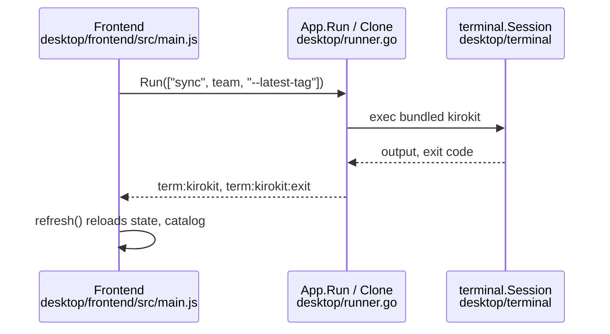

# Desktop app: how it runs git and kirokit, and how it learns the checkout state

## Findings

### Update and Sync send `sync ... --latest-tag` through the bundled kirokit; Clone runs `git clone` then `kirokit sync --latest-tag`
**Answers:** 4

- Update: `updateArgs(installs)` returns `['sync', <first installed team>, '--latest-tag']`, or `['sync', '--latest-tag']` when no team is installed (`desktop/frontend/src/pages/settings.js:31-34`). `main.js` wires it as `runCommand(updateArgs(view.installs), 'update')` (`desktop/frontend/src/main.js:140`).
- Sync (per-row button): `syncArgs(team)` is always `['sync', team, '--latest-tag']` (`desktop/frontend/src/pages/install.js:26`), dispatched at `desktop/frontend/src/main.js:145-146`.
- `runCommand` calls `api.run(args)`; a refusal becomes `view.actionError` shown beside the button (`desktop/frontend/src/main.js:69-79`). `App.Run` resolves `BundledCLI()` and calls `runProgram("kirokit", cli, args)` (`desktop/runner.go:45-51`).
- Neither button can send a branch: no branch/ref argument exists in either args builder. The CLI side of `--latest-tag`: `updateCheckout` runs `git fetch --tags --prune --quiet`; without the flag `git pull --ff-only --quiet`; with it picks the first of `git tag --list v* --sort=-v:refname` and runs `git checkout --quiet <tag>` (detached HEAD), erroring "no v* tag found after fetch" if none (`cmd/kirokit/commands/sync.go:125-143`). `gitOutput` runs plain `git` with `externalskills.WithoutRepoGitEnv()` (`cmd/kirokit/commands/sync.go:145-148`, `internal/externalskills/fetch.go:324-336`). The CLI `sync` chdirs to `--repo`, else `KIROKIT_REPO`, else `.` (`cmd/kirokit/commands/sync.go:56-69`).
- Clone (`App.Clone`): validates the address against `repoURLPattern` (`desktop/clone.go:27-29`), resolves the bundled CLI, `reserve()`s the tab, then in a goroutine runs `cloneAndSync` and emits `clone:done` (`desktop/clone.go:25-53`). `cloneAndSync` renames an existing repo dir to `<repo>.old-<unix>` (suffix `-N` if taken) (`desktop/clone.go:58-69`), runs `git clone -- <address> <repo>` (`desktop/clone.go:82`), then `kirokit sync --latest-tag` with no team (`desktop/clone.go:90`). On failure it removes the partial clone and renames the old one back (`desktop/clone.go:70-76`). A sync output tail containing "no v* tag found" is OK with a notice (`desktop/clone.go:96-97`). The address is saved to settings only after success (`desktop/clone.go:41-48`).
- The git binary for the clone is `a.loginEnv().Lookup("git")` on the captured login PATH, falling back to bare `"git"` (`desktop/clone.go:78-81`); `Lookup` resolves on the captured `PATH`/`PATHEXT` (`desktop/envcapture.go:32-35`).

### One command at a time is enforced by `runHost` (`sess` plus `reserved`), and Clone holds `reserved` across its steps
**Answers:** 4

- `runHost` has `mu`, `sess` (nil when idle), `id`, `reserved` (`desktop/runner.go:24-29`).
- `runProgram` returns `errRunning` ("kirokit is still running a command") if `sess != nil || reserved`, else launches under the mutex (`desktop/runner.go:60-64`). `reserve()` does the same check and sets `reserved` (`desktop/runner.go:73-76`); `release()` clears it (`desktop/runner.go:80-85`).
- `runStep` (used only inside the reserved clone job) skips the `reserved` check, calls `launchLocked`, unlocks and blocks on the result channel (`desktop/runner.go:88-97`). `launchLocked` still refuses if `h.sess != nil` (`desktop/runner.go:103-105`).
- Between clone steps `sess` is nil but `reserved` is true, so a button `Run` is refused (`desktop/runner.go:60`). `Clone` itself fails if a command runs or is reserved (`desktop/clone.go:34`).
- `finishRun` streams output (keeping the last 4096 bytes as `Tail`), waits, clears `h.sess`, and sends `runResult{Code, Tail}` on `done` after emitting `term:kirokit:exit` (`desktop/runner.go:134-165`, `tailSize` at `:39`).
- `RunWrite` forwards keystrokes only for the current run id (`desktop/runner.go:169-179`).
- The lock is per `App` in memory; it does not coordinate with the shell tab (`a.shell`) or an external `kirokit`.

### The run environment is the captured login env plus KIROKIT_REPO, KIRO_HOME and the bundled CLI first on PATH
**Answers:** 4

- `launchLocked` builds `exec.Command(program, args...)`, `cmd.Env = a.terminalEnv(cli, nil)`, `cmd.Dir = a.repoDir()` falling back to the home dir if that folder is missing, and starts it on a pseudo-terminal 120x30 (`desktop/runner.go:107-114`, sizes `:18-21`).
- `terminalEnv` copies `loginEnv().Vars`, sets `TERM`, `COLORTERM`, `KIROKIT_REPO=a.repoDir()`, `KIRO_HOME=a.kiroHome()`, and prepends the CLI's directory to `PATH` (`desktop/shell.go:110-121`); extra entries override; the result is sorted (`desktop/shell.go:122-130`).
- `loginEnv()` returns the cached capture once `envReady`, otherwise captures synchronously via `refreshEnv` (`desktop/shell.go:97-105`). `startup` also captures in the background (`desktop/app.go:78`). `Capture` runs the login shell, with a fallback to the app's own env plus a note on failure/timeout; on Windows it uses the app env directly (`desktop/envcapture.go:42-53`).
- `repoDir()` is the saved `RepoDir` setting, else `<dataDir>/repo` (`desktop/app.go:134-143`); `kiroHome()` is the saved setting, else the captured default (`desktop/settings.go:143-151`). Settings are re-read from the JSON file on every call; a read or parse error yields empty settings (`desktop/settings.go:42-52`).
- Because the header is "▸ <name> <args>", the clone's git step shows as `git clone -- ...` (`desktop/runner.go:122`).

### The catalog is refreshed after any run whose name is `kirokit` and first arg `sync`, including the clone's sync step
**Answers:** 4

- `launchLocked` sets `isSync := name == "kirokit" && len(args) > 0 && args[0] == "sync"` (`desktop/runner.go:126`) and passes it to `finishRun`, which calls `a.refreshCatalog()` after clearing the lock (`desktop/runner.go:151-153`). The clone's step is launched with name `"kirokit"` and args `sync --latest-tag`, so it also refreshes (`desktop/clone.go:90`); the `git clone` step (name `"git"`) does not.
- Then `finishRun` runs `poller.Check()` to re-read install records and emits `term:kirokit:exit` (`desktop/runner.go:155-163`). The frontend answers that event with `refresh()`, i.e. `api.state()`, `api.catalog()`, `api.installs()` (`desktop/frontend/src/main.js:162-190`, `:206-210`). `clone:done` also triggers `settings.load()` and `refresh()` (`desktop/frontend/src/main.js:211-217`).
- `refreshCatalog` locks the cache and rebuilds for `repoDir()` (`desktop/catalog.go:275-279`). Test: `TestRunner_SyncEndRendersTheCatalogAgain` shows install does not rebuild, sync does (`desktop/runner_test.go:186-218`).

### The checkout state is read from git in exactly one place: `repoTag` runs `git describe --tags --exact-match HEAD` inside `BuildCatalog`, cached with the catalog
**Answers:** 5

- `repoTag(repo)` runs `git -C <repo> describe --tags --exact-match HEAD` using bare `git` from the app process's own `PATH` (not the login env), with `GIT_*` variables stripped by `withoutGitEnv` and `hideConsole(cmd)` (no-op off Windows) (`desktop/catalog.go:229-240`, `:242-250`, `desktop/procgroup_unix.go:17-18`).
- Any error returns `""`; the docs say empty means "on a branch or git cannot say", so a missing git, a non-repo, a branch and an untagged commit are indistinguishable (`desktop/catalog.go:236-238`).
- It is called only from `BuildCatalog` (`desktop/catalog.go:78`), stored in `Catalog.Tag` (`json:"tag"`, `desktop/catalog.go:28`). Only the name of an exactly-matching tag is read: no branch name, no commit, no dirty state, no remote.
- When `teams/` is missing, `build` returns an empty catalog with no tag and no git call (`desktop/catalog.go:283-286`). A render failure returns `Catalog{}` (empty tag) with the error (`desktop/catalog.go:281-288`, errors in `BuildCatalog` return `Catalog{}`).
- Timing: `Catalog()` builds on first call and caches until `refreshCatalog` (`desktop/catalog.go:264-271`, `catalogCache` `:253-258`); rebuilds happen at `startup` (`desktop/app.go:79`) and after each sync run (see above). A `git checkout` made outside the app (shell tab or a terminal) is not seen until the next sync or restart. `Catalog` does not fail on the git read.
- `State()` does not use git: `Cloned` is `os.Stat(<repoDir>/.git)` succeeding; `AppState` holds `Settings`, `Cloned`, `Env` (`desktop/app.go:49-53`, `:116-131`).

### `catalog.tag` reaches the frontend but no page displays it
**Answers:** 5

- The Wails binding returns `Catalog` including `tag`; `main.js` stores it as `view.catalog` after `api.catalog()` (`desktop/frontend/src/main.js:172`), with the initial default `tag: ''` (`desktop/frontend/src/main.js:27`).
- Outside tests and the generated `dist` bundle, the only occurrence of `tag` in `desktop/**/*.js|html|go` code consuming the catalog is that default; page modules do not read `catalog.tag` and `desktop/frontend/index.html` has no tag element (the Settings hints at `desktop/frontend/index.html:69-75` describe folders and address only). The frontend test fixtures set `tag: 'v1.0.0'` and `tag: ''` (`desktop/frontend/src/pages/pages.test.js:13`, `:245`) but I found no assertion that a page renders it (searched by `grep` for `tag`; fact for source, not a runtime check).
- Documentation: README describes `--branch` for `setup` only (`README.md:297-303`); I did not find the desktop README section claiming a tag display (`README.md:329` introduces the desktop app).

## How it is tested today

- Go tests live beside the code in `desktop/*_test.go` (own module `desktop/go.mod`): `runner_test.go` (header/output/exit, second-command refusal, sync re-renders catalog, install records), `clone_test.go` (real git against a local origin via `cleanGitEnv()`, old-clone restore, no-release case), `catalog_test.go` (real teams, cache until refresh, no clone). Runner tests use a fake kirokit script per OS (`runnerApp`). Frontend: `desktop/frontend/src/pages/pages.test.js` asserts `updateArgs`/`syncArgs` (`:110-113`).
- One Go file's tests: `cd desktop && go test ./... -run 'TestRunner_'` (or `-run TestClone_`, `-run TestCatalog_`). Whole desktop suite: `cd desktop && go vet ./... && go test ./...`. Frontend: `cd desktop/frontend && node --test "src/**/*.test.js"`. All three via `task desktop:test` from the repository root (`Taskfile.yaml` lines 32-37). CLI side: `go test ./...` from the root. I did not run any of these.

## Open questions

None.

## Code references

- `desktop/clone.go:25-106`, `desktop/runner.go:45-189`, `desktop/shell.go:97-131`
- `desktop/catalog.go:25-30, 73-78, 229-288`, `desktop/app.go:49-53, 78-79, 116-143`, `desktop/settings.go:42-52, 143-151`, `desktop/envcapture.go:32-53`
- `desktop/frontend/src/main.js:27, 69-79, 140-146, 162-217`, `desktop/frontend/src/pages/settings.js:31-34`, `desktop/frontend/src/pages/install.js:26`
- `cmd/kirokit/commands/sync.go:56-69, 125-148`, `internal/externalskills/fetch.go:324-336`
- Tests: `desktop/runner_test.go:186-218`, `desktop/clone_test.go:106-260`, `desktop/frontend/src/pages/pages.test.js:110-113`
- Change frequency (90 days, commits): clone.go 1, runner.go 1, catalog.go 3, app.go 2, shell.go 2, main.js 3, settings.js 1, install.js 1. Exhaustive for the named question files; not a full audit of the desktop module.
