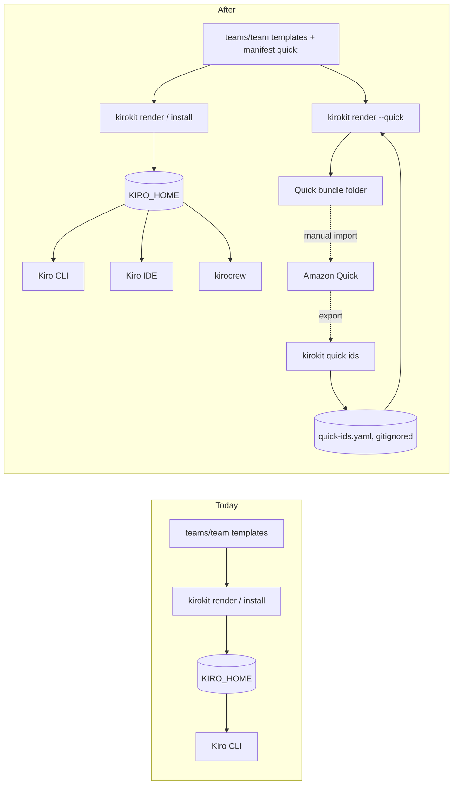
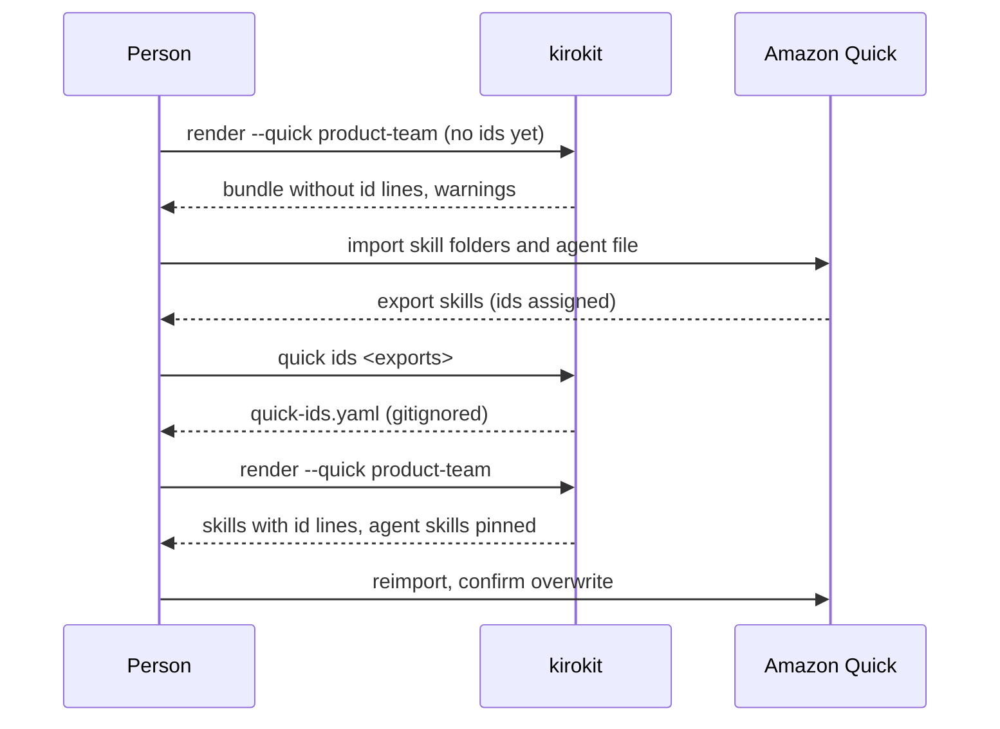

# Quick bundles, Kiro IDE and kirocrew, and a shorter README

## Summary

After this change a team can turn its chosen skills and agents into an Amazon Quick bundle with `kirokit render --quick <team>`, or with **Export for Quick** in the desktop app, and import it through Quick's own screens. A second pass with the ids Quick assigned keeps those ids across reimports. Kiro IDE and kirocrew are confirmed to pick up an installed team from the same Kiro home, and the README says so in a new, short intro with a new showcase video.

- **Quick bundle from the same templates.** Skills are the same files Kiro gets; agents reuse their Kiro prompt; Quick-only fields live in `manifest.yaml`.
- **Ids survive reimports.** `kirokit quick ids` reads what you export from Quick into a file that never gets committed; the next render writes the ids back.
- **Checked like the Kiro output.** Quick goldens are compared byte for byte in CI.
- **One install, three Kiro tools.** Kiro CLI, Kiro IDE and kirocrew all list the installed team's agents; the README says what each picks up.
- **A README that starts with what kirokit is.** A short intro, the new video and install steps first; reference material moves to `docs/` pages.

## How we will know it works

**Oracle:** On a fresh Kiro home, `kirokit install product-team` makes the five product-team agents appear in Kiro CLI, in Kiro IDE's agent picker and in kirocrew's agent list, and the `user-story` skill and `product-owner` agent from `kirokit render --quick product-team` survive the full two-pass round trip in Quick: after `kirokit quick ids` and a second render, the reimport overwrites both in place, the skill re-exports identical to the rendered file with the same id, and the re-exported agent still lists that id in `skills`.

**Size:** about 6 slices and 20 tasks.

**Risky:** Amazon Quick is an outside system with no API: its import rules come from experiments on one account (research brief), and agent overwrite on reimport has never been tried.

## Interface

**Look here:** unsure · the button sits beside Install on every team card that lists Quick content; a team without it gets a one-line note instead of a disabled button.

<!-- ql:artifact artifacts/team-quick-bundle/index.html#teams-quick -->
**Artifact: Teams with Quick export.** Teams page: an Export for Quick button on each team card that lists Quick content; it renders the team's Amazon Quick bundle and opens its folder. Shown in QualityLayer, on the author's Mac only.
<!-- /ql:artifact -->

- **Export for Quick runs one visible command.** It runs `kirokit render --quick <team> --out <app data>/quick/<team>` in the kirokit tab like every other button, so the person sees exactly what ran.
- **Success shows where the bundle is.** The card shows "Quick bundle ready: N skills, M agents", the folder path and **Show folder**, and the folder opens once on success.
- **Failure stays beside the button.** The card says the render failed and points at the kirokit tab; the dock holds kirokit's message.
- **While it runs, the card's buttons are disabled**, like Install today, because the kirokit tab runs one command at a time.

## Today and after the change



## Engineering decisions

### The Quick bundle is a separate render mode that writes only Quick files

`kirokit render --quick [team] --out <dir>` writes `skills/<name>/SKILL.md` per Quick skill and `agents/<name>.json` per Quick agent into `<dir>` (one folder per team when no team is named, as `render` does today); it never writes the Kiro tree. Each skill folder is importable with Quick's **From folder**, each agent file with **From file**. `install`, `uninstall` and `sync` are unchanged: nothing is installed into Quick.

```text
<out>/
  skills/user-story/SKILL.md      # the Kiro-rendered skill, plus `id:` when known
  agents/product-owner.json       # Quick's nine-key agent format
```

<!-- ql:decide d1 -->
<!-- /ql:decide -->

### Quick content is chosen per team in a new `quick` section of manifest.yaml

The team lists the skills and agents meant for Quick; everything else stays Kiro-only. An agent's name, description and prompt come from its Kiro agent (a `file://` prompt is read from the rendered prompt file); its welcome message, starter prompts and pinned skills come from the manifest. Teams without a `quick` section get no bundle and their goldens do not change.

```yaml
quick:
  skills: [user-story]            # team or vendored skills
  agents:
    - name: product-owner         # an agent of this team
      welcomeMessage: "What should we build next?"
      starterPrompts: ["Write a user story for …"]
      skills: [user-story]        # pinned in Quick; each must be in quick.skills
```

<!-- ql:decide d2 -->
<!-- /ql:decide -->

### Quick ids live in a gitignored file keyed by skill name, filled from Quick's own exports

`quick-ids.yaml` at the config repository root (override with `--quick-ids <file>` or `KIROKIT_QUICK_IDS`) maps each skill's frontmatter `name`, Quick's match key, to its 32-hex id. `kirokit quick ids <export>...` reads exported `SKILL.md` files, folders and `.zip` files and merges their `name`/`id:` pairs into it. With an id, render writes `id:` as the last frontmatter line (where Quick puts it) and lists the id in pinned agents' `skills`; without one, the skill renders id-less, the agent omits it, and render prints one warning per skill but succeeds, because that is the normal first pass.



<!-- ql:decide d3 -->
<!-- /ql:decide -->

### Kiro IDE and kirocrew need no output change, only documentation

Both tools list all five installed product-team agents from an isolated Kiro home (probes under Before the build), and no agent hits the IDE's CLI-only rule because every kirokit agent has `permissions`. So the build changes no render output for them. The README gets a "Works with" table of what each tool picks up, and the larger rough edges go under *Not doing*.

<!-- ql:decide d4 -->
<!-- /ql:decide -->

### The showcase grows two scenes driven like the desktop app, and its length limit grows to 90 seconds

**Look here:** risky · the recording now starts two more apps; Kiro IDE uses this Mac's existing Kiro sign-in through the real `HOME`, never a copied profile.

`record.sh` adds a Quick render to the CLI scene and two new clips: Kiro IDE through `playwright-core`'s Electron driver (fresh `--user-data-dir` under `/tmp/kirokit-demo`, `KIRO_HOME` set to the demo home, the agent picker opened) and kirocrew's dashboard through headless Chrome (gateway on a throwaway `HOME`, a spare port, the agent list shown). The 30 to 60 second length check becomes 30 to 90, size limits grow to 10 MB GIF and 6 MB MP4, and the privacy check also reads both new scenes' page text.

<!-- ql:decide d5 -->
<!-- /ql:decide -->

### The README keeps intro, video, install and first steps; reference sections move to docs pages

The new README follows the QualityLayer README's order: logo, one-line pitch, the video, a "Why kirokit" table, install for CLI and app, first steps, "Works with" and a docs index. The "After" half of the flowchart in *Today and after the change* goes into the README's "Works with" section as a Mermaid block, and into `docs/amazon-quick.md`. Its labels must match the final command names (`render --quick`, `quick ids`, `quick-ids.yaml`). Each moved section becomes a page under `docs/`, and every link or quoted section name in the repository points at its new place.

| README section today | Goes to |
|---|---|
| Directory Layout, manifest.yaml Reference, Central env/mcp-versions.yaml, Onboarding a New Team | `docs/configuration.md` |
| Role agents and feedback, External Skills | `docs/agents-and-skills.md` |
| Secrets via SOPS | `docs/secrets.md` |
| Install / Uninstall, Existing files are backed up, Setup, Sync | `docs/install-and-sync.md` |
| Testing and verify by rendering upfront | `docs/testing.md` |
| Desktop app | `docs/desktop-app.md` |
| (new) Amazon Quick | `docs/amazon-quick.md` |

<!-- ql:decide d6 -->
<!-- /ql:decide -->

## Not doing

- **Installing into Quick**, connectors, spaces, routines, sharing or publishing; Quick has no API for them.
- **Rewriting prompts for Quick.** An agent's Quick prompt is its Kiro prompt; a prompt that mentions Kiro-only abilities (subagents, MCP tools) keeps that text.
- **Steering in Quick agents.** Global and team steerings stay Kiro-only.
- **Validating `KIRO_HOME`** against Kiro IDE's rules (it ignores a relative path, a root folder or one containing the home folder); the docs mention it.
- **Removing kirocrew's own `kirocrew-skill-view-*.json` files** from `agents/`; they are kirocrew's, and kirokit's backup copies them like any other file there.
- **Kiro web.**

## Decisions made for you

- `--quick` is a flag on `render`, not `--target quick` — the research brief records it as your choice and nothing else needs a target list.
- The example is a new `user-story` skill and `product-owner` agent in product-team — `analyze-session` reads Kiro session files and means nothing in Quick.
- Quick agent JSON keeps Quick's key order and two-space indent and ends with a newline — matches the exports, and goldens need one fixed form.
- Missing ids warn and never fail; there is no `--strict-ids` — the brief made it optional and nothing needs it yet.
- The `quick` manifest section is decoded strictly (unknown keys fail) while the rest of the manifest stays lenient — a typo there would otherwise silently drop content from the bundle.
- No committed `quick-ids.example.yaml` — `kirokit quick ids` writes the file, and `docs/amazon-quick.md` shows its shape.
- A skill listed for Quick must have `name` and `description` frontmatter, or render fails — Quick needs both.
- Text in a team skill that Quick should see as `{{input}}` is written `{{"{{"}}input}}` in the template, or the skill is vendored — the vendored path already copies text unchanged.
- Desktop exports go to `<app data>/quick/<team>`, not into the config clone — the bundle is an output, and the clone stays clean for sync.
- The ids file sits at the config repository root and is gitignored there — kirokit already resolves everything from that root, and one person's checkout is one Quick account.

## Assumptions

- Quick agent import matches by `name` and offers to overwrite like skill import does (brief open question 3). The round-trip probe right after the first slice answers it; if not, the docs say to delete the agent before reimporting. (unconfirmed)
- An agent pinned to a skill id keeps that skill after the skill is overwritten with its `id:` line present (brief open question 11). The same probe answers it; if not, the Plan is amended before the desktop and docs slices describe the flow. (unconfirmed)
- kirocrew's dashboard has an agents view that shows the same list as `/api/agents/installed`; the showcase slice finds the page. (unconfirmed)

## Before the build

| # | Prerequisite | Met by | Status |
|---|---|---|---|
| P1 | Permission to run the agreed build | the user, at approval | granted · approved in the App, 2026-10-27 14:04 UTC |
| P2 | Kiro IDE 1.4.26 on this Mac, signed in, drivable by Playwright with an isolated Kiro home | agent probe | met · [records/probe-kiro-ide-agents.txt](records/probe-kiro-ide-agents.txt) |
| P3 | kirocrew 0.10.0 on this Mac, runnable on a throwaway home and port | agent probe | met · [records/probe-kirocrew-agents.txt](records/probe-kirocrew-agents.txt) |
| P4 | An Amazon Quick account to import into for the Done means 7 round trip | your answer: the research round trips ran on your account | met · [records/p4-quick-account.txt](records/p4-quick-account.txt) |

## Risks

- **Quick import rules differ from the brief's experiments.** Mitigation: the bundle format is pinned by goldens built from real exports (`docs/research/quick/`). The first slice delivers `render --quick` and `quick ids`. Then the build records a need for you to run the two-pass round trip on your account: import, export, `quick ids`, render again, reimport, export the skill and agent again. The build saves the exports under `records/` and checks three things: the skill matches the rendered file, the id is unchanged, and the agent's `skills` still holds it. Independent slices (Kiro IDE and kirocrew docs, README, showcase) go on meanwhile. A failure amends the Plan before the desktop button and the Quick docs describe the flow.
- **The longer showcase breaks a check or grows too large.** Mitigation: `node --test scripts/showcase/` covers the new limits and the new scene drivers' failure paths before recording; `checks.sh` still blocks publishing.
- **The IDE or kirocrew scene leaks personal data.** Mitigation: the privacy check reads both scenes' page text for `$HOME`, the git email and `$USER`, and fails the recording on a match.
- **Moving README sections breaks links.** Mitigation: a check run in the docs slice lists every `README.md#…` and `docs/*.md#…` link and every quoted section name, and each resolves.
- **A new manifest field changes every team's `context.json`.** Mitigation: the field is `omitempty`, so only product-team's golden changes; `go test ./internal/golden` shows it.

## Decided by you

<!-- ql:decided-by-you -->
- Discuss · What should support for Kiro IDE and kirocrew mean? — Check, fix small gaps, document
- Discuss · Where do the Quick agents come from? — Derived from the Kiro agents
- Discuss · Which skills go into the Quick bundle? — Opt-in list per team
- Discuss · Should the desktop app get the Quick bundle too? — Also an app button
- Discuss · What should the new GIF and video show? — Also Kiro IDE and kirocrew
- Discuss · Where does the README's reference detail go? — Move to docs/ pages
<!-- /ql:decided-by-you -->

## What the Plan rests on

- Research: *Templated vs verbatim: the `.tmpl` suffix decides, for every file in the team folder*; *Vendored external skills are copied byte for byte and never touch the template engine*; *manifest.yaml is decoded by yaml.v3 into one struct, with no unknown-key rejection*; *The harness compares two things per team*; *`kiro-cli agent validate` accepts an agent JSON with an unknown top-level key*; *The IDE reads flat `agents/<name>.json` and `.md`, recursively, but skips files that carry only CLI 2.x trust fields*; *kirocrew resolves one Kiro home, honours KIRO_HOME, and reads agents, skills, settings from it*; *The README showcase is recorded by `task showcase`*; *The README has 15 H2/H3 sections*.
- `docs/research/quick/QUICK-TARGET-BRIEF.md` sections 2.2 to 2.4 (export formats, identity by name, server-assigned ids) and 4.1 (the two-pass flow).
- Probes P2 and P3 above; project memory: GIF at the top under the intro with the MP4 as sharp master, and the showcase story of a CLI install, then Kiro, then the app.

## Reviewed by

<!-- ql:reviews -->
**Second opinion · Codex, GPT-6.1 Sol** · asked for 1 change · 1 finding: 1 taken, 0 kept.
- 03-plan.md — Assumptions, Risks and Oracle: The two-pass design depends on unconfirmed agent overwrite and pinned-skill retention, but testing waits until Verify. · Taken: The Oracle now requires the full two-pass round trip: the reimport overwrites in place, the skill re-exports identical with the same id, and the agent still pins it. Risks and Assumptions now place that round trip on your account right after the first slice (render --quick and quick ids). The build records it as a need for you, saves the exports under records/, and checks them. Independent slices continue meanwhile, and a failure amends the Plan before the desktop and docs slices describe the flow. It cannot run before the gate because no code exists yet to render the bundle.

**Design reviewed** · nothing to change.
<!-- /ql:reviews -->

## System design contracts

**Trust boundary:** `kirokit quick ids` reads files exported from Amazon Quick (`SKILL.md`, folders, `.zip`) that the person passes on the command line; it only parses them in memory and writes `quick-ids.yaml`.

### `render` gains `--quick` and `--quick-ids`; output is the Quick bundle only

```go
// cmd/kirokit/commands/render.go
cmd.Flags().BoolVar(&quick, "quick", false, "render the team's Amazon Quick bundle instead of the Kiro tree")
cmd.Flags().StringVar(&quickIDs, "quick-ids", "", "Quick skill ids file (default <repo>/quick-ids.yaml, or KIROKIT_QUICK_IDS)")

// internal/quick (new package)
type Options struct{ IDs map[string]string } // skill name -> 32-hex id
type Result struct{ Skills, Agents int; MissingIDs []string }
func RenderTeam(teamsRoot, team, globalRoot, envVersionsPath, outDir string, opts Options) (Result, error)
```

`quick.RenderTeam` renders the Kiro tree into a scratch folder with `render.RenderTeamWith` (sentinel Kiro home), then builds the bundle from it and publishes `outDir` the same way render does. Output per run: `rendered Quick bundle for <team>: N skills, M agents`, then `warning: no Quick id for skill <name> yet (first import); run kirokit quick ids after importing` per missing id, to stderr. A team with no `quick` section is an error for a named team (`team <t> lists nothing for Quick`) and skipped with a note when rendering all teams. Errors: a listed skill or agent missing from the team, an agent skill not in `quick.skills`, a skill without `name`/`description`, an unreadable ids file, an id that is not 32 lowercase hex. Rejected: writing Quick files beside the Kiro tree in one render, because install would then copy them into the Kiro home.

### Quick skill and agent shapes

- **Skill:** the rendered `skills/<dir>/SKILL.md` bytes; with an id, `id: <hex>` inserted as the last line before the closing `---` of the frontmatter. Vendored skill folders are copied whole (references included), as for Kiro.
- **Agent:** JSON object, keys in this order, two-space indent, trailing newline:

```json
{
  "name": "<Kiro agent name>",
  "description": "<Kiro agent description>",
  "system_prompt": "<inline prompt, or the rendered file a file:// prompt points to>",
  "welcome_message": "<manifest, default \"\">",
  "starter_prompts": ["<manifest, default []>"],
  "capabilities": [],
  "connectors": [],
  "skills": ["<ids of pinned skills that have one, manifest order>"],
  "spaces": [],
  "files": []
}
```

A `system_prompt` over 50,000 characters is an error (Quick's limit). A `file://` prompt that leaves the rendered tree is an error.

### Manifest `quick` section

```go
// internal/manifest
type Quick struct {
	Skills []string     `yaml:"skills" json:"skills,omitempty"`
	Agents []QuickAgent `yaml:"agents" json:"agents,omitempty"`
}
type QuickAgent struct {
	Name           string   `yaml:"name" json:"name"`
	WelcomeMessage string   `yaml:"welcomeMessage" json:"welcomeMessage,omitempty"`
	StarterPrompts []string `yaml:"starterPrompts" json:"starterPrompts,omitempty"`
	Skills         []string `yaml:"skills" json:"skills,omitempty"`
}
// Manifest gains: Quick *Quick `yaml:"quick" json:"quick,omitempty"`
```

`Load` decodes the `quick` node a second time with `yaml.v3` `KnownFields(true)` and fails on unknown keys or a duplicate name. Membership checks (skills and agents exist in the team) run at Quick render, where the inventory is known.

### `quick-ids.yaml` and `kirokit quick ids`

```yaml
# Amazon Quick skill ids for one Quick account. Written by `kirokit quick ids`; never commit.
skills:
  user-story: 0123456789abcdef0123456789abcdef
```

`kirokit quick ids [--quick-ids <file>] <path>...`: each path is a `SKILL.md`, a folder (searched for `SKILL.md` files) or a `.zip` (each `SKILL.md` entry read in memory, at most 1 MiB per entry and 256 entries). It reads frontmatter `name` and `id`, merges into the file (existing names updated, others kept, keys sorted), writes it with mode 0600 and prints `recorded <n> ids in <file>`, plus `skipped <path>: no id` per export without one. A file with two different ids for one name in one run is an error. Path resolution: flag, then `KIROKIT_QUICK_IDS`, then `<repo>/quick-ids.yaml`. `.gitignore` gains `/quick-ids.yaml`.

### Golden harness covers the Quick bundle

`golden.Compare` and `golden.Update` also render `quick.RenderTeam` for teams with a `quick` section, using the committed fixture `testdata/golden/quick-ids.yaml`, into `testdata/golden/<team>/quick/`, compared with the same `diffDirs`. A team without the section must have no `quick/` folder. `kirokit update` rewrites it with `rendered/`.

### Desktop: catalog flag, Export for Quick, open folder

- `desktop/catalog.go` `Team` gains `Quick bool` (true when the manifest lists any Quick skill or agent).
- `desktop/frontend/src/pages/teams.js` adds the button (`data-action="quick"`) and the result line from the artifact; `main.js` asks `api.quickDir(team)`, runs `['render', '--quick', team, '--out', dir]` through `runCommand` with `where = 'quick:' + team`, and when that run ends with exit 0 (the existing `term:kirokit:exit` event, matched by run id) calls `api.quickBundle(team)`, stores the result in `view.quick[team]` and calls `api.openFolder(team)` once. A non-zero exit sets `view.actionError` for `quick:<team>` with "kirokit render failed: see the kirokit tab below." Show folder calls `api.openFolder(team)` again.
- Go, bound to the frontend: `App.QuickDir(team string) (string, error)` returns `<dataDir>/quick/<team>` (team must be a plain name); `App.QuickBundle(team string) (QuickBundle, error)` with `type QuickBundle struct { Dir string; Skills, Agents int }` counts `skills/*/SKILL.md` and `agents/*.json` in that folder; `App.OpenFolder(team string) error` opens that folder with `openCommandFor(goos)` in `desktop/platform.go` (`open` on macOS, `xdg-open` on Linux, `explorer` on Windows). The frontend never passes a path, so nothing outside `<dataDir>/quick` can be opened. Rejected: parsing the counts from dock text.

### Showcase scenes

- `scripts/showcase/cli-drive.sh` now installs product-team (not platform-team), starts `kiro-cli chat --agent product-owner --v3`, types `/user` and waits for `user-story`, quits, then runs `kirokit render --quick product-team --out quick` and `ls -R quick`. The IDE and kirocrew scenes reuse that Kiro home. The app scene (`app-drive.mjs`) is unchanged and never clicks Export for Quick, so no file manager opens during a recording.
- New `scripts/showcase/ide-drive.mjs`: `_electron.launch` of `/Applications/Kiro.app/Contents/MacOS/Kiro` with `--user-data-dir=$demo/ide`, `KIRO_HOME=$demo/kiro`, real `HOME`; Skip All, open the chat panel's agent selector, wait for the five product-team names; record with the launch option `recordVideo` (as `app-drive.mjs:39` does for Chrome) into `ide.webm`, write `ide-marks.json` and `ide-text.txt` (window and webview text sampled every 200 ms) for captions and the privacy check.
- New `scripts/showcase/crew-drive.mjs`: start `kirocrew gateway --no-open --no-tunnel --no-crons --port 34117 --json-ready` with `HOME=$demo/crew-home`, `KIRO_HOME=$demo/kiro`, read the token from the ready line, open the dashboard's agent list in headless Chrome with `recordVideo` into `crew.webm`, wait for the five names, write `crew-marks.json` and `crew-text.txt`; stop the gateway on exit. The token only travels in the URL, never in page text.
- `record.sh` composes title, CLI clip, IDE clip, kirocrew clip, app clip and end card in that order, each clip trimmed by its marks file as the app clip is today.
- `checks.sh length` limit 30 to 90 s; `size` 10 MB GIF, 6 MB MP4; preflight adds `/Applications/Kiro.app`, `kirocrew` and port 34117. New captions: "Or export it for Amazon Quick", "Kiro IDE lists the same agents", "So does kirocrew".

## Patterns to follow

- **A new render mode:** follow `cmd/kirokit/commands/render.go:11-44` (team loop, `--out`, one line per team) and render into a scratch folder then publish, as `internal/install/install.go:92-102` and `internal/render/render.go:164-205` do.
- **Copying text unchanged:** `internal/render/externalskills.go:28-69` (`os.ReadFile`/`os.WriteFile`, no template engine).
- **Manifest fields:** `internal/manifest/manifest.go:18-29` (`omitempty`/`omitzero` keep goldens stable), validation style in `manifest.go:216-264`, tests with `writeFixture` in `internal/manifest/manifest_test.go`.
- **Goldens:** `internal/golden/golden.go:29-113`; regenerate with `./kirokit update product-team` and review the diff; never hand-edit `testdata/golden/**`.
- **Subcommand group:** `cmd/kirokit/commands/skills.go:14-23` (`skills fetch`) is the shape for `quick ids`.
- **Repo-relative paths and env overrides:** `cmd/kirokit/commands/root.go:12-31` (`KIROKIT_REPO`, `repoPath`).
- **Per-OS code:** functions taking the OS name in `desktop/platform.go:16-235`, tested on every OS (`desktop/platform_test.go`).
- **Desktop button flow:** `desktop/frontend/src/main.js:76-98` (`runCommand`, `installTeam`), `desktop/frontend/src/pages/teams.js:4-37`, `desktop/frontend/src/api.js:27,85-92`; page tests in `desktop/frontend/src/pages/pages.test.js`.
- **Showcase drivers:** `scripts/showcase/app-drive.mjs:44-122` (playwright-core, text sampling for privacy, marks), `scripts/showcase/caption.mjs:28-40`, `scripts/showcase/record.sh:86-217`, tests in `scripts/showcase/showcase.test.mjs`.
- **How it is tested:** Go unit tests with temp dirs beside each package; golden comparison for render output; `node --test` for the frontend and showcase; the IDE and kirocrew scenes only run on a Mac with both apps (they skip in tests when absent).
- **Start the program:** `task build && ./kirokit render --quick product-team --out /tmp/q`; the app with `task desktop:dev`; the recording with `task showcase`.

**Project checks:** `task ci` (build, `go vet ./...`, golangci-lint, `go test ./...`) · `node scripts/sync-agent-assets.mjs --check` · `task desktop:test` · `node --test scripts/showcase/`

## Proven before the gate

| Depends on | Proven how | Result |
|---|---|---|
| Kiro IDE loading kirokit agents from an isolated `KIRO_HOME`, driven by `playwright-core`'s Electron driver | Spike: installed product-team into a temp Kiro home, launched Kiro with a fresh profile and real `HOME`, skipped onboarding, opened the agent selector | All five agents listed under GLOBAL; a profile path under the long scratch folder fails (socket path too long), `/tmp` works · [records/probe-kiro-ide-agents.txt](records/probe-kiro-ide-agents.txt) |
| kirocrew listing kirokit agents from an isolated home | Spike: `kirocrew gateway` on a throwaway `HOME`, port 5599, `/api/agents/installed` | Dashboard up in 5 s; all five listed as foreign agents · [records/probe-kirocrew-agents.txt](records/probe-kirocrew-agents.txt) |
| `kiro-cli agent validate` with an unknown top-level key | Ran it on a golden agent copy with an extra key | Accepted silently (Research finding) |
| Quick skill and agent formats, identity by name | The research brief's round trips on your account | Formats and rules in `docs/research/quick/`; agent overwrite not yet tried (Assumptions) |
