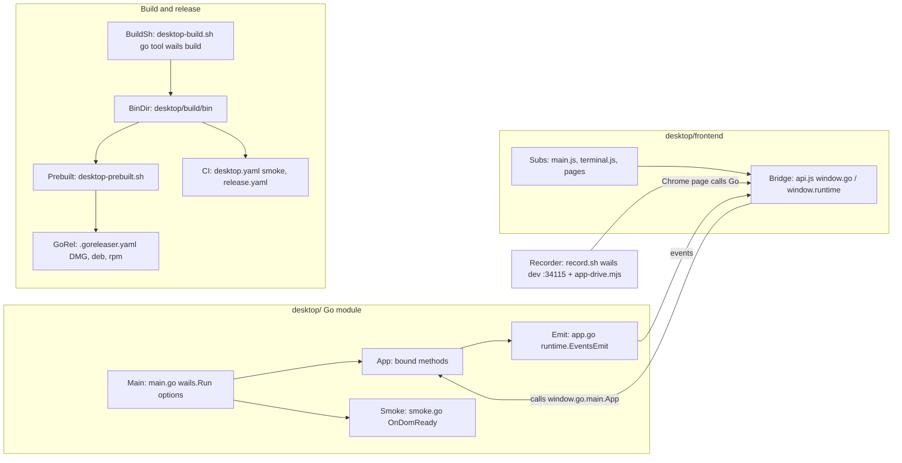
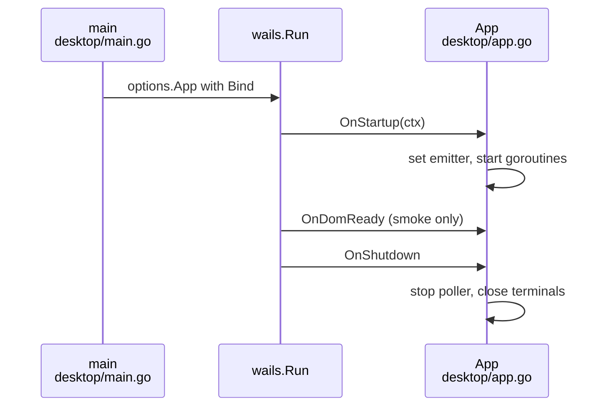

# Research: Upgrade desktop app to Wails v3

## Summary

Wails is used in a narrow band of the app. On the Go side, only the start-up file and one line in the app file touch it: the window options, the start and stop hooks, and the single function that sends events to the window. On the page side, one small module is the only code that calls Go, listens for events or opens the browser. Everything else (terminals, clone, install records, settings) is plain Go and plain JavaScript, tested without Wails.

The wide band is the build. One script calls the Wails v2 command per system, and five other places (the staging script, GoReleaser, two CI workflows and the app's own lookup of its bundled CLI) expect the exact folder and file names that Wails v2 produces. Wails v3 builds through its own task files, writes to a different folder, defaults Linux to a newer GTK and WebKit, no longer lets a plain browser in dev mode call Go, hands event listeners an envelope instead of the payload, and keeps the app running on macOS after its window closes. Its Windows installer keeps v2's registry key and install folder.

## How it works today



Two Wails touch points carry the app (Main/Emit in Go, Bridge in the page); the build chain and the recorder depend on Wails v2's CLI, its output folder and its dev server.

## What it means for your request

- **Easy: the Go side is a small, contained change.** Only the start-up options, the start/stop hooks and the one emitter call reach Wails; every bound method and event payload is plain Go already tested without Wails. Rests on: The app starts through one `wails.Run` call and binds a single `*App`; Tests touch Wails only through `runtime.Quit`'s function type and a hand-faked `window`.
- **Easy: the page side changes in one module, but every listener sees a new shape.** Only `api.js` reaches Go, yet v3 hands listeners an event object, so either `api.on` unwraps `data` or all six subscribers change. Rests on: Frontend-to-Go calls are plain promises on `window.go.main.App`; errors arrive as rejected promise text; v3 replaces window globals with a runtime whose event handlers receive an event object.
- **Hard: the build chain is wired to Wails v2's folder and file names in six places.** v3 writes to `bin/` and builds through its own task files, while the build script, staging script, GoReleaser, both workflows and the CLI lookup expect `desktop/build/bin/…`. Rests on: Consumers of those paths; Which names are Wails v2 conventions versus project-chosen; v3 packaging writes to bin/, keeps v2's Windows installer identity, and keeps running on macOS when the window closes.
- **Risky: Linux support depends on the GTK choice.** v3 defaults to GTK 4 / WebKitGTK 6.0, which today's packages, CI images and documented distro list do not match; GTK 3 remains only until v3.1. Rests on: Wails v3.0.0 builds Linux against GTK 4 and WebKitGTK 6.0 unless built with the gtk3 tag.
- **Risky: the showcase recorder cannot use v3's dev mode.** It needs a Chrome page that calls Go; in v3 only the server build gives a browser working bindings and events. Rests on: The recorder runs the app in `wails dev` and drives it from headless Chrome over http://localhost:34115; In v3 a plain browser on the dev server gets no Go bindings; the server build does.
- **Risky: two silent behaviour changes.** Closing the window on macOS would no longer quit the app, and the smoke start's "page loaded" signal moves to a window event; both pass compilation unnoticed. Rests on: The smoke start is an `OnDomReady` hook plus a 60 second watchdog; v3 packaging writes to bin/, keeps v2's Windows installer identity, and keeps running on macOS when the window closes.
- **Easy: Windows upgrade in place is within reach.** v3's installer template derives the same uninstall key and install folder as v2 from the same company and product names. Rests on: The v2 assets customise identity, the CLI placement and the Windows installer; v3 packaging writes to bin/, keeps v2's Windows installer identity, and keeps running on macOS when the window closes.

## Open questions

Question 4: Whether v3's darwin Taskfile still produces a universal (amd64+arm64) `kirokit.app` with the same `Contents/MacOS/kirokit`, `Info.plist` and `iconfile.icns` names that `scripts/desktop-prebuilt.sh` reads is not traced; it needs a trial build.
Question 7: Whether the v3 server build serves the frontend's `@wailsio/runtime` calls to a headless Chrome page exactly as the desktop window does (same method names, events over WebSocket) is documented but not tried.

## Findings


<!-- ql:folded -->
### The app starts through one `wails.Run` call and binds a single `*App`
**Answers:** 1

- `desktop/main.go:18` builds `NewApp()`; `desktop/main.go:20-33` fills `options.App`: Title "kirokit", 1180x760, min 720x480 (`desktop/main.go:21-25`), embedded `frontend/dist` as the asset server with no custom handler or middleware (`desktop/main.go:14-15,26-28`), background `RGBA{23,19,31,1}` (`desktop/main.go:29`), `OnStartup: app.startup`, `OnShutdown: app.shutdown`, `Bind: []any{app}` (`desktop/main.go:30-32`). No menu, tray, extra windows, `OnBeforeClose`, or platform options are set; `OnDomReady` is set only for the smoke start (`desktop/main.go:35-40`).
- `wails.Run` returns an error that goes to `log.Fatal` (`desktop/main.go:41-43`). Only the `desktop/main.go` and `desktop/app.go` files import Wails (`wails/v2`, `options`, `assetserver`, `runtime` in main.go:8-11; `runtime` in app.go:11); no other `.go` file in `desktop/` references `wailsapp` (grep).
- `NewApp` -> `NewAppAt(dataDirFor(userConfigDir()))` (`desktop/app.go:61-71`); `captureFn` defaults to the login-shell capture (`desktop/app.go:69`).
- `startup(ctx)` (`desktop/app.go:76-84`): under `a.mu` it stores `a.emitter = func(event, data){ runtime.EventsEmit(ctx, event, data) }` (line 78), then `go a.refreshEnv()`, `go a.refreshCatalog()`, and `a.startInstallPoller()` (synchronous; its constructor takes a first reading and starts a goroutine, `desktop/installs.go:30-35,88-93`).
- `emit` (`desktop/app.go:99-106`) reads the emitter under the lock and calls it; before `startup` it silently drops events (comment `desktop/app.go:28`). `ctx` is the only Wails runtime handle the app holds; `EventsEmit` is the single runtime call in app code (`desktop/app.go:78`).
- `shutdown` (`desktop/app.go:87-97`) stops the install poller (waits for its goroutine), then `a.shell.close()` and `a.runner.close()` which close the PTY sessions (`desktop/shell.go:279-288`, `desktop/runner.go:182-189`). It ignores the ctx argument.



### Fourteen of the exported `App` methods are bound; only a few block or run long
**Answers:** 1

Every exported method on `*App` is bound (Wails v2 binds all exported methods of the `Bind` values). Frontend calls go through `desktop/frontend/src/api.js:11-72`.

| Method (source) | Args | Returns to JS | Blocking? |
|---|---|---|---|
| `State` (`desktop/app.go:119`) | none | `AppState{settings{repoUrl,kiroHome,repoDir,ref}, cloned, env{defaultKiroHome,defaultRepoDir,ready,note,shell}}` (`desktop/app.go:37-56`, `desktop/settings.go:18-23`) | short disk reads |
| `SaveSettings` (`desktop/settings.go:60`) | `Settings` | error: joined lines "KiroHome: ...", "RepoURL: ...", "RepoDir: ..." (`desktop/settings.go:68-83`) | short |
| `SetRepoDir` (`desktop/settings.go:91`) | string | error "RepoDir: ..." (`desktop/settings.go:95`) | short |
| `Catalog` (`desktop/catalog.go:268`) | none | `(Catalog{teams,pins,tag}, error)`; json tags `desktop/catalog.go:26-67` | holds `cat.mu` while it builds the first time (`desktop/catalog.go:268-275`), so it waits on a concurrent `refreshCatalog` (render of every team) |
| `Installs` (`desktop/installs.go:97`) | none | `([]install.Record, error)`; never nil (`desktop/installs.go:98-101`) | short |
| `Prerequisites` (`desktop/prereq.go:20`) | team (ignored, `_ = team`) | `[]Check{name,found,detail}` (`desktop/prereq.go:11-13`) | blocks: `a.refreshEnv()` spawns the login shell (bounded by `captureTimeout`, `desktop/app.go:69`) |
| `Run` (`desktop/runner.go:45`) | `[]string` | `(int runId, error)`; error `kirokit is still running a command` (`desktop/runner.go:14`) | returns once the PTY is started; output streams as events |
| `RunWrite` (`desktop/runner.go:169`) | id int, data string | nothing | short; drops input for a stale id (`desktop/runner.go:175-177`) |
| `ShellWrite` (`desktop/shell.go:218`) | string | nothing | holds shell mutex; may start the shell (`desktop/shell.go:222-226`) |
| `ShellResize` (`desktop/shell.go:232`) | cols, rows | nothing | ignores sizes outside 1..1000 (line 233-235); first call starts the shell (line 244-246) |
| `QuickDir` / `QuickBundle` / `OpenFolder` (`desktop/quick.go:25,33,50`) | team | string / `QuickBundle{dir,skills,agents}` / error | short; `OpenFolder` starts the file manager detached |
| `Clone` (`desktop/clone.go:25`) | address | error (bad address, no CLI, `errRunning`) | returns immediately; the clone runs in a goroutine (`desktop/clone.go:38-52`) and ends with `clone:done` |
| `Checkout` (`desktop/version.go:23`) | none | `(checkout.Refs{current{kind,name,commit},branches,tags,newest}, error)` (`internal/checkout/checkout.go:30-41`) | runs git against local refs, no network |
| `SwitchRef` (`desktop/version.go:40`) | ref | error (bad name wrapped `kirokit sync: --branch: ...`, no CLI, `errRunning`) | returns immediately; goroutine ends with `ref:done` (`desktop/version.go:56-59`) |

The long-running work (clone, sync, every button command) is never inside a bound call: `Run`, `Clone` and `SwitchRef` start it and return, and results arrive as events. The kirokit tab accepts one command at a time through `runHost.sess` and `reserved` (`desktop/runner.go:24-29,56-65,69-78`); a multi-step job (`Clone`, `SwitchRef`) reserves the tab (`desktop/clone.go:34`, `desktop/version.go:53`) and runs steps with `runStep`, which waits on a result channel (`desktop/runner.go:88-97`).

### Events travel Go -> frontend as `runtime.EventsEmit` payloads, and there are six event names
**Answers:** 2

Emit sites (`a.emit` / poller emit) and their payload shapes:

| Event | Emit site | Payload (JSON) |
|---|---|---|
| `term:kirokit` | `desktop/runner.go:123,141` | `{id, b64}` from `chunkOf(id, bytes)` (`desktop/shell.go:290-292`); `termChunk{ID int json:"id,omitempty"; B64 string json:"b64"}` (`desktop/shell.go:21-24`) |
| `term:kirokit:exit` | `desktop/runner.go:163` | `termExit{id, code}` (`desktop/shell.go:27-30`) |
| `term:shell` | `desktop/shell.go:259,265,273` | `{b64}`; ID is 0 so `id` is omitted (`omitempty`) |
| `clone:done` | `desktop/clone.go:51` | `cloneResult{ok, error}`; `ok:true` with a non-empty `error` means "no release yet" (`desktop/clone.go:12-19`) |
| `ref:done` | `desktop/version.go:58` | `refResult{ok, error}` (`desktop/version.go:14-17`) |
| `installs:changed` | `desktop/installs.go:66` | `[]install.Record` (never nil) |

Subscribers (all through `api.on`, `desktop/frontend/src/api.js:102-105`):
- `desktop/frontend/src/main.js:289` `installs:changed` stores records; `main.js:293` `term:kirokit` marks `view.running` if `id > lastExit`; `main.js:300` `term:kirokit:exit` records `lastExit`, clears running, settles Quick export, refreshes; `main.js:307` `clone:done`; `main.js:317` `ref:done`.
- `desktop/frontend/src/terminal.js:147` `term:shell` writes base64-decoded bytes (decoder `terminal.js:22-27`); `terminal.js:148` `term:kirokit` switches to a new run id and selects the kirokit tab; `terminal.js:156` `term:kirokit:exit` prints "exited with code N" when non-zero.

Frontend assumptions about delivery:
- Ordering/races: events can precede the bound call's resolution. `main.js:83` ("A fast command may already have ended before the id arrives") compares `id > lastExit`; `main.js:197-198` marks `view.switching` before `switchRef` because "ref:done may arrive before switchRef resolves".
- Wails runs each bound call on its own goroutine, so `api.js:51-64` serialises keystrokes per terminal: `line()` chains each call after the previous one settled (`tail = result.catch(() => {})`); `runLine` and `shellLine` are separate chains (`api.js:63-64,67,70`). `shellResize` and the other calls are not queued (`api.js:72`).
- Payload `id` for the kirokit tab is a positive run counter (`h.id++`, `desktop/runner.go:118`).
- `on` returns the unsubscribe function from `window.runtime.EventsOn`, or a no-op if the runtime is absent (`api.js:102-105`); `terminal.js` and `main.js` never call the unsubscribe.

### Frontend-to-Go calls are plain promises on `window.go.main.App`; errors arrive as rejected promise text
**Answers:** 2

- `api.js:5-9` resolves `window.go.main.App` on each call and throws `kirokit is not running inside its window` if it is missing. Nothing generated is committed (`api.js:1-3`). Pages import only `api.js` for Go access (stated `api.js:1-3`; the only other `window.go|runtime` match in non-test code is a comment in `desktop/frontend/src/pages/feedback.js:76`).
- Go `error` returns become rejected promises whose reason is the error string; the UI normalises with `message = String((e && e.message) || e)` (`main.js:73`). Settings refusals are multi-line "Field: text" strings; `main.js:165` strips a leading `RepoDir: ` before showing it beside the folder field (`.replace(/^RepoDir: /, '')`). `api.js:13-14` documents the contract. Refusals shown beside buttons: `main.js:78-88,106-119,138-141,147-155`.
- `openURL` (`api.js:94-99`) does not go through `App`: it validates with the regexes at `api.js:79-90` (GitHub `/issues/new?` only), rejects with `refusing to open <url>`, then calls `window.runtime.BrowserOpenURL(url)` (`api.js:96-98`). `BrowserOpenURL` is the only Wails runtime function the frontend calls besides `EventsOn`.
- `feedback.js:76` and `pages/feedback.test.js:31-34` encode the Wails v2.17 `BrowserOpenURL` validator (refuses `;|\`$\\<>*{}[]()~! \t\n\r`), so the issue address is percent-encoded to avoid those characters.

### The smoke start is an `OnDomReady` hook plus a 60 second watchdog
**Answers:** 3

- Enabled only when `KIROKIT_DESKTOP_SMOKE=1` (`desktop/main.go:35`); then `opts.OnDomReady = smokeWatch(smokeTimeout, runtime.Quit, func(){ log.Print(...); os.Exit(1) })` (`desktop/main.go:36-39`). `smokeTimeout = 60 * time.Second` (`desktop/smoke.go:10`).
- `smokeWatch` (`desktop/smoke.go:15-31`) starts a goroutine that selects on `loaded` or `time.After(timeout)`; on timeout it calls `fail()` (-> `os.Exit(1)`). The returned `OnDomReady` runs `once.Do(close(loaded); quit(ctx))`, so a second DOM-ready does nothing (`desktop/smoke.go:25-30`).
- Exit 0: `runtime.Quit(ctx)` makes `wails.Run` return nil, `main` returns, and `OnShutdown` runs (`desktop/app.go:87`). Exit 1: only the timeout path (`os.Exit(1)`) or `log.Fatal` if `wails.Run` errors (`desktop/main.go:41-43`). "The page has loaded" means Wails' DOM-ready callback fired; the frontend `main.js` is not required to have rendered anything, and no Go bound method is checked.
- Unit tests: `desktop/smoke_test.go:10-21` (ready twice -> one quit, no fail; timeout 1s with a 1.2s sleep) and `smoke_test.go:23-36` (50ms timeout -> fail, no quit). They use the function directly and no Wails types, other than `context.Context`.
- CI (`.github/workflows/desktop.yaml`): job matrix on ubuntu/windows/macos (lines 29-31); steps `task desktop:test` (71-72), `task desktop:build` (74-75), then "Smoke start" with `KIROKIT_DESKTOP_SMOKE: "1"` and `timeout-minutes: 5` (78-87): macOS runs `desktop/build/bin/kirokit.app/Contents/MacOS/kirokit`, Linux `xvfb-run -a desktop/build/bin/kirokit-desktop`, Windows `desktop/build/bin/kirokit-desktop-$(go env GOARCH).exe`. The step passes when the process exits 0.
- Second smoke: "Install the Linux packages and start the app" (lines 116-125), only on Linux pull requests with `GORELEASER_KEY` set (line 117), after the snapshot release. It `apt-get install`s the `kirokit_*_linux_amd64.deb` and `kirokit-desktop_*_linux_amd64.deb`, runs `kirokit --version`, `test -x /usr/lib/kirokit-desktop/kirokit`, then `xvfb-run -a /usr/bin/kirokit-desktop` with `KIROKIT_DESKTOP_SMOKE=1`. Build deps are `libgtk-3-dev libwebkit2gtk-4.1-dev xvfb` (lines 58-62), and the Linux build uses `-tags webkit2_41` (`scripts/desktop-build.sh:62`).
- Build entry points that invoke the Wails CLI: `scripts/desktop-build.sh:47` (`go tool wails build -platform darwin/universal -clean`), `:62` (linux, `-tags webkit2_41 -o kirokit-desktop`), `:77` (windows `-nsis -o kirokit-desktop-$arch.exe`); `Taskfile.yml:43` (`go tool wails dev`); `desktop/go.mod:8` (`wails/v2 v2.17.0`) and `:113` (`tool github.com/wailsapp/wails/v2/cmd/wails`); `desktop/wails.json` (schema `config.v2.json`).

### Tests touch Wails only through `runtime.Quit`'s function type and a hand-faked `window`
**Answers:** 6

Go (`desktop/*_test.go`):
- No Go test file imports Wails. `app_test.go:7-21` calls `NewApp().State()` with `HOME` redirected. `smoke_test.go` passes plain funcs (`func(context.Context)`), not `runtime.Quit`.
- Events are intercepted by assigning `a.emitter` directly (`desktop/runner_test.go:97`, `eventLog.emit` at `runner_test.go:31-52` type-asserts payloads `cloneResult`, `refResult`, `termChunk`, `termExit`, `[]install.Record`), and `fakeEmitter` for the poller (`desktop/installs_test.go:19,52,97,113`). So changing payload Go types or the `emit(event, data any)` signature breaks these tests; the Wails `EventsEmit` call itself (`desktop/app.go:78`) is untested.
- `testtools_test.go:11-54` supplies OS helpers (`onWindows`, `exeName`, `writeTool` sh vs `.cmd`, `loginVars`) with no Wails link. `shell_test.go:212-245` tests `resolveCLIFor` including `wails dev` working-directory layouts (cases "wails dev prefers dev-bin over a stale bundled CLI").
- Bound-method contracts (argument/return/error text) are covered by `settings_test.go`, `clone_test.go`, `version_test.go`, `quick_test.go`, `prereq_test.go`, `catalog_test.go` as direct Go calls; nothing tests the JS binding layer.

Frontend (`desktop/frontend/src/**/*.test.js`, `node:test`):
- `api.test.js:6-18` fakes `globalThis.window = { go: { main: { App: { ShellWrite, RunWrite } } } }` and imports `./api.js` (lines 22-23, 32-33) to test per-terminal serial ordering and failure isolation (`api.test.js:20-44`). `api.test.js:48-72` fakes `window.runtime.BrowserOpenURL` and checks the URL allow-list; `api.test.js:76-80` uses `window = {}` and expects `kirokit is not running inside its window`. Because `api.js` reads `window` per call, tests re-set `globalThis.window` between cases while `import('./api.js')` is cached.
- `pages/pages.test.js:279-302` builds a fake `document` and `window.go.main.App` with `State` and `SaveSettings` only, for the Settings page; the page code reaches Go through `api.js`.
- `pages/feedback.test.js:31-34` hard-codes the v2.17 `BrowserOpenURL` validator character set (`WAILS_REFUSES`) and asserts encoded addresses avoid it (line 36-42). It is the one test that mirrors Wails runtime behaviour.
- `main.js` and `terminal.js` (the `api.on` subscribers) have no tests; `window.runtime.EventsOn` is not faked anywhere in the tests (`api.on` is untested). `dialogs.test.js`, `sidebar.test.js`, `tabs.test.js` do not touch `window.go`/`window.runtime`.

### What a later change would meet
**Answers:** 1, 2, 3, 6

- Churn in 90 days (`git log --oneline --since=90.days -- <path> | wc -l`): `desktop/main.go` 2, `desktop/app.go` 3, `desktop/smoke.go` 1, `desktop/runner.go` 1, `desktop/shell.go` 2, `api.js` 4, `main.js` 5, `terminal.js` 2.
- Call sites others already use: `a.emit` (runner, shell, clone, version, poller), `chunkOf`, `termExit`, `cloneResult`, `refResult`, `api.on`, `window.go.main.App` (api.js only). Hard to change: the `App` name and `main` package, since JS addresses `window.go.main.App.<Method>` (`api.js:6`); emitted event names and payload JSON tags, since three JS files and the Go `eventLog` test helper rely on them; `desktop/frontend/dist` embed (`desktop/main.go:14`); build scripts that call the Wails v2 CLI.

### One script builds per OS, and each consumer reads a fixed path under desktop/build/bin/
**Answers:** 4

`scripts/desktop-build.sh` switches on `go env GOOS` (`scripts/desktop-build.sh:34`). `task desktop:build` only calls `bash scripts/desktop-build.sh` (`Taskfile.yml:45-49`). It derives the version from `$VERSION` or `git describe`, strips a leading `v` (`scripts/desktop-build.sh:23-24`), and injects it into the CLI only via ldflags `-X ...commands.version/commit/date` (`scripts/desktop-build.sh:28-29`). The Wails app itself gets no version flag; its product version stays `0.0.0` from `desktop/wails.json:12`.

```
desktop/build/bin/
  macOS:   kirokit.app/Contents/MacOS/kirokit            (Wails, universal)
           kirokit.app/Contents/Resources/bin/kirokit   (CLI, lipo universal)
  Linux:   kirokit-desktop  +  kirokit                  (CLI beside it)
  Windows: cli/windows_<arch>/kirokit.exe               (staged CLI)
           kirokit-desktop-<arch>.exe                   (Wails app)
           kirokit-<arch>-installer.exe  -> mv ->  installers/kirokit-desktop_<v>_windows_<arch>-setup.exe
```

- macOS: builds the CLI for amd64 and arm64 with `CGO_ENABLED=0`, joins them with `lipo` (`scripts/desktop-build.sh:36-40`). Exports `-mmacosx-version-min=13.0` in CGO flags (`:43-44`). Runs `go tool wails build -platform darwin/universal -clean` (`:47`). The Wails convention supplies the output `kirokit.app` (from `outputfilename` in `desktop/wails.json:4`). `-clean` empties `build/bin`, so the CLI is copied into `Contents/Resources/bin/kirokit` afterwards (`:46-51`). Then `codesign --force --deep --sign -` re-seals ad hoc (`:53`).
- Linux: builds the CLI for `$GOARCH`, then `wails build -platform linux/$arch -tags webkit2_41 -clean -o kirokit-desktop` (`:62`). Installs the CLI as `desktop/build/bin/kirokit` (`:63`). Wails v2 conventions in play: `-platform`, `-tags webkit2_41` (WebKitGTK 4.1 ABI), `-o`.
- Windows: `rm -rf desktop/build/bin`, then per arch (default `amd64 arm64`, `:71`) stages the CLI at `bin/cli/windows_<arch>/kirokit.exe` (`:73-74`). Runs `wails build -platform windows/$arch -nsis -o kirokit-desktop-$arch.exe` without `-clean` and with GOOS/GOARCH unset for the tool (`:77`). Renames Wails' `kirokit-<arch>-installer.exe` to `installers/kirokit-desktop_<v>_windows_<arch>-setup.exe` (`:78`). The installer name comes from the template `OutFile "..\..\bin\${INFO_PROJECTNAME}-${ARCH}-installer.exe"` (`desktop/build/windows/installer/project.nsi:78`), which is Wails v2's NSIS convention. The Windows build needs `makensis` on PATH (`scripts/desktop-build.sh:11`).

### Consumers of those paths
**Answers:** 4

- `scripts/desktop-prebuilt.sh` (staging for GoReleaser prebuilt builders), under `desktop/build/bin/prebuilt/`:
  - darwin: reads `kirokit.app/Contents/MacOS/kirokit`, `Contents/Info.plist`, `Contents/Resources/iconfile.icns`, `Contents/Resources/bin/kirokit` (`scripts/desktop-prebuilt.sh:34,42-44`). Writes `kirokit_darwin_{amd64,arm64}/kirokit`, removes the signature and re-signs ad hoc (`:32-40`), plus a `bundle/` folder with the plist, icon and CLI (`:30,42-44`).
  - linux: requires `desktop/build/bin/{kirokit-desktop,kirokit}` (`:49-51`). Writes `kirokit-desktop_linux_<GOARCH>/{kirokit-desktop,kirokit}` (`:52-56`).
  - windows: no-op (`:59-61`).
- `.goreleaser.yaml`:
  - Builds: `kirokit` (CLI, `CGO_ENABLED=0`, 3 OS x 2 arch, `:16-32`). `kirokit-desktop-bin` prebuilt, darwin amd64/arm64, path `desktop/build/bin/prebuilt/kirokit_{{ .Os }}_{{ .Arch }}/kirokit` (`:37-46`). `kirokit-desktop-linux-amd64` and `-arm64` prebuilt (`:52-71`). The arm64 build is skipped when `KIROKIT_SKIP_LINUX_ARM64_APP` is set (`:65`).
  - `app_bundles` wraps the binary as `kirokit.app` with bundle id `io.github.mavogel.kirokit`. `extra_files` copy `prebuilt/bundle/Contents/{Info.plist, Resources/iconfile.icns, Resources/bin/kirokit}` (`:75-87`).
  - `dmg` uses `appbundle`, named `kirokit-desktop_{{ .Version }}_darwin_{{ .Arch }}` (`:89-95`).
  - Archives: tar.gz, zip for windows, CLI only (`:97-107`). nfpm `kirokit` (CLI `.deb`/`.rpm`, `/usr/bin`, `:112-126`). nfpm `kirokit-desktop` (`:128-161`): the app at `/usr/bin/kirokit-desktop`, its CLI copy from `prebuilt/kirokit-desktop_linux_{{ .Arch }}/kirokit` to `/usr/lib/kirokit-desktop/kirokit`, `desktop/build/linux/kirokit-desktop.desktop` and `.png` to the menu and `hicolor/512x512` (`:143-151`). Deps are `libgtk-3-0` + `libwebkit2gtk-4.1-0` (deb), `gtk3` + `webkit2gtk4.1` (rpm) (`:152-161`).
  - Casks: `kirokit-desktop` with `app: kirokit.app` and a quarantine-clearing postflight (`:220-235`). Release `extra_files` glob `./desktop/build/bin/installers/*-setup.exe` (`:244-245`).
  - Windows setup programs are not GoReleaser artifacts; they are release extras.
- `.github/workflows/release.yaml`: jobs `version`, `app-linux-arm64` (runner `ubuntu-26.04-arm`, `:74-77`), a `split` matrix over macos/ubuntu/windows (`:117-130`), and `merge`. Each build job runs `task desktop:build` then `scripts/desktop-prebuilt.sh` (`:102-107`, `:169-172`). The arm64 Linux staging folder is uploaded and downloaded into `desktop/build/bin/prebuilt/kirokit-desktop_linux_arm64` (`:113`, `:174-179`). GoReleaser Pro runs `release --clean --split` (`:191-196`). Windows uploads `desktop/build/bin/installers/` as artifact `installers-<run>` (`:219-226`), which `merge` restores to the same path (`:256-260`) before `continue --merge` (`:269-275`). NSIS is installed with choco (`:161-165`). Linux installs `libgtk-3-dev libwebkit2gtk-4.1-dev` (`:155-159`).
- `.github/workflows/desktop.yaml`: per OS runs `task desktop:test`, `task desktop:build` (`:71-75`). Smoke start with `KIROKIT_DESKTOP_SMOKE=1` of `desktop/build/bin/kirokit.app/Contents/MacOS/kirokit`, `desktop/build/bin/kirokit-desktop` (under xvfb) or `desktop/build/bin/kirokit-desktop-$(go env GOARCH).exe` (`:78-87`). Windows' smoke exe is the pre-NSIS `-o kirokit-desktop-<arch>.exe` file, so it depends on the `-o` naming in `scripts/desktop-build.sh:77`. On PRs with `GORELEASER_KEY` it stages and runs a snapshot, and on Linux installs the built `.deb`s and checks `/usr/lib/kirokit-desktop/kirokit` and `/usr/bin/kirokit-desktop` (`:92-125`).
- `Taskfile.yml`: `desktop:test` (frontend `npm ci && npm run build`, `node --test`, `go vet`/`go test` in `desktop`, `:32-37`), `desktop:dev` (builds the CLI to `desktop/build/dev-bin/kirokit`, then `cd desktop && go tool wails dev`, `:39-43`), `desktop:build` (`:45-49`).
- `scripts/showcase/record.sh` builds the CLI to `desktop/build/dev-bin/kirokit` (`:85`) and runs `go tool wails dev` in `desktop` (`:141-148`), waiting for the log line `Using DevServer URL: http://localhost:34115` (`:152-157`). That is Wails v2 dev-server output and port.

### Which names are Wails v2 conventions versus project-chosen
**Answers:** 4

| Name / flag | Origin |
|---|---|
| `go tool wails build`, `-platform darwin/universal`, `linux/<arch>`, `windows/<arch>`, `-clean`, `-nsis`, `-o` | Wails v2 CLI (tool pinned `desktop/go.mod:113`, `wails/v2 v2.17.0` at `:8`) |
| `-tags webkit2_41` | Wails v2 build tag for WebKitGTK 4.1 |
| `kirokit.app` | `outputfilename: kirokit` in `desktop/wails.json:4`, bundle template in `desktop/build/darwin/` |
| `<project>-<arch>-installer.exe` in `build/bin` | Wails NSIS template (`project.nsi:78`) |
| `build/bin/`, `build/darwin/`, `build/windows/`, `build/linux/` | Wails v2 build directory layout |
| `iconfile.icns`, `Contents/Info.plist` | Wails v2 macOS bundle (read by `scripts/desktop-prebuilt.sh:42-43`) |
| `kirokit-desktop` binary, `bin/cli/windows_<arch>/`, `installers/`, `prebuilt/`, `dev-bin/`, `*-setup.exe` | project-chosen |

### The v2 assets customise identity, the CLI placement and the Windows installer
**Answers:** 5

- macOS: `desktop/build/darwin/Info.plist` hard-codes `CFBundleIdentifier` `io.github.mavogel.kirokit` (`:10-11`), minimum macOS 13.0 (`:20-21`), icon `iconfile` (`:18-19`), and fills name/version/copyright from Wails templates (`{{.Info.ProductName}}`, `{{.OutputFilename}}`, `:6-17`). `Info.dev.plist` is identical plus `NSAppTransportSecurity`/`NSAllowsLocalNetworking` (`:26-30`) for the dev server. GoReleaser sets the same bundle id (`.goreleaser.yaml:80`) but takes the plist from the built app (`scripts/desktop-prebuilt.sh:42`).
- `desktop/wails.json`: name `kirokit`, `outputfilename` `kirokit`, company `mavogel`, product name `kirokit`, version `0.0.0`, copyright "Copyright mavogel", frontend commands `npm install`/`npm run build`/`npm run dev` (`:3-15`).
- Windows `project.nsi` overrides only `PRODUCT_EXECUTABLE` as `kirokit-desktop.exe` (`:35`), so the app does not collide with the `kirokit` CLI on PATH (`:33-34`). Defaults from `wails_tools.nsh`: project `kirokit`, company `mavogel`, product `kirokit` (`wails_tools.nsh:7-14`). Uninstall key name is `${COMPANY}${PRODUCT}` = `mavogelkirokit` (`:25-26`), so the registry key is `Software\Microsoft\Windows\CurrentVersion\Uninstall\mavogelkirokit` (`:28`). `project.nsi` does not define `WAILS_INSTALL_SCOPE`, so the `!else` branch writes it under HKLM with `RequestExecutionLevel admin` (`wails_tools.nsh:134-140`, `:30-34`); the registry view is 64-bit (`:117`). Install dir with no scope defined is `$PROGRAMFILES64\mavogel\kirokit` (`project.nsi:86`). Shortcuts `$SMPROGRAMS\kirokit.lnk` and `$DESKTOP\kirokit.lnk` point to `kirokit-desktop.exe` (`:109-110`). Uninstall removes `$AppData\kirokit-desktop.exe` (WebView2 data) and `$INSTDIR` (`:121-123`). The installer bootstraps WebView2 (`wails.webview2runtime`, `:97`).
- `windows/info.json` and `wails.exe.manifest` are Wails templates: version resource (company, product name, comments, copyright) and assembly identity `com.wails.{{.Name}}` plus Common-Controls 6 and per-monitor DPI (`manifest:3,6,11-12`).
- Linux `kirokit-desktop.desktop`: `Name=kirokit`, `Exec=kirokit-desktop`, `Icon=kirokit-desktop`, `StartupWMClass=kirokit`, `Categories=Development;` (`:1-9`). Installed by nfpm only (`.goreleaser.yaml:148-151`).

### The bundled CLI is placed per OS and found at run time by a fixed search order
**Answers:** 5

Placement:
- macOS: `Contents/Resources/bin/kirokit` (`scripts/desktop-build.sh:50-51`, `.goreleaser.yaml:86-87`).
- Windows: `$INSTDIR\bin\kirokit.exe` from `File "/oname=kirokit.exe" "..\..\bin\cli\windows_${ARCH}\kirokit.exe"` (`project.nsi:105-106`).
- Linux: `/usr/lib/kirokit-desktop/kirokit` (`.goreleaser.yaml:144-145`).

Run time: `BundledCLI` in `desktop/shell.go:38-42` calls `resolveCLIFor` (`:44-75`). Order:
1. `$KIROKIT_DESKTOP_CLI` returned unchecked (`:45-47`).
2. Under `wails dev`, i.e. when the executable is under `<cwd>/build/bin/`, `<cwd>/build/dev-bin/kirokit(.exe)` goes first (`:57-62`).
3. `installedCLIFor(goos, filepath.Dir(exe))` (`desktop/platform.go:179-188`): darwin `exeDir/../Resources/bin/kirokit`, windows `exeDir/bin/kirokit.exe`, other `exeDir/../lib/kirokit-desktop/kirokit`.
4. `<cwd>/build/dev-bin/kirokit(.exe)` (`shell.go:66-68`).
The first existing non-directory file wins (`:69-73`); otherwise it errors with a per-OS hint (`:74`, `platform.go:191-199`). `desktop/runner.go:108` puts the CLI's folder first on PATH for terminals. Note the macOS and Windows paths depend on the Wails v2 executable location (`Contents/MacOS/<outputfilename>`, install folder next to `kirokit-desktop.exe`).

### Churn and hard-to-change points
**Answers:** 4, 5

- Fact: `git log --since=90.days` shows 2 commits touching `desktop/build` and 13 touching the build script, `.goreleaser.yaml` and `release.yaml`.
- The coupling is by literal path strings across `scripts/desktop-build.sh`, `scripts/desktop-prebuilt.sh`, `.goreleaser.yaml`, `desktop.yaml` and `release.yaml` (all listed above), plus `desktop/platform.go:181-186`. `desktop/shell_test.go:201-246` hard-codes the same layouts.
- A reply to the batch question could not be recorded (`question reply` refused: "read the current answer before recording what you did"). The poll answer ("also add v3-only features") concerns scope, not these questions, and is not used here.

### The recorder runs the app in `wails dev` and drives it from headless Chrome over http://localhost:34115
**Answers:** 7

- `scripts/showcase/record.sh:146-155` starts `go tool wails dev` from `desktop/` in its own process group (`set -m`), with a throwaway `HOME`, the real Go/npm caches, and the output in `$out/wails.log`. The only Wails invocation in the script is `npm_config_cache="$npmcache" go tool wails dev` (`scripts/showcase/record.sh:152`).
- Before that, `scripts/showcase/record.sh:85` builds the CLI into `desktop/build/dev-bin/kirokit`, which the app prefers over a bundled CLI in dev mode (`desktop/shell.go:36`, `desktop/shell.go:55`; test at `desktop/shell_test.go:214`).
- Readiness: a 720 x 0.25 s loop (180 s) greps `$out/wails.log` for the literal `Using DevServer URL: http://localhost:34115` and aborts if the wails process dies (`scripts/showcase/record.sh:158-164`). That log line is Wails v2 dev-mode output; the recorder depends on its exact text.
- Ports 34115, 5173 and 34117 are checked free with `lsof` in preflight (`scripts/showcase/record.sh:66-70`). 34115 is the Wails dev server URL the driver opens (`scripts/showcase/app-drive.mjs:23`). 5173 is the vite dev server that `wails.json` launches via `"frontend:dev:watcher": "npm run dev"` with `"frontend:dev:serverUrl": "auto"` (`desktop/wails.json:7-8`; the 5173 default is inferred from vite, and `scripts/showcase/showcase.test.mjs:388-389` says "vite binds [::1]:5173"). 34117 is not the app: it is the kirocrew gateway port (`scripts/showcase/crew-drive.mjs:17`, `scripts/showcase/crew-drive.mjs:31`).
- `scripts/showcase/app-drive.mjs:34` launches installed Google Chrome (`channel: 'chrome'`, headless) through `playwright-core`, opens a 1180x760 context with video recording (`app-drive.mjs:37-41`) and does `page.goto('http://localhost:34115')` (`app-drive.mjs:66`). No Wails window is used; the app is a plain page in Chrome.
- Dependency: the frontend only reaches Go through `window.go.main.App` (bound methods) and `window.runtime` (events, `BrowserOpenURL`), per `desktop/frontend/src/api.js:1-8` and `desktop/frontend/src/api.js:96-104`. Without them `api.js:7` throws "kirokit is not running inside its window". Since the driver's Chrome is not a Wails webview, this works only because the v2 dev server at 34115 serves the page with Wails' injected runtime/IPC bridge (the dev server proxies to vite and adds the bindings over a websocket). This is an inference from the passing recording flow, not read from Wails source. The driver depends on it for: Clone (`#clone-form`), version step, Install, and the dock (xterm rows fed by `term:kirokit` events, `desktop/frontend/src/main.js:293-300`; `app-drive.mjs:117-122` waits on an xterm row `installed platform-team into`). Events are emitted from Go with `runtime.EventsEmit` (`desktop/app.go:78`).
- So the recorder relies on a browser at http://localhost:34115 calling bound Go methods (State, Clone etc.) and receiving events. It also relies on stable DOM ids/selectors (`#clone-address`, `button[data-action="install"]`, `.card .badge.ok`, `#term-kirokit .xterm-rows`; `app-drive.mjs:67-122`).
- After the run, `record.sh:168-170` stops the whole process group (`kill -TERM -- -$wails`) so vite and the dev app die with it.
- `app-drive.mjs` writes `app.webm`, `app-dock.txt` (privacy check input) and `app-marks.json` (`app-drive.mjs:7-10`); `record.sh:256` feeds `app-dock.txt` to `checks.sh privacy`.

### The recorder's tests only cover the failure paths around Wails, not a real dev server
**Answers:** 7

- `scripts/showcase/showcase.test.mjs:394-406`: usage error without outdir (exit 2), and "without a dev server it stops at the welcome step" (skips if port 34115 is busy or Chrome is absent; expects stderr `app-drive: welcome: `).
- `scripts/showcase/showcase.test.mjs:608-624`: occupies 34115 with a plain `net` server and expects `showcase: preflight: port 34115 is busy: close the running wails dev or kirocrew gateway first` (this message text mentions `wails dev`; `record.sh:68` is the source).
- `showcase.test.mjs:572` and `showcase.test.mjs:590` skip when 34115 or 5173 is in use. No test starts `wails dev`, checks the `Using DevServer URL` grep, or exercises the binding bridge. The `Using DevServer URL` readiness path is therefore untested.
- Churn: 2 commits in 90 days touch `record.sh` + `app-drive.mjs`; 4 touch `desktop/frontend/src/api.js` (`git log --oneline --since=90.days`).

### Statements naming Wails, WebKitGTK, NSIS or build outputs in the four docs
**Answers:** 8

`README.md` has no mention of "Wails", `wails dev`, WebKitGTK or NSIS (grep). It names only user-facing outputs:
- `README.md:57-63`: desktop install table: `kirokit-desktop_<version>_darwin_<arch>.dmg`, cask `kirokit-desktop`, `.deb`/`.rpm` (Ubuntu 22.04+, Debian 12+, Fedora 40+), `kirokit-desktop_<version>_windows_<arch>-setup.exe`.
- `README.md:68`: SmartScreen/Setup program note; `README.md:69`: DMG quarantine note. These describe artifacts, not Wails tooling.

`docs/desktop-app.md`:
- `docs/desktop-app.md:7`: "a desktop app (Wails)".
- `docs/desktop-app.md:9-11`: release artifacts: macOS universal `.dmg` (arm64 and amd64 holding the same universal app) and cask; Linux `.deb`/`.rpm` installing `/usr/bin/kirokit-desktop` and `/usr/lib/kirokit-desktop/kirokit`, "depend on GTK 3 and WebKitGTK 4.1 (Ubuntu 22.04+, Debian 12+, Fedora 40+)"; Windows `-setup.exe` installing `kirokit-desktop.exe` with `bin\kirokit.exe`, "uses the WebView2 runtime Windows 11 ships with (the setup instal..." (line truncated in my read; the full sentence needs re-reading by the Plan).
- `docs/desktop-app.md:13`: "`task desktop:build` (on Linux it needs `libgtk-3-dev` and `libwebkit2gtk-4.1-dev`; on Windows `makensis` from NSIS and Git Bash), or run it from source with `task desktop:dev` (`task desktop:test` runs its checks)".

`CONTRIBUTING.md`:
- `CONTRIBUTING.md:63`: install `libgtk-3-dev` and `libwebkit2gtk-4.1-dev` on Linux; NSIS (`makensis`) on Windows, run tasks from Git Bash.
- `CONTRIBUTING.md:65`: the Linux container mirrors CI's runner "(Go, Node, Task, sops, WebKitGTK 4.1, NSIS)"; `env GOOS=windows task desktop:build` "builds the Windows setup programs".
- `CONTRIBUTING.md:74`: layout table, "the Wails desktop app (its own Go module, with a vite + xterm.js frontend)".
- `CONTRIBUTING.md:98`: Desktop workflow runs `task desktop:test`, `task desktop:build`, a smoke start (`KIROKIT_DESKTOP_SMOKE=1`) on all three OSes, and release snapshots with the GoReleaser Pro key.
- `CONTRIBUTING.md:104-113`: showcase section: ports 34115, 5173 and 34117 must be free ("no `task desktop:dev` or kirocrew gateway running").

`AGENTS.md`:
- `AGENTS.md:8`: "the Wails desktop app: its own Go module".
- `AGENTS.md:10`: `scripts/linux-docker.sh` "also builds the Windows setup programs with `env GOOS=windows task desktop:build`".
- `AGENTS.md:29`: CI runs CLI and desktop tests on three OSes (indirect).
- No `go tool wails` or `wails dev` text in `AGENTS.md`, `README.md`, `docs/desktop-app.md` or `CONTRIBUTING.md`; `go tool wails` appears only in `Taskfile.yml` (`desktop:dev`, lines 39-43) and `scripts/showcase/record.sh:152`. The "wails dev" words appear in `record.sh:68` and the test regex at `showcase.test.mjs:622`.

Related non-doc statements the same change would meet: `desktop/go.mod:8` (`wails/v2 v2.17.0`), `desktop/go.mod:113` (`tool github.com/wailsapp/wails/v2/cmd/wails`), `desktop/wails.json` (v2 schema, `$schema` `config.v2.json`), `desktop/main.go:20-41` (v2 `options.App`, `Bind: []any{app}`, `OnStartup`), `desktop/app.go:11,78`.
<!-- /ql:folded -->

The findings below are supplemental, written after the helpers: they describe Wails v3.0.0 itself, read from its module source `github.com/wailsapp/wails/v3@v3.0.0` (fetched into the Go module cache with `go mod download`; `desktop/go.mod` is unchanged) and the docs at https://v3.wails.io. Module paths are given as plain text with line numbers in words, since they are not in this repository. Repository state read throughout: commit b12c4a0, working tree clean apart from this task's documents.

### Wails v3.0.0 builds Linux against GTK 4 and WebKitGTK 6.0 unless built with the gtk3 tag
**Answers:** 4, 5

- The v3.0.0 release notes (release_notes.md in the module, line 52): "Linux uses GTK4 and WebKitGTK 6.0 by default. The legacy GTK3 stack is still available with `-tags gtk3` until v3.1."
- The default Linux backend, pkg/application/linux_cgo.go (build constraint `linux && cgo && !gtk3`), links `gtk4 webkitgtk-6.0`. The `gtk3` tag selects pkg/application/linux_cgo_gtk3.go, which links `gtk+-3.0 webkit2gtk-4.1`: the stack today's build selects with v2's `webkit2_41` tag (`scripts/desktop-build.sh:62`).
- Today's Linux packages depend on GTK 3 and WebKitGTK 4.1 (`.goreleaser.yaml:152-161`); the docs promise Ubuntu 22.04+, Debian 12+, Fedora 40+ (`docs/desktop-app.md:10`); CI and the release install `libgtk-3-dev libwebkit2gtk-4.1-dev` (`.github/workflows/desktop.yaml:57-62`, `.github/workflows/release.yaml:155-159`).

**Tested today:** only by CI's Linux build and smoke starts (`.github/workflows/desktop.yaml:78-87`, `.github/workflows/desktop.yaml:116-125`).

### In v3 a plain browser on the dev server gets no Go bindings; the server build does
**Answers:** 7

- v3 docs (guides/build/customization): in dev mode a browser can open the Vite URL `http://localhost:9245`, but "Go bindings will not work in this mode". `wails3 dev` serves the frontend on port 9245 by default (reference/cli). The v2 address `http://localhost:34115` and the log line `Using DevServer URL` that `scripts/showcase/record.sh:158-164` waits for do not exist in v3.
- v3 has a server build: `go build -tags server` runs the app as an HTTP server (pkg/application/application_server.go, constraint `server`). The host comes from `ServerOptions.Host` or `WAILS_SERVER_HOST`, default `localhost`; the port from `ServerOptions.Port` (pkg/application/application_options.go, type `ServerOptions`). Bound methods are called over HTTP and Go events reach every connected browser over a WebSocket (guides/server-build).
- The recorder's dependency, a headless Chrome page that calls bound methods and receives events (`scripts/showcase/app-drive.mjs:23`, `scripts/showcase/app-drive.mjs:66-122`), is therefore met in v3 by the server build and not by `wails3 dev`.

**Tested today:** `scripts/showcase/showcase.test.mjs:394-406` and `scripts/showcase/showcase.test.mjs:608-624` cover only the busy-port and no-server paths.

### v3 replaces window globals with a runtime whose event handlers receive an event object
**Answers:** 2

- Go side: `app.Event.Emit(name, data...)` replaces `runtime.EventsEmit(ctx, …)` (reference/events); a service's `ServiceStartup(ctx, options)` and `ServiceShutdown()` replace `OnStartup`/`OnShutdown` (concepts/lifecycle); a window's `events.Common.WindowRuntimeReady` event replaces `OnDomReady` (features/windows/events).
- Frontend side: there is no `window.go.main.App`; a method is called by name with `Call.ByName("<package>.<Struct>.<Method>", …)` from `@wailsio/runtime`, and `Events.On(name, handler)` hands the handler an event object whose payload is `event.data` (features/events/system). Today every subscriber receives the payload itself (`desktop/frontend/src/api.js:102-105`, `desktop/frontend/src/main.js:289-317`, `desktop/frontend/src/terminal.js:147-156`).
- `Browser.OpenURL` validation (pkg/application/urlvalidator.go, `ValidateAndSanitizeURL`) refuses `; | \` $ \ < >`, space, tab, newline and control or invisible Unicode characters. It no longer refuses `* ( ) ! ~ [ ] { }`, which v2 did and which `desktop/frontend/src/pages/feedback.test.js:31-34` mirrors.

**Tested today:** `desktop/frontend/src/api.test.js:6-80` fakes `window.go` and `window.runtime`; `api.on` has no test.

### v3 packaging writes to bin/, keeps v2's Windows installer identity, and keeps running on macOS when the window closes
**Answers:** 4, 5

- v3 builds and packages through a Taskfile per OS (internal/commands/build_assets/{darwin,linux,windows}/Taskfile.yml, plus build/config.yml). Binaries and packages land in `bin/` at the project root; "There is no `build/bin/`" (reference/cli). Today five consumers read `desktop/build/bin/…` (finding *Consumers of those paths*).
- The v3 NSIS template (internal/commands/build_assets/windows/nsis/project.nsi.tmpl) keeps v2's defaults: uninstall key `${INFO_COMPANYNAME}${INFO_PRODUCTNAME}` (line 29), install folder `$PROGRAMFILES64\${INFO_COMPANYNAME}\${INFO_PRODUCTNAME}` for the default machine scope (lines 76 to 79), and installer `${INFO_PROJECTNAME}-${ARCH}-installer.exe` written to the project's `bin/` (line 75). Today these resolve to `mavogelkirokit` and `$PROGRAMFILES64\mavogel\kirokit` (`desktop/build/windows/installer/wails_tools.nsh:25-28`, `desktop/build/windows/installer/project.nsi:86`).
- macOS: v3 sets `applicationShouldTerminateAfterLastWindowClosed` from `Mac.ApplicationShouldTerminateAfterLastWindowClosed`, default false (pkg/application/application_darwin.go, lines 325 to 326; application_options.go, line 275). Today closing the one window quits the app: v2's `HideWindowOnClose` defaults to false and `desktop/main.go:20-33` does not set it.
- Menus: v3 provides the roles `AppMenu`, `EditMenu`, `WindowMenu`, `HelpMenu` and `About` with constructors `NewAppMenu`, `NewEditMenu`, `NewWindowMenu` and `NewHelpMenu` (pkg/application/roles.go, lines 14 to 156). On macOS and on Linux with GTK 3 it falls back to `DefaultApplicationMenu()` when none is set (application_darwin.go, line 306; application_linux_gtk3.go, line 102). Today no menu is set (`desktop/main.go:20-33`).

**Tested today:** packaging only in CI (`.github/workflows/desktop.yaml`, `.github/workflows/release.yaml`).

## What the goal puts at risk

- Reuse: `a.emit` and its payload types (`desktop/app.go:99-106`, `desktop/shell.go:21-30`) stay the one way Go talks to the page; `api.js`'s per-terminal call queue (`desktop/frontend/src/api.js:55-72`) and URL allow-list (`desktop/frontend/src/api.js:79-99`) stay; `smokeWatch` (`desktop/smoke.go:15-31`) can keep its shape with a v3 quit function.
- Churn over 90 days: `.github/workflows/release.yaml` 9 commits, `.goreleaser.yaml` 8, `desktop/frontend/src/main.js` 5, `desktop/frontend/src/api.js` 4, `.github/workflows/desktop.yaml` 4, `scripts/desktop-build.sh` 3, `desktop/app.go` 3; everything else 1 to 2.
- Hard to change: the literal `desktop/build/bin/…` paths shared by `scripts/desktop-build.sh`, `scripts/desktop-prebuilt.sh`, `.goreleaser.yaml`, `.github/workflows/desktop.yaml`, `.github/workflows/release.yaml` and `desktop/platform.go:179-188` plus `desktop/shell.go:57-62` (the dev-mode CLI lookup keys on `<cwd>/build/bin/`).
- The JS method address: today `window.go.main.App.<Method>`; in v3 `Call.ByName` uses the Go package and type name, so the `main` package and `App` type names become part of the page's contract.
- Untouched by the questions: the `go tool` pin for the v3 CLI (`desktop/go.mod:113`), the `@wailsio/runtime` npm package entering `desktop/frontend/package.json`, and v3's minimum macOS version against the app's 13.0 floor (`desktop/build/darwin/Info.plist:20-21`).
- **Look here:** risky · `scripts/desktop-build.sh:34-88` and its five consumers: the release only works if every path still matches after v3 changes the output folder.
- **Look here:** risky · `desktop/shell.go:44-75` with `desktop/platform.go:179-188`: the app finds its bundled CLI by the executable's location, which v3's dev and package layout may move.
- **Look here:** unsure · `scripts/showcase/record.sh:141-170`: the recorder's launch, port and readiness line all change with the server build.

## Decided with you

<!-- ql:decided -->
| # | Question | Your answer |
|---|---|---|
| 4 | Wails v3 defaults Linux to GTK 4 / WebKitGTK 6.0. Which should the Linux app use? | Move to GTK 4 / WebKitGTK 6.0 now (v3 default) |
<!-- /ql:decided -->

## The questions

1. **How does the desktop app start, bind its Go methods and shut down today?** Trace `desktop/main.go` (`wails.Run`, `options.App`: window size, min size, background colour, asset server, `OnStartup`, `OnShutdown`, `OnDomReady`, `Bind`) and `desktop/app.go` (`startup`, `shutdown`, `emit`). List every exported method on `App` the frontend calls, their argument and return types (structs with JSON tags, errors), and which ones run long or block.

2. **How do Go-to-frontend events and frontend-to-Go calls travel today, and what does the frontend assume about them?** Read `desktop/frontend/src/api.js` (`window.go.main.App`, `window.runtime.EventsOn`, `BrowserOpenURL`, the per-terminal call queue in `line()`), every `api.on(...)` subscriber in `desktop/frontend/src/main.js` and `terminal.js`, and every `a.emit(...)` in `desktop/*.go`. Note the payload shapes (e.g. `chunkOf`, `termExit`), how errors from bound calls reach the UI (rejected promise text such as `RepoDir: ...`), and what `api.test.js` fakes on `window`.

3. **How is the smoke start wired and how does CI use it?** Read `desktop/smoke.go`, `desktop/smoke_test.go`, `desktop/main.go:34-40` and `.github/workflows/desktop.yaml` (both smoke runs, including the installed `.deb` under xvfb). What exactly signals "the page has loaded" and what makes the process exit 0 or 1?

4. **How are the desktop builds produced and packaged per OS today?** Trace `scripts/desktop-build.sh`, `scripts/desktop-prebuilt.sh`, `Taskfile.yml` desktop tasks, `.goreleaser.yaml` (desktop ids, DMG, nfpm `.deb`/`.rpm`, archives), `.github/workflows/release.yaml` and `.github/workflows/desktop.yaml`. Which paths and file names under `desktop/build/bin/` does each consumer expect, and which come from Wails v2's conventions (`-o`, `-nsis` installer name `kirokit-<arch>-installer.exe`, `kirokit.app`, `webkit2_41` tag, `-platform darwin/universal`)?

5. **What do the v2 packaging assets in `desktop/build/` customise, and what identity do installed copies carry?** Read `desktop/build/darwin/Info.plist`, `Info.dev.plist`, `desktop/build/windows/installer/project.nsi`, `windows/info.json`, `wails.exe.manifest`, `linux/kirokit-desktop.desktop` and `desktop/wails.json`. Record the bundle identifier, Windows product/uninstall registry keys and install folder, how the CLI is placed beside the app (`bin\kirokit.exe`, `Contents/Resources/bin/kirokit`), and how the app finds that bundled CLI at run time.

6. **What do the desktop tests and the frontend tests depend on from Wails?** Read `desktop/*_test.go` (especially `app_test.go`, `smoke_test.go`, `testtools_test.go`) and `desktop/frontend/src/**/*.test.js`. Which tests construct Wails types, fake `window.go` / `window.runtime`, or mirror Wails behaviour (e.g. `feedback.test.js` mirroring v2's URL validator)?

7. **How does the showcase recorder drive the desktop app?** Read `scripts/showcase/record.sh` (the `wails dev` launch, ports 34115/5173/34117, the readiness grep on `Using DevServer URL`), `scripts/showcase/app-drive.mjs` and `scripts/showcase/showcase.test.mjs`. What does the recorder rely on: a browser at `http://localhost:34115` being able to call bound Go methods and receive events?

8. **What do the docs and repository instructions say about the Wails tooling?** List the statements in `README.md`, `docs/desktop-app.md`, `CONTRIBUTING.md` and `AGENTS.md` that name Wails, `go tool wails`, `wails dev`, WebKitGTK, NSIS or the build outputs, so the Plan can name each one that must change.

**Key context pointers:**

- `desktop/main.go`, `desktop/app.go`, `desktop/smoke.go`, `desktop/go.mod` (`tool github.com/wailsapp/wails/v2/cmd/wails`)
- `desktop/frontend/src/api.js` (the only frontend module that reaches Go)
- `desktop/wails.json`, `desktop/build/**`
- `scripts/desktop-build.sh`, `scripts/desktop-prebuilt.sh`, `Taskfile.yml`, `.goreleaser.yaml`
- `.github/workflows/desktop.yaml`, `.github/workflows/release.yaml`, `.github/workflows/ci.yaml`
- `scripts/showcase/record.sh`, `scripts/showcase/app-drive.mjs`
- Wails v3 migration guide: https://wails.io/migration/v2-to-v3/
- Earlier task research on the desktop build: `docs/plans/2026-10-25-feat-make-the-desktop-and-cli-also-avail/02-research.md`

## Code references


<!-- ql:folded references -->
- `desktop/main.go:14-44`, `desktop/app.go:14-154`, `desktop/smoke.go:9-31`, `desktop/smoke_test.go:10-36`
- `desktop/runner.go:14-189`, `desktop/shell.go:18-30,218-304`, `desktop/clone.go:12-102`, `desktop/version.go:13-87`, `desktop/settings.go:18-102`, `desktop/installs.go:13-103`, `desktop/catalog.go:26-67,268-292`, `desktop/prereq.go:11-30`, `desktop/quick.go:17-60`
- `desktop/frontend/src/api.js:1-105`, `main.js:73-323`, `terminal.js:21-163`, `api.test.js:1-80`, `pages/feedback.test.js:31-42`, `pages/pages.test.js:279-302`
- `.github/workflows/desktop.yaml:22-125`, `Taskfile.yml:32-49`, `scripts/desktop-build.sh:47,62,77`, `desktop/go.mod:8,113`, `desktop/wails.json`
- Exhaustiveness: complete for the files named in questions 1, 2, 3 and 6; not covered (outside the questions): `scripts/desktop-prebuilt.sh`, `.goreleaser.yaml`, `release.yaml`, `scripts/showcase/*`, `desktop/build/**`, `desktop/terminal`.
- `scripts/desktop-build.sh:18-88`, `scripts/desktop-prebuilt.sh:19-69`, `Taskfile.yml:32-54`
- `.goreleaser.yaml:15-161,200-245`
- `.github/workflows/release.yaml:29-307`, `.github/workflows/desktop.yaml:21-125`
- `desktop/wails.json:1-20`, `desktop/go.mod:8,113`
- `desktop/build/darwin/Info.plist:10-21`, `desktop/build/darwin/Info.dev.plist:26-30`
- `desktop/build/windows/installer/project.nsi:35,78,86,101-123`, `desktop/build/windows/installer/wails_tools.nsh:7-34,114-140`
- `desktop/build/windows/info.json`, `desktop/build/windows/wails.exe.manifest:3-12`, `desktop/build/linux/kirokit-desktop.desktop:1-9`
- `desktop/shell.go:32-75`, `desktop/platform.go:177-199`, `desktop/runner.go:108`, `desktop/shell_test.go:175-246`
- `scripts/showcase/record.sh:85,141-157`
- Exhaustiveness: the files named in the question were all read in full; `ci.yaml` and `app-drive.mjs` were not opened, and docs under `docs/` were not audited.
- `scripts/showcase/record.sh:59-70,84-89,146-170,256`
- `scripts/showcase/app-drive.mjs:23,34-41,66-122`
- `scripts/showcase/showcase.test.mjs:386-406,572,590,608-624`
- `scripts/showcase/crew-drive.mjs:17,31`
- `desktop/frontend/src/api.js:1-8,96-104`; `desktop/frontend/src/main.js:289-300`
- `desktop/main.go:20-41`; `desktop/app.go:73-86`; `desktop/shell.go:36-58`; `desktop/wails.json`; `desktop/go.mod:8,113`
- `Taskfile.yml:36,39-54`
- `README.md:57-69`; `docs/desktop-app.md:7-13`; `CONTRIBUTING.md:63-65,74,98,104-113`; `AGENTS.md:8,10,29`
- Exhaustive for the four named doc files (grep for Wails/WebKit/NSIS/desktop/build outputs); not exhaustive for `.github/workflows`, `.goreleaser.yaml` or `scripts/desktop-*.sh`, which belong to other questions.

**How it is tested today**
- Go: module `desktop/` (its own `go.mod`). One file: `cd desktop && go test ./... -run TestSmoke` (or any file's test name); full suite `cd desktop && go vet ./... && go test ./...`. Isolation: temp dirs and `t.Setenv("HOME", ...)`, stand-in tools written by `writeTool`, `a.emitter` replaced by `eventLog.emit` (`desktop/runner_test.go:14-52,97`), poller with an hour interval and a fake emitter. Some tests need a Unix shell and skip on Windows (`internal/testutil`, per repo AGENTS.md).
- Frontend: `cd desktop/frontend && node --test src/api.test.js` for one file; all: `cd desktop/frontend && node --test "src/**/*.test.js"` (`Taskfile.yml:32-37`). Fakes are assigned to `globalThis.window`/`globalThis.document`; no DOM library.
- Everything together from the repo root: `task desktop:test` (`Taskfile.yml:32-37`: `npm ci && npm run build`, node tests, `go vet`, `go test`).
- Smoke start and installed-package start run only in CI (`.github/workflows/desktop.yaml:78-87,116-125`); I did not run them. All findings above are from reading source; I ran no tests or builds.
- Go tests for CLI resolution and per-OS paths: `desktop/shell_test.go` (cases at `:175-246`, covering darwin/linux/windows and dev-bin precedence), `desktop/runner_test.go`. One file or test: `cd desktop && go test -run <Name> ./...`. Suite: `task desktop:test` (`Taskfile.yml:32-37`) from the repository root, or `cd desktop && go vet ./... && go test ./...` after building the frontend.
- Frontend: `cd desktop/frontend && node --test "src/**/*.test.js"`.
- Build and packaging have no unit tests: they are exercised in CI by `.github/workflows/desktop.yaml` (build, smoke start with `KIROKIT_DESKTOP_SMOKE=1`, GoReleaser snapshot, `.deb` install on Linux) on Ubuntu, Windows and macOS. `scripts/linux-docker.sh <command>` reproduces the Linux runner locally (AGENTS.md).
- Not run by me: no build or test was executed in this research; everything is from reading source.
- Recorder: `node --test scripts/showcase/` from the repository root (about 40 s per `CONTRIBUTING.md:113`); one file: `node --test scripts/showcase/showcase.test.mjs`. Tests use scratch dirs, stub `PATH` binaries, and skip without tmux/ffmpeg/Chrome/Kiro IDE or when ports 34115/5173 are in use. A real recording is only `task showcase` (macOS, `Taskfile.yml:51-54`).
- Desktop frontend: `cd desktop/frontend && node --test "src/**/*.test.js"` (`Taskfile.yml:36`); suite `task desktop:test`. Go: `cd desktop && go test ./...`; one file's tests via `go test -run <Name> ./...` (not verified by running).
- I did not execute any of these commands; all findings are from reading source.
<!-- /ql:folded -->
