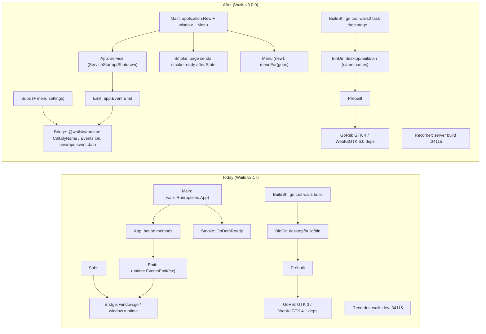
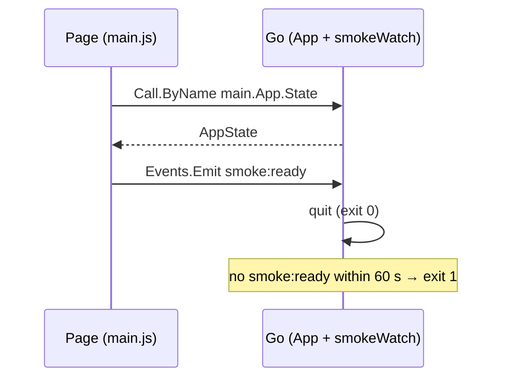
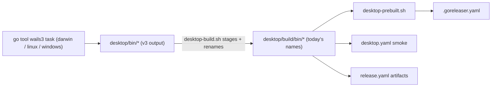
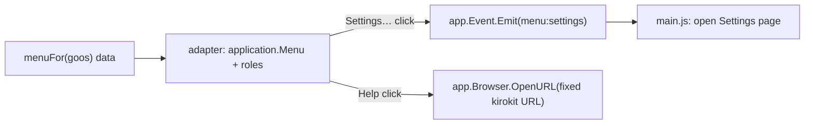

# Upgrade the desktop app to Wails v3, with a native menu

## Summary

After this change the kirokit desktop app runs on Wails v3.0.0 instead of v2.17 and looks and behaves as it does today, plus a native application menu (macOS menu bar; a menu bar in the window on Windows and Linux). Releases ship the same files under the same names, and Linux moves to GTK 4 / WebKitGTK 6.0 as you chose. `task desktop:dev`, `task desktop:test`, `task desktop:build`, `task ci` and `task showcase` keep working.

- **Same app, new framework.** Every screen, both terminal tabs and the live updates work as before; the Go code and the page each keep one small place that talks to Wails.
- **A native menu.** kirokit, Edit, Window and Help on macOS; File, Edit, Window and Help on Windows and Linux; Settings, documentation and "Report a problem" are the only new entries.
- **Same release files.** DMG and cask, `.deb`/`.rpm`, and a setup program per Windows architecture keep their names; installing over the old version replaces it and keeps settings and the clone.
- **Linux on GTK 4.** The Linux packages depend on GTK 4 and WebKitGTK 6.0; the supported distro list is measured in the build and written into the docs.
- **The showcase keeps recording.** It drives a localhost-only server build of the app instead of v2's dev server.

## How we will know it works

**Oracle:** the release workflow's macOS, Linux and Windows builds from this branch each produce today's file names, and each built app passes CI's smoke start, which now quits only after the page has loaded through Wails v3, received the answer to one bound call (`State`) and acknowledged it back to Go — a v2 leftover or a broken bridge in either direction fails it even when every unit test passes.

**Size:** about 6 slices and 19 tasks.

**Expected reach:** `desktop/` (Go module and `desktop/build/`), `desktop/frontend/`, `scripts/` (`desktop-build.sh`, `desktop-prebuilt.sh`, `linux-docker.Dockerfile`, `scripts/showcase/`), `.github/workflows/`, `.goreleaser.yaml`, `Taskfile.yml`, docs (`docs/desktop-app.md`, `CONTRIBUTING.md`, `AGENTS.md`, `README.md`).

**Risky:** new dependency (Wails v3.0.0 and the `@wailsio/runtime` npm package replace v2), outside system (the operating systems' packaging: NSIS, app bundles, GTK 4 distro packages), hard to undo (an installer that does not upgrade in place leaves duplicate installs on users' machines).

**Look here:** risky · the build adapter (*The build script stays the one adapter between Wails v3's output and every release consumer*): six consumers depend on today's paths, and the release only proves them end to end.

## Interface

The menu is the only visible addition; every page stays as it is.

<!-- ql:artifact app-menu -->
**Artifact: App menu.** The native application menu the Wails v3 upgrade adds: macOS menu bar and the Windows/Linux window menu. Shown in QualityLayer, on the author's Mac only.
<!-- /ql:artifact -->

## Today and after the change



The two Wails touch points (Main/Emit, Bridge) and the build adapter change; every consumer behind `desktop/build/bin` keeps its paths.

## Engineering decisions

### The Go app stays one bound type, registered as a v3 service
`App` keeps its name, package and every exported method; it is registered with `application.NewService(app)`, its `startup`/`shutdown` become `ServiceStartup`/`ServiceShutdown`, and the emitter becomes `app.Event.Emit` set before `Run`. Nothing is split into several services, so the page's method names stay `main.App.<Method>`.

<!-- ql:decide d1 -->
<!-- /ql:decide -->

### The page keeps one bridge module, now on @wailsio/runtime, and listeners still receive the payload
**Look here:** unsure · v3 hands event listeners an envelope; unwrapping it in one place keeps the six subscribers unchanged.
`desktop/frontend/src/api.js` keeps its exports and their behaviour, imports `@wailsio/runtime` 3.0.0, calls Go with `Call.ByName("main.App.<Method>", …)` and subscribes with `Events.On`, passing only `event.data` to each handler (the spike proved both, and that a Go error rejects with the error's own text). No bindings are generated, as you chose; the node tests swap in a fake runtime through one seam.

<!-- ql:decide d2 -->
<!-- /ql:decide -->

### The smoke start proves the page loaded and the bridge answers
In smoke mode Go quits only when the page sends a `smoke:ready` event, which the page's first load emits after its `State` call has resolved; a rejected call never sends it, so the app runs into the existing 60-second failure. `smokeWatch` keeps its shape with a `func()` quit; `OnDomReady` has no v3 equivalent to keep.



<!-- ql:decide d3 -->
<!-- /ql:decide -->

### The build script stays the one adapter between Wails v3's output and every release consumer
**Look here:** risky · six consumers read `desktop/build/bin/…`; changing all of them would spread the migration across the release.
`scripts/desktop-build.sh` runs Wails v3's own build and package tasks (`go tool wails3 task …`, committed under `desktop/build/` and `desktop/Taskfile.yml` with `APP_NAME: kirokit`) and then stages their output under today's paths and names: `kirokit.app` with `Contents/MacOS/kirokit`, `kirokit-desktop` on Linux, `kirokit-desktop-<arch>.exe` and the renamed setup program on Windows. `scripts/desktop-prebuilt.sh`, `.goreleaser.yaml` and both workflows keep their paths; only what Wails v3 names differently (the macOS icon `icons.icns`, the Linux binary, the Windows installer) is renamed in the script.



<!-- ql:decide d4 -->
<!-- /ql:decide -->

### The Windows installer keeps v2's identity so it installs over the old version
The v3 NSIS template is committed with kirokit's two customisations carried over (app executable `kirokit-desktop.exe`, CLI at `bin\kirokit.exe`) and the same company and product names, so the uninstall key stays `mavogelkirokit` and the folder `Program Files\mavogel\kirokit` with machine scope. A Windows CI step installs the last release silently, then the new setup program, and checks that the installed app and CLI are byte-identical to the new build and that exactly one uninstall entry of any name mentions kirokit.

<!-- ql:decide d5 -->
<!-- /ql:decide -->

### Linux builds on GTK 4 / WebKitGTK 6.0, and the supported distros are measured, not guessed
As you chose, no `gtk3` tag: build hosts install `libgtk-4-dev libwebkitgtk-6.0-dev`, the `.deb` depends on `libgtk-4-1, libwebkitgtk-6.0-4` and the `.rpm` on `gtk4, webkitgtk6.0`. The Linux app is built on the oldest Ubuntu it claims (runners pinned to `ubuntu-24.04` and `ubuntu-24.04-arm` instead of `ubuntu-latest` and `ubuntu-26.04-arm`), and a CI job installs the built `.deb` and runs the installed app's smoke start in each candidate distro container (`ubuntu:24.04`, `ubuntu:26.04`, `debian:12`, `debian:13`) on amd64 and arm64; the docs and the GoReleaser comment list exactly the ones that pass.

<!-- ql:decide d6 -->
<!-- /ql:decide -->

### The menu is described per operating system as data, then built with Wails' menu roles
A function `menuFor(goos)` returns the menu as plain data (labels, standard roles, kirokit actions), tested for darwin, linux and windows on any machine as the repository does for other per-OS code; a thin adapter turns it into a Wails menu, set as the application menu and, on Windows and Linux, shown in the window. Settings emits `menu:settings`, which the page answers by opening its Settings page; the Help menu is kirokit's own (Wails' Help role would add a "Learn More" link to wails.io), and its two entries open fixed kirokit addresses from Go.



<!-- ql:decide d7 -->
<!-- /ql:decide -->

### The showcase drives a localhost-only server build on the same port
`scripts/showcase/record.sh` builds the frontend, then the app with `go build -tags server`, starts it with `WAILS_SERVER_HOST=127.0.0.1` and `WAILS_SERVER_PORT=34115` set explicitly (an inherited host never reaches it), checks that the only listener on 34115 is bound to loopback, and waits until `http://localhost:34115` answers instead of grepping v2's log line; `app-drive.mjs` keeps its address and selectors. The server build exists only inside the recorder's throwaway folder; no release or task ships it.

<!-- ql:decide d8 -->
<!-- /ql:decide -->

### macOS keeps quitting when the window closes
The app sets `Mac.ApplicationShouldTerminateAfterLastWindowClosed: true`, because v3 would otherwise keep running with no window; Windows and Linux already quit by default.

<!-- ql:decide d9 -->
<!-- /ql:decide -->

## Not doing

- **No generated typed bindings.** You chose like-for-like plus the menu; the page keeps calling Go by name through one module.
- **No tray icon, extra windows or separate Settings window.** Not picked.
- **No GTK 3 fallback build.** You chose GTK 4 now; a second Linux variant is not built.
- **No signing or notarisation changes.** Releases stay unsigned as today.
- **No v3 dev-mode browser workflow.** `task desktop:dev` opens the app's own window; a plain browser on the dev server has no bindings in v3.

## Decisions made for you

- Wails v3 pinned at v3.0.0 and its CLI through `tool github.com/wailsapp/wails/v3/cmd/wails3` in `desktop/go.mod` — keeps the existing `go tool` pinning pattern, no global install. Because v3's task files call a bare `wails3`, `desktop-build.sh` and `task desktop:dev` first build the pinned CLI into a folder they put first on `PATH` (the spike's gotcha 2).
- The frontend keeps its own plain `vite.config.js`; Wails' vite plugin is not added — it requires generated bindings (spike gotcha 3).
- macOS minimum stays 13.0, set in the committed darwin Taskfile and `Info.plist` (v3's template says 12.0) — matches today and Go 1.27's own minimum.
- `desktop/wails.json` is replaced by v3's `desktop/build/config.yml` carrying the same product info (company `mavogel`, product `kirokit`, version `0.0.0`) — v3 reads its project info there; same values keep installer identity.
- v3's default build step that generates bindings is removed from the committed Taskfile — nothing generated is committed or needed.
- `feedback.js` keeps percent-encoding `! ' ( ) * ~` even though v3 no longer refuses them; the test's comment cites v3's validator — extra encoding is harmless and keeps old issue addresses identical.
- Shortcut ⌘, (macOS) / Ctrl+, (Windows, Linux) opens Settings; all other shortcuts are the system's — the only new shortcut follows platform convention.
- Help → "kirokit documentation" opens `https://github.com/mavogel/kirokit/blob/main/docs/desktop-app.md`, "Report a problem with kirokit…" opens `https://github.com/mavogel/kirokit/issues/new` — fixed addresses, no user input reaches them.
- The dev-mode CLI lookup follows v3's dev output folder (`desktop/bin/`) instead of v2's `desktop/build/bin/` — keeps `task desktop:dev` using the freshly built `dev-bin` CLI.
- The showcase preflight stops checking port 5173 — the server build serves the built page itself, so vite's dev port is no longer used.

## Assumptions

- The Linux app built on Ubuntu 24.04 with GTK 4 / WebKitGTK 6.0 runs on Ubuntu 24.04+ and Debian 13 (unconfirmed); point 5's container smoke check measures the real list, and the docs and the Fedora line follow it.
- Wails v3's Windows and Linux package tasks, which the spike did not run, build from the Linux container as v2's did; the first build slice proves it (point 5).
- `wails3 dev` with the committed Taskfile opens the app window as `wails dev` did; the spike did not run dev mode, so point 7's work proves it.

## Before the build

| # | Prerequisite | Met by | Status |
|---|---|---|---|
| P1 | Permission to run the agreed build | the user, at approval | granted · approved in the App, 2026-10-29 06:56 UTC |

## Risks

- **New dependency: the bridge breaks silently.** v3's event envelope or method addressing differs from what `api.js` expects. Mitigation: `api.test.js` covers `on` unwrapping and `Call.ByName` names against a fake runtime, and the smoke start round-trips `State` and `smoke:ready` through the real bridge on all three systems.
- **Outside system: packaging names drift.** v3 names the app, icon or installer differently. Mitigation: `desktop-build.sh` stages to today's names and fails if an expected file is missing; CI's smoke start and the release snapshot (`.github/workflows/desktop.yaml`) run the staged files.
- **Hard to undo: duplicate Windows installs.** Mitigation: the Windows CI step installs the last release then the new setup program, compares the installed files' hashes with the new build and counts every uninstall entry that mentions kirokit.
- **Outside system: GTK 4 narrows Linux support, and a newer build host raises the glibc floor.** Mitigation: Linux builds run on the oldest claimed Ubuntu, and the container smoke check runs the installed app on each claimed distro and architecture; the docs list only those that pass.
- **New behaviour: an HTTP listener that can run shell input.** The server build exposes `ShellWrite` and `Run` over HTTP. Mitigation: `record.sh` sets `WAILS_SERVER_HOST=127.0.0.1` itself (overriding any inherited value), aborts unless `lsof` shows the 34115 listener on loopback only, builds it into the recorder's temporary folder and kills it with the recorder's process group; a showcase test starts `record.sh`'s launch step with `WAILS_SERVER_HOST=0.0.0.0` inherited and asserts loopback; no release, task or workflow builds it.

## Decided by you

<!-- ql:decided-by-you -->
- Discuss · Should the upgrade stay like-for-like, or also adopt things v3 offers? — Also add v3-only features (native menu, tray or extra windows)
- Discuss · If v3's dev mode breaks the showcase recorder, fix it in this task? — also update the recorder
- Discuss · Which v3-only features should the upgrade add? — Native application menu
- Research · Wails v3 defaults Linux to GTK 4 / WebKitGTK 6.0. Which should the Linux app use? — Move to GTK 4 / WebKitGTK 6.0 now (v3 default)
<!-- /ql:decided-by-you -->

## What the Plan rests on

- Findings: *The app starts through one `wails.Run` call and binds a single `*App`*; *Events travel Go -> frontend as `runtime.EventsEmit` payloads, and there are six event names*; *Frontend-to-Go calls are plain promises on `window.go.main.App`; errors arrive as rejected promise text*; *The smoke start is an `OnDomReady` hook plus a 60 second watchdog*; *Consumers of those paths*; *The v2 assets customise identity, the CLI placement and the Windows installer*; *The bundled CLI is placed per OS and found at run time by a fixed search order*; *The recorder runs the app in `wails dev` and drives it from headless Chrome over http://localhost:34115*; *Wails v3.0.0 builds Linux against GTK 4 and WebKitGTK 6.0 unless built with the gtk3 tag*; *In v3 a plain browser on the dev server gets no Go bindings; the server build does*; *v3 replaces window globals with a runtime whose event handlers receive an event object*; *v3 packaging writes to bin/, keeps v2's Windows installer identity, and keeps running on macOS when the window closes*.
- Reverses `2026-10-25-feat-make-the-desktop-and-cli-also-avail`'s Linux stack (GTK 3 / WebKitGTK 4.1, Ubuntu 22.04+) per your answer to question 4.

## Reviewed by

<!-- ql:reviews -->
**Second opinion · Codex, GPT-6.1 Sol** · asked for 4 changes · 4 findings: 4 taken, 0 kept.
- 03-plan.md — Trust boundary / Showcase server build: Setting only the port does not enforce loopback: inherited `WAILS_SERVER_HOST` overrides Wails’ configuration ([official documentation](https://wa… · Taken: `record.sh` now starts the server build with `WAILS_SERVER_HOST=127.0.0.1` and `WAILS_SERVER_PORT=34115` set explicitly, aborts unless `lsof` shows the 34115 listener on loopback only, and `showcase.test.mjs` gains a case that inherits `WAILS_SERVER_HOST=0.0.0.0` and asserts loopback (Decision *The showcase drives a localhost-only server build on the same port*, contract *Showcase server build*, Risks).
- 03-plan.md — System design contracts / Smoke start: Quitting directly from `WindowRuntimeReady` contradicts the oracle requiring a successful `State` call. · Taken: the smoke start no longer uses `WindowRuntimeReady`: `api.start()` calls `State` and emits `smoke:ready` only after it resolves, and Go quits only on that event; `api.test.js` checks a rejecting `State` emits nothing, and `smoke_test.go` keeps the timeout case (Oracle, Decision d3, contract *Smoke start*).
- 03-plan.md — Windows upgrade check: The old installation already satisfies the proposed key and file-existence assertions, so a failed replacement can pass; counting only the exact expected key also… · Taken: the check now compares `Get-FileHash` of the installed `kirokit-desktop.exe` and `bin\kirokit.exe` with the new build's files and counts every uninstall entry under HKLM (both views) and HKCU whose `DisplayName` or `InstallLocation` mentions kirokit, requiring exactly one, `mavogelkirokit` (Decision d5, contract *Windows upgrade check*, Risks).
- 03-plan.md — Linux compatibility checks: Successful dependency installation cannot establish that the release’s cgo binary runs on that distro; the release currently builds arm64 on Ubuntu 26.04. · Taken: Linux builds move to `ubuntu-24.04` / `ubuntu-24.04-arm` runners (the oldest claimed Ubuntu), the Linux container's base follows, and a CI matrix installs the `.deb` and runs the installed app's smoke start in `ubuntu:24.04`, `ubuntu:26.04`, `debian:12` and `debian:13` on amd64 and arm64; the docs list only images that pass (Decision d6, contract *Linux packaging and hosts*, Assumptions, Risks).
<!-- /ql:reviews -->

## System design contracts

**Trust boundary:** one new crossing: the showcase-only server build (`go build -tags server`) serves the app's bound methods, including `ShellWrite` and `Run`, over HTTP on `localhost:34115` while `scripts/showcase/record.sh` runs. Shipped builds keep today's boundaries: the page's `openURL` allow-list (`desktop/frontend/src/api.js:79-99`) is unchanged, and the menu's Help entries open two constant URLs from Go.

### Go start-up: `application.New` + one window + menu, `App` as service
Today `desktop/main.go:20-43` calls `wails.Run(&options.App{…})`. After:

```go
app := NewApp()
wapp := application.New(application.Options{
    Name:     "kirokit",
    Services: []application.Service{application.NewService(app)},
    Assets:   application.AssetOptions{Handler: application.AssetFileServerFS(assets)},
    Mac:      application.MacOptions{ApplicationShouldTerminateAfterLastWindowClosed: true},
})
app.emitter = func(event string, data any) { wapp.Event.Emit(event, data) } // set via a setter under a.mu before Run
win := wapp.Window.NewWithOptions(application.WebviewWindowOptions{
    Title: "kirokit", Width: 1180, Height: 760, MinWidth: 720, MinHeight: 480,
    BackgroundColour: application.NewRGB(23, 19, 31),
    UseApplicationMenu: true, // Windows and Linux show the menu in the window
})
wapp.Menu.Set(buildMenu(wapp, menuFor(runtime.GOOS)))
if os.Getenv("KIROKIT_DESKTOP_SMOKE") == "1" {
    ready := smokeWatch(smokeTimeout, wapp.Quit, func() { log.Print("smoke start: the page did not load within ", smokeTimeout); os.Exit(1) })
    wapp.Event.On("smoke:ready", func(*application.CustomEvent) { ready() })
}
if err := wapp.Run(); err != nil { log.Fatal(err) }
```

- `ServiceStartup(ctx, application.ServiceOptions) error` does today's `startup` minus storing the emitter (refreshEnv, refreshCatalog, startInstallPoller); returns nil. `ServiceShutdown() error` does today's `shutdown`; returns nil. On macOS `wapp.Quit()` ends the process without returning from `Run` (spike gotcha 5), so all cleanup stays in `ServiceShutdown`, none after `Run`.
- `UseApplicationMenu` is checked against v3.0.0's `WebviewWindowOptions` in the build; the spike recorded it with `Windows.Menu`/`Linux.Menu` and `win.SetMenu` as equivalents.
- `//go:embed all:frontend/dist` stays (v3 serves the same `dist`; `dist/.gitkeep` keeps a clean checkout compiling).
- Failure: `Run` error → `log.Fatal` as today. Rejected: one service per area (renames every JS call, no user benefit).

### Page bridge: `api.js` exports unchanged; one runtime seam
- `import * as wails from '@wailsio/runtime'` (imports cleanly under plain Node, checked; it prints a browser-development notice). `runtime()` returns `globalThis.__kirokitRuntime ?? wails`; the override is the tests' seam and replaces today's `window.go` fake.
- `app()` is replaced by `call(method, ...args)` → `runtime().Call.ByName("main.App." + method, ...args)` (format `<Go package>.<Type>.<Method>`; `App.X` and `<module>.App.X` are rejected by Wails).
- `on(event, handler)` → `runtime().Events.On(event, (e) => handler(e.data))`, returns the unsubscribe function.
- New `start()` → `state()` and, once it resolves, `runtime().Events.Emit("smoke:ready")`, resolving to the state; `main.js`'s first load calls `start()` instead of `state()` (always, not only in smoke mode; Go listens only in smoke mode). A rejected `state()` rejects `start()` and emits nothing.
- `openURL` keeps its allow-list and calls `runtime().Browser.OpenURL(url)`.
- Errors: a Go error rejects with `name === "RuntimeError"` and `message === err.Error()` (spike), so `main.js:73`'s `String((e && e.message) || e)` and the `RepoDir: ` strip at `main.js:165` keep working unchanged.
- "Not running inside its window": a call rejects with Wails' own transport error in a plain browser; the message `kirokit is not running inside its window` stays only for a missing runtime object (the test at `desktop/frontend/src/api.test.js:76-80` keeps it via the seam).
- The per-terminal queue (`desktop/frontend/src/api.js:55-72`) stays.
- `package.json` gains `"@wailsio/runtime": "3.0.0"` (exact).
- New event `menu:settings` (no payload): `main.js` navigates to the Settings page as its sidebar button does.

### Smoke start
- `smokeWatch(timeout time.Duration, quit func(), fail func()) func()`; `main.go` calls the returned func from the `smoke:ready` listener, registered only when `KIROKIT_DESKTOP_SMOKE=1`.
- Tests: `desktop/smoke_test.go` keeps the ready-twice and timeout cases with the new signature; `api.test.js` checks that `start()` emits `smoke:ready` only after a fake `State` resolves, and emits nothing when it rejects.
- Exit codes unchanged: 0 after quit, 1 after 60 s.

### Menu data
```go
type menuItem struct {
    Label    string // empty for a separator
    Role     string // "about", "quit", "edit", "window", "app", "help", "" for kirokit actions
    Action   string // "settings", "docs", "report", "" for roles
    Shortcut string // "CmdOrCtrl+," for settings only
}
type menuGroup struct { Title string; Items []menuItem }
func menuFor(goos string) []menuGroup
```
- darwin: `kirokit` (About role, separator, Settings… `CmdOrCtrl+,`, separator, Services role, separator, Hide / Hide Others / Show All roles, separator, Quit role), `Edit` (EditMenu role), `Window` (WindowMenu role), `Help` (kirokit's own submenu: docs, report).
- windows, linux: `File` (Settings…, separator, Quit role), `Edit` (EditMenu role), `Window` (WindowMenu role), `Help` (docs, report, separator, About role).
- Adapter (spike-proven calls): `menu := application.NewMenu()`, `menu.AddRole(application.EditMenu)` etc., `menu.AddSubmenu("Help").Add(label).SetAccelerator(...).OnClick(func(*application.Context){…})`, `wapp.Menu.Set(menu)`. If the AppMenu role cannot take a Settings item between About and Services, the darwin `kirokit` submenu is built from the individual roles (About, Services, Hide, HideOthers, UnHide, Quit) instead.
- Action handlers: `settings` → `emit("menu:settings", nil)`; `docs`/`report` → `wapp.Browser.OpenURL(<constant>)`, error logged.
- Rejected: building the Wails menu directly per OS with no data step (untestable without a display).

### Build adapter: `scripts/desktop-build.sh`
- Inputs unchanged (`VERSION`, `GOARCH`, `ARCHES`); outputs unchanged: `desktop/build/bin/kirokit.app` (universal, CLI at `Contents/Resources/bin/kirokit`, ad-hoc re-signed), `desktop/build/bin/kirokit-desktop` + `kirokit`, `desktop/build/bin/kirokit-desktop-<arch>.exe` + `desktop/build/bin/installers/kirokit-desktop_<v>_windows_<arch>-setup.exe`.
- First `(cd desktop && go build -o "$work/tools/wails3" github.com/wailsapp/wails/v3/cmd/wails3)` and `PATH="$work/tools:$PATH"`, so the task files' bare `wails3` is the pinned v3.0.0.
- Wails steps: darwin `go tool wails3 task darwin:package:universal` (spike: exit 0, `bin/kirokit.app` with `Contents/MacOS/kirokit`, `x86_64 arm64`); linux and windows the corresponding v3 build/package tasks from the committed Taskfiles. Outputs are copied from `desktop/bin/` with a check that each expected file exists (fail with `desktop-build: missing <path>`).
- macOS renames: `Contents/Resources/icons.icns` → `iconfile.icns` (committed `Info.plist` names `CFBundleIconFile` `iconfile`, so `desktop-prebuilt.sh:42-44` and `.goreleaser.yaml:75-87` stay); `Assets.car` is kept in the bundle.
- macOS minimum stays 13.0: the committed darwin Taskfile's `-mmacosx-version-min`/`MACOSX_DEPLOYMENT_TARGET` and `Info.plist`'s `LSMinimumSystemVersion` say 13.0; the script also exports them, which the spike showed overrides the Taskfile.
- `desktop/build/` holds v3's committed assets: `config.yml`, `Taskfile.yml` per OS, `darwin/Info.plist`, `windows/nsis/project.nsi` (customised), `windows/info.json`, `windows/wails.exe.manifest`, `linux/kirokit-desktop.desktop`, icons; `desktop/bin/` is gitignored.

### Linux packaging and hosts
- `.goreleaser.yaml` nfpm `kirokit-desktop`: deb `libgtk-4-1`, `libwebkitgtk-6.0-4`; rpm `gtk4`, `webkitgtk6.0`; comment lists the measured distros.
- The `.deb` installs `desktop/build/linux/apparmor/kirokit-desktop` as `/etc/apparmor.d/kirokit-desktop` (a conffile): an unconfined profile for `/usr/bin/kirokit-desktop` whose only rule is `userns`, which Ubuntu 23.10+ requires before WebKitGTK 6.0's bubblewrap sandbox may create user namespaces. Its postinstall (`desktop/build/linux/apparmor/postinstall.sh`) loads it with `apparmor_parser` when AppArmor is present. The Desktop workflow's Linux smoke start loads the same profile for the build's path; the `linux-distros` job lifts the runner's user-namespace rule and runs its containers with `apparmor=unconfined`, since a profile cannot reach a path inside a container. Added after PR #32's first CI run showed the app stopping at start on Ubuntu 24.04 (records/ci-pr32-linux-sandbox.txt).
- `apt-get install` lines in `.github/workflows/desktop.yaml:62`, `.github/workflows/release.yaml:100`, `.github/workflows/release.yaml:159` and `scripts/linux-docker.Dockerfile:15`: `libgtk-4-dev libwebkitgtk-6.0-dev`. The Dockerfile's base moves from bookworm to the oldest claimed Debian/Ubuntu that has WebKitGTK 6.0 dev packages, so local Linux builds match CI's baseline.
- Runners: `ubuntu-latest` → `ubuntu-24.04` for the Linux desktop build in `.github/workflows/desktop.yaml:30` (matrix entry) and `.github/workflows/release.yaml:126`; `ubuntu-26.04-arm` → `ubuntu-24.04-arm` at `.github/workflows/release.yaml:77`.
- Distro check: a `.github/workflows/desktop.yaml` job on pull requests with the snapshot, matrix `arch: [amd64 on ubuntu-24.04, arm64 on ubuntu-24.04-arm]` × `image: [ubuntu:24.04, ubuntu:26.04, debian:12, debian:13]`: `apt-get install ./kirokit-desktop_*_linux_<arch>.deb xvfb xauth`, then `KIROKIT_DESKTOP_SMOKE=1 xvfb-run -a /usr/bin/kirokit-desktop`. Images that fail are dropped from the matrix and the docs in the same change, with the failure saved under `records/`.
- No `-tags webkit2_41` or `gtk3`.

### Windows upgrade check
- `.github/workflows/desktop.yaml`, Windows only, after `task desktop:build`: download the latest release's `kirokit-desktop_*_windows_amd64-setup.exe` with `gh release download`, run it with `/S`, then run the new setup program with `/S`. Assert:
  - `Get-FileHash` of `C:\Program Files\mavogel\kirokit\kirokit-desktop.exe` and `bin\kirokit.exe` equals the hash of the new build's app and CLI (`desktop/build/bin/kirokit-desktop-amd64.exe`, `desktop/build/bin/cli/windows_amd64/kirokit.exe`);
  - across `HKLM` (64- and 32-bit views) and `HKCU` `…\CurrentVersion\Uninstall\*`, exactly one entry has a `DisplayName` or `InstallLocation` mentioning kirokit, and it is `mavogelkirokit`.
- Skips with a notice when no previous release exists.

### Showcase server build
- `record.sh`: `npm ci && npm run build` in `desktop/frontend`, `go build -tags server -o "$out/kirokit-server" .` in `desktop/`, start it in its own process group with `env WAILS_SERVER_HOST=127.0.0.1 WAILS_SERVER_PORT=34115` (explicit; overrides any inherited value) and the throwaway `HOME`, poll `curl -fsS http://localhost:34115/` up to 180 s, abort if the process dies, then abort unless `lsof -nP -iTCP:34115 -sTCP:LISTEN` lists only `127.0.0.1` addresses. Preflight checks 34115 and 34117. The busy-port message names "a running kirokit app server or kirocrew gateway".
- `showcase.test.mjs` gains a case: with `WAILS_SERVER_HOST=0.0.0.0` in the environment, the launch step's listener is still loopback-only.
- `app-drive.mjs` unchanged: the spike drove a server build from headless Chrome with bound calls and events working.

## Patterns to follow

- Per-OS behaviour as a function of the OS name, tested for every OS on any machine: `desktop/platform.go:179-188` (`installedCLIFor(goos, …)`) with `desktop/shell_test.go:175-246`. `menuFor(goos)` follows it.
- Event capture in Go tests: replace `a.emitter` (`desktop/runner_test.go:31-52`, `desktop/runner_test.go:97`); keep this seam, so `ServiceStartup` must not overwrite an emitter a test set.
- Frontend fakes on `globalThis` per test: `desktop/frontend/src/api.test.js:6-44`; `globalThis.__kirokitRuntime` replaces the `window.go` fake.
- `go tool` pinning: `desktop/go.mod:113` and `Taskfile.yml:39-43`.
- Build script layout per OS with staging after the Wails step: `scripts/desktop-build.sh:34-88`.
- Start the app from source: `task desktop:dev`; run the built app's smoke start: `KIROKIT_DESKTOP_SMOKE=1 desktop/build/bin/kirokit.app/Contents/MacOS/kirokit`.
- Linux and Windows builds from macOS: `scripts/linux-docker.sh task desktop:build` and `scripts/linux-docker.sh env GOOS=windows task desktop:build`.
- Commits follow Conventional Commits (`cz check` in lefthook).

**Project checks:** `task desktop:test` · `task ci` · `node --test scripts/showcase/` · `task desktop:build` · `node scripts/check-doc-links.mjs` · `node scripts/sync-agent-assets.mjs --check`

## Proven before the gate

| Depends on | Proven how | Result |
|---|---|---|
| Wails v3.0.0 CLI via `go tool` | spike: `go get -tool …/wails3@v3.0.0`, `go tool wails3 version` | works, prints `v3.0.0`; the task files need `wails3` on `PATH` (pinned build put first) · [records/spike-wails3.txt](records/spike-wails3.txt) |
| macOS universal package layout | spike: `go tool wails3 task darwin:package:universal` on this Mac | exit 0 in 32 s; `bin/<APP_NAME>.app`, `Contents/MacOS/<APP_NAME>`, `lipo`: `x86_64 arm64`; icon `icons.icns`; minimum 12.0 unless overridden (env override proven) · [records/spike-wails3.txt](records/spike-wails3.txt) |
| Server build + headless Chrome calling `main.App.*` and receiving events | spike: minimal v3 app, `go build -tags server`, playwright-core with Chrome | `Call.ByName("main.App.Echo")` works; Go error → `RuntimeError` with the error text; events arrive as `{name, data}`; `WAILS_SERVER_PORT` sets the port · [records/spike-wails3.txt](records/spike-wails3.txt) |
| `@wailsio/runtime` under Node's test runner | `node -e "await import('@wailsio/runtime')"` in the spike's frontend | imports, exports `Call`, `Events`, `Browser` |
| Quit from a window/event hook and `ApplicationShouldTerminateAfterLastWindowClosed` | spike: tiny desktop build with SMOKE=1 | exits 0 in 0.30 s; option compiles; quit does not return from `Run` on macOS · [records/spike-wails3.txt](records/spike-wails3.txt) |
| Menu roles API | spike: compile a role-based menu | `application.NewMenu`, `AddRole`, `AddSubmenu(...).Add(...).SetAccelerator(...).OnClick`, `app.Menu.Set` compile; Help role adds "Learn More" → wails.io · [records/spike-wails3.txt](records/spike-wails3.txt) |
| Windows NSIS and Linux packages under v3, `wails3 dev` | not run on this Mac | first build slice (Done means 5, 7) |
