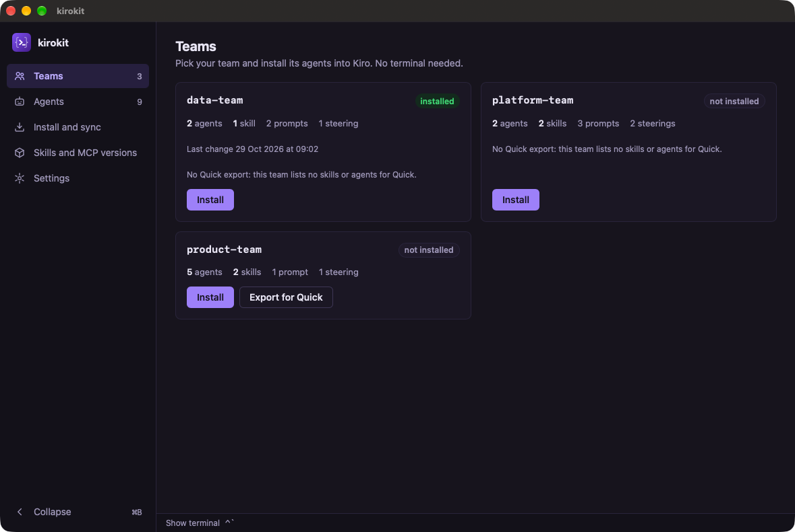

# Upgrade desktop app to Wails v3 · what was checked

## Summary

<!-- ql:summary -->
6 of 8 points assessed · 3 passed

Unverified after 1 judge run: 12 items remain unresolved. No acceptance recorded.
<!-- /ql:summary -->

## Open items

<!-- ql:open-items -->
- **Unverified:** Point 5 · Release builds keep their formats and names on all three systems · CI's smoke starts and the Linux packages were not run here. The branch is not pushed (main is 8 commits ahead), so the Desktop and Release workflows never ran on it, and no `.deb`/`.rpm` was packaged. Shown locally: the universal `kirokit.app` (minimum 13.0, CLI inside) in both `kirokit-desktop_<v>_darwin_<arch>.dmg` from a GoReleaser snapshot, with a smoke start exit 0 from the DMG (); `kirokit-desktop` and `kirokit` for Linux with smoke exit 0 (); one `kirokit-desktop_<v>_windows_<arch>-setup.exe` per architecture (). Push the branch and let the Desktop workflow and a Release dry run finish
- **Unverified:** Point 6 · Existing installs upgrade in place · Installing over the last Windows release runs only in CI, which has not run. The new installer's identity matches v2's in the source (key `mavogelkirokit` under HKLM, 64-bit view, folder `$PROGRAMFILES64\mavogel\kirokit`, `kirokit-desktop.exe`), and `v0.8.1` has a Windows amd64 setup asset for the check to use (). On macOS the data folder is unchanged and the new app opened straight on a saved clone and settings, but no install over the v0.8.1 app was done
- **Unverified:** Point 7 · The developer commands and the showcase still work · `task showcase` was not run, because it needs your signed-in Kiro IDE and kiro-cli, kirocrew and your SOPS age key. The rest holds: `task desktop:test`, `task desktop:build` and `task ci` receipts pass, and `task desktop:dev` built the pinned `wails3`, started vite and opened the window from `desktop/bin/kirokit.dev.app` with the fresh dev-bin CLI (,). The changed showcase step, `app-server.sh`, served the app on 127.0.0.1:34115 and Chrome drove it end to end (). The docs name `wails3`, the menu, GTK 4 and the measured distros
- **Unverified:** Renovate can update Wails' Go module and the page's runtime apart. No rule groups `github.com/wailsapp/wails/v3` with `@wailsio/runtime`, so a bump of one alone can break the bridge until a smoke start catches it
- **Unverified:** The app inside each DMG fails a strict signature check. The v0.8.1 release DMG fails the same way, so this predates the change: GoReleaser re-bundles an ad-hoc-signed binary
- **Need:** T5 · Open each menu of the built macOS app (desktop/build/bin/kirokit.app) and check: kirokit (About, Settings…, Services, Hide, Hide Others, Show All, Quit), Edit, Window, Help (kirokit documentation, Report a problem with kirokit…); ⌘, opens Settings; Help entries open the docs page and the new-issue form · queued for Review
- **Need:** T8 · Push this branch and open its pull request so the Desktop workflow runs (Ubuntu 24.04, Windows, macOS smoke starts, the linux-distros job and the Windows install-over-last-release check), then run the Release workflow by hand as a dry run · queued for Review
- **Only you can confirm:** The menu reads right on each system
- **Only you can confirm:** It feels the same to use
<!-- /ql:open-items -->

## How it is checked

<!-- ql:lanes -->
- **Security review** · a fresh agent · read-only
  - State: done
  - Result: done · nothing severe in the change
  - Why it runs here: The change crosses a trust boundary: one new crossing: the showcase-only server build serves the app's bound methods, including, over HTTP on while runs, Shipped builds keep.
- **Project checks** · QualityLayer itself · no agent
  - State: done
  - Result: done · 6 checks
- **Independent review** · fresh helper
  - State: fail
  - Result: failed · 3 of 6 points
- **Second opinion** · Codex · GPT-6.1 Sol · another vendor
  - State: done
  - Result: done · 1 finding · 1 fix awaiting checks
  - Why it runs here: Runs because the change crosses a trust boundary: one new crossing: the showcase-only server build serves the app's bound methods, including, over HTTP on while runs, Shipped builds keep, the Plan says it is risky: new dependency (Wails v3.0.0 and the npm package replace v2), outside system (the operating systems' packaging: NSIS, app bundles, GTK 4 and slice 3 is marked risky.
- **Fix rounds** · the build session
  - State: done
  - Result: done · none needed
<!-- /ql:lanes -->

## Done means, checked

<!-- ql:proof -->
| Done means | Proof | |
|---|---|---|
| 1. The app runs on Wails v3 with no Wails v2 left | The module graph holds only `github.com/wailsapp/wails/v3 v3.0.0`, no tracked file outside `docs/plans/` names Wails v2, `go tool wails3 version` prints v3.0.0, and the built app's smoke start (which needs the new `smoke:ready`) exits 0 in 1 s,. | passed |
| 2. Every screen and action works as it does today | Does the app feel the same to use? Every action in scenario 2 worked as before (clone, version step, Teams, both terminals, tag switch, Export for Quick, Open folder, the report link); only you can judge the feel, so use the built app for a while. | yours to confirm |
| 3. Both terminal tabs stream live and take input as before | The kirokit tab streamed the clone and both `kirokit sync` runs with their ends; the zsh tab ran typed input (`echo hi-from-$((40+2))` → `hi-from-42`) and `stty size` went from 120 to 81 columns after the window shrank. | passed |
| 4. Live updates still arrive without a reload |  | passed |
| 5. Release builds keep their formats and names on all three systems | Environment: CI's smoke starts and the Linux packages were not run here. The branch is not pushed (main is 8 commits ahead), so the Desktop and Release workflows never ran on it, and no `.deb`/`.rpm` was packaged. Shown locally: the universal `kirokit.app` (minimum 13.0, CLI inside) in both `kirokit-desktop_<v>_darwin_<arch>.dmg` from a GoReleaser snapshot, with a smoke start exit 0 from the DMG (); `kirokit-desktop` and `kirokit` for Linux with smoke exit 0 (); one `kirokit-desktop_<v>_windows_<arch>-setup.exe` per architecture (). Push the branch and let the Desktop workflow and a Release dry run finish. | missing |
| 6. Existing installs upgrade in place | Environment: installing over the last Windows release runs only in CI, which has not run. The new installer's identity matches v2's in the source (key `mavogelkirokit` under HKLM, 64-bit view, folder `$PROGRAMFILES64\mavogel\kirokit`, `kirokit-desktop.exe`), and `v0.8.1` has a Windows amd64 setup asset for the check to use (). On macOS the data folder is unchanged and the new app opened straight on a saved clone and settings, but no install over the v0.8.1 app was done. | missing |
| 7. The developer commands and the showcase still work | Environment: `task showcase` was not run, because it needs your signed-in Kiro IDE and kiro-cli, kirocrew and your SOPS age key. The rest holds: `task desktop:test`, `task desktop:build` and `task ci` receipts pass, and `task desktop:dev` built the pinned `wails3`, started vite and opened the window from `desktop/bin/kirokit.dev.app` with the fresh dev-bin CLI (,). The changed showcase step, `app-server.sh`, served the app on 127.0.0.1:34115 and Chrome drove it end to end (). The docs name `wails3`, the menu, GTK 4 and the measured distros. | missing |
| 8. The app has a native menu with the usual entries |  | yours to confirm |
<!-- /ql:proof -->

## Fix rounds

<!-- ql:fix-rounds -->
- Round 1 · 8 points still open
<!-- /ql:fix-rounds -->

## Second opinion

<!-- ql:reviews -->
**Second opinion · Codex, GPT-6.1 Sol** · asked for 1 change · 1 finding: 1 taken, 0 kept.
- [.github/workflows/desktop.yaml:100](/Users/mavogel/Developer/projects/kirokit/.github/workflows/desktop.yaml:100): Check `gh release view`’s exit status before treating empty output as no installer. · Taken: the step now asks `gh release list` for the latest published release and `gh release view <tag>` for its assets, and throws when either exits non-zero; only an empty release list (or a release without a Windows setup program) skips the check with a notice. Both queries return `v0.8.1` and `kirokit-desktop_0.8.1_windows_amd64-setup.exe` against mavogel/kirokit; `actionlint` passes.
<!-- /ql:reviews -->

## Checks

<!-- ql:checks -->
- all · 837556288739971e93951573981b7bb83ca27409d4a75bdadea9c8d3b4a0d8d1 · `task desktop:test` · exit 0 · 10.2s
- all · 837556288739971e93951573981b7bb83ca27409d4a75bdadea9c8d3b4a0d8d1 · `task ci` · exit 0 · 9.8s
- all · 837556288739971e93951573981b7bb83ca27409d4a75bdadea9c8d3b4a0d8d1 · `node --test scripts/showcase/` · exit 0 · 76.9s
- all · 837556288739971e93951573981b7bb83ca27409d4a75bdadea9c8d3b4a0d8d1 · `task desktop:build` · exit 0 · 9.4s
- all · 837556288739971e93951573981b7bb83ca27409d4a75bdadea9c8d3b4a0d8d1 · `node scripts/check-doc-links.mjs` · exit 0 · 0.1s
- all · 837556288739971e93951573981b7bb83ca27409d4a75bdadea9c8d3b4a0d8d1 · `node scripts/sync-agent-assets.mjs --check` · exit 0 · 0.1s
<!-- /ql:checks -->

## Quality pass

<!-- quality-record:security -->

### Security

**Result:** done · nothing severe in the change
**Boundaries:** showcase-only `-tags server` build on 127.0.0.1:34115 (browser or local process to the app's bound methods, `ShellWrite` and `Run` included); the page's `openURL` allow-list (cloned manifest to system browser); the menu's two constant Help URLs (Go to system browser); CI workflows (release asset to the Windows runner)
- S1 low · scripts/showcase/app-server.sh:36 · during a recording any local process, including another user's on a shared machine, can reach the unauthenticated server and drive `ShellWrite` as the recording user; the cross-site and DNS-rebinding routes are closed by Wails' Host and Origin/Sec-Fetch-Site checks (`host_guard_server.go`, `transport_http_server.go`), and the script forces the loopback bind and aborts if another process holds the port or the listener is not 127.0.0.1 · listed

Checked and clear: the server tag is absent from every shipped build (`-tags production` in the three platform Taskfiles, `.goreleaser.yaml`, `scripts/desktop-build.sh`); `openURL` in `desktop/frontend/src/api.js` is unchanged in policy; menu actions open constants from Go; the Windows upgrade step downloads the repository's own release with a step-scoped `GH_TOKEN`; actions stay pinned by SHA.

<!-- /quality-record:security -->

<!-- quality-record:security-recheck -->

<!-- /quality-record:security-recheck -->

<!-- optional section here, only when there is content: "Independent review" -->

## Verification

### Iteration 1

**Revision:** 837556288739971e93951573981b7bb83ca27409d4a75bdadea9c8d3b4a0d8d1

**Assignment:** ca305293-00d5-48f1-8c27-d493bcc47ec7
**Judge:** fresh helper

- [PASS] check: reused receipt — all · `task desktop:test` · exit 0 · 10.2s
- [PASS] check: reused receipt — all · `task ci` · exit 0 · 9.8s
- [PASS] check: reused receipt — all · `node --test scripts/showcase/` · exit 0 · 76.9s
- [PASS] check: reused receipt — all · `task desktop:build` · exit 0 · 9.4s
- [PASS] check: reused receipt — all · `node scripts/check-doc-links.mjs` · exit 0 · 0.1s
- [PASS] check: reused receipt — all · `node scripts/sync-agent-assets.mjs --check` · exit 0 · 0.1s
- [PASS] done 1: the module graph holds only `github.com/wailsapp/wails/v3 v3.0.0`, no tracked file outside `docs/plans/` names Wails v2, `go tool wails3 version` prints v3.0.0, and the built app's smoke start (which needs the new `smoke:ready`) exits 0 in 1 s — `evidence/it1-truth-1.txt`, `evidence/it1-scenario-1.txt`
- [USER] done 2: Does the app feel the same to use? Every action in scenario 2 worked as before (clone, version step, Teams, both terminals, tag switch, Export for Quick, Open folder, the report link); only you can judge the feel, so use the built app for a while.
- [PASS] done 3: the kirokit tab streamed the clone and both `kirokit sync` runs with their ends; the zsh tab ran typed input (`echo hi-from-$((40+2))` → `hi-from-42`) and `stty size` went from 120 to 81 columns after the window shrank — `evidence/it1-scenario-2.txt`
- [PASS] done 4: install records changing on disk updated the native window with no input (`evidence/it1-native-events-before.png`, `evidence/it1-native-events-after.png`); a finished clone and both branch/tag switches updated the page by themselves — `evidence/it1-scenario-2.txt`
- [MISSING] done 5: environment: CI's smoke starts and the Linux packages were not run here. The branch is not pushed (main is 8 commits ahead), so the Desktop and Release workflows never ran on it, and no `.deb`/`.rpm` was packaged. Shown locally: the universal `kirokit.app` (minimum 13.0, CLI inside) in both `kirokit-desktop_<v>_darwin_<arch>.dmg` from a GoReleaser snapshot, with a smoke start exit 0 from the DMG (`evidence/it1-macos-dmg.txt`); `kirokit-desktop` and `kirokit` for Linux with smoke exit 0 (`evidence/it1-scenario-4-linux.txt`); one `kirokit-desktop_<v>_windows_<arch>-setup.exe` per architecture (`evidence/it1-scenario-4-windows.txt`). Push the branch and let the Desktop workflow and a Release dry run finish.
- [MISSING] done 6: environment: installing over the last Windows release runs only in CI, which has not run. The new installer's identity matches v2's in the source (key `mavogelkirokit` under HKLM, 64-bit view, folder `$PROGRAMFILES64\mavogel\kirokit`, `kirokit-desktop.exe`), and `v0.8.1` has a Windows amd64 setup asset for the check to use (`evidence/it1-release-config.txt`). On macOS the data folder is unchanged and the new app opened straight on a saved clone and settings, but no install over the v0.8.1 app was done.
- [MISSING] done 7: environment: `task showcase` was not run, because it needs your signed-in Kiro IDE and kiro-cli, kirocrew and your SOPS age key. The rest holds: `task desktop:test`, `task desktop:build` and `task ci` receipts pass, and `task desktop:dev` built the pinned `wails3`, started vite and opened the window from `desktop/bin/kirokit.dev.app` with the fresh dev-bin CLI (`evidence/it1-desktop-dev.txt`, `evidence/it1-desktop-dev.png`). The changed showcase step, `app-server.sh`, served the app on 127.0.0.1:34115 and Chrome drove it end to end (`evidence/it1-scenario-2.txt`). The docs name `wails3`, the menu, GTK 4 and the measured distros.
- [USER] done 8: Does the menu read right on each system? On macOS the menu bar reads kirokit, Edit, Window, Help (`evidence/it1-menu-bar.png`); on Linux the window shows File, Edit, Window, Help (`evidence/it1-scenario-3-linux-menu.png`). The menus could not be opened here, so open each one on macOS, Windows and Linux, press ⌘, / Ctrl+, and try both Help entries.
- [PASS] scenario 1: all 6 steps as expected: no `wails/v2` module, `lipo` `x86_64 arm64` with minos 13.0, CLI and `iconfile.icns` in the bundle, signature valid, smoke start exit 0 in 1 s, `desktop-prebuilt.sh` staged — `evidence/it1-scenario-1.txt`
- [PASS] scenario 2: step 1 on the native app (`evidence/it1-scenario-2-step-1.png`); steps 2 to 7 through `app-server.sh`'s server build in Chrome, because this session has no accessibility access to click inside the native window. Clone, the version step and Teams arrived without a reload; the tag switch ran in the kirokit tab and the version line followed; Export for Quick rendered and Show folder opened Finder there; the Feedback button sent the issue form through `Browser.OpenURL`. Install from Teams stopped at its SOPS-key check, so `kirokit install` from the zsh tab drove the live install update. Probe: Clone with an empty address showed Go's own refusal sentence — `evidence/it1-scenario-2.txt`
- [MISSING] scenario 3: environment: menus could not be opened and ⌘, could not be sent here (osascript: "not allowed assistive access", `AXIsProcessTrusted` false). Step 1 passed (`go test -run Menu`), step 2 shows the menu bar only, step 6 shows Linux's File, Edit, Window, Help bar; steps 3 to 5 need someone at the Mac — `evidence/it1-scenario-3.txt`
- [MISSING] scenario 4: environment: the branch is not pushed, so the Desktop workflow, a Release dry run and an install over a real release could not run. Steps 1 and 2 pass: the Linux build links GTK 4 / WebKitGTK 6.0 and its smoke start as a regular user exits 0; both Windows setup programs are built and hold the app and CLI byte for byte — `evidence/it1-scenario-4-linux.txt`, `evidence/it1-scenario-4-windows.txt`
- [MISSING] scenario 5: environment: `task showcase` needs your Kiro sign-in, Kiro IDE, kirocrew and SOPS key and was not run. Steps 1, 2, 3 and 6 are receipts; step 4, `task desktop:dev`, opened the window — `evidence/it1-desktop-dev.txt`
- [PASS] dod T1: `smokeWatch` quits once and fails after the limit (`smoke_test.go`, desktop:test receipt); `ServiceStartup` never sets the emitter; `ServiceShutdown` stops the poller, shell and runner; `go list` names `wails/v3 v3.0.0` and no v2
- [PASS] dod T2: `api.test.js` covers the `main.App.<Method>` names, per-terminal order, payload unwrapping and unsubscribe, `start()` ordering and rejection, `openURL` refusals and the no-runtime message; the server build returned Go's `RuntimeError` text unchanged to the page
- [PASS] dod T3: universal, minimum 13.0, icon and CLI in place, signature valid, smoke exit 0, prebuilt staged; with the icon copy removed in a scratch clone the script stopped with `desktop-build: missing desktop/bin/kirokit.app/Contents/Resources/iconfile.icns`, exit 1 — `evidence/it1-build-missing-output.txt`
- [PASS] dod T4: `menu_test.go` passes for darwin, windows and linux
- [MISSING] dod T5: environment: Settings…, ⌘, , Edit's copy/paste and the Help entries could not be driven in the built app here (no accessibility access). The menu bar shows kirokit, Edit, Window, Help and `GOOS=windows go vet ./...` passes — `evidence/it1-scenario-3.txt`
- [PASS] dod T6: `ldd` lists `libgtk-4.so.1` and `libwebkitgtk-6.0.so.4` and no `webkit2gtk-4.1`; the regular-user smoke start exits 0; `.goreleaser.yaml` declares the GTK 4 dependencies and `goreleaser check` passes
- [PASS] dod T7: both setup programs and both `kirokit-desktop-<arch>.exe` exist with the right architectures; `7z l` lists `kirokit-desktop.exe` and `bin/kirokit.exe`, byte-identical to the build; install folder and uninstall key as v2's
- [PASS] dod T8: Linux job on `ubuntu-24.04` with the GTK 4 packages, `linux-distros` on amd64 and arm64 over the three passing images (the snapshot-`.deb` change and debian:12's removal are recorded deviations), Windows install-over check with its skip notice; `actionlint` clean
- [PASS] dod T9: both Linux release builds on Ubuntu 24.04 runners with the GTK 4 packages; `actionlint` clean
- [PASS] dod T10: dev-bin comes first under `<wd>/bin` on darwin, windows and linux, and an installed app's order is unchanged; `task desktop:dev` opened the window from `desktop/` with the fresh dev-bin CLI
- [PASS] dod T11: the showcase tests pass in the receipt, and `app-server.sh` served on 127.0.0.1:34115 only for the scenario 2 run
- [PASS] dod T12: README, `docs/desktop-app.md` and the GoReleaser comment agree with the `linux-distros` images (Ubuntu 24.04, 26.04, Debian 13)
- [PASS] dod T13: the Renovate guard tracks `wails/v3/cmd/wails3` and the feedback comments cite v3
- [PASS] dod T14: the v2 grep returns nothing; `task ci` and `task desktop:test` receipts pass
- [MISSING] truth oracle: environment: the release workflow and CI's smoke starts have not run on this branch, which is not pushed. Local stand-ins pass: the macOS app and both DMGs with smoke exit 0, the Linux build's smoke exit 0 in Ubuntu 24.04, both Windows setup programs under today's names. Windows' own smoke start and the CI matrix remain — `evidence/it1-macos-dmg.txt`, `evidence/it1-scenario-4-linux.txt`, `evidence/it1-scenario-4-windows.txt`
- [PASS] truth 1: no tracked file outside `docs/plans/` names `wailsapp/wails/v2`, `window.go`, `window.runtime` or a `wails dev`/`wails build` command — `evidence/it1-truth-1.txt`
- [PASS] review: no swallowed errors, races or wrong error paths; every changed file is in a Files block or a recorded deviation; stack drift limited to Wails v3, `@wailsio/runtime` 3.0.0 and the recorded indirect bumps; the Security block's S1 stands and I found nothing to add; tests: 5 tests added (`desktop/menu_test.go` every menu role reaches Wails; `desktop/shell_test.go` Linux dev-bin first, sibling `bin*` folder keeps its bundle; `desktop/frontend/src/api.test.js` `openURL` rejects when Wails' `Browser.OpenURL` does, a payload-less event reaches its handler), all pass (`evidence/it1-new-tests.txt`) · docs: no doc impact
- [NOTE] review: Renovate can update Wails' Go module and the page's runtime apart. No rule groups `github.com/wailsapp/wails/v3` with `@wailsio/runtime`, so a bump of one alone can break the bridge until a smoke start catches it.
- [NOTE] review: The app inside each DMG fails a strict signature check. The v0.8.1 release DMG fails the same way, so this predates the change: GoReleaser re-bundles an ad-hoc-signed binary — `evidence/it1-macos-dmg.txt`

**Pictures:** `evidence/it1-scenario-2-step-1.png` (native first-launch page), `evidence/it1-menu-bar.png` (macOS menu bar), `evidence/it1-native-events-before.png` and `evidence/it1-native-events-after.png` (live install update in the native window), `evidence/it1-scenario-2-step-2.png`, `evidence/it1-scenario-2-step-3-4.png`, `evidence/it1-scenario-2-step-5.png` (server build in Chrome), `evidence/it1-scenario-3-cmd-comma.png` (⌘, not delivered), `evidence/it1-scenario-3-linux-menu.png` (Linux window menu), `evidence/it1-desktop-dev.png` (dev mode window)

**Try it:**

1. Build and smoke-start the macOS app: `task desktop:build && KIROKIT_DESKTOP_SMOKE=1 desktop/build/bin/kirokit.app/Contents/MacOS/kirokit; echo $?`; look for `0` within a few seconds.
2. Open `desktop/build/bin/kirokit.app`; check the menu bar shows kirokit, Edit, Window, Help, press ⌘, (Settings opens), copy and paste in a Settings field, and try Help → kirokit documentation and Report a problem with kirokit….
3. Clone a repository, install a team, type in the zsh tab and resize the window; the page updates on its own and the shell re-wraps.
4. Linux: `scripts/linux-docker.sh task desktop:build`, then the T6 smoke command from the outline; look for exit 0.
5. Windows: `scripts/linux-docker.sh env GOOS=windows task desktop:build`; look for both `kirokit-desktop_<v>_windows_{amd64,arm64}-setup.exe`.
6. Push the branch and open its pull request; the Desktop workflow (smoke starts, `linux-distros`, the Windows install-over check) and a Release dry run must pass.
7. `task desktop:dev` opens the dev window; `task showcase` rewrites `assets/kirokit-showcase.gif` and `.mp4`.

**Result:** fail
