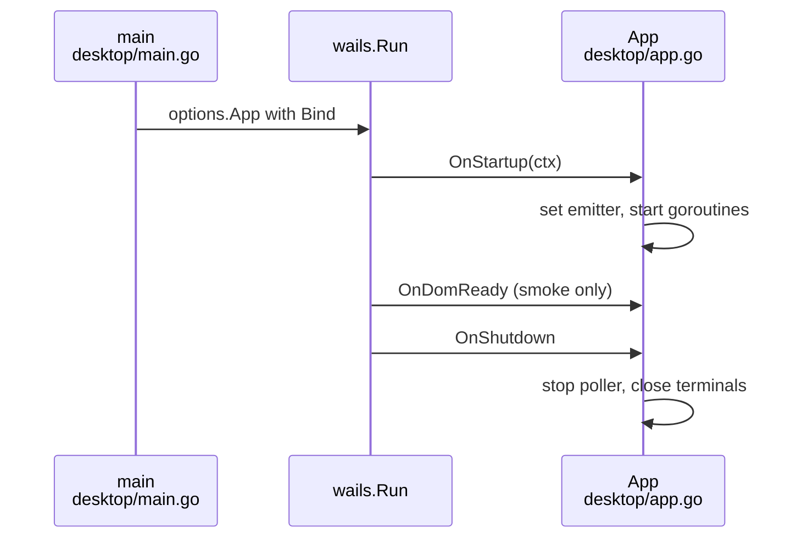

# Desktop app lifecycle, Go/frontend bridge, smoke start and Wails test coupling (Wails v2.17.0)

## Findings

### The app starts through one `wails.Run` call and binds a single `*App`
**Answers:** 1

- `desktop/main.go:18` builds `NewApp()`; `desktop/main.go:20-33` fills `options.App`: Title "kirokit", 1180x760, min 720x480 (`desktop/main.go:21-25`), embedded `frontend/dist` as the asset server with no custom handler or middleware (`desktop/main.go:14-15,26-28`), background `RGBA{23,19,31,1}` (`desktop/main.go:29`), `OnStartup: app.startup`, `OnShutdown: app.shutdown`, `Bind: []any{app}` (`desktop/main.go:30-32`). No menu, tray, extra windows, `OnBeforeClose`, or platform options are set; `OnDomReady` is set only for the smoke start (`desktop/main.go:35-40`).
- `wails.Run` returns an error that goes to `log.Fatal` (`desktop/main.go:41-43`). Only the `desktop/main.go` and `desktop/app.go` files import Wails (`wails/v2`, `options`, `assetserver`, `runtime` in main.go:8-11; `runtime` in app.go:11); no other `.go` file in `desktop/` references `wailsapp` (grep).
- `NewApp` -> `NewAppAt(dataDirFor(userConfigDir()))` (`desktop/app.go:61-71`); `captureFn` defaults to the login-shell capture (`desktop/app.go:69`).
- `startup(ctx)` (`desktop/app.go:76-84`): under `a.mu` it stores `a.emitter = func(event, data){ runtime.EventsEmit(ctx, event, data) }` (line 78), then `go a.refreshEnv()`, `go a.refreshCatalog()`, and `a.startInstallPoller()` (synchronous; its constructor takes a first reading and starts a goroutine, `desktop/installs.go:30-35,88-93`).
- `emit` (`desktop/app.go:99-106`) reads the emitter under the lock and calls it; before `startup` it silently drops events (comment `desktop/app.go:28`). `ctx` is the only Wails runtime handle the app holds; `EventsEmit` is the single runtime call in app code (`desktop/app.go:78`).
- `shutdown` (`desktop/app.go:87-97`) stops the install poller (waits for its goroutine), then `a.shell.close()` and `a.runner.close()` which close the PTY sessions (`desktop/shell.go:279-288`, `desktop/runner.go:182-189`). It ignores the ctx argument.

### Fourteen of the exported `App` methods are bound; only a few block or run long
**Answers:** 1

Every exported method on `*App` is bound (Wails v2 binds all exported methods of the `Bind` values). Frontend calls go through `desktop/frontend/src/api.js:11-72`.

| Method (source) | Args | Returns to JS | Blocking? |
|---|---|---|---|
| `State` (`desktop/app.go:119`) | none | `AppState{settings{repoUrl,kiroHome,repoDir,ref}, cloned, env{defaultKiroHome,defaultRepoDir,ready,note,shell}}` (`desktop/app.go:37-56`, `desktop/settings.go:18-23`) | short disk reads |
| `SaveSettings` (`desktop/settings.go:60`) | `Settings` | error: joined lines "KiroHome: ...", "RepoURL: ...", "RepoDir: ..." (`desktop/settings.go:68-83`) | short |
| `SetRepoDir` (`desktop/settings.go:91`) | string | error "RepoDir: ..." (`desktop/settings.go:95`) | short |
| `Catalog` (`desktop/catalog.go:268`) | none | `(Catalog{teams,pins,tag}, error)`; json tags `desktop/catalog.go:26-67` | holds `cat.mu` while it builds the first time (`desktop/catalog.go:268-275`), so it waits on a concurrent `refreshCatalog` (render of every team) |
| `Installs` (`desktop/installs.go:97`) | none | `([]install.Record, error)`; never nil (`desktop/installs.go:98-101`) | short |
| `Prerequisites` (`desktop/prereq.go:20`) | team (ignored, `_ = team`) | `[]Check{name,found,detail}` (`desktop/prereq.go:11-13`) | blocks: `a.refreshEnv()` spawns the login shell (bounded by `captureTimeout`, `desktop/app.go:69`) |
| `Run` (`desktop/runner.go:45`) | `[]string` | `(int runId, error)`; error `kirokit is still running a command` (`desktop/runner.go:14`) | returns once the PTY is started; output streams as events |
| `RunWrite` (`desktop/runner.go:169`) | id int, data string | nothing | short; drops input for a stale id (`desktop/runner.go:175-177`) |
| `ShellWrite` (`desktop/shell.go:218`) | string | nothing | holds shell mutex; may start the shell (`desktop/shell.go:222-226`) |
| `ShellResize` (`desktop/shell.go:232`) | cols, rows | nothing | ignores sizes outside 1..1000 (line 233-235); first call starts the shell (line 244-246) |
| `QuickDir` / `QuickBundle` / `OpenFolder` (`desktop/quick.go:25,33,50`) | team | string / `QuickBundle{dir,skills,agents}` / error | short; `OpenFolder` starts the file manager detached |
| `Clone` (`desktop/clone.go:25`) | address | error (bad address, no CLI, `errRunning`) | returns immediately; the clone runs in a goroutine (`desktop/clone.go:38-52`) and ends with `clone:done` |
| `Checkout` (`desktop/version.go:23`) | none | `(checkout.Refs{current{kind,name,commit},branches,tags,newest}, error)` (`internal/checkout/checkout.go:30-41`) | runs git against local refs, no network |
| `SwitchRef` (`desktop/version.go:40`) | ref | error (bad name wrapped `kirokit sync: --branch: ...`, no CLI, `errRunning`) | returns immediately; goroutine ends with `ref:done` (`desktop/version.go:56-59`) |

The long-running work (clone, sync, every button command) is never inside a bound call: `Run`, `Clone` and `SwitchRef` start it and return, and results arrive as events. The kirokit tab accepts one command at a time through `runHost.sess` and `reserved` (`desktop/runner.go:24-29,56-65,69-78`); a multi-step job (`Clone`, `SwitchRef`) reserves the tab (`desktop/clone.go:34`, `desktop/version.go:53`) and runs steps with `runStep`, which waits on a result channel (`desktop/runner.go:88-97`).

### Events travel Go -> frontend as `runtime.EventsEmit` payloads, and there are six event names
**Answers:** 2

Emit sites (`a.emit` / poller emit) and their payload shapes:

| Event | Emit site | Payload (JSON) |
|---|---|---|
| `term:kirokit` | `desktop/runner.go:123,141` | `{id, b64}` from `chunkOf(id, bytes)` (`desktop/shell.go:290-292`); `termChunk{ID int json:"id,omitempty"; B64 string json:"b64"}` (`desktop/shell.go:21-24`) |
| `term:kirokit:exit` | `desktop/runner.go:163` | `termExit{id, code}` (`desktop/shell.go:27-30`) |
| `term:shell` | `desktop/shell.go:259,265,273` | `{b64}`; ID is 0 so `id` is omitted (`omitempty`) |
| `clone:done` | `desktop/clone.go:51` | `cloneResult{ok, error}`; `ok:true` with a non-empty `error` means "no release yet" (`desktop/clone.go:12-19`) |
| `ref:done` | `desktop/version.go:58` | `refResult{ok, error}` (`desktop/version.go:14-17`) |
| `installs:changed` | `desktop/installs.go:66` | `[]install.Record` (never nil) |

Subscribers (all through `api.on`, `desktop/frontend/src/api.js:102-105`):
- `desktop/frontend/src/main.js:289` `installs:changed` stores records; `main.js:293` `term:kirokit` marks `view.running` if `id > lastExit`; `main.js:300` `term:kirokit:exit` records `lastExit`, clears running, settles Quick export, refreshes; `main.js:307` `clone:done`; `main.js:317` `ref:done`.
- `desktop/frontend/src/terminal.js:147` `term:shell` writes base64-decoded bytes (decoder `terminal.js:22-27`); `terminal.js:148` `term:kirokit` switches to a new run id and selects the kirokit tab; `terminal.js:156` `term:kirokit:exit` prints "exited with code N" when non-zero.

Frontend assumptions about delivery:
- Ordering/races: events can precede the bound call's resolution. `main.js:83` ("A fast command may already have ended before the id arrives") compares `id > lastExit`; `main.js:197-198` marks `view.switching` before `switchRef` because "ref:done may arrive before switchRef resolves".
- Wails runs each bound call on its own goroutine, so `api.js:51-64` serialises keystrokes per terminal: `line()` chains each call after the previous one settled (`tail = result.catch(() => {})`); `runLine` and `shellLine` are separate chains (`api.js:63-64,67,70`). `shellResize` and the other calls are not queued (`api.js:72`).
- Payload `id` for the kirokit tab is a positive run counter (`h.id++`, `desktop/runner.go:118`).
- `on` returns the unsubscribe function from `window.runtime.EventsOn`, or a no-op if the runtime is absent (`api.js:102-105`); `terminal.js` and `main.js` never call the unsubscribe.

### Frontend-to-Go calls are plain promises on `window.go.main.App`; errors arrive as rejected promise text
**Answers:** 2

- `api.js:5-9` resolves `window.go.main.App` on each call and throws `kirokit is not running inside its window` if it is missing. Nothing generated is committed (`api.js:1-3`). Pages import only `api.js` for Go access (stated `api.js:1-3`; the only other `window.go|runtime` match in non-test code is a comment in `desktop/frontend/src/pages/feedback.js:76`).
- Go `error` returns become rejected promises whose reason is the error string; the UI normalises with `message = String((e && e.message) || e)` (`main.js:73`). Settings refusals are multi-line "Field: text" strings; `main.js:165` strips a leading `RepoDir: ` before showing it beside the folder field (`.replace(/^RepoDir: /, '')`). `api.js:13-14` documents the contract. Refusals shown beside buttons: `main.js:78-88,106-119,138-141,147-155`.
- `openURL` (`api.js:94-99`) does not go through `App`: it validates with the regexes at `api.js:79-90` (GitHub `/issues/new?` only), rejects with `refusing to open <url>`, then calls `window.runtime.BrowserOpenURL(url)` (`api.js:96-98`). `BrowserOpenURL` is the only Wails runtime function the frontend calls besides `EventsOn`.
- `feedback.js:76` and `pages/feedback.test.js:31-34` encode the Wails v2.17 `BrowserOpenURL` validator (refuses `;|\`$\\<>*{}~! \t\n\r`), so the issue address is percent-encoded to avoid those characters.

### The smoke start is an `OnDomReady` hook plus a 60 second watchdog
**Answers:** 3

- Enabled only when `KIROKIT_DESKTOP_SMOKE=1` (`desktop/main.go:35`); then `opts.OnDomReady = smokeWatch(smokeTimeout, runtime.Quit, func(){ log.Print(...); os.Exit(1) })` (`desktop/main.go:36-39`). `smokeTimeout = 60 * time.Second` (`desktop/smoke.go:10`).
- `smokeWatch` (`desktop/smoke.go:15-31`) starts a goroutine that selects on `loaded` or `time.After(timeout)`; on timeout it calls `fail()` (-> `os.Exit(1)`). The returned `OnDomReady` runs `once.Do(close(loaded); quit(ctx))`, so a second DOM-ready does nothing (`desktop/smoke.go:25-30`).
- Exit 0: `runtime.Quit(ctx)` makes `wails.Run` return nil, `main` returns, and `OnShutdown` runs (`desktop/app.go:87`). Exit 1: only the timeout path (`os.Exit(1)`) or `log.Fatal` if `wails.Run` errors (`desktop/main.go:41-43`). "The page has loaded" means Wails' DOM-ready callback fired; the frontend `main.js` is not required to have rendered anything, and no Go bound method is checked.
- Unit tests: `desktop/smoke_test.go:10-21` (ready twice -> one quit, no fail; timeout 1s with a 1.2s sleep) and `smoke_test.go:23-36` (50ms timeout -> fail, no quit). They use the function directly and no Wails types, other than `context.Context`.
- CI (`.github/workflows/desktop.yaml`): job matrix on ubuntu/windows/macos (lines 29-31); steps `task desktop:test` (71-72), `task desktop:build` (74-75), then "Smoke start" with `KIROKIT_DESKTOP_SMOKE: "1"` and `timeout-minutes: 5` (78-87): macOS runs `desktop/build/bin/kirokit.app/Contents/MacOS/kirokit`, Linux `xvfb-run -a desktop/build/bin/kirokit-desktop`, Windows `desktop/build/bin/kirokit-desktop-$(go env GOARCH).exe`. The step passes when the process exits 0.
- Second smoke: "Install the Linux packages and start the app" (lines 116-125), only on Linux pull requests with `GORELEASER_KEY` set (line 117), after the snapshot release. It `apt-get install`s the `kirokit_*_linux_amd64.deb` and `kirokit-desktop_*_linux_amd64.deb`, runs `kirokit --version`, `test -x /usr/lib/kirokit-desktop/kirokit`, then `xvfb-run -a /usr/bin/kirokit-desktop` with `KIROKIT_DESKTOP_SMOKE=1`. Build deps are `libgtk-3-dev libwebkit2gtk-4.1-dev xvfb` (lines 58-62), and the Linux build uses `-tags webkit2_41` (`scripts/desktop-build.sh:62`).
- Build entry points that invoke the Wails CLI: `scripts/desktop-build.sh:47` (`go tool wails build -platform darwin/universal -clean`), `:62` (linux, `-tags webkit2_41 -o kirokit-desktop`), `:77` (windows `-nsis -o kirokit-desktop-$arch.exe`); `Taskfile.yml:43` (`go tool wails dev`); `desktop/go.mod:8` (`wails/v2 v2.17.0`) and `:113` (`tool github.com/wailsapp/wails/v2/cmd/wails`); `desktop/wails.json` (schema `config.v2.json`).

### Tests touch Wails only through `runtime.Quit`'s function type and a hand-faked `window`
**Answers:** 6

Go (`desktop/*_test.go`):
- No Go test file imports Wails. `app_test.go:7-21` calls `NewApp().State()` with `HOME` redirected. `smoke_test.go` passes plain funcs (`func(context.Context)`), not `runtime.Quit`.
- Events are intercepted by assigning `a.emitter` directly (`desktop/runner_test.go:97`, `eventLog.emit` at `runner_test.go:31-52` type-asserts payloads `cloneResult`, `refResult`, `termChunk`, `termExit`, `[]install.Record`), and `fakeEmitter` for the poller (`desktop/installs_test.go:19,52,97,113`). So changing payload Go types or the `emit(event, data any)` signature breaks these tests; the Wails `EventsEmit` call itself (`desktop/app.go:78`) is untested.
- `testtools_test.go:11-54` supplies OS helpers (`onWindows`, `exeName`, `writeTool` sh vs `.cmd`, `loginVars`) with no Wails link. `shell_test.go:212-245` tests `resolveCLIFor` including `wails dev` working-directory layouts (cases "wails dev prefers dev-bin over a stale bundled CLI").
- Bound-method contracts (argument/return/error text) are covered by `settings_test.go`, `clone_test.go`, `version_test.go`, `quick_test.go`, `prereq_test.go`, `catalog_test.go` as direct Go calls; nothing tests the JS binding layer.

Frontend (`desktop/frontend/src/**/*.test.js`, `node:test`):
- `api.test.js:6-18` fakes `globalThis.window = { go: { main: { App: { ShellWrite, RunWrite } } } }` and imports `./api.js` (lines 22-23, 32-33) to test per-terminal serial ordering and failure isolation (`api.test.js:20-44`). `api.test.js:48-72` fakes `window.runtime.BrowserOpenURL` and checks the URL allow-list; `api.test.js:76-80` uses `window = {}` and expects `kirokit is not running inside its window`. Because `api.js` reads `window` per call, tests re-set `globalThis.window` between cases while `import('./api.js')` is cached.
- `pages/pages.test.js:279-302` builds a fake `document` and `window.go.main.App` with `State` and `SaveSettings` only, for the Settings page; the page code reaches Go through `api.js`.
- `pages/feedback.test.js:31-34` hard-codes the v2.17 `BrowserOpenURL` validator character set (`WAILS_REFUSES`) and asserts encoded addresses avoid it (line 36-42). It is the one test that mirrors Wails runtime behaviour.
- `main.js` and `terminal.js` (the `api.on` subscribers) have no tests; `window.runtime.EventsOn` is not faked anywhere in the tests (`api.on` is untested). `dialogs.test.js`, `sidebar.test.js`, `tabs.test.js` do not touch `window.go`/`window.runtime`.

### What a later change would meet
**Answers:** 1, 2, 3, 6

- Churn in 90 days (`git log --oneline --since=90.days -- <path> | wc -l`): `desktop/main.go` 2, `desktop/app.go` 3, `desktop/smoke.go` 1, `desktop/runner.go` 1, `desktop/shell.go` 2, `api.js` 4, `main.js` 5, `terminal.js` 2.
- Call sites others already use: `a.emit` (runner, shell, clone, version, poller), `chunkOf`, `termExit`, `cloneResult`, `refResult`, `api.on`, `window.go.main.App` (api.js only). Hard to change: the `App` name and `main` package, since JS addresses `window.go.main.App.<Method>` (`api.js:6`); emitted event names and payload JSON tags, since three JS files and the Go `eventLog` test helper rely on them; `desktop/frontend/dist` embed (`desktop/main.go:14`); build scripts that call the Wails v2 CLI.

## How it is tested today

- Go: module `desktop/` (its own `go.mod`). One file: `cd desktop && go test ./... -run TestSmoke` (or any file's test name); full suite `cd desktop && go vet ./... && go test ./...`. Isolation: temp dirs and `t.Setenv("HOME", ...)`, stand-in tools written by `writeTool`, `a.emitter` replaced by `eventLog.emit` (`desktop/runner_test.go:14-52,97`), poller with an hour interval and a fake emitter. Some tests need a Unix shell and skip on Windows (`internal/testutil`, per repo AGENTS.md).
- Frontend: `cd desktop/frontend && node --test src/api.test.js` for one file; all: `cd desktop/frontend && node --test "src/**/*.test.js"` (`Taskfile.yml:32-37`). Fakes are assigned to `globalThis.window`/`globalThis.document`; no DOM library.
- Everything together from the repo root: `task desktop:test` (`Taskfile.yml:32-37`: `npm ci && npm run build`, node tests, `go vet`, `go test`).
- Smoke start and installed-package start run only in CI (`.github/workflows/desktop.yaml:78-87,116-125`); I did not run them. All findings above are from reading source; I ran no tests or builds.

## Open questions

None. (Not verified by execution: the Wails v2.17 binding behaviour "binds all exported methods", that bound calls run on their own goroutines, and the `BrowserOpenURL` validator are taken from the code comments at `desktop/frontend/src/api.js:51-53` and `desktop/frontend/src/pages/feedback.test.js:31-34`, not from reading Wails' source.)

## Code references

- `desktop/main.go:14-44`, `desktop/app.go:14-154`, `desktop/smoke.go:9-31`, `desktop/smoke_test.go:10-36`
- `desktop/runner.go:14-189`, `desktop/shell.go:18-30,218-304`, `desktop/clone.go:12-102`, `desktop/version.go:13-87`, `desktop/settings.go:18-102`, `desktop/installs.go:13-103`, `desktop/catalog.go:26-67,268-292`, `desktop/prereq.go:11-30`, `desktop/quick.go:17-60`
- `desktop/frontend/src/api.js:1-105`, `main.js:73-323`, `terminal.js:21-163`, `api.test.js:1-80`, `pages/feedback.test.js:31-42`, `pages/pages.test.js:279-302`
- `.github/workflows/desktop.yaml:22-125`, `Taskfile.yml:32-49`, `scripts/desktop-build.sh:47,62,77`, `desktop/go.mod:8,113`, `desktop/wails.json`
- Exhaustiveness: complete for the files named in questions 1, 2, 3 and 6; not covered (outside the questions): `scripts/desktop-prebuilt.sh`, `.goreleaser.yaml`, `release.yaml`, `scripts/showcase/*`, `desktop/build/**`, `desktop/terminal`.
